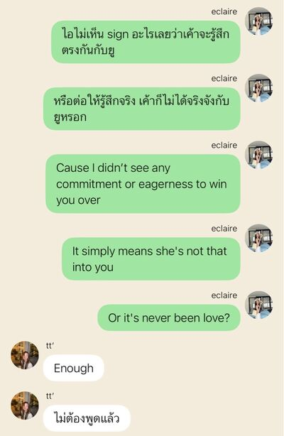
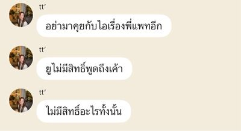
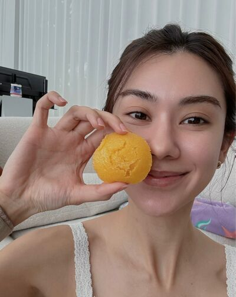
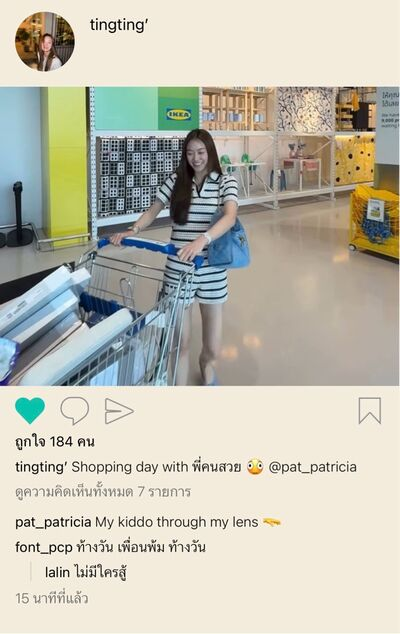

# Never Without You — Chapter 10

English translation · September 14–15 and 19

## Character and alias key

- tt’ — TingTing / Ting / Muay.
- Patricia🌻 — Patricia / Pat / P’Pat.
- eclaire — Claire / P’Claire.
- lalin — Lalin.
- font_pcp — Font, distinct from the coworker Namfon.
- khim09 — Khim.
- JJAPP — Japp.
- BEll — Bell.
- Namfon — Namfon / P’Fon.
- Duen — P’Duen.
- หม่าม้า — Mom, TingTing’s mother (display name retained).
- ปะป๊า — Dad, TingTing’s father (display name retained).

Mentioned: P’Sita, Nong Chan, Aunt Ying, Khun Thai, P’Tuk, and Patricia’s mother.

## Translation notes

P’ is an affectionate or respectful honorific for someone older. Muay is Patricia’s nickname for TingTing. “55555” and its variations are Thai internet laughter. Kub is a playful masculine polite particle. The friends’ repeated death jokes dramatise lovesickness; “falling” refers to falling for someone. “Dao” is a playful self-reference in the “you deceived Dao” joke. “Roles” in the wife exchange refers to the pair’s imagined relationship dynamic. “Unknown Elders” follows the project’s group-name convention. Medical statements, the DNA joke, and percentages are character dialogue, not medical facts or assessments.

Original English messages are retained. Eight photographs reference the exact filenames in the JSON: 001.jpg, 002.jpg, and 005.jpg through 010.jpg, each prefixed chat_image_. The 003.png and 004.png entries are call-interface icons, not photographs; their omitted labels have been recovered from the saved HTML and rendered as a missed/unanswered-call notice and a 00:00:44 call. No picture files have been inspected or downloaded. Image contents have not been translated. The closing “first ep” ticket reference is kept without guessing a specific event.

## Full translated chat transcript

---

September 14th  
Monday

---

### eclaire

*8:49 p.m.*

**eclaire**  
Lalin.

**eclaire**  
I made Ting angry.

**lalin**  
Ting’s angry with you, P’Claire?

**lalin**  
About P’Pat?

**eclaire**  
Mm.

**lalin**  
She’s really upset. I heard you held her hand and patted her head in front of P’Pat too.

**eclaire**  
She wasn’t angry then.

**eclaire**  
She only got angry just now.

**lalin**  
Why? What did you say to her?

**eclaire**  

**eclaire**  

**lalin**  
Oh, P’Claire.

**lalin**  
You went and hit a nerve again.

**eclaire**  
I don’t like it. I really don’t.

**eclaire**  
She calls Ting “Muay,” and Ting calls herself Muay too.

**eclaire**  
You know Ting doesn’t like people giving her nicknames.

**lalin**  
Yes, she doesn’t.

**lalin**  
She never has. She doesn’t like you calling her “little whiner” either. I know all that.

**lalin**  
But she likes Muay because P’Pat calls her that.

**lalin**  
You should know how much P’Pat means to her by now. You shouldn’t have hit that nerve.

**eclaire**  
Knowing is exactly why I don’t like it.

**eclaire**  
I don’t like that she doesn’t even try with Ting, yet Ting still likes her that much.

**lalin**  
You were butthurt I understand but you shouldn’t have talked to Ting like that

**lalin**  
It hurt her deeply you know?

**eclaire**  
I will apologize to her

**lalin**  
Do it sincerely

**lalin**  
She’ll forgive you

**lalin**  
She probably won’t stay angry with you long. Right now she’s hurt about P’Pat.

**eclaire**  
Is she really hurt?

**lalin**  
Of course.

**lalin**  
She loves P’Pat now.

**lalin**  
Not just likes her.

*[Read]*

**lalin**  
We think she’s straight too.

**lalin**  
We’ve been trying to put the brakes on Ting all along.

**lalin**  
But she willingly charges straight at her. And P’Pat’s really good to her too, from what Ting tells us.

**lalin**  
Maybe not good the way you are. I mean, not devoting her whole life to looking after Ting. Probably because, like you said, she doesn’t like Ting that way.

**lalin**  
But she makes Ting happy with her life. Makes her want to be a better person.

**lalin**  
She shaped her into a better person something like that

**eclaire**  
I understand.

**eclaire**  
Her parents said she even made Ting go tell them she loved them.

**lalin**  
Exactly.

**lalin**  
Ting doesn’t just love her. She admires her as a person too.

**lalin**  
So it’s a little difficult to say anything bad about P’Pat to Ting.

**eclaire**  
I know she admires her so much.

**eclaire**  
I spoke without thinking.

**eclaire**  
I was hurt, I guess. Angry too.

**lalin**  
Feeling neglected. Jealous too.

**eclaire**  
Mm.

**lalin**  
But does she treat Ting well? Yes. We just don’t know what kind of feelings she has for Ting.

**lalin**  
P’Japp says she treats Ting more specially than everyone else. That’s why Ting still has hope.

**lalin**  
She’s been calling to wake her for work since the third day they knew each other. Still calls every morning now.

**lalin**  
Maybe you didn’t see her making an effort today, but that doesn’t mean she never has.

**lalin**  
I think she does things for Ting in her own way. Otherwise Ting wouldn’t love her. At most, she’d just like her because she’s beautiful.

**eclaire**  
I can’t sense it, Lalin.

**eclaire**  
If she thought of Ting as more than a younger sister, I believe I’d know.

**lalin**  
Yeah. Maybe she only sees her as a younger sister.

**lalin**  
But that doesn’t mean she doesn’t love Ting, right?

**lalin**  
You were too cruel, P’Claire.

**eclaire**  
Mm.

**lalin**  
Give it a day or two, then apologise.

**lalin**  
You probably know how to make it up to her.

**eclaire**  
Just wait for her to stop being angry herself.

**eclaire**  
Someone that kind can’t stay angry with anyone long.

### Patricia🌻

*8:58 p.m.*

**Patricia🌻**  
Muay, home yet?

**Patricia🌻**  
You disappeared.

**Patricia🌻**  
I’ve been home a while. I was talking with Mom, so I hadn’t messaged you. Thought you’d get home before me.

*9:13 p.m.*

**Patricia🌻**  
Ting, haven’t you got home yet?

**tt’**  
Been home ages.

**Patricia🌻**  
Why didn’t you tell me?

**Patricia🌻**  
I thought you weren’t home. Worried something happened.

**tt’**  
Nothing happened. I just wasn’t on my phone.

**Patricia🌻**  
Have you showered yet?

**tt’**  
Not yet.

**tt’**  
I’ll go shower first, then. See you tomorrow.

**Patricia🌻**  
You’re leaving already?

**tt’**  
Yes.

**Patricia🌻**  
Are you upset with me?

**tt’**  
No.

**Patricia🌻**  
You always say no when you’re upset, Muay.

**tt’**  
Forget it.

**tt’**  
I don’t want to talk.

**Patricia🌻**  
Muay, what’s wrong?

**tt’**  
I don’t want to talk about this.

*[Read]*

**Patricia🌻**  
Will you want to talk after your shower?

**tt’**  
Don’t know.

**Patricia🌻**  
Then go shower first. Message me if you want to talk. I’ll wait.

**tt’**  
You don’t have to wait.

**tt’**  
Get some rest.

**Patricia🌻**  
Because I went home by myself?

**tt’**  
No.

**Patricia🌻**  
If it’s not that, did I do something else you didn’t like?

*[Read]*

**Patricia🌻**  
Ting, I want to know. Could you answer me?

**Patricia🌻**  
I’m good at coaxing you. I’ll keep going until you stop sulking.

**Patricia🌻**  
Muaaay 🥺

**tt’**  
It’s not that I don’t like it.

**tt’**  
I just… don’t understand.

**tt’**  
I’m not sure.

**Patricia🌻**  
About what?

**Patricia🌻**  
What don’t you understand? What aren’t you sure about?

*[Read]*

**Patricia🌻**  
You can talk to me, kiddo

**Patricia🌻**  
Anything, just tell me

*[Read]*

**Patricia🌻**  
Ok you got me tripping

**Patricia🌻**  
You need to tell me now

*[Read]*

**Patricia🌻**  
Ting, could you not go quiet?

**tt’**  
Are we really special?

**Patricia🌻**  
Yes, we are

**Patricia🌻**  
Why?

**tt’**  
I don’t feel like it

*[Read]*

**Patricia🌻**  
Honestly

**Patricia🌻**  
That was quite upsetting to know

*[Read]*

**Patricia🌻**  
What did I do?

**Patricia🌻**  
I still don’t understand anything, Ting.

**Patricia🌻**  
What happened?

*[Read]*

**Patricia🌻**  
Ting, I don’t want you to keep going silent.

**Patricia🌻**  
Did something happen to make you feel that way?

**Patricia🌻**  
Did I do something to make you feel bad?

*[Read]*

**Patricia🌻**  
This feels awful.

**Patricia🌻**  
We can talk later.

**Patricia🌻**  
But promise we’ll talk it through?

**Patricia🌻**  
I don’t want us misunderstanding each other like this.

**Patricia🌻**  
Every word and every action I’ve shown you comes from my real feelings, Ting.

**Patricia🌻**  
When I said we were special, I meant it

**Patricia🌻**  
And it was a bit hard to find out you didn’t feel the same way

**tt’**  
Will you change, P’Pat?

**Patricia🌻**  
Change what?

**Patricia🌻**  
I’ve never wanted to change anything.

**Patricia🌻**  
Do you want to change things?

*[Read]*

**Patricia🌻**  
I’m feeling really uneasy, Ting. I don’t understand any of this right now.

**tt’**  
No. I don’t want to change things.

**tt’**  
I don’t want anything to change.

**tt’**  
I’m sorry. I just got upset on my own.

**tt’**  
Claire made me feel a little bad, so I took it out on you.

**tt’**  
I’m sorry.

**tt’**  
Really sorry. Sorry I said that.

**tt’**  
I never doubt your words or actions

**tt’**  
I know you were being genuine

**Patricia🌻**  
What did she do to you?

**tt’**  
Nothing. Forget it.

**Patricia🌻**  
I asked what she did to you.

**tt’**  
It’s okay. I’ve talked to her already.

**Patricia🌻**  
You won’t tell me?

**tt’**  
I don’t want to talk about it. What she said wasn’t nice.

**Patricia🌻**  
Isn’t she an older friend you’re close to?

**Patricia🌻**  
Why would she say things that hurt you?

**tt’**  
She probably spoke without thinking. Leave her be. I’m okay now.

**Patricia🌻**  
Are you sure?

**tt’**  
Yes.

**tt’**  
I’m sorry, P’Pat. Please don’t be angry with me.

**Patricia🌻**  
I’m not angry. Just confused, I guess. I can’t keep up.

**Patricia🌻**  
And a little hurt.

**tt’**  
Hurt about what? Why?

**tt’**  
Did I hurt you?

**Patricia🌻**  
I thought we shared that special bond

**tt’**  
Yes, we did

**tt’**  
It was special

**tt’**  
It’s really special

**tt’**  
I’m sorry I made it sound otherwise

**tt’**  
I’m really sorry. Please don’t be hurt.

**tt’**  
I’m sorry.

**Patricia🌻**  
I’m not hurt anymore. Seeing you apologise this much, I’m not hurt anymore.

**tt’**  
😞

**Patricia🌻**  
No. Don’t be upset either. We’ll never finish if we keep making each other sad.

**Patricia🌻**  
It’s all right now. We understand each other, don’t we? 🫳

**tt’**  
Mm 🫠

**Patricia🌻**  
But you really are okay now?

**tt’**  
Yes. I’m okay.

**Patricia🌻**  
Muay, can you promise me something?

**Patricia🌻**  
If you’re upset,

**Patricia🌻**  
or if one day I make you feel bad,

**Patricia🌻**  
tell me properly. I promise I’ll listen. I’ll make it up to you. I’ll apologise if I’ve done something wrong.

**Patricia🌻**  
But don’t ever doubt our relationship again

**Patricia🌻**  
Cause it’s the most authentic relationship I could have with someone

**Patricia🌻**  
And I’m always grateful it was you

**tt’**  
I promise

**tt’**  
And I promise I’ll never do anything that jeopardizes our relationship

**tt’**  
It’ll be kept close to my heart

### prettybabies (3)

*10:09 p.m.*

**tt’**  
Font.

**tt’**  
Lalin.

**tt’**  
If I have to die, just let me die.

**tt’**  
I really don’t want anything else in this life anymore.

**tt’**  
If she doesn’t want to change anything, I won’t change anything.

**tt’**  
It’s good now. Our relationship is really, really good.

**tt’**  
It’s special enough.

**font_pcp**  
What the hell?

**tt’**  
She only said she was a little hurt, and I wanted to stab myself.

**tt’**  
I don’t want to hurt her at all.

**tt’**  
I said such awful things. I hate myself.

**font_pcp**  
Whaaat?

**font_pcp**  
P’Pat?

**tt’**  
Mm 🫠

**lalin**  
What did you talk about with her?

**tt’**  
So much.

**tt’**  
Claire stressed me out. I felt awful about everything.

**tt’**  
I already felt bad after talking to you. Talking to Claire made it worse.

**tt’**  
Then P’Pat messaged and I took my mood out on her. I felt hurt and neglected.

**lalin**  
When you say you said awful things, what did you say?

**tt’**  
I asked if we were really special.

**tt’**  
She said we were. But I told her I didn’t feel that way.

**font_pcp**  
Tiiing.

**tt’**  
😞

**font_pcp**  
Were you hurt because she wasn’t jealous?

**tt’**  
Mm. She made me feel like I wasn’t special at all. Once Claire came, she just left me with her.

**tt’**  
Why didn’t she want to stay with me? Why did she let me go with Claire so easily?

**tt’**  
That’s what was in my head when I replied like that.

**tt’**  
But when she said she was hurt, I felt awful. I shouldn’t have said that. It was like I’d wounded her feelings.

**tt’**  
We really are special. I know she’s genuine with me. Every bit of worry and goodwill. I know she feels it.

**tt’**  
Even when she told me about the whole sun, she sounded so excited. Typed such a long message. All these things making me feel special 🫠

**lalin**  
It’s special.

**lalin**  
But maybe it’s not special in the way you want?

**lalin**  
You want to be special as a lover, not just as a close younger friend.

**tt’**  
Exactly.

**tt’**  
But what can I do? If she doesn’t feel the same, I don’t want to risk confessing and making her change.

**tt’**  
If telling her means our relationship won’t be as special anymore, why would I tell her?

**font_pcp**  
Not hoping she’ll fall for you anymore?

**tt’**  
I still hope.

**tt’**  
But I don’t know how much hope there is.

**tt’**  
I’m scared, Font.

**lalin**  
Because of P’Claire, right?

**lalin**  
She sent me screenshots of what she said to you.

**font_pcp**  
What? What did she say? Share immediately.

**lalin**  
I’ll send them.

**lalin**  
Just so you know, she knows she was wrong. She’s waiting to apologise.

**tt’**  
Even though I don’t like what Claire said,

**tt’**  
deep down I know it’s true.

**tt’**  
It’s not only Claire who sensed it. I’d already thought it myself. That’s why I told you about it.

**tt’**  
Then Claire drove it home and it felt even more real.

**lalin**  
I understand.

**lalin**  
If you can accept that it can’t go any further, that’s okay.

**font_pcp**  
But can you really?

**tt’**  
I guess I’ll have to.

**font_pcp**  
But there’s still that one-in-a-thousand chance, Ting. Don’t let your hope drop to zero yet.

**font_pcp**  
Keep slipping by for now. Gay kids are unkillable anyway.

**font_pcp**  
Right? @lalin

**lalin**  
Yeees.

**lalin**  
If you can keep slipping by, do it for now.

**lalin**  
Straight people are stupid. They don’t know anything. Get what you can while you can.

**font_pcp**  
555555555

**lalin**  
I’m scared she’ll actually die. Let me give her a push today.

**tt’**  
Didn’t you say I can’t keep doing this forever, Lalin?

**lalin**  
You really can’t.

**lalin**  
If she’s straight, I mean.

**lalin**  
One day she’ll get a partner and a family.

**lalin**  
Say a man pursues her and she likes him. How will you cope, Ting? She might even ask you for advice.

**font_pcp**  
If Ting gets cast as the relationship adviser, she’s dead. No question.

**tt’**  
🫠

**lalin**  
Your only way out is hoping she falls for you.

**lalin**  
Or hitting the jackpot: she’s gay but keeping her cool.

**font_pcp**  
There we go. Jackpot.

**font_pcp**  
Come on. The gay kid might survive.

**tt’**  
What jackpot?

**tt’**  
My head’s going to crack first.

**font_pcp**  
5555555555555

**lalin**  
Oh, there’s another way. Get over her yourself.

**tt’**  
I can’t.

**tt’**  
Don’t want to either.

**tt’**  
She shouldn’t be this lovely.

**tt’**  
If she were only beautiful, getting over her would be easier.

**tt’**  
She really shouldn’t 😞

**lalin**  
Want me to make her out to be a shitty person? Maybe that’ll make it easier.

**lalin**  
I can mess with your head.

**tt’**  
Lalin, stop right now 🤬

**font_pcp**  
555555555555

**font_pcp**  
P’Claire messing with your head already brought you to your knees.

**font_pcp**  
If Lalin hits a nerve, you’ll drop dead on the spot.

**tt’**  
No. Absolutely no bad-mouthing P’Pat.

**tt’**  
She’ll always be the kindest beautiful older sister in my heart.

**font_pcp**  
Deaaad.

**lalin**  
I’m the one who’s dead.

**lalin**  
My friend really doesn’t want anything else anymore.

**lalin**  
Determined to die.

**font_pcp**  
55555555555

### khim09

*9:47 p.m.*

**Patricia🌻**  
Khim.

**Patricia🌻**  
I want your advice about something.

*9:55 p.m.*

**Patricia🌻**  
[Call — not answered]

**Patricia🌻**  
Did you reject my call?

**Patricia🌻**  
You’re awful.

*10:04 p.m.*

**khim09**  
I was showering.

**khim09**  
What is it?

**Patricia🌻**  
I’m worried about something.

**Patricia🌻**  
With Ting.

**khim09**  
What about?

**Patricia🌻**  
She said she didn’t feel like our relationship was special

**Patricia🌻**  
She even asked me if we were really special

**khim09**  
Your whole sun said that???

**Patricia🌻**  
Yes, and my heart hurt

**Patricia🌻**  
I’m hurt, Khim.

**Patricia🌻**  
I didn’t dare tell her how hurt. Scared I’d seem dramatic and immature. So I just said a little hurt.

**khim09**  
Didn’t I tell you not to listen to so much Taylor?

**Patricia🌻**  
You bitch.

**khim09**  
555555555

**khim09**  
Don’t start pouting and crying yet.

**Patricia🌻**  
😭

**khim09**  
Why did she say that?

**khim09**  
There must be a reason.

**Patricia🌻**  
I don’t know what I did to her either.

**Patricia🌻**  
Or whether that older friend she’s close to said something.

**Patricia🌻**  
She met me for the first time today, when I walked Ting to the car.

**khim09**  
Her older friend? What’s she got to do with this?

**Patricia🌻**  
Don’t know.

**Patricia🌻**  
But Ting said she made her feel bad, so she took it out on me.

**Patricia🌻**  
When we met, she spoke nicely. Seemed lovely. Really close to Ting. Drove over to pick her up and take her home too.

**Patricia🌻**  
Ting even calls her just by her name. She goes on Ting’s family outings too. That’s how close they are.

**Patricia🌻**  
She offered to drive me home too, but I declined. So I don’t know whether something happened between them afterward.

**Patricia🌻**  
Anyway, she said she didn’t feel like we were special

**Patricia🌻**  
That was painful

**khim09**  
Yes, I know it hurt.

**khim09**  
I know the princess is so sensitiveeee.

**Patricia🌻**  
😭

**khim09**  
Pat, you’re determined to become a Disney princess, aren’t you?

**Patricia🌻**  
No. But it hurt.

**Patricia🌻**  
I took the risk and opened my heart. Everything I’ve said to Ting or done for her, I meant it all.

**Patricia🌻**  
Once you’ve given your whole heart, and someone says they don’t feel it, wouldn’t that hurt?

**khim09**  
But Ting said that?

**khim09**  
She doesn’t seem like she’d say that to you. When we met, she seemed like such a lovely kid.

**khim09**  
Not someone who’d say things to hurt people.

**Patricia🌻**  
She apologised when I started seeming upset.

**Patricia🌻**  
Then told me what I told you. That Claire made her feel bad.

**khim09**  
Claire is her older friend, right?

**Patricia🌻**  
Yes.

**khim09**  
Didn’t you ask what Claire did?

**Patricia🌻**  
Asked. She wouldn’t tell me.

**khim09**  
Oh, boy.

**khim09**  
But maybe she was stressed and just said it?

**khim09**  
If she’s apologised, don’t overthink it.

**khim09**  
Maybe she speaks on emotion first and reasons later.

**Patricia🌻**  
Maybe.

**Patricia🌻**  
Usually Ting seems to appreciate what we have. She’s not the kind of kid to say that.

**Patricia🌻**  
But I’m still hurt. Still thinking about it.

**khim09**  
Pat.

**Patricia🌻**  
😭

**Patricia🌻**  
I’m scared I hurt her without realising.

**Patricia🌻**  
But she wouldn’t answer when I asked. I don’t know whether I did something wrong or whether it was Claire, like she said.

**khim09**  
It’s that Claire girl, obviously.

**khim09**  
Take what Ting says at face value for now.

**khim09**  
Why sit around blaming yourself?

**Patricia🌻**  
Is it that easy? You always make it sound easy.

**khim09**  
Well.

**khim09**  
Why make it difficult?

**khim09**  
You try to see everything simply, but now you’re making this complicated?

**khim09**  
Up to you. Want to overthink yourself to death, go ahead. She’s already apologised. What the fuck are you thinking so much for?

**Patricia🌻**  
Khiiiim.

**khim09**  
What? What, Khim?

**Patricia🌻**  
Does she really think it isn’t special?

**Patricia🌻**  
I truly love the vibe between us

**Patricia🌻**  
It’s really special, the bond we’re growing 😭

**khim09**  
Want to give me Ting’s LINE?

**khim09**  
If she won’t answer you, I’ll ask her myself.

**Patricia🌻**  
Don’t be ridiculous.

**khim09**  
Then calm yourself down.

**khim09**  
You’re losing your mind.

**khim09**  
P’Pat needs to be more composed. calm down ka.

*[Read]*

**Patricia🌻**  
Okay.

**Patricia🌻**  
We've still got each other

**Patricia🌻**  
That what matters most

**khim09**  
Right.

**khim09**  
Exactly.

**Patricia🌻**  
Actually, she promised me

**Patricia🌻**  
She promised she'd keep our relationship close to her heart 🥺

**khim09**  
You two really suit each other.

**khim09**  
Why are you so sweet together? So very girly.

**Patricia🌻**  
Yeah. I can’t do that with you either.

**khim09**  
Try it. I’ll tease you to death.

**khim09**  
I’ll tease you until you actually die of embarrassment, Pat.

**khim09**  
Whole sun, Sunshine. Gives me the fucking chills.

**Patricia🌻**  
5555555555555

**khim09**  
Yeah. Stop spiralling, P’Pat.

**Patricia🌻**  
I’m glad I met Ting. Really, Khim.

**khim09**  
I know.

**Patricia🌻**  
If one day we weren’t this close anymore, I’d be so hurt.

**Patricia🌻**  
I don’t want to lose good people in my life anymore.

**Patricia🌻**  
Not Ting. I don’t want it to be Ting.

**khim09**  
If you don’t want to lose her, take good care of what you have.

**khim09**  
You can do it, Pat.

**khim09**  
I know you can. You’re so nice and kind and so romantic.

**khim09**  
Still don’t know how you ended up my friend.

**Patricia🌻**  
555555

**khim09**  
Stop overthinking.

**khim09**  
She's your whole sun

**khim09**  
She'll never leave you to die, Miss Sunflower

**Patricia🌻**  
LOL

**Patricia🌻**  
You're starting to be like me in a way, friend

**khim09**  
I have to talk to you like this to get through to you.

**Patricia🌻**  
True.

**Patricia🌻**  
Thanks so much. You can go to sleep now.

**khim09**  
Yes, ma’am.

**khim09**  
Feel better and ditch me, you bitch.

**Patricia🌻**  
555555

---

September 15th  
Tuesday

---

### Patricia🌻

*6:30 a.m.*

**Patricia🌻**  
[Call — 00:00:44]

*6:31 a.m.*

**tt’**  
I’m up.

**Patricia🌻**  
Hurry over or we won’t make it.

**Patricia🌻**  
But don’t rush too much. Drive safely, Muay.

**tt’**  
Yes, ma’am 🫡

**tt’**  
I’d forgotten I asked you to invite me for breakfast.

**Patricia🌻**  
55555

**Patricia🌻**  
Mom usually makes it for me every day.

**Patricia🌻**  
But I told her yesterday not to make any today. I’m eating with you.

**tt’**  
🫪

**Patricia🌻**  
In a good mood now?

**tt’**  
Yes 🫠

**tt’**  
Sorry about yesterday. I didn’t mean it.

**Patricia🌻**  
It’s okay. As long as you’re in a good mood now.

**Patricia🌻**  
See you soon. Call when you get here.

**tt’**  
Okay.

### IG: tingting’

*8:51 a.m.*

IG: font_pcp: Getting your beautiful-older-sister fix first thing in the morning, Ting.

IG: tingting’: 🫪

### IG: pat_patricia

*8:53 a.m.*

### khim09

*9:13 a.m.*

**khim09**  
Not stressed anymore?

**khim09**  
You can be sweet together again.

**Patricia🌻**  
I invited Ting for breakfast today. Wanted time to talk before work.

**Patricia🌻**  
Wanted to know if she was really back to normal.

**Patricia🌻**  
She seemed okay when we met. So I’m relieved now.

**khim09**  
You really do overthink. You seemed fine last night, but still planned to get her to talk before work.

**Patricia🌻**  
555555

**Patricia🌻**  
I felt relieved, but not reassured.

**khim09**  
You’re that far gone, Pat.

**khim09**  
I don’t know who’s whose privilege anymore.

**Patricia🌻**  
Ting.

**Patricia🌻**  
Ting’s my privilege.

### B2B marketing (6)

*1:24 p.m.*

**Patricia🌻**  
P’Fon, do you have a moment to discuss the Backstage project with Japp and me? It won’t take long. If I know where it’s stuck, I can help follow up. @Namfon

**Duen**  
This project’s been going on for weeks. What’s the holdup?

**Duen**  
I’ve seen Pat follow up several times.

**Namfon**  
I’m caught up supporting another campaign. Khun Thai needs it today because the event’s tomorrow.

**JJAPP**  
P’Fon probably needs to prioritise Khun Thai’s work first.

**Namfon**  
Yes. I’m running out of time.

**Patricia🌻**  
I understand. That’s why I want to find out where it’s stuck and follow up for you.

**JJAPP**  
On my side it affects funds I’ve already requested for payment. Please find a moment to talk, P’Fon. Just a moment. If it won’t be ready, I can reallocate the funds and adjust the strategy instead 🙏

**Duen**  
Didn’t Khun Thai’s request come later? But I’ve seen Pat and Japp chasing theirs several times already.

**Patricia🌻**  
Actually, P’Fon has helped check and follow up several times, P’Duen. If I understand correctly, it seems to be held up with P’Tuk.

**Duen**  
Then following up is Fon’s responsibility, not Pat’s.

**Duen**  
If it’s happened several times, that’s clear enough. Pat, you don’t need to defend anyone.

**Duen**  
Fon, find time to talk to Pat and Japp. @Namfon

**Namfon**  
Understood.

### Unknown Elders (5)

*1:35 p.m.*

**BEll**  
Paaat.

**Namfon**  
I’m sorry, Pat. Waaaah.

**Namfon**  
I’ll find time as soon as I can.

**Patricia🌻**  
Of course, P’Fon.

**BEll**  
The punching bag. Good or bad, Pat gets hit first.

**Patricia🌻**  
5555555

**Patricia🌻**  
Don’t worry, P’Fon. I’m not upset. Come talk when you find the time.

**Namfon**  
Okay, okay.

**tt’**  
Her intentions are good, sure. But could she speak a little more nicely?

**tt’**  
And telling people off in the group. Snarling like a dog.

**JJAPP**  
5555555555555555

**Patricia🌻**  
Muaaay.

**tt’**  
Almost managed a decent conversation. But who wants to talk to someone with such a foul mouth?

**BEll**  
I was stressed. Now I’m laughing.

**tt’**  
😡

**tt’**  
Has she even checked your work list? The one she asked you to send?

**Patricia🌻**  
Probably hasn’t had time yet.

**tt’**  
I’m waiting. Tell me when she replies 😡

**JJAPP**  
Who’s snarling like a dog? P’Duen or Muay?

**BEll**  
5555555

### Patricia🌻

*1:46 p.m.*

**Patricia🌻**  
Muay, you’re breathing hard again.

**tt’**  
I’m annoyed. Why did she tell you off? 😡

**Patricia🌻**  
5555555

**Patricia🌻**  
But I’m glad.

**tt’**  
Glad about what? You got told off. What’s there to be glad about? 😡

**Patricia🌻**  
Glad you’re back to yourself.

**Patricia🌻**  
Very, very much the same old Muay.

**tt’**  
Getting angry makes me my old self?

**Patricia🌻**  
55555

**Patricia🌻**  
I’d rather see you angry than like you were last night.

**Patricia🌻**  
I don’t like things feeling uncomfortable between us.

**tt’**  
🫠

**tt’**  
I won’t be like last night again. I promised.

**Patricia🌻**  
Okay 🫳

**Patricia🌻**  
Calm down. You don’t have to pay so much attention to P’Duen’s words.

**Patricia🌻**  
I don’t even care about them.

**tt’**  
Fine.

**tt’**  
You really do let everything slide, P’Pat. Honestly 😠

**Patricia🌻**  
Oh, now you’re angry with me instead.

**tt’**  
555555

**Patricia🌻**  
Actually, I can’t let everything slide.

**Patricia🌻**  
I thought about you all night yesterday.

**Patricia🌻**  
I don’t want us to have problems.

**Patricia🌻**  
Talked to Khim about it and got scolded too.

**tt’**  
You talked to P’Khim about me?

**Patricia🌻**  
Yes.

**tt’**  
🫠

**Patricia🌻**  
But it’s all right now.

**Patricia🌻**  
Back to work.

**tt’**  
Okay.

### prettybabies (3)

*2:42 p.m.*

**tt’**  
I love P’Pat.

**tt’**  
I love her.

**lalin**  
@font_pcp

**font_pcp**  
55555555555555

**lalin**  
Can’t keep up with her.

**lalin**  
Don’t know what mood this is.

**tt’**  
A good mood 🫪

**font_pcp**  
Must be because she got time with the beautiful older sister this morning.

**tt’**  
That too.

**tt’**  
She called and invited me for breakfast. I got to see the beautiful older sister before anyone else.

**tt’**  
Then she showed me she was drinking water too. P’Pat’s so cute 🫠

**lalin**  
Just drinking water, and she’s cute already.

**lalin**  
This straight girl doesn’t understand.

**font_pcp**  
55555555

**tt’**  
She just told me she thought about me all night. Doesn’t want us to have problems.

**tt’**  
She talked to P’Khim about me too, you guys.

**tt’**  
It really is special, don’t you think?

**font_pcp**  
Yes, ma’am. Special.

**tt’**  
Be serious 😠

**font_pcp**  
Yeees. Special.

**lalin**  
Are we allowed to give any other answer?

**font_pcp**  
I’m confused.

**lalin**  
But P’Pat was so beautiful this morning.

**tt’**  
Right?

**tt’**  
She’s this beautiful every day. I can’t survive 🫠

**font_pcp**  
I get it, friend.

**lalin**  
Or is she gay?

**tt’**  
🫪

**font_pcp**  
Lalin, don’t play with the gay kid’s heart.

**lalin**  
55555555555

**lalin**  
Giving her some motivation to live.

**tt’**  
You’re deceiving Dao so hard.

**tt’**  
But Dao will let herself be deceived because Dao loves the beautiful older sister 🙂‍↕️

**font_pcp**  
555555555

### eclaire

*7:36 p.m.*

**eclaire**  
Your mom said you’re home.

**tt’**  
Why are you talking to Mom?

**eclaire**  
I always do. She even invited me for dinner.

**tt’**  
You don’t have to talk to her.

**eclaire**  
Still angry with me?

*[Read]*

**eclaire**  
TingTing, I’m sorry.

**eclaire**  
Sorry I dragged her into this when I don’t know her at all.

**eclaire**  
It’s between you and her. You know her better than I do.

**eclaire**  
I’m sorry I said awful things and hurt you.

**eclaire**  
I’m sorry baby

**tt’**  
You were so mean yesterday

**tt’**  
Why did you say those harsh words to me?

**eclaire**  
I was jealous

**eclaire**  
I knew you loved her and I was jealous

**eclaire**  
That's all

**eclaire**  
My words meant nothing, all rubbish

**eclaire**  
Please forgive me

**tt’**  
Don’t do that again.

**tt’**  
Don’t talk about P’Pat again either.

**tt’**  
I don’t like it.

**eclaire**  
Okay. I won’t talk about her anymore.

**eclaire**  
I know I have no right.

**eclaire**  
Let’s make up. Don’t be angry with me anymore.

**tt’**  
Mm.

---

September 19th  
Saturday

---

### Patricia🌻

*7:48 a.m.*

**Patricia🌻**  
Morning, kub.

**Patricia🌻**  
Eating treats while I wait for you, Muay.

**Patricia🌻**  

*8:14 a.m.*

**tt’**  
What are you doing to me this early, Miss Patricia? 🫪

**Patricia🌻**  
5555555

**Patricia🌻**  
Good thing you’re awake just after eight. Thought you’d sleep later.

**tt’**  
When I have plans with the beautiful older sister, I have to wake up early 🙂‍↕️

**Patricia🌻**  
With Mom too.

**tt’**  
Exactly. Can’t be late with an elder coming along. 555555

**Patricia🌻**  
555555

**tt’**  
I’ll shower and eat, then come over.

**Patricia🌻**  
Okay. Waiting.

### Family 🏠 (3)

*10:13 a.m.*

**หม่าม้า**  
You won’t let Dad and Mom come too, sweetheart?

**หม่าม้า**  
I can follow you there.

*10:42 a.m.*

**tt’**  
I’m at P’Pat’s house now.

**tt’**  
Noooo.

**tt’**  
Her mom’s coming too. I’m not ready for a gathering of all the elders.

**หม่าม้า**  
You’re always with her mom. Who am I supposed to spend time with?

**tt’**  
Moooom 🫠

**หม่าม้า**  
I’m going to sulk. All your time is with P’Pat.

**tt’**  
Tomorrow I’m definitely spending time with you and Dad 🙂‍↕️

**หม่าม้า**  
Okay.

*12:46 p.m.*

**tt’**  

**tt’**  

**tt’**  
Finished shopping. Off to eat next.

**หม่าม้า**  
Your daughter’s so happy. @ปะป๊า

**ปะป๊า**  
🤣

### IG: tingting’

*1:09 p.m.*

### khim09

*1:27 p.m.*

**Patricia🌻**  
Khim.

**Patricia🌻**  
Mom helped load things into the car and got chest pain and tightness.

**Patricia🌻**  
She says she’s fine, but Ting wants to take her to the doctor.

**khim09**  
Oh, why did you let her carry things?

**Patricia🌻**  
Who let her? I told her not to. Wouldn’t listen. Insisted on helping.

**khim09**  
Go.

**khim09**  
Get her checked. Mom can’t tell whether something’s wrong. Go for peace of mind.

**Patricia🌻**  
Mm.

*1:36 p.m.*

**khim09**  
But will there be an appointment if you go now, Pat?

**khim09**  
Where are you? You’re coming from IKEA Bangna, right?

**khim09**  
Can Ting park there? Parking’s hard to find.

**Patricia🌻**  
She’s taking us to Bangkok Hospital. Apparently her doctor relative knows a senior specialist there.

**Patricia🌻**  
And he happens to be there today.

**khim09**  
Bangkok Hospital?

**khim09**  
Shit. Who’s paying?

**Patricia🌻**  
Don’t know. Mom and I weren’t going to go. But Ting called her mom, and she said to take her straight there. Don’t wait.

**Patricia🌻**  
I said no. We could go to her usual doctor. But Ting and her mom completely ignored me.

**khim09**  
Oh.

**khim09**  
Bangkok Hospital is expensive, young miss.

**Patricia🌻**  
😭

**khim09**  
But you’re on your way, right?

**khim09**  
I’ll come see you.

**Patricia🌻**  
Yeah.

### Family 🏠 (3)

*3:08 p.m.*

**tt’**  
Mom, I’m having them check everything. @หม่าม้า

**tt’**  
P’Pat said nothing came up at the last checkup. But it was only basic tests. They didn’t check calcium deposits in the arteries.

**tt’**  
So I asked for everything. A thorough check.

**หม่าม้า**  
Yes. Have them check everything.

**tt’**  
🫡

**หม่าม้า**  
I’ve asked your doctor relative to speak with the senior doctor already. But talk to him yourself too. Have them take the best possible care of her.

**tt’**  
Yes, ma’am.

### khim09

*6:43 p.m.*

**khim09**  
So what happened? Ting paid?

**Patricia🌻**  
Yeah.

**Patricia🌻**  
Mom feels uneasy too, having her pay for us.

**Patricia🌻**  
I transferred it back, and she sent it right back to me. Three rounds until she was furious and ready to smack me.

**Patricia🌻**  
Even threatened to crash into the car in front if I didn’t stop transferring.

**khim09**  
5555555555

**khim09**  
She’s stubborn. A truly spoiled rich kid.

**khim09**  
But I noticed her hanging around the billing desk. Figured she must be waiting to pay.

**khim09**  
How much was it?

**Patricia🌻**  
Over thirty thousand.

**khim09**  
And that’s just checking her heart.

**Patricia🌻**  
Mm. There’s medication too.

**khim09**  
But good thing you listened and got the full check. Otherwise you wouldn’t know her calcium level was high.

**Patricia🌻**  
An irregular heartbeat too. They didn’t find it last time.

**Patricia🌻**  
I’m stressed about Mom. Stressed about Ting’s money too.

**Patricia🌻**  
What do I do? Help me find a way to pay her back.

**khim09**  
Believe me, Pat.

**khim09**  
Ting isn’t taking your money.

**khim09**  
You’ll transfer back and forth until your bank statement stretches all the way to Chiang Mai.

**Patricia🌻**  
But that’s not right, Khim. How can I let her pay?

**khim09**  
It's your Privilege

**khim09**  
Embrace it

**Patricia🌻**  
Don’t. That’s not it.

**Patricia🌻**  
You can’t use privilege as an excuse for everything.

**khim09**  
Excuse me. You’re the one who called her your privilege.

**Patricia🌻**  
Not for this.

**khim09**  
Then go find a way to pay her back.

**khim09**  
But watch out. She might really crash into the car in front. I’ll laugh at you. 555555555

**Patricia🌻**  
Sigh.

**khim09**  
Or if you can’t repay her with money, repay her with something else.

**khim09**  
I doubt Nong Ting wants your money.

**khim09**  
Looks like she wants something else.

**Patricia🌻**  
What?

**Patricia🌻**  
Do you know something?

**khim09**  
You don’t know?

**Patricia🌻**  
Know what?

**Patricia🌻**  
What does Ting want?

**Patricia🌻**  
Did you secretly talk to her while I was with Mom?

**khim09**  
Nothing secret. I didn’t talk about anything.

**Patricia🌻**  
What do you mean, then?

**khim09**  
I just mean you want Ting in your life.

**khim09**  
She probably wants you in hers too. If she can help you, she wants to.

**khim09**  
Probably isn’t counting pennies over it.

**khim09**  
She doesn’t want money. Just the good feeling of taking care of you. Something like that.

**khim09**  
I think you two are each other's Privilege

**Patricia🌻**  
How am I a privilege for her?

**khim09**  
Okay. I’ll get poetic so it goes straight to your heart.

**khim09**  
If Sunflower needs Sun to grow and thrive

**khim09**  
Then Sun needs Sunflower to be its reason to shine

### khim09

*7:47 p.m.*

**khim09**  
Young Miss Ting. Did Pat say she’s home?

**tt’**  
Yes. She’s home.

**khim09**  
You don’t have to be so polite.

**tt’**  
55555

**khim09**  
Want to ask you something.

**khim09**  
Serious question. Answer seriously.

**tt’**  
What is it?

**khim09**  
Do you like Pat?

*[Read]*

**khim09**  
Just answer. Takes one to know one, kid.

**tt’**  
I do.

**khim09**  
There it is.

**khim09**  
Gay, right?

**tt’**  
You can tell?

**khim09**  
Pretty obvious.

**khim09**  
You worry about her that much. Not hard to see.

**khim09**  
To put it crudely, like an ordinary person such as me,

**khim09**  
you take care of her like a wife.

**tt’**  
🫪

**tt’**  
Who’s the wife?

**tt’**  
I take care of her like I’m her wife, or like she’s my wife?

**khim09**  
She’s serious about this stuff, huh? 555555

**khim09**  
Why do the roles matter? Let language be flexible.

**tt’**  
If it’s obvious to you, does P’Pat know?

**khim09**  
She doesn’t.

**tt’**  
P’Khim.

**tt’**  
Do I have any hope?

**khim09**  
You want me to answer that?

**tt’**  
You’re close to her. You should know what she thinks.

**khim09**  
You want the truth, right?

**tt’**  
Yes.

**khim09**  
Completely honest, then.

**tt’**  
Wait.

**khim09**  
Yeah. Go brace yourself, then we’ll talk.

**tt’**  
Forget bracing myself. Just say it. We’ve come this far.

**khim09**  
555555555

**tt’**  
Don’t laugh. I’m about to cry.

**khim09**  
Nong Ting, I’m sorry.

**tt’**  
🫠

**khim09**  
All right. Ready?

**tt’**  
Mm.

**khim09**  
Pat’s straight. Body and soul.

**khim09**  
Even if you plucked an eyebrow hair and tested it, its DNA would scream “straight woman.”

*[Read]*

**tt’**  
Then why is she so good to me?

**tt’**  
It’s so special.

**khim09**  
Pat seems to understand the world. And she does.

**khim09**  
But she has this bubble of her own.

**khim09**  
The side of her that’ll crown someone her whole sun. Things like that.

**khim09**  
And that someone is you. And you happen to be gay.

**khim09**  
I’m telling you. Bad luck.

**tt’**  
Not bad luck. I’m not unlucky.

**khim09**  
You really are lovely.

**tt’**  
😞

**khim09**  
But if you’re asking whether she’s deliberately leading you on, I’d stake my life on it: no.

**khim09**  
That’s just how she is. She lives in her own bubble.

**khim09**  
A hopeless romantic looking for a beautiful relationship you’d only find in a novel.

**khim09**  
That’s my friend.

**tt’**  
I want to die, P’Khim.

**tt’**  
You know, ever since I met your friend, I’ve wanted to die every day.

**khim09**  
5555555

**khim09**  
Honestly, at first I thought you were like her. That’s how you got along.

**khim09**  
Then I saw you today. Oh, this kid’s gay.

**khim09**  
Couldn’t tell the first day we met. 55555

**tt’**  
🫠

**tt’**  
So I have no hope at all?

**khim09**  
Let’s put it this way.

**khim09**  
She’s 99.99% straight.

**khim09**  
I’m leaving you 0.01% in case the world ends and she suddenly starts liking women.

**tt’**  
You could just say there’s none, then.

**tt’**  
For fuck’s sake, P’Khim.

**khim09**  
5555555

**khim09**  
Even her ex looked like a male lead stepped out of a novel.

**tt’**  
Okay. Stop talking.

**tt’**  
I ask ten, you answer a hundred. I’m hurting here, and you’re bringing up exes now?

**khim09**  
“Fuck,” “here.” We’re close enough for that already, kid?

**tt’**  
Don’t “kid” me 😡

**khim09**  
555555

**tt’**  
Could you not tell P’Pat?

**tt’**  
I’m scared she’ll change if she knows.

**khim09**  
Mm. I won’t.

**khim09**  
Almost did, but read the room and thought I’d better not. Came to talk to you first.

**khim09**  
Sad?

**tt’**  
Of course.

**khim09**  
Then I’ll give you some good news.

**tt’**  
What? 😡

**khim09**  
Still snapping, this kid.

**tt’**  
🤬

**khim09**  
Pat doesn’t seem to be looking for anyone. Seems to want to be alone. Says she’s content.

**khim09**  
She’s told me she already has you.

**khim09**  
From what I see, she’s happy with her life with you in it now.

**tt’**  
🫪

**khim09**  
I’m giving you that 0.01%.

**khim09**  
The world could end, you know.

**tt’**  
Let it end already. Otherwise I’m going to die for the hundredth time.

**khim09**  
5555555

**khim09**  
You really are funny. And lovely.

**khim09**  
Even when I said you were unlucky, you said you weren’t.

**tt’**  
How could meeting P’Pat be bad luck?

**tt’**  
I’m so lucky to have her in my life.

**khim09**  
Pat thinks the same thing.

**khim09**  
She’s lucky to have you too.

.

.

.

## Author’s note

Young Miss Ting has died for the hundredth time already. Who knows when the world will end.
A gay kid was always bound to fall for a straight girl, right? 🙂‍↕️

Thank you to everyone who came to read. I hope you all manage to get tickets for first ep. Just don’t take mine 😠
