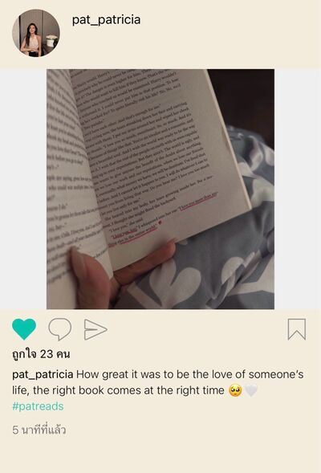
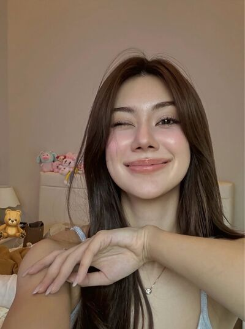
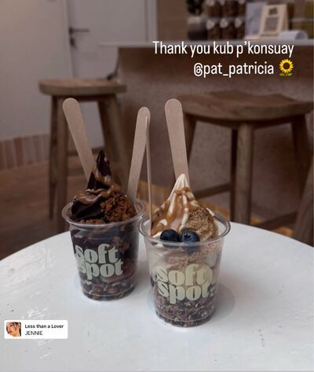

# Never Without You — Chapter 11

English translation · September 19 and 21

## Character and alias key

- tt’ — TingTing / Ting / Muay.
- Patricia🌻 — Patricia / Pat / P’Pat.
- font_pcp — Font, distinct from the coworker Namfon.
- lalin — Lalin.
- khim09 — Khim.
- JJAPP — Japp.
- BEll — Bell.
- Namfon — Namfon / P’Fon.
- eclaire — Claire / P’Claire.
- หม่าม้า — Mom, TingTing’s mother (display name retained).
- ปะป๊า — Dad, TingTing’s father (display name retained).

Mentioned: P’Duen, Khun Kasem, Nong Chan, Patricia’s mother, and Patricia’s former boyfriend.

## Translation notes

P’ is an affectionate or respectful honorific for someone older. Muay is Patricia’s nickname for TingTing. “55555” and its variations are Thai internet laughter. Kub is a masculine polite particle used playfully; “P’Pat-kub” evokes a handsome, masculine persona. “Pull myself together” conveys the recurring self-composure cue taught by Patricia. The death-and-rebirth jokes dramatise TingTing’s lovesickness. “Takes one to know one” renders the friends’ “ghost sees ghost” expression. A “lavender-field world” is an idealised, rosy view of life. “Unknown Elders” follows the project’s group-name convention.

Original English messages are retained. Seven picture appearances reference five unique files in your local img folder, including all three appearances of chat_image_001.jpg. Picture contents have not been inspected or translated. The author’s original Thai hashtag is retained. Percentages and relationship assessments are character dialogue, not objective predictions.

## Full translated chat transcript

---

September 19th  
Saturday

---

### Patricia🌻

*8:03 p.m.*

**Patricia🌻**  
Muay.

**Patricia🌻**  
Thank you for today.

**Patricia🌻**  
Thank you so much.

**tt’**  
Stop transferring money to me. My finger’s tired from sending it back 😡

**tt’**  
I’m the one who took you there. Let me handle it.

**Patricia🌻**  
Mom doesn’t want you paying either. She feels bad.

**tt’**  
I told her it’s a benefit from the big capitalist.

**tt’**  
You’ve been taken advantage of so much already. It’s okay to get something back.

**Patricia🌻**  
Muaaay.

**tt’**  
Not discussing it anymore.

**tt’**  
If you send it again, I’ll send back sixty thousand and keep doubling it.

**Patricia🌻**  
Okay. No more transfers.

**Patricia🌻**  
Stubborn.

**tt’**  
You’re the stubborn one 😠

**Patricia🌻**  
And why did Khim ask me whether you’d got home?

**Patricia🌻**  
Are you two close now?

**tt’**  
Yes. P’Khim messaged me.

**Patricia🌻**  
Aren’t you getting close a little fast?

**Patricia🌻**  
You’ve only met twice.

**tt’**  
Not fast at all.

**tt’**  
I was close to you from the very first day we met.

**Patricia🌻**  
555555555

**Patricia🌻**  
Who said we were close?

**Patricia🌻**  
Did you imagine that, Muay?

**tt’**  
Then who said we weren’t?

**tt’**  
You, P’Pat? 🤔

**Patricia🌻**  
Noooo.

**tt’**  
So were we close?

**Patricia🌻**  
What did we talk about on the first day? I don’t remember.

**tt’**  
Onboarding.

**tt’**  
You teased me that you wouldn’t wait to eat with me because you like eating alone.

**tt’**  
You got scolded by P’Duen.

**tt’**  
You taught me to pull myself together.

**tt’**  
You explained the work with the tracking problem.

**tt’**  
And we said good night for the first time.

**tt’**  
After that, I wanted to see you every day.

**Patricia🌻**  
Muay, you remember all of that?

*[Read]*

**tt’**  
Who would remember? I scrolled back to look.

**tt’**  
555555555555

**Patricia🌻**  
Wow. I thought you remembered.

**tt’**  
Why would I remember?

**tt’**  
You don’t remember either.

**Patricia🌻**  
Are you sulking now?

**tt’**  
No.

**Patricia🌻**  
“No” again.

**Patricia🌻**  
I do remember. It’s not that I don’t.

**Patricia🌻**  
For onboarding, I told you to stop playing on your phone and listen to the important information.

**Patricia🌻**  
I teased you about lunch because you were endearing and I wanted to poke fun at you.

**Patricia🌻**  
How could I not wait? I was the one who asked if you’d eaten first.

**Patricia🌻**  
When you sulked, I messaged to coax you. That was the first time I made it up to you. You didn’t mention that. Forgot, did you?

**tt’**  
Don’t try to beat me 😠

**Patricia🌻**  
555555

**Patricia🌻**  
I got scolded because I waited to eat with you. That’s how I found out what an irritable little thing you were. A sulker too.

**tt’**  
🫠

**Patricia🌻**  
You’ve grown up a lot, haven’t you?

**Patricia🌻**  
Hmm. Or have you? Is your EQ still scraping the ground like before?

**tt’**  
555555555

**tt’**  
You really do remember.

**Patricia🌻**  
Of course I do. Believe me now?

**tt’**  
Fine. I believe you.

**tt’**  
But I have grown up.

**tt’**  
I’m so much better at keeping myself together.

**Patricia🌻**  
Really? I’ll have to test that.

**tt’**  
55555555

**Patricia🌻**  
That laugh tells me…

**tt’**  
Noooo.

**Patricia🌻**  
555555

**tt’**  
Then why did you say you didn’t remember?

**Patricia🌻**  
Just teasing you.

**Patricia🌻**  
I was annoyed about Khim.

**tt’**  
Whaaat? What about P’Khim?

**Patricia🌻**  
What do you two know that I don’t?

**Patricia🌻**  
She seems to know something about you. Keeping secrets?

**tt’**  
No.

**tt’**  
Don’t know anything.

**Patricia🌻**  
🧐

**tt’**  
Really. Nothing.

**tt’**  
Why?

**tt’**  
What did P’Khim say?

**Patricia🌻**  
She sounded like she knew something I didn’t.

**Patricia🌻**  
Is there something you want that I don’t know about?

**Patricia🌻**  
Do you want anything, Muay? 🥺

**tt’**  
Stop the puppy eyes.

**Patricia🌻**  
🥺🥺🥺🥺

**tt’**  
I said stop!!

**Patricia🌻**  
55555555

**tt’**  
No. I don’t want anything.

**tt’**  
Just for your mom to be healthy.

**tt’**  
If I want anything, it’s not to see her ill. Not to see you stressed like today again.

**tt’**  
About the extra medication, tell me if you have any trouble.

**Patricia🌻**  
No trouble. I can handle it myself, Muay. Thank you so much.

**tt’**  
I only just found out you handle all the expenses yourself.

**tt’**  
You’re amazing. So small, but as capable as the whole world 🫠

**Patricia🌻**  
Small? I’m the same size as you.

**tt’**  
Can’t I just compliment you? 😠

**Patricia🌻**  
555555

**tt’**  
Are you stressed?

**Patricia🌻**  
About Mom?

**tt’**  
Yes.

**Patricia🌻**  
If I said no, you’d know I was lying.

**tt’**  
Mm.

**tt’**  
Your hands were so cold while we waited for the results.

**Patricia🌻**  
I was anxious, Muay. Scared it would be bad.

**Patricia🌻**  
Deep down I know Mom isn’t healthy. Her heart’s not good.

**Patricia🌻**  
Sometimes these things just happen all at once.

**Patricia🌻**  
Honestly, I’m scared all the time.

**tt’**  
😞

**Patricia🌻**  
But it’s okay. I have you with me, handling everything.

**Patricia🌻**  
You stayed right beside me today 🫳

**tt’**  
If I left, I was scared your hands would freeze solid.

**Patricia🌻**  
55555

**Patricia🌻**  
Good thing your hands are warm.

**Patricia🌻**  
But when I went in for the results without you, they got cold again. My body’s response to stress, I guess.

**tt’**  
If I could’ve gone in with you, I would have.

**Patricia🌻**  
Actually, you could have.

**tt’**  
No. Better to leave it as your family’s business.

**tt’**  
You’d tell me when you came out anyway.

**Patricia🌻**  
True. 55555

**tt’**  
I’ll take your mom to the doctor again next month.

**Patricia🌻**  
Okay. Thank you, Muay.

**tt’**  
You’ve thanked me so many times.

**Patricia🌻**  
You’ve done so much for me.

**Patricia🌻**  
You’re not a little Privilege anymore.

**Patricia🌻**  
You’re the biggest Privilege now.

**tt’**  
For you, I could be the biggest biggest Privilege.

**tt’**  
Or even biggest biggest of the biggest Privilege

**Patricia🌻**  
Enough. I’m going to cry.

**tt’**  
Joking or serious?

**Patricia🌻**  
Serious.

**Patricia🌻**  
It’s overwhelming, Muay.

**Patricia🌻**  
In a positive way na

**tt’**  
Don’t cry.

**tt’**  
I want to do this for you. I’m so happy to.

**Patricia🌻**  
🥺

**Patricia🌻**  
I’m glad I met you.

**tt’**  
Stop.

**tt’**  
You’ll make me cry too.

**Patricia🌻**  
55555

**tt’**  
It's just like you said

**tt’**  
We're special

**Patricia🌻**  
Yes, we're special 🤍

### prettybabies (3)

*9:13 p.m.*

**tt’**  
You guys.

**tt’**  
I really am in love with a straight girl. One hundred percent straight, P’Khim says.

**tt’**  
But she saved my life with 0.01%. If the world ends, maybe P’Pat will love me. That’s what she said.

**font_pcp**  
You’re sure she’s straight?

**tt’**  
Sure.

**font_pcp**  
Has Ting’s day of death finally arrived?

**lalin**  
Why did she suddenly tell you?

**tt’**  
We met at the hospital today. She could tell I liked P’Pat.

**lalin**  
Oh. She’s gay too, right?

**tt’**  
Yeah. Told me, “Takes one to know one.”

**tt’**  
Now the entire world knows I love P’Pat, except P’Pat herself.

**font_pcp**  
55555555

**lalin**  
So what now? Dying for real yet?

**tt’**  
Dying every second.

**tt’**  
But reborn every second too.

**font_pcp**  
Oh my god, Tiiing.

**tt’**  

**lalin**  
Really?

**lalin**  
Not shaken at all? Isn’t the gay kid a little too strong?

**tt’**  
Kidding.

**tt’**  
I’m about to sob myself to death.

**font_pcp**  
5555555555

**tt’**  
But I’m not as sad as I expected. Maybe because everything’s still the same.

**tt’**  
Just have to accept that she only sees me as a younger sister. Nothing else.

**font_pcp**  
Isn’t that painful enough for gays like us?

**tt’**  
Mm.

**tt’**  
It feels so hopeless. 5555555

**tt’**  
But P’Pat’s always so good to me. Still makes me feel good all the time.

**tt’**  
It’s confusing. Can’t be fully sad, can’t be fully happy.

**lalin**  
Because you love her. The smallest thing she does makes you happy.

**lalin**  
It’s not that what she does makes you feel good. It feels good because she’s the one doing it.

**lalin**  
If P’Claire did the same things, you probably wouldn’t feel that way, Ting.

**tt’**  
True.

**tt’**  
You’re right.

**tt’**  
I love her. Not anyone else.

**font_pcp**  
Right. Fabulous.

**tt’**  
🫠

**tt’**  
We were just talking about what we said on the first day we met.

**tt’**  
She said she didn’t remember. I died.

**tt’**  
Just thinking it wasn’t important enough for her to remember hurt. Because I remember it all. Every single thing.

**tt’**  
Or do I have main character syndrome? Maybe no one needs to remember things about me.

**font_pcp**  
55555555

**font_pcp**  
She still finds time for self-awareness.

**lalin**  
No. Irrelevant. Don’t be ridiculous, Ting.

**lalin**  
You just love her.

**lalin**  
That’s why you want to matter to her.

**tt’**  
Mm. I love her.

**tt’**  
I even listed everything we talked about on that first day.

**tt’**  
Then she asked if I remembered it all.

**tt’**  
I didn’t dare say yes. Told her I’d scrolled back to look.

**tt’**  
Scared she’d know how much I love her 🫠

**font_pcp**  
Ting. You’re so precious.

**tt’**  
Then I died again because she remembered too. I was so flustered.

**lalin**  
Did she scroll back too?

**font_pcp**  
Oof. Fatal blow.

**tt’**  
She said she remembered!!!

**tt’**  
I want to scream in Lalin’s face 😡

**lalin**  
555555555

**lalin**  
Kidding. She probably does remember. You’re special, after all.

**tt’**  
Really special. we’re special all day long, me and her.

**font_pcp**  
55555555

**font_pcp**  
P’Pat, take responsibility for my friend’s heart when you say these things.

**font_pcp**  
Doing nothing but intoxicating the gay kid with “special.”

**tt’**  

**lalin**  
She lets her do it. Who can she blame?

**font_pcp**  
555555555

**lalin**  
Speaking of meeting P’Pat, I was waiting to help figure out whether she was straight.

**lalin**  
Too late. My friend outed herself in front of her gay friend first.

**font_pcp**  
5555555

**font_pcp**  
Still laughing at “takes one to know one.” P’Pat’s friend is funny.

**tt’**  
Really funny.

**tt’**  
Two meetings and we’re close already.

**tt’**  
Then she told me P’Pat’s ex looked like a male lead stepped out of a novel. Listen to that mouth on her 😡

**lalin**  
Want to see him.

**lalin**  
Bet he’s handsome, judging by P’Pat’s face.

**font_pcp**  
Lalin’s mouth is probably on par with P’Khim’s.

**tt’**  
Yeah. What the fuck? Foul-mouthed 🤬

**lalin**  
555555555555

**tt’**  
Huh?

**tt’**  
P’Pat posted on Instagram.

**font_pcp**  
Look how fast she moves.

### khim09

*10:09 p.m.*

**tt’**  
P’Khim, did you see P’Pat’s Instagram post?

**khim09**  
No. Why?

**tt’**  
She’s reading The Seven Husbands of Evelyn Hugo and posted this.

**tt’**  

**tt’**  
Do you know it’s a gay novel?

**tt’**  
Who’s she underlining those words of love for?

**tt’**  
Tell me. Is she telling me she loves me?

**tt’**  
Right time right now. Am I the only one in her life? Tell me.

**khim09**  
55555555555

**khim09**  
Wow, kid. Opening like that, how am I supposed to respond?

**khim09**  
But yes. Right now, you’re the only one in her life.

**tt’**  
🫠

**khim09**  
But don’t read too much into it. Typical Pat. She gets immersed in novels.

**khim09**  
She could relate to 2% of her real life, whip it up past a hundred, then lie there blissfully thinking my life is like a novel.

**tt’**  
Wow, P’Khim.

**tt’**  
What an awful mouth.

**khim09**  
55555555555

**khim09**  
Fine, fine. Pat’s telling you she loves you.

**tt’**  
Exactly. That’s all I asked for.

**tt’**  
Don’t say so much next time.

**khim09**  
This kid.

**tt’**  
😡

**tt’**  
But does she really get this invested in novels?

**khim09**  
Yes.

**khim09**  
But she hadn’t posted on Instagram in ages. Only started using it again when she met you.

**tt’**  
Then tell your friend to stop reading novels.

**tt’**  
Otherwise I’m going to kill myself.

**khim09**  
55555555555

**khim09**  
Always dying, dying. Never actually dies.

**tt’**  
Can’t die.

**tt’**  
I want to stay alive to love your friend every day.

**khim09**  
Oh, god.

**khim09**  
You suit each other so well. A perfect couple.

**tt’**  
5555555555555

**tt’**  
I can never sob for long.

**tt’**  
Just seeing her face revives me, P’Khim 🫠

**khim09**  
Yeees. Pat’s beautiful. I understand.

**tt’**  
Right?

**khim09**  
Want some rare pictures?

**khim09**  
Ones she hasn’t posted.

**tt’**  
🫪

**tt’**  
Immediately.

**khim09**  
Transfer me five thousand.

**tt’**  
You’re good-looking.

**tt’**  
Why are you a thief?

**khim09**  
55555555555

**tt’**  
🤬

**khim09**  
Let me find them.

**khim09**  

**tt’**  
Whaaaaaat?

**khim09**  
Beautiful, right?

**tt’**  
🫪🫠🫪🫠🫪🫠🫪🫠🫪🫠

**tt’**  
I want to die, P’Khim. Die, die, die.

**tt’**  
What, what, what?

**tt’**  
Crazy beautiful.

**tt’**  
As in, P’Pat’s beautiful. I’m crazy.

**tt’**  
What is she wearing? Can she wear it again? Please.

**tt’**  
🫪🫪🫪🫪🫪🫪

**khim09**  
555555555555

**khim09**  
The outfit she wore to the beach with her ex, sweetheart.

*[Read]*

**khim09**  
Don’t die yet.

**khim09**  
I’ve only just started, kid.

**tt’**  
P’Khim, you little—

**tt’**  
We’re getting a little too close.

**khim09**  
5555555555

**tt’**  
And don’t mention her ex again. Don’t want to know 🤬

**khim09**  
5555555

**khim09**  
Want a selfie?

**khim09**  
A pretty one. Her makeup was gorgeous that day, so she sent it to show off.

**tt’**  
Yes 🫪

**khim09**  

**tt’**  
P’Khim.

**tt’**  
I love you

**tt’**  
Love you. Thank you.

**khim09**  
55555555555

**khim09**  
Ting, you’re hilarious. I want you to end up dating Pat.

**khim09**  
The four of us together? We’d laugh all day.

**tt’**  
Tell your friend.

**tt’**  
I’m ready to be her wife already.

**tt’**  
Not just her girlfriend.

**khim09**  
Oh. So the wife, then.

**tt’**  
Husband works too.

**tt’**  
Whatever.

**tt’**  
Anything.

**khim09**  
5555555555

**tt’**  
I can be anything for her, but I’m not any of it.

**tt’**  
I want to die.

**khim09**  
You’re her whole sun, you know.

**tt’**  
But I want to be her wife 🫠

**khim09**  
Are you joking?

**tt’**  
No. Serious.

**khim09**  
555555

**khim09**  
Then let me tell you something.

**khim09**  
There’s a reason Pat has an ex.

**khim09**  
And that reason came from her. He didn’t want to break up.

**tt’**  
She was the one who ended it?

**khim09**  
Yes.

**tt’**  
Why?

**khim09**  
If it ever comes up, you’d better ask her yourself.

**khim09**  
But what I’m saying is, she can leave a boyfriend. She definitely won’t leave a whole sun like you.

**khim09**  
Trust me.

**khim09**  
The person she loves most in the world will always be her mom.

**khim09**  
But second place will never be her boyfriend. She prioritises people like me or you more.

**khim09**  
That’s a boyfriend, though. A husband’s another story. 5555555

**tt’**  
But you said she’s romantic.

**tt’**  
Doesn’t she love her boyfriend deeply? Isn’t she lovesick over him?

**khim09**  
She loves him. But Pat’s romantic side has layers. She’s more invested in lasting relationships.

**khim09**  
A best friend like me, a close younger friend like you. She cherishes those relationships so much.

**tt’**  
You know her so well, huh?

**khim09**  
Of course. I’m her best friend.

**tt’**  
I don’t know anything.

**khim09**  
You know plenty. Her house, her mom, everything.

**khim09**  
Be patient. Don’t feel left out. You’ll get to know her better with time, kid.

**tt’**  
🫠

---

September 21st  
Monday

---

### Unknown Elders (5)

*2:27 p.m.*

**JJAPP**  
Judging by Muay’s face, P’Duen calling you in didn’t help much?

**tt’**  
😡

**Namfon**  
What did she say, Pat?

**Patricia🌻**  
At first she was going to find someone to help take some work. In the end she couldn’t.

**Patricia🌻**  
So I’ll keep doing it, P’Fon.

**tt’**  
Can’t help with anything.

**tt’**  
Can’t provide any support at all.

**JJAPP**  
Muay’s probably the one who needs bubble tea most right now, P’Pat.

**JJAPP**  
Order some for her. Quick.

**BEll**  
555555555

**Patricia🌻**  
She doesn’t like it. I’ll take her for acai this evening.

**Patricia🌻**  
I told her straight after talking to P’Duen that I’d take her for treats tonight.

**BEll**  
Easy to look after, Muay.

**tt’**  
🫠

**JJAPP**  
She’s completely tame now. Whatever P’Pat says, it’s “yes, of course.”

**tt’**  
Why?

**JJAPP**  
A real Care Bear couple.

**tt’**  
🫪

**JJAPP**  
Hey, P’Pat’s smiling.

**JJAPP**  
What are you smiling at?

**BEll**  
Where? Where?

**Patricia🌻**  
Oh, sit down.

**Patricia🌻**  
Don’t crowd around.

**BEll**  
555555555555

**JJAPP**  
Ting, stop smiling.

**tt’**  
What? Don’t know, don’t know.

**Namfon**  
Oh, I saw your post yesterday, Pat.

**Namfon**  
Was it about Ting?

**JJAPP**  
P’Fon asking on society’s behalf.

**tt’**  
Enough, enough.

**BEll**  
Why has Muay passed an anti-teasing law today?

**JJAPP**  
Yeah. Suspicious, isn’t it?

**tt’**  
There’s nothing to it. P’Pat just read a novel and got immersed.

**Patricia🌻**  
Who told you that?

*[Read by 4]*

**JJAPP**  
(I’m holding my breath, everyone.)

**Patricia🌻**  
Yes. I really was immersed.

**Patricia🌻**  
But reading it made me think of Muay.

**BEll**  
Aaaaaaaaaah.

**JJAPP**  
I can’t survive. I can’t survive. This office is terrifying. I caaaan’t.

**Namfon**  
Is this the relationship reveal?

**Patricia🌻**  
555555

**JJAPP**  
Seriously, P’Pat? Are you announcing it?

**Patricia🌻**  
Are you crazy? No. Announcing what?

**Patricia🌻**  
I got into the novel like Ting said. But some elements made me think of her.

**tt’**  
See? Just immersed in a novel.

**tt’**  
Only 2% relates to real life. She whipped up the rest herself. Got it, P’Japp? 😡

**JJAPP**  
Hey, why are you angry with me?

**tt’**  
You know perfectly well, yet you keep teasing.

**JJAPP**  
Well, it still makes me happy.

**BEll**  
What do you know? Let me know too.

**JJAPP**  
That Muay has a temper.

**tt’**  
🤬

**JJAPP**  
See? Only ever gets angry with me.

**BEll**  
555555

**BEll**  
Because you tease her the most.

**JJAPP**  
Fine. I’ll be the punching bag today.

**Namfon**  
Poor Japp. Everyone’s enjoying it, but only she gets hit.

**JJAPP**  
Right, P’Fon? I’m confused.

**JJAPP**  
Everyone’s enjoying the Care Bear couple, but I’m the only one getting it.

**Namfon**  
5555555

**Namfon**  
Muay’s emotional punching bag.

### Patricia🌻

*2:46 p.m.*

**Patricia🌻**  
Why did you say that, Muay?

**tt’**  
Say what?

**Patricia🌻**  
About relating to 2% of my life and whipping up the rest.

**tt’**  
Why?

**Patricia🌻**  
Doesn’t sound like something you’d say.

**Patricia🌻**  
Have you been talking to Khim?

**Patricia🌻**  
Sounds just like her.

**tt’**  
🤔

**Patricia🌻**  
Definitely.

**Patricia🌻**  
Khim told you, didn’t she?

**tt’**  
Well, yes 🫠

**Patricia🌻**  
Awful.

**Patricia🌻**  
I mean Khim. Not you.

**tt’**  
But it’s true, isn’t it?

**Patricia🌻**  
It is.

**Patricia🌻**  
She’s been teasing me to you?

**tt’**  
Something like that.

**Patricia🌻**  
You really are close now, huh?

**tt’**  
We are.

**tt’**  
Too close too fast. 55555

**Patricia🌻**  
But you got close to me faster.

**Patricia🌻**  
Right?

**tt’**  
What?

**Patricia🌻**  
I don’t want to lose to Khim.

**tt’**  
What is with you, P’Pat?

**Patricia🌻**  
Hurry up and answer.

**Patricia🌻**  
You got close to me faster than Khim, right?

**tt’**  
🧐

**Patricia🌻**  
Don’t tease me, Muay.

**tt’**  
I’m going to.

**Patricia🌻**  
Could you not? 🥺

**tt’**  
Puppy eyes for everything lately.

**tt’**  
You’re the one teasing me.

**Patricia🌻**  
555555555

**tt’**  
Of course I got close to you faster. I told you that day.

**tt’**  
You don’t have to worry about losing to anyone.

**tt’**  
You'll always be my no.1

**Patricia🌻**  
You too pretty 🥺🫳

**tt’**  
🫠

### prettybabies (3)

*2:58 p.m.*

**tt’**  
I know she’s straight, but I still get flustered.

**tt’**  
What do I do? 🫠

**font_pcp**  
My frieeend.

**font_pcp**  
Never learns. Never pays attention to anything.

**tt’**  
P’Japp won’t stop teasing either.

**font_pcp**  
5555555555

**tt’**  
Knows she’s straight and still keeps teasing. Is she crazy? Of course I get shy 😡

**font_pcp**  
You can’t stop getting shy. How is P’Japp supposed to stop teasing, Ting?

**lalin**  
Time to make the most of it, Ting.

**tt’**  
Now?

**lalin**  
Yeah. Enjoy getting flustered while you can.

**lalin**  
If it makes you happy, do it.

**font_pcp**  
Hey, is that a good idea?

**lalin**  
Does she listen when we tell her not to?

**lalin**  
Loves her straight older sister with her whole heart.

**tt’**  
🫠

**font_pcp**  
Oh, right. I get it.

**font_pcp**  
Can’t beat her, join her.

**tt’**  
Yes. Join me.

**font_pcp**  
Look at you.

**tt’**  
I really do die and get reborn every second, you guys.

**tt’**  

**font_pcp**  
555555555

### Family 🏠 (3)

*6:12 p.m.*

**tt’**  
Not eating at home tonight. Going to dinner with P’Pat.

**tt’**  
I’ll be a little late. Driving her home too.

**หม่าม้า**  
Okay.

**ปะป๊า**  
Mom’s used to it. You don’t even have to tell us anymore, sweetheart.

**tt’**  
55555555555

### IG: tingting’

*7:37 p.m.*

### eclaire

*7:42 p.m.*

**eclaire**  
Lalin.

**eclaire**  
Are they together now?

**lalin**  
Who?

**lalin**  
Ting and P’Pat?

**eclaire**  
Mm. Saw Ting’s story.

**lalin**  
What did she post? Let me look.

*7:44 p.m.*

**lalin**  
Oh, there’s nothing. Her usual post. Thought there was something different.

**lalin**  
But no. They’re not together. P’Pat is 100% straight. 5555555555

**eclaire**  
They seem to be together all the time. The song made me wonder too.

**lalin**  
Less than a lover clearly means not a lover.

**eclaire**  
Looks like they’re courting.

**lalin**  
Only Ting is courting P’Pat. 55555

**eclaire**  
But she really is straight, then?

**lalin**  
Yes. We read it right.

**eclaire**  
Is Ting okay? Is she really hurt?

**lalin**  
Still worrying about her like this.

**eclaire**  
How can I not?

**eclaire**  
I love her

**lalin**  
From what I see, she’s not too hurt yet. Not crying her eyes out or anything.

**lalin**  
She hasn’t told P’Pat she likes her. So everything’s still the same.

**lalin**  
But the one who’s not okay, the one who’s really hurting, is you, P’Claire.

**lalin**  
Look after your own heart before worrying about Ting.

**eclaire**  
I haven’t talked to her at all.

**eclaire**  
I shouldn’t have hurt her with my words, Lalin.

**lalin**  
But she forgave you, didn’t she?

**eclaire**  
Mm. But I don’t dare talk to her much anymore.

**lalin**  
You can. Go ahead.

**lalin**  
Ting won’t mind ordinary conversation.

**lalin**  
You know what she’s like.

**eclaire**  
Knowing her so well is why I feel so guilty.

**eclaire**  
After everything I said, she only stayed angry for a day.

**lalin**  
5555555

**lalin**  
That’s Ting.

**eclaire**  
I want her to love Ting.

**eclaire**  
She really deserves to be loved

**lalin**  
Really?

**lalin**  
From the heart?

**eclaire**  
If eventually it can't be me

**eclaire**  
Then it should be someone she loves with all her heart

**lalin**  
This world is funny

**lalin**  
Why can't we just love someone who loves us?

**eclaire**  
Cause the world is funny

**eclaire**  
And I kinda understand it now

### Patricia🌻

*9:27 p.m.*

**tt’**  
I’m home, kub.

**tt’**  
Went to brag to Mom that you bought me five lipsticks.

**Patricia🌻**  
Why brag about that?

**Patricia🌻**  
You bought me two before.

**tt’**  
Don’t know. Brag first.

**tt’**  
Mom asked why I let you buy so many. Why bother you and make you spend so much?

**Patricia🌻**  
But her daughter spent tens of thousands on medical bills, you know.

**tt’**  
Don’t know, don’t know.

**Patricia🌻**  
Nothing but “I don’t know.” Want to be P’Duen, Muay?

**tt’**  
5555555

**Patricia🌻**  
But you really do have so much makeup.

**tt’**  
I like buying it. 5555555

**tt’**  
I want to do your makeup. Can I try? You’ll look gorgeous.

**Patricia🌻**  
Sure. Go ahead.

**Patricia🌻**  
I want to see how you’d do it too.

**tt’**  
Good. Let me try sometime 🙂‍↕️

**Patricia🌻**  
Okaaay, kub.

**tt’**  
Such a P’Pat-kub.

**Patricia🌻**  
Picked it all up from you.

**tt’**  
5555555

**tt’**  
Let’s have dinner this Saturday. Mom’s invited you so many times.

**Patricia🌻**  
Really? I’m nervous.

**tt’**  
Don’t be nervous.

**tt’**  
It’s nothing. Mom and Dad are really kind.

**Patricia🌻**  
I doubt it. Khun Kasem doesn’t seem that kind.

**tt’**  
Khun Kasem is mean, but my dad is kind.

**tt’**  
Come with me. No one will dare do anything to you.

**tt’**  
Come, okay?

**Patricia🌻**  
All right.

**tt’**  
Finally 🙂‍↕️

**Patricia🌻**  
Now I’m stressed.

**Patricia🌻**  
I’m definitely going to be so quiet that day.

**tt’**  
5555555

**tt’**  
It’s fine. I’ll do lots of talking.

**Patricia🌻**  
Will your older friend be there too?

**tt’**  
My older friend? Who?

**Patricia🌻**  
Claire.

**tt’**  
Oh.

**tt’**  
No.

**tt’**  
I haven’t invited her.

**Patricia🌻**  
She should come. I’d have company. 5555

**tt’**  
Do you want her there?

**Patricia🌻**  
No strong feelings. I don’t really know her.

**Patricia🌻**  
But maybe it’d be less tense with her there. Another younger person.

**tt’**  
No need to invite her. She probably wouldn’t want to come.

**Patricia🌻**  
Okay. Up to you.

**tt’**  
How’s your mom? Any symptoms still?

**Patricia🌻**  
Normal as long as she doesn’t exert herself. I keep organising her medication.

**tt’**  
Okay. I hope she stays healthy.

**Patricia🌻**  
Thank you for worrying about Mom 🫳

**tt’**  
I don’t want you to be stressed.

**Patricia🌻**  
I don’t want to either. But I can’t avoid it.

**Patricia🌻**  
I keep trying to remind myself too.

**tt’**  
😞

**Patricia🌻**  
It's okay

**Patricia🌻**  
I'm okay, don't worry kiddd

**tt’**  
Tell me if your mom wants to go anywhere. I’ll take her everywhere.

**Patricia🌻**  
Here we go again.

**tt’**  
What?

**Patricia🌻**  
You’ll make me cry again.

**Patricia🌻**  
No, enough. One day without getting emotional, please, Muay.

**Patricia🌻**  
I’m going back to my novel. I’ll get too immersed again and get teased for whipping things up.

**tt’**  
555555555

**Patricia🌻**  
Going to deal with Khim first.

**tt’**  
Go ahead. P’Khim’s wrong. I’m not 😡

**Patricia🌻**  
You’re both as bad as each other.

**tt’**  
55555555

**tt’**  
Then don’t get so immersed.

**tt’**  
Someone else might get caught up too.

**Patricia🌻**  
Want to borrow it? I want someone to get immersed with me too.

**tt’**  
P’Pat 😤

**Patricia🌻**  
What? 55555

**tt’**  
Nothing. Go talk to P’Khim. I’ll go shower.

**Patricia🌻**  
Tell me when you’re done.

**tt’**  
Yes, ma’am.

### khim09

*9:43 p.m.*

**Patricia🌻**  
Gossiping about me with Ting?

**khim09**  
Which bit? Gossiped about plenty.

**Patricia🌻**  
You idiot.

**khim09**  
55555555

**Patricia🌻**  
Me getting immersed in novels.

**khim09**  
Why? Embarrassed?

**khim09**  
Weren’t embarrassed when you posted it.

**Patricia🌻**  
It was sweet.

**khim09**  
Yeah. That’s who you are. No need to be embarrassed.

**Patricia🌻**  
I hate that you say I’m whipping it up. The line I posted just amplifies my emotions.

**khim09**  
OMG Amplifyyyy.

**khim09**  
Bitch, how’s that different from whipping it up?

**khim09**  
Don’t use English to make yourself sound better.

**Patricia🌻**  
5555555555

**khim09**  
Why? Are you saying you’ve found them?

**khim09**  
Someone you’d tell i love you more than anything else in the entire world?

**Patricia🌻**  
No.

**khim09**  
Then you’re whipping it up, Pat.

**Patricia🌻**  
Fine, fine. I’m whipping it up.

**Patricia🌻**  
I haven’t found them.

**Patricia🌻**  
But reading it made me think of Ting.

**Patricia🌻**  
She’s probably the closest thing.

**khim09**  
What’s that? How’s that?

**Patricia🌻**  
Don't get it wrong, it's not a romantic love

**Patricia🌻**  
But I love her and am always grateful to have her

**Patricia🌻**  
I don't know, she's just that someone I think of

**Patricia🌻**  
That's it

**khim09**  
I’m happy for Ting.

**khim09**  
She’d be happy if she knew.

**Patricia🌻**  
Going to butt in and tell Ting what I said again?

**Patricia🌻**  
What will you tease me about next?

**khim09**  
5555555

**khim09**  
P’Pat has such a sharp tongue.

**Patricia🌻**  
Khim.

**Patricia🌻**  
Mom talked to me again today.

**Patricia🌻**  
More seriously this time.

**khim09**  
About what?

**Patricia🌻**  
Wanting me to have a partner.

**Patricia🌻**  
Ting drove me home today. Mom said having her look after me is good, but she wants someone to really take care of me.

**khim09**  
How is Ting not really taking care of you?

**Patricia🌻**  
She probably means in every situation.

**khim09**  
Tell Ting to look after you in every situation, then. She could do it. Believe me?

**Patricia🌻**  
No. It’s not the same.

**khim09**  
How isn’t it the same?

**Patricia🌻**  
What is with you?

**khim09**  
I want to know.

**Patricia🌻**  
She’s not my partner.

**khim09**  
What does partner mean to you?

**Patricia🌻**  
What strange questions, Khim.

**Patricia🌻**  
A lover.

**Patricia🌻**  
A man.

**khim09**  
Okay. I get it. Completely.

**Patricia🌻**  
Mom wants me to have a family now. Scared I’ll grow old alone.

**Patricia🌻**  
Keeps saying ominous things every day. I try not to think or stress, but she must be stressed too.

**Patricia🌻**  
Maybe because she takes more medication now. Having been seriously ill before, she thinks it could happen again.

**Patricia🌻**  
Scared of everything. I’m scared too. Every conversation ends with her wanting me to have a family.

**khim09**  
Do you want one?

**khim09**  
A partner.

**Patricia🌻**  
I don’t think I need one. I’m content like this.

**Patricia🌻**  
I told you before.

**khim09**  
Yeah. Still feel the same?

**Patricia🌻**  
Yes. The same.

**Patricia🌻**  
Things are good now. I haven’t dated anyone for years. I’m used to being alone.

**Patricia🌻**  
But I want Mom to feel at ease. Don’t want her worrying.

**khim09**  
You can take care of yourself. Tell her not to worry.

**khim09**  
But parents, right? Want to see their child settled down.

**Patricia🌻**  
Mm.

**Patricia🌻**  
Do I really need a partner, Khim?

**khim09**  
No.

**Patricia🌻**  
Right?

**Patricia🌻**  
I don’t need one at all.

**khim09**  
55555555555

**khim09**  
But you have to talk it through with Mom.

**khim09**  
Is she pressuring you to have one?

**Patricia🌻**  
Not pressuring me.

**Patricia🌻**  
She doesn’t say I have to. Just wants me to, because she worries.

**khim09**  
Anyone caught your eye? Someone you’d want to date?

**Patricia🌻**  
No.

**Patricia🌻**  
Who would there be? I’d have told you if there was.

**khim09**  
Yeah. All I hear these days is Ting’s name.

**Patricia🌻**  
555555555

**khim09**  
And if someone did catch your eye?

**khim09**  
Would you date him?

**Patricia🌻**  
If there was someone?

**khim09**  
Yeah. Handsome, rich, takes good care of you. Be your prince.

**Patricia🌻**  
Maybe.

**Patricia🌻**  
If someone like that actually exists.

**khim09**  
Hard to find, huh?

**Patricia🌻**  
Do they even exist?

**khim09**  
Of course.

**khim09**  
They do exist.

**khim09**  
You’ve met one yourself. Listen to you.

**Patricia🌻**  
555555

**khim09**  
Pat.

**khim09**  
You really scatter your beauty everywhere.

**Patricia🌻**  
What are you on about?

**khim09**  
Your beauty causes people pain, you know.

**Patricia🌻**  
Who have I caused pain, Khim?

**Patricia🌻**  
I haven’t even got involved with anyone.

**khim09**  
Whatever.

**Patricia🌻**  
What?

**khim09**  
Don’t get a boyfriend. You’ll just break his heart again.

**khim09**  
Stay with Ting. That’s good enough.

**khim09**  
I’ll sort it out with your dear mom.

**Patricia🌻**  
555555

**Patricia🌻**  
Mm. Staying with Ting is good.

**Patricia🌻**  
But ask her first whether she wants to stay with me. What if she runs off and gets a partner before I do? 🧐

**khim09**  
555555555555

**khim09**  
You’re funny, Pat.

**Patricia🌻**  
What?

**khim09**  
I seriously want the fucking world to end tomorrow.

**Patricia🌻**  
What nonsense are you talking, Khim?

**khim09**  
Go read your novel. I’m going to spend time with my wife. Go whip up your emotions some more.

**Patricia🌻**  
Oh, you idiot. Go on. Always teasing me.

**Patricia🌻**  
You’re the one not making sense now.

**khim09**  
Yeah. Don’t try to understand me.

**khim09**  
Stay immersed in your rosy lavender-field world, beautiful.

.

.

.

## Author’s note

P’Pat, could you stop scattering your beauty everywhere? The gay kid is suffering 🫠
And is it really okay to get immersed in a novel and tell my baby you love her like this? Not okay. Go hug Ting right now 😡

Thank you to everyone who came to read 🙏
P.S. Come play in the hashtag with me. Lonelyyy. 555555 #แพทถิง, everyone 😭😭😭😭😭
