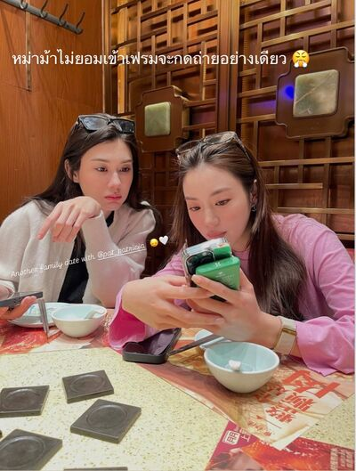
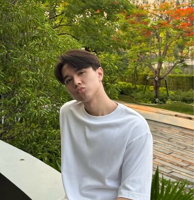

# Never Without You — Chapter 12

English translation · September 26, 28 and 30

## Character and alias key

- tt’ — TingTing / Ting / Muay; the group’s “Sun.”
- Patricia🌻 — Patricia / Pat / P’Pat; “Sunflower.”
- khim09 — Khim; Patricia’s close friend.
- 🌕 — Chan / Nong Chan / P’Chan; Khim’s partner and the group’s “Moon.”
- font_pcp — Font, distinct from the coworker Namfon.
- lalin — Lalin.
- JJAPP — Japp.
- BEll — Bell.
- Namfon — Namfon / P’Fon.

Mentioned: Claire / P’Claire, P’Duen, Mike from IT, TingTing’s parents and grandmother, and Patricia’s parents.

## Translation notes

P’ is an affectionate or respectful honorific for someone older. Muay is Patricia’s nickname for TingTing. “55555” and its variations are Thai internet laughter. Kub is a playful masculine polite particle. The new group name is rendered “Moon and Sun, Sunflower and the Gay Friend (4),” preserving its four-person celestial/flower joke. The trailing Thai vowel strings are playful drawn-out sounds, rendered through elongated English; an isolated imitation is rendered as an echoed drawn-out phrase. The allergy joke plays on being “allergic to” versus being “defeated by / unable to resist” someone. “Unknown Elders” follows the established coworker group-name convention.

Original English messages and all emoji sequences are retained. Three pictures reference chat_image_001.jpg through chat_image_003.jpg in your local img folder. Pictures have not been inspected, downloaded, or translated. Characters’ intoxication, driving, and death threats are retained as fictional dialogue, not advice or endorsement. Relationship claims and percentages are characters’ views, not objective assessments.

## Full translated chat transcript

---

September 26th  
Saturday

---

### Patricia🌻

*7:02 a.m.*

**Patricia🌻**  
Morningg ☀️

**Patricia🌻**  
Tell me when you leave, Muay. I’ll get ready and wait.

*8:19 a.m.*

**tt’**  
You wake up so early every day. How do you do it? 🫠

**Patricia🌻**  
555555

**Patricia🌻**  
Used to it.

**Patricia🌻**  
What time are you leaving?

**Patricia🌻**  
Or should I go myself? I feel bad. Your dad has to drive all the way here to pick me up.

**tt’**  
It’s fiiine. Dad will pick you up.

**tt’**  
Probably leaving at eleven.

**Patricia🌻**  
I’m nervous. 555555

**tt’**  
Don’t be.

**tt’**  
It’s nothing. Relax.

**tt’**  
I’ll go shower. See you soon.

**Patricia🌻**  
Okaaay, kub.

### khim09

*10:41 a.m.*

**Patricia🌻**  
Khim.

**Patricia🌻**  
I’m having a meal with Ting’s family today. I’m nervous.

**khim09**  
Taking her home already? Nice work, Nong Ting.

**Patricia🌻**  
Taking me home? It’s just a meal.

**khim09**  
555555

**khim09**  
And you’re going.

**Patricia🌻**  
Her parents have invited me several times.

**Patricia🌻**  
And Ting’s met my mom. I didn’t want to turn them down.

**khim09**  
Go, then. They probably want to know their daughter’s close older friend.

**Patricia🌻**  
I’m so tense.

**Patricia🌻**  
Khim. Help.

**khim09**  
Oh, Pat. You’re a grown-ass woman.

**Patricia🌻**  
😭

### Moon and Sun, Sunflower and the Gay Friend (4)

*11:15 a.m.*

**khim09**  
All together now? Take good care of my friend. @tt’

**tt’**  
55555555555555

**tt’**  
That group name is awful, P’Khim.

**khim09**  
What? Had to include all four of us. 55555

**tt’**  
We’re together. I’ll take good care of her. Don’t worry 🙂‍↔️

**khim09**  
Let’s have a meal, all four of us, once my Nong Chan’s free.

**khim09**  
Darling, come say hello. @🌕

**tt’**  
Don’t bother her.

**Patricia🌻**  
Wait. Is Khim my friend or Ting’s?

**Patricia🌻**  
You two are so close.

**tt’**  
55555555

**khim09**  
No, no jealousy, Pat.

**🌕**  
Why? Anything or anyone I should be jealous of?

**khim09**  
Not at all, darliiing.

**Patricia🌻**  
Do you believe her, Chan?

**🌕**  
Of course not, P’Pat. What could I believe from someone like P’Khim?

**Patricia🌻**  
5555555

**khim09**  
Oh, Pat. Seizing the chance to gang up on me.

**🌕**  
Look after P’Pat, Ting. She may not look it, but she gets shy around new people.

**tt’**  
I’ll look after her. Don’t worry. Definitely won’t leave her stranded for words 🙂‍↕️

**Patricia🌻**  
🥺

### IG: tingting’

*12:04 p.m.*

### prettybabies (3)

*12:11 p.m.*

**font_pcp**  
Ting, happy family day.

**tt’**  
🫪

**tt’**  
The only person calling P’Pat beautiful more than me is Mom 🙂‍↕️

**font_pcp**  
555555555555

**tt’**  
But before meeting her, I told my parents P’Pat doesn’t know I like her. Absolutely no saying anything.

**font_pcp**  
Weren’t they confused? How doesn’t she know when their daughter’s this obvious?

**lalin**  
555555555

**tt’**  
Font 😡

**tt’**  
They asked why. I told them she doesn’t like women 🫠

**font_pcp**  
Gay kid dead on the spot.

**tt’**  
Yeah. No coming back this time.

**tt’**  
They asked why I still liked her. I said she’s lovely. I want to keep loving her.

**font_pcp**  
Dead again before she even revived.

**lalin**  
But your parents probably aren’t that surprised. They’ve seen the P’Claire case.

**lalin**  
All that care, but not liking someone is not liking them. I think your parents can probably tell Claire likes you.

**tt’**  
Probably. Don’t know, though. Never told them.

**tt’**  
But if even my parents can see it, why does P’Pat…

**lalin**  
Because P’Pat is 1000% straight.

**font_pcp**  
Has P’Claire seen the story, Lalin? Can she handle it? That used to be her place.

**lalin**  
Ask Ting. Has she seen it?

**tt’**  
Not yet.

**font_pcp**  
Aha. Checking too, are you?

**lalin**  
She’ll probably message me when she sees it.

**tt’**  
Why? Does she message you often?

**lalin**  
Whenever something happens.

**tt’**  
What happens?

**lalin**  
Something that shakes her heart, obviously.

**lalin**  
You don’t need to know. You’ll just get stressed.

**font_pcp**  
Yeah. You’ve posted a story like that already, Ting. Why worry now?

**lalin**  
5555555

*12:45 p.m.*

**tt’**  
Mom just asked about Claire too. Said we hadn’t eaten with her for ages. Asked me to invite her, but I went quiet.

**lalin**  
Impeccable timing, Mom.

**tt’**  
Seemed like she happened to remember, so she asked.

**lalin**  
What did you say?

**tt’**  
Said we hadn’t been in touch much lately.

**font_pcp**  
Dead.

**font_pcp**  
P’Claire’s dead.

**lalin**  
Really dead.

**tt’**  
Mom immediately asked why. What happened? Had to tell her we’d talk later.

**lalin**  
She must’ve been shocked. You used to be so close.

**tt’**  
Mm.

**font_pcp**  
P’Japp asked whether P’Pat really won’t fall for you.

**font_pcp**  
She’s starting to think P’Pat might.

**lalin**  
5555555

**font_pcp**  
Everyone thinks so. Look what she does to my friend. Anyone who doesn’t think so can punch me.

**tt’**  
Maybe that one-in-a-thousand chance really is mine.

**lalin**  
Could be.

**font_pcp**  
Aaaaaah.

**tt’**  
🫪

### Moon and Sun, Sunflower and the Gay Friend (4)

*2:24 p.m.*

**tt’**  
Delivered her home safely 🙂‍↕️ @khim09

**khim09**  
Reporting in. 55555

**khim09**  
How was it? Did my friend survive?

**tt’**  
My parents adore P’Pat.

**tt’**  
Mom kept saying how beautiful she is. Like, “She really is beautiful. So beautiful.”

**khim09**  
Pat really does scatter her beauty everywhere.

**tt’**  
5555555555

**tt’**  
I took the opportunity to complain about work to my parents too.

**tt’**  
Usually P’Pat reins me in, right? Today she sat still, too tense to interrupt.

**tt’**  
Next time I want to complain about work, I’ll do it in front of my parents. Complain to my heart’s content 🙂‍↕️

**Patricia🌻**  
Muaaay.

**khim09**  
Ask your dad to promote my friend.

**Patricia🌻**  
Khim, you little—

**tt’**  
555555555555555

**tt’**  
Could even give her shares.

**khim09**  
Rich kids really are something else.

**Patricia🌻**  
Enoooough.

**khim09**  
Enough what? Here’s your chance. Make a good impression.

**khim09**  
How many times in your life will you meet someone like Ting? If you don’t seize this opportunity, when will you?

**khim09**  
Want to be an office worker all your life?

**tt’**  
55555555

**Patricia🌻**  
Muay. Don’t laugh like you approve.

**Patricia🌻**  
Did you make this group to gang up on me, Khim?

**khim09**  
55555555

**khim09**  
Choose the right people and you’ll be comfortable all your life, Pat.

**khim09**  
Look at me. Choose a good wife, live a happy liiife.

**khim09**  
Darling, did I say that well? Come praise me. @🌕

**tt’**  
P’Khim, too funny. 55555555555555

**Patricia🌻**  
Could you not pass these habits on to Ting?

**khim09**  
What habits, sweeeetie?

**tt’**  
Yeah, what habits, sweeeetie?

**Patricia🌻**  
These 😭

**🌕**  
P’Khim, don’t tease P’Pat.

**khim09**  
But was I right? Tell me first.

**🌕**  
Sigh.

**Patricia🌻**  
Break up with her, Chan. Do it.

**🌕**  
Can’t. I love her.

**Patricia🌻**  
I don’t want to be here anymore.

**khim09**  
555555555555555

**tt’**  
If you don’t want to be here, come be with me.

**khim09**  
There we go.

**khim09**  
This one knows what she’s doing.

**Patricia🌻**  
Stop teaching Ting bad habits before I leave the group.

**khim09**  
What? Your kid said it herself. When did I teach her anythiiiing?

**tt’**  
Anythiiiing.

**Patricia🌻**  
Muay, stop talking to her or I really will be angry with you.

**tt’**  
Whaaaat?

**khim09**  
Pat, taking it out on everyone.

**Patricia🌻**  
😤

### Patricia🌻

*2:41 p.m.*

**tt’**  
P’Paaaat.

**Patricia🌻**  
Scared I’ll get angry, huh?

**tt’**  
Yes 🫠

**Patricia🌻**  
You teamed up with her to tease me.

**Patricia🌻**  
You’re supposed to be on my side.

**tt’**  
But teasing you is funny.

**tt’**  
Usually you’re the one scolding me. Now I have backup, can’t I get a little revenge?

**Patricia🌻**  
Getting revenge on me?

**tt’**  
Can’t I, sweeeetie?

**Patricia🌻**  
Muaaay.

**tt’**  
55555555555

**tt’**  
Fine, fine. No more teasing.

**Patricia🌻**  
Home yet?

**tt’**  
Not yet. Going to Grandma’s next.

**tt’**  
Probably won’t get home till evening.

**Patricia🌻**  
A real family day.

**tt’**  
All day.

**Patricia🌻**  
555555

**Patricia🌻**  
Talk later, then. Tell me when you get home.

**tt’**  
Yes, ma’am.

### khim09

*2:44 p.m.*

**tt’**  
P’Khim, that was funny. 55555

**tt’**  
But I had to hide before P’Pat actually got mad.

**khim09**  
55555555

**khim09**  
She’s just saying that.

**khim09**  
Good thing we made a group. I get to talk to her more too.

**tt’**  
Don’t you usually have a group?

**khim09**  
No.

**khim09**  
All separate chats. Chan doesn’t chat with us together.

**khim09**  
But I thought of it this morning. Made it so Chan and I can help create gay vibes.

**khim09**  
Just want to infect her with gayness so the world ends faster. Good idea?

**tt’**  
P’Khiiiim.

**tt’**  
I really love you 🫠

**tt’**  
Thank you so much.

**khim09**  
Hey, it’s nothing, kid.

**khim09**  
I just want my friend to have a good love.

**khim09**  
And I believe you can absolutely be that person for her.

**tt’**  
🫪

**khim09**  
If that 0.01% kicks in. Don’t get your hopes up too much yet.

**tt’**  
😞

**khim09**  
555555

**tt’**  
But it’s nice. I get to see another side of her.

**tt’**  
Seeing her talk to you, I realised she’s a baby too. Always getting teased by her friend.

**khim09**  
5555555555

**khim09**  
This is the Pat I’ve always known.

**khim09**  
Beautiful. Dreamy. Fun to tease.

**khim09**  
But she has her mature side too. You’ve probably seen all of that already.

**tt’**  
Yes, yes.

**tt’**  
So nice. I get to know her a little more again.

**khim09**  
Do you like it?

**tt’**  
I like her every day.

**tt’**  
More and more too 🫠

### Patricia🌻

*7:17 p.m.*

**tt’**  
I’m hooome.

**tt’**  
How was today? Okay, meeting my parents?

**Patricia🌻**  
It was okay.

**Patricia🌻**  
Wasn’t it? What do you think?

**tt’**  
5555555555555

**Patricia🌻**  
What are you laughing at?

**Patricia🌻**  
Wasn’t it okay?

**tt’**  
It was.

**tt’**  
Laughing because you sound so unsure.

**tt’**  
Of course it was okay. More than okay. Really good.

**Patricia🌻**  
Your mom’s so kind.

**tt’**  
And Dad isn’t?

**Patricia🌻**  
He is. Just more reserved.

**tt’**  
But you were the most reserved of all.

**Patricia🌻**  
I did talk. Don’t tease me.

**tt’**  
55555555

**tt’**  
See? Nothing scary. Went really well.

**Patricia🌻**  
Thank your parents again for worrying about my mom, Muay.

**Patricia🌻**  
I promise to take very good care of their daughter.

**tt’**  
Yes. Please do.

**Patricia🌻**  
Haven’t I been doing that since day one?

**tt’**  
Yes 🫪

**Patricia🌻**  
555555

**tt’**  
You say things like that, then blush when I praise you.

**Patricia🌻**  
But I really was shy.

**Patricia🌻**  
You spoke so highly of me ah

**Patricia🌻**  
What have you told your parents?

**tt’**  
Everything. They know it all.

**tt’**  
That’s why they wanted to meet you. Invited you so many times.

**tt’**  
Like they said, I complain less, find happiness more easily, understand the world better (even if I don’t want to).

**tt’**  
It was like you'd changed my core

**tt’**  
Didn’t you see Dad trying so hard to make me kick up a fuss when I complained about work? Didn’t work, because I know where I need to fix the problem now 🙂‍↕️

**Patricia🌻**  
You’re precious, Muay. You really have grown up.

**Patricia🌻**  
Well done 🥺🫳

**tt’**  
Because of you.

**tt’**  
But I didn’t tell them about your dad beforehand. They only found out from you today.

**Patricia🌻**  
It’s okay. Even if you’d told them, it would’ve been fine.

**Patricia🌻**  
It isn’t a secret.

**tt’**  
But it’s your personal business.

**Patricia🌻**  
Personal business I chose to tell you.

**Patricia🌻**  
If I didn’t want you telling anyone, I’d tell you first. Like I said not to tell the people at work.

**Patricia🌻**  
But I wouldn’t be angry if you told your parents. You overthink, Muay.

**tt’**  
🫠

**Patricia🌻**  
Now they know my dad passed away, your mom worries about me and Mom even more.

**Patricia🌻**  
From asking me to look after you to asking you to look after me.

**tt’**  
555555555

**tt’**  
Of course I can. Gladly 🙂‍↕️

**Patricia🌻**  
Yeees, kub. You’re the best.

**tt’**  
555555

**Patricia🌻**  
Have you ever taken care of someone this much?

**Patricia🌻**  
Your mom said you used to be the one looked after. By your P’Claire.

*[Read]*

**tt’**  
Never. But I can.

**tt’**  
I can take care of you.

**Patricia🌻**  
Muay.

**Patricia🌻**  
Are you still having problems with her?

*[Read]*

**Patricia🌻**  
I mean Claire.

**tt’**  
Not problems.

**tt’**  
Just not as close as before.

**Patricia🌻**  
What did she do to you?

**Patricia🌻**  
You never told me.

**Patricia🌻**  
You said her words weren’t nice. Were they really bad? Did she hurt you?

*[Read]*

**Patricia🌻**  
You can’t tell me at all?

**tt’**  
No it’s not like that

**Patricia🌻**  
It didn't look that way

**tt’**  
I really can’t tell you. It’s not that I don’t want to.

**tt’**  
If I could, I would have.

**Patricia🌻**  
It’s okay. You don’t have to tell me.

**Patricia🌻**  
I’m just worried and want to know what she did to you.

**Patricia🌻**  
No. Honestly, maybe I just don’t like it. It’s been bothering me.

**tt’**  
What don’t you like?

**Patricia🌻**  
That she hurt you.

**tt’**  
🫠

**Patricia🌻**  
She really hurt you, right?

**tt’**  
She did.

**tt’**  
But she apologised.

**tt’**  
And I forgave her.

**Patricia🌻**  
Mm. Okay.

**Patricia🌻**  
Let me put her name on my list.

**tt’**  
What?

**tt’**  
It’s over. She apologised. That’s it.

**Patricia🌻**  
You can be done. I’m not.

**Patricia🌻**  
I won’t be kind to someone who hurts you.

**tt’**  
Wow. Scary.

**Patricia🌻**  
Right?

**Patricia🌻**  
First time I’ve felt this way too.

**Patricia🌻**  
I brought her up yesterday because I wanted to know how you two were doing. You haven’t talked about Claire since that day.

**Patricia🌻**  
You weren’t saying anything, so I didn’t want to push. But when your mom asked today, you still didn’t want to talk about her. Made me more curious.

**tt’**  
You want to know about Claire too?

**Patricia🌻**  
Of course.

**tt’**  
But you never ask.

**Patricia🌻**  
I’m asking right now. You’re the one not answering.

**Patricia🌻**  
I asked that day too, Muay.

**tt’**  
🫠

**Patricia🌻**  
See? I wanted you to tell me yourself. You never did, so I had to ask.

**Patricia🌻**  
But asking doesn’t get an answer either, because you didn’t want to tell me to begin with.

**tt’**  
What? Are you angry with me?

**Patricia🌻**  
No. Just saying.

**Patricia🌻**  
Or am I angry?

**tt’**  
Hey.

**Patricia🌻**  
55555

**Patricia🌻**  
Not with you. But I’m so angry with her.

**Patricia🌻**  
You say there’s no problem, but I think she must’ve hurt you badly.

**Patricia🌻**  
Thinking that makes me dislike her.

**Patricia🌻**  
Funny. Not even my business. Why am I so upset?

**Patricia🌻**  
Probably like when you get angry with P’Duen on my behalf.

**tt’**  
True. 5555555555

**Patricia🌻**  
Look how much I’m talking. It really bothers me.

**tt’**  
555555555

**tt’**  
You’re funny. I’ve never seen you angry with anyone.

**Patricia🌻**  
I usually let things slide. But when it’s you, it stays with me.

**Patricia🌻**  
Knowing she’s close to you but hurt you makes me really dislike it.

**Patricia🌻**  
I’ve never wanted to hurt you.

**tt’**  
Then don’t, okay?

**tt’**  
Don’t hurt me.

**Patricia🌻**  
Of course I won’t.

**tt’**  
Promise?

**Patricia🌻**  
I promise.

**Patricia🌻**  
Don’t let anyone hurt you either.

**tt’**  
You mean Claire?

**Patricia🌻**  
Everyone.

**Patricia🌻**  
But yes. especially Claire.

**tt’**  
555555

**Patricia🌻**  
What’s funny?

**tt’**  
You being angry with Claire.

**tt’**  
Worried about me that much, beautiful older sister?

**Patricia🌻**  
Teasing me?

**Patricia🌻**  
Not worried anymore.

**tt’**  
5555555

**Patricia🌻**  
Muay, honestly.

**tt’**  
Not teasing. Not laughing anymore.

**tt’**  
I’m glad you worry, but you don’t need to.

**tt’**  
I won’t let anyone hurt me.

**tt’**  
Especially Claire 😏

**Patricia🌻**  
You’re mocking me ah!!!

**tt’**  
5555555555555555

**Patricia🌻**  
I’m not letting you talk to Khim anymore.

**tt’**  
I’m going to.

**Patricia🌻**  
Muaaay.

**tt’**  
Teasing you is fun.

**Patricia🌻**  
When did we stop loving each other?

**tt’**  
Have we started loving each other, then?

**Patricia🌻**  
Look at you.

**Patricia🌻**  
Choosing Khim over me now?

**tt’**  
Not true.

**tt’**  
I’ll always choose you over anyone else

**Patricia🌻**  
Awww

**Patricia🌻**  
You’re literally my Privilege

**tt’**  
Of course 🙂‍↕️

### prettybabies (3)

*8:13 p.m.*

**tt’**  
P’Pat’s angry with Claire too.

**tt’**  
For hurting me.

**tt’**  
I think she loves me.

**font_pcp**  
Here we go again.

**font_pcp**  
She can still keep going.

**tt’**  

**font_pcp**  
Go for it.

**font_pcp**  
Dying is just dying, P’.

**lalin**  
555555555

**lalin**  
Told you. Does she listen when we stop her?

**tt’**  
Worst case, I just die 🫠

**font_pcp**  
Yeah. I understand my friend completely.

**font_pcp**  
For the beautiful older sister, dying’s no problem.

**tt’**  
True 🙂‍↕️

**tt’**  
But she seemed so angry with Claire. So unlike P’Pat. Funny. 5555555

**lalin**  
Does she know what Claire said?

**tt’**  
No. Didn’t tell her.

**lalin**  
Thought so. Tell her and she’d know you like her.

**tt’**  
She only knows Claire hurt me. Said something bad.

**font_pcp**  
Said P’Pat doesn’t love her, that’s what.

**tt’**  
😡

**tt’**  
After we dropped P’Pat off, Mom asked if I’d fought with Claire.

**tt’**  
Even Dad wanted to know.

**lalin**  
They’ve known her ages. Trusted her to look after their daughter too.

**lalin**  
What did you say, Ting?

**tt’**  
Told them Claire said things that hurt me about P’Pat. Didn’t tell them exactly what.

**tt’**  
Mom looked shocked. But I told her Claire apologised.

**tt’**  
I’m not angry. We’re just not as close.

**tt’**  
Mom seemed to understand. Probably feels it’s a shame, though. Asked if she could still talk to Claire.

**font_pcp**  
Mooom.

**font_pcp**  
So precious.

**tt’**  
Mm. Mom really likes Claire.

**lalin**  
Practically another daughter.

**tt’**  
I told her to act normally.

**tt’**  
Travel, eat together, go wherever they want. Just don’t invite me.

**font_pcp**  
I feel sorry for P’Claire. Seriously.

**lalin**  
She’s lucky Ting was only angry for one day.

**font_pcp**  
55555555

**tt’**  
What does Claire talk to you about, Lalin?

**lalin**  
Why do you want to know?

**tt’**  
Honestly,

**tt’**  
I don’t want her to be hurt.

**tt’**  
I know she'd been good to me

**font_pcp**  
Don’t ever let P’Claire see this, Lalin.

**lalin**  
Yeah. Can’t let her see. She’ll move on in circles again.

**tt’**  
😞

**lalin**  
Let P’Claire go, Ting.

**lalin**  
You’re not going to love her. Not the way she wants.

**lalin**  
Let her go.

**tt’**  
Mm.

**lalin**  
Everyone has to live with their own karma.

**lalin**  
Don’t worry about anyone else. Worry about your own future first.

**font_pcp**  
Oh. My friend got hit again.

**lalin**  
5555555

**tt’**  
I want to bring P’Pat to meet you.

**tt’**  
So you can know her the way I do.

**lalin**  
Bring her. Been wanting to meet her for ages.

**font_pcp**  
Exactly.

**font_pcp**  
I know she’s lovely. P’Japp says so too.

**font_pcp**  
But I want to see her with you. See how lovely she is.

**lalin**  
Next Saturday? I’ll find a place.

**tt’**  
But she doesn’t like drinking.

**lalin**  
Not asking her to drink.

**lalin**  
Asking her to help look after you while you drink.

**tt’**  
🫪

**tt’**  
Let’s go.

**font_pcp**  
Ting. 555555

**font_pcp**  
Wants to go with P’Pat? No.

**font_pcp**  
Wants to go drinking? Yes.

**tt’**  
You’re making me look bad.

**font_pcp**  
Is it true?

**tt’**  
True 🙂‍↕️

**tt’**  
Are you crazy? I want to go drinking with P’Pat!! 😡

**font_pcp**  
Not an improvement.

**tt’**  
5555555555

**lalin**  
Invite her.

**tt’**  
Okay. I’ll get her to come 🫪

---

September 28th  
Monday

---

### Moon and Sun, Sunflower and the Gay Friend (4)

*8:41 p.m.*

**tt’**  
P’Khim. Been asking since Saturday. It’s Monday and P’Pat still hasn’t agreed.

**tt’**  
Are you really not coming, P’Pat? 🫠

**tt’**  
@khim09

**khim09**  
Playing hard to get again, Pat.

**khim09**  
Here. Tell her if she doesn’t go, you’ll drink yourself senseless and crash into every lamppost. She’ll go. Trust me.

**khim09**  
Don’t say, “If P’Pat doesn’t go, I won’t.” That’s playing right into her hands.

**Patricia🌻**  
Khim, you little—

**Patricia🌻**  
The things you teach her.

**tt’**  
55555555555

**tt’**  
Okay. Got it 🙂‍↕️

**khim09**  
Begin.

**tt’**  
If you won’t come, I’ll drink until I black out and drive into the gate so Dad and Mom scream 😡

**Patricia🌻**  
Muaaay.

**🌕**  
P’Khim, could you stop teasing P’Pat so much?

**khim09**  
You’re not taking my side?

**🌕**  
Because this is too funny.

**tt’**  
555555555

**khim09**  
Darling really loves me. I’m touched.

**Patricia🌻**  
Oh, goood.

**khim09**  
Just go with her. I know you don’t like bars, but go. Look after Ting.

**tt’**  
Exactly.

**Patricia🌻**  
Muay. So quick to agree.

**Patricia🌻**  
I can go. I just don’t want you drinking.

**Patricia🌻**  
Once I’m going, you say you’ll drink even more.

**khim09**  
She’s twenty-two, not two, you idiot.

**tt’**  
Why are you insulting P’Pat?

**khim09**  
What? Am I wrong? I’m helping you, Ting. Am I wrong, sweetie?

**tt’**  
Helping is one thing. But don’t insult her. I don’t like it 😡

**Patricia🌻**  
5555555555

**tt’**  
You too, P’Pat. Don’t laugh. I’ve only gone drinking once since we met. You can’t even come with me this once 😠

**khim09**  
This kid really does snap at everyone.

**🌕**  
5555555

**Patricia🌻**  
😭

**🌕**  
Ting, try sweet-talking P’Pat nicely.

**🌕**  
Don’t listen to P’Khim. Ask nicely. P’Pat will soften.

**tt’**  
I have to sweet-talk her? 🫪

**🌕**  
Try it.

**khim09**  
Pat’s dead. Allergies.

**khim09**  
Allergic to what? Young women.

**Patricia🌻**  
Shut up, Khim.

**khim09**  
555555555555

**tt’**  
Let me sweet-talk her in private. It’s too embarrassing here.

**Patricia🌻**  
Oh, Muaaay.

**khim09**  
Ooooh. My little Ting’s got game.

**khim09**  
Go ahead. I won’t interrupt. Sweet-talk each other in private all you liiike.

**tt’**  
🫪

### Patricia🌻

*8:56 p.m.*

**tt’**  
P’Paaaat.

**Patricia🌻**  
Not listening. Not reading.

**tt’**  
Why? Scared?

**Patricia🌻**  
Scared of what? What would I be scared of with you?

**tt’**  
Scared of being allergic to young women.

**Patricia🌻**  
Muay, I really will stop you talking to Khim.

**tt’**  
55555555

**tt’**  
But I really want you to come. I want you to meet my friends too.

**Patricia🌻**  
You want me to meet your friends?

**tt’**  
Mm. Like I know P’Khim and P’Chan.

**tt’**  
I want you to know my inner circle too.

**tt’**  
I know you don’t like going to those places.

**tt’**  
But come with me. I want us to go together.

**tt’**  
Come with me.

**tt’**  
Please? 🥺

**Patricia🌻**  
Puppy eyes now?

**Patricia🌻**  
I managed to stay strong for so long, Muay.

**tt’**  
🥺🥺🥺

**Patricia🌻**  
I’ll go. I’ll go.

**Patricia🌻**  
But I’m not drinking. Okay?

**tt’**  
Of course. No problem.

**Patricia🌻**  
I’ll drive for you instead.

**tt’**  
🫪

**tt’**  
Wait. If you drive my car and take me home, how will you get home?

**Patricia🌻**  
I’ll call a ride. It’s fine.

**tt’**  
It’s not. No. Dangerous.

**Patricia🌻**  
Then how am I getting home?

**tt’**  
You don’t have to.

**tt’**  
You can stay over at my place 🫪

**Patricia🌻**  
You never stop, do you, Muay?

**tt’**  
Won’t you sleep over? I’m worried. Don’t want you going home alone late.

**Patricia🌻**  
Then don’t drink so much to begin with. You can drive yourself home.

**tt’**  
I want to drink 🫠

**Patricia🌻**  
See? You’re being stubborn. How can I indulge you?

**tt’**  
Can’t you indulge me?

**Patricia🌻**  
But you’re stubborn.

**tt’**  
I won’t be.

**tt’**  
I won’t drink much.

**tt’**  
But you stay over ok?

**Patricia🌻**  
Then if you don’t drink much, you can drive yourself.

**tt’**  
See? Even when I’m not stubborn, you still won’t indulge me 😞

**Patricia🌻**  
Oh.

**tt’**  
You’re mean.

**tt’**  
I’m not being stubborn anymore. Can’t you stay over? 🥺

**Patricia🌻**  
You tease me about puppy eyes, but now you never stop using them yourself.

**tt’**  
Will you give in?

**tt’**  
Will you be defeated by a young woman? 🥺

**Patricia🌻**  
I will.

**Patricia🌻**  
But not young women in general.

**Patricia🌻**  
I think I’m weak against you, Muay.

**tt’**  
🫪

**Patricia🌻**  
No more sweet-talking. I’ve agreed to stay over.

**tt’**  
🫪🫪🫪🫪

### Moon and Sun, Sunflower and the Gay Friend (4)

*9:16 p.m.*

**tt’**  
P’Chan, love you. Thank you so much.

**tt’**  
If this isn’t someone who knows P’Pat better than P’Khim 🙂‍↔️

**tt’**  
@🌕

**khim09**  
What? Pat agreed?

**tt’**  
Never stood a chance 🙂‍↔️

**khim09**  
555555555555

**khim09**  
What? Defeated by sweet-talking?

**tt’**  
No. Not defeated by sweet-talking 🫪

**Patricia🌻**  
Stop right there.

**Patricia🌻**  
If you tell Khim what I said, I really will be angry.

**tt’**  
🫪

**khim09**  
Come on. Tell me.

**tt’**  
No. Can’t tell. Won’t tell.

**khim09**  
Just the two of you know, huh?

**tt’**  
Mm. Just us two is enough 🙂‍↕️

**khim09**  
Okay.

**khim09**  
Even without knowing, I’m happy seeing you happy.

**tt’**  
5555555

**khim09**  
What did Pat saaay?

**tt’**  
Oops.

**Patricia🌻**  
I’m about to change my mind. Just wait.

**tt’**  
Not saying it. Won’t say anything 🙂‍↔️

**khim09**  
What kind of sweet-talking did they do?

**khim09**  
Darling, come sweet-talk me too. @🌕

**🌕**  
Do you ever get tired of yourself?

**khim09**  
Hey, sweetheart. Why say that?

**tt’**  
5555555555

---

September 30th  
Wednesday

---

### Unknown Elders (5)

*5:21 p.m.*

**JJAPP**  
Who’s that, P’Bell? @BEll

**JJAPP**  
Coming but not coming, leaving but not leaving. That guy keeps hovering.

**BEll**  
You want to know, huh?

**JJAPP**  
What department?

**BEll**  
IT. Mike. Never talked to him?

**JJAPP**  
No. But if he’s IT, he can go right back. They’re all weird.

**BEll**  
555555555555

**Namfon**  
How do you know, Bell?

**BEll**  
Someone gave me a heads-up.

**BEll**  
He’s got an objective.

**JJAPP**  
What objective?

**BEll**  
A certain beautiful person around here.

**tt’**  
Who?

**JJAPP**  
Muay’s fast. 555555555

**JJAPP**  
Got an alert set for the word “beautiful”?

**tt’**  
Who’s here for the beautiful person?

**tt’**  
That bland-faced guy?

**JJAPP**  
Intense.

**BEll**  
5555555555

**Namfon**  
Trying not to laugh. Can’t. 555555

**BEll**  
And Ting isn’t claiming to be the beautiful person around here, either.

**JJAPP**  
Of course not. She’s being possessive over the beautiful person instead.

**tt’**  
🤬

**tt’**  
P’Bell, tell me what you know.

**BEll**  
He’ll come back around. Apparently today’s his last day, so he has to make it happen.

**BEll**  
Let him reveal it himself.

**JJAPP**  
Does the other person involved know anything about this?

**Namfon**  
Probably not. 5555555

**JJAPP**  
Hasn’t even read LINE.

**BEll**  
The one who knows and is upset is the kid beside her.

**JJAPP**  
55555555

**JJAPP**  
Let’s see how far the Care Bear couple goes.

**tt’**  
What, P’Japp? What?

**JJAPP**  
Want to know if they’ll stay a pair.

**JJAPP**  
Or become odd ones out.

**tt’**  
PatTing is the pair.

**tt’**  
That bland-faced guy is the odd one out.

**tt’**  
Okay?

**JJAPP**  
His name’s Mike. You won’t even use it.

**tt’**  
Bland-face.

**JJAPP**  
5555555555

**Namfon**  
Japp, stop teasing her.

**JJAPP**  
Ting’s actually angry. Look at her face. 55555555

**BEll**  
Someone nudge Pat.

**BEll**  
Never mind. He’s back.

**BEll**  
Let him nudge her himself.

*5:47 p.m.*

**BEll**  
What happened? @JJAPP

**JJAPP**  
Wait for P’Pat to come back and tell us. Don’t know what they went out to discuss.

**JJAPP**  
What I do know is Muay’s scowling.

**JJAPP**  
Looks like she tried stopping P’Pat talking to him, but P’Pat went anyway.

**BEll**  
Seriously?

**BEll**  
Muaaay. @tt’

**tt’**  
Yes.

**tt’**  
Wait for her to tell you herself.

**JJAPP**  
Seriously sulking.

**tt’**  
I’m going home.

**JJAPP**  
Hey.

**JJAPP**  
Not waiting for P’Pat?

**tt’**  
No.

**Namfon**  
Muaaay.

**JJAPP**  
Here we go.

**BEll**  
Oh, shit, Paaat. @Patricia🌻

### Patricia🌻

*5:58 p.m.*

**Patricia🌻**  
Muay, where are you?

**Patricia🌻**  
You really left?

*6:05 p.m.*

**Patricia🌻**  
You’re driving, right?

**Patricia🌻**  
Tell me when you get home, then.

### prettybabies (3)

*6:11 p.m.*

**font_pcp**  
Tiiing. P’Japp said you got upset with P’Pat and went home? @tt’

**tt’**  
Yeah.

**tt’**  
Driving.

**tt’**  
Thinking about that bland face pisses me off.

**tt’**  
Don’t know why she had to talk to him.

**lalin**  
Which bland face?

**font_pcp**  
A guy from IT came to see P’Pat today.

**font_pcp**  
According to P’Japp.

**font_pcp**  
Apparently he wanted a private talk. Ting didn’t want her going, but she went out with him anyway.

**font_pcp**  
So she fled home.

**lalin**  
There it is.

**lalin**  
Might actually need to collect a body today.

**font_pcp**  
But P’Japp said they didn’t talk long. He’s already left too.

**tt’**  
Who knows if they exchanged LINE?

**tt’**  
Going to focus on driving. I’m fucking annoyed!!!!!

**lalin**  
The gay kid’s so jealous too.

**font_pcp**  
Yeah. First time seeing this side of Ting. Not surprised, though. 555555555555

### Patricia🌻

*6:47 p.m.*

**Patricia🌻**  
Muaaay.

**Patricia🌻**  
Are you really angry with me?

**Patricia🌻**  
Left without waiting.

*7:04 p.m.*

**Patricia🌻**  
What are you angry with me about? 😭

*7:08 p.m.*

**tt’**  
Are you home yet, P’Pat?

**Patricia🌻**  
Yes. You?

**tt’**  
Been home a while.

**Patricia🌻**  
And you didn’t tell me.

**tt’**  
I’m angry.

**Patricia🌻**  
Seeing your reply, I thought you weren’t anymore.

**tt’**  
Of course I am.

**tt’**  
But I need to know you’re home first.

**Patricia🌻**  
5555555

**tt’**  
Not funny.

**Patricia🌻**  
Muaaay.

**Patricia🌻**  
What are you angry with me about, first of all?

**tt’**  
I told you not to go talk to him.

**tt’**  
P’Bell told us enough to know he came to flirt.

**Patricia🌻**  
He came up and asked to talk. How could I say no?

**tt’**  
Why couldn’t you?

**Patricia🌻**  
Want me to tell you what we talked about?

**tt’**  
Tell me if you want. Don’t ask me.

**tt’**  
But one look at him and you can tell he couldn’t look after you. A kid like that.

**Patricia🌻**  
He’s older than you, Muay. 555555

**tt’**  
Why? Do you like him?

**Patricia🌻**  
Should I?

*[Read]*

**Patricia🌻**  
Muaaay.

**Patricia🌻**  
Kidding.

**tt’**  
Everything’s so fun for you.

**tt’**  
Don’t want to talk anymore.

**Patricia🌻**  
I’m soooorry.

**Patricia🌻**  
I don’t like him at all.

**Patricia🌻**  
I know you don’t either.

**tt’**  
Really?

**tt’**  
Sure?

**Patricia🌻**  
Of course.

**tt’**  
Then why go talk to him?

**Patricia🌻**  
Just didn’t want to reject him in front of everyone.

**tt’**  
That had better be true.

**Patricia🌻**  
It is.

**tt’**  
Tell me what you talked about.

**Patricia🌻**  
Oh? Want to know now?

**tt’**  
P’Pat.

**Patricia🌻**  
Okay, okay. 55555

**tt’**  
Stop laughing!! 😡

**Patricia🌻**  
Okay. Not laughing.

**Patricia🌻**  
He confessed he’d liked me for a long time but didn’t dare say it. Since today was his last day, he wanted to try telling me.

**Patricia🌻**  
He asked for my Instagram. I didn’t give it to him. Said I hardly use it and I’m not interested in seeing anyone. He understood. That was all.

**tt’**  
And LINE?

**Patricia🌻**  
He already has it. From the group.

**tt’**  
True.

**tt’**  
Has he ever messaged you?

**Patricia🌻**  
Only about work.

**tt’**  
Then you can block him. No more work to discuss from now on.

**Patricia🌻**  
Block him, Muay?

**tt’**  
Will you?

**Patricia🌻**  
Yes. I’ll block him.

**tt’**  
That’s all.

**Patricia🌻**  
Why are you this angry?

**tt’**  
😡

**tt’**  
Don’t like him.

**tt’**  
Don’t like his face. Don’t get good vibes. Don’t want you involved with him.

**Patricia🌻**  
I’m not involved. Wasn’t interested anyway.

**tt’**  
Good. You did the right thing.

**Patricia🌻**  
Can you stop being angry with me now?

**tt’**  
😤

**Patricia🌻**  
Muay, I’ve explained everything.

**Patricia🌻**  
I don’t feel anything for him. It’s funny that you’re so upset and dislike him this much.

**Patricia🌻**  
I just didn’t want to hurt his feelings in front of everyone.

**tt’**  
I understand. I know.

**Patricia🌻**  
So you’re not angry with me anymore?

**tt’**  
Not anymore.

**tt’**  
But next time, if I don’t like someone, could you not talk to them?

**Patricia🌻**  
Okay. Won’t talk to them.

**Patricia🌻**  
I don’t want to talk to anyone anyway.

**tt’**  
What if one day there’s someone you really want to talk to?

**Patricia🌻**  
I’ll ask you first, then.

**Patricia🌻**  
How’s that? Let you screen them first.

**tt’**  
None of them will pass.

**Patricia🌻**  
5555555

**tt’**  
If I say they don’t pass, will you not talk to them?

**Patricia🌻**  
I said that from the start. You keep asking more questions.

**tt’**  
In case there’s someone you really want to talk to.

**Patricia🌻**  
All right, okay.

**Patricia🌻**  
If you say they don’t pass, I won’t talk to them.

**Patricia🌻**  
Your opinion matters most. Okay?

**tt’**  
Really?

**Patricia🌻**  
Yes.

**Patricia🌻**  
I’m not talking to him today, either.

**Patricia🌻**  
When I told Mike I wasn’t interested in seeing anyone, I meant it.

**Patricia🌻**  
Don’t worry about this. I don’t fall for people easily.

**Patricia🌻**  
And I’m not really looking for a partner.

**tt’**  
What if I say no, but you like them so much? What will you do?

**Patricia🌻**  
There won’t be anyone.

**tt’**  
But what if there is?

**Patricia🌻**  
I’ll have them prove themselves to you until you approve.

**tt’**  
What if nothing they do passes?

**Patricia🌻**  
Then they’re not good enough yet.

**Patricia🌻**  
If I like someone, I suppose they’ll need to make you see they’re good enough for me.

**Patricia🌻**  
Because you’re one of the people who worries about me most. You want me to meet someone good, right?

**tt’**  
Mm.

**Patricia🌻**  
So many questions. So many conditions. I’m confused now.

**tt’**  
But the answer’s the same: you won’t talk to them. You said it.

**Patricia🌻**  
Yes. If you don’t approve, I won’t. Exactly that.

**Patricia🌻**  
I care about you so much. I was shocked when you left early today.

**tt’**  
I’m sorry 🫠

**Patricia🌻**  
It’s okay.

**Patricia🌻**  
Just wanted to tell you. Don’t want you angry with me again.

**Patricia🌻**  
Or if you are, I just want us to talk properly first.

**Patricia🌻**  
I told you. If I make you feel bad, just tell me. I’ll listen and apologise.

**Patricia🌻**  
And you promised me too. Remember?

**tt’**  
I remember.

**tt’**  
It’s not that I felt bad. I just didn’t like it.

**Patricia🌻**  
And now that feeling’s gone, right?

**tt’**  
Yes.

**Patricia🌻**  
Finally made it up to you.

**Patricia🌻**  
Hard to coax this time.

**tt’**  
🫠

**Patricia🌻**  
Don’t know what you’re so angry about.

**Patricia🌻**  
You already know I have to choose you before anyone else.

**tt’**  
Mm. Don’t choose that bland-faced guy.

**tt’**  
Not even handsome 😡

**Patricia🌻**  
55555555

**tt’**  
Good thing you don’t want a partner.

**tt’**  
Stay with me like this for a long, long time.

**Patricia🌻**  
Yes. Let’s stay like this for a long, long time.

**tt’**  
🙂‍↕️

**Patricia🌻**  
🫳

### prettybabies (3)

*7:43 p.m.*

**tt’**  
We’ve made up. P’Pat came and coaxed me. Okay? 😤

**font_pcp**  
Oh. So easy to coax.

**tt’**  
Not easy. Took ages.

**lalin**  
Ages how? Not even two hours, was it?

**tt’**  
Really? Felt like I was playing very hard to get. Like I’d sulked for fifty years.

**font_pcp**  
55555555555

**tt’**  
P’Pat doesn’t like him.

**tt’**  
Rejected him. That’s all I need to feel better 🙂‍↕️

**lalin**  
Ting still won’t die.

**font_pcp**  
Waiting to collect a body, never getting to.

**tt’**  
Go collect Mike instead. One rejection already 🙂‍↔️

**tt’**  
That ugly and he still dares flirt with P’Pat. Shameless.

**font_pcp**  
Tiiing. 5555555555

**lalin**  
How ugly? Let me see.

**tt’**  

**lalin**  
Whoa. This is ugly???

**lalin**  
I’d like to see your husband. How handsome is he?

**tt’**  
My husband’s beautiful 😠

**font_pcp**  
A beautiful husband now. My friend, honestly.

**lalin**  
555555555

**lalin**  
You survived today, at least.

**tt’**  
Yeah. So relieved. I was so stressed my heart nearly stopped. Damn it.

**font_pcp**  
5555555

**font_pcp**  
P’Japp said she was furious. Everyone was confused.

**lalin**  
The beautiful older sister still doesn’t know her kid likes her?

**tt’**  
She even said she’d let me screen men for her. You guys, I want to die.

**font_pcp**  
Oh, P’Paaat.

**lalin**  
See? Here comes the adviser role.

**tt’**  
None of them will pass. If they’re not better than me, prepare for elimination 🤬

### khim09

*8:29 p.m.*

**tt’**  
P’Khim, did P’Pat talk to you about the IT guy?

**khim09**  
No.

**tt’**  
Good 😠

**khim09**  
What happened?

**tt’**  
Someone from IT came to flirt with her. A man too. Maximum danger.

**khim09**  
55555555

**khim09**  
She’s beautiful. Everyone likes her.

**tt’**  
But I told her this one doesn’t pass. Too young. How could he look after her?

**khim09**  
And you’re not young, Ting?

**tt’**  
Young. But I can look after her 🙂‍↕️

**khim09**  
Oh, sabotaging him to cut off his chances.

**tt’**  
He never had a chance to begin with.

**khim09**  
Determined not to let my friend have a partner?

**tt’**  
If I can’t have your friend as my girlfriend, no one else should hope to.

**khim09**  
Yeah. I like that spirit.

**khim09**  
If cunning won’t do, trickery will, huh?

**tt’**  
She said I could screen them. If I say no, she won’t talk to them.

**khim09**  
Going to screen people for her forever?

**khim09**  
Don’t want to be her girlfriend instead?

**tt’**  
Will your friend have me as her girlfriend?

**khim09**  
555555

**khim09**  
Wait for the world to end first.

**tt’**  
Oh, will I die of old age waiting for that 0.01%, P’Khim?

**tt’**  
I’m starting to think, fine, fine. We don’t have to date. As long as she chooses me first like today.

**tt’**  
How’s that? Am I good? Living with reality.

**khim09**  
5555555555

**khim09**  
Settling for less now.

**tt’**  
Would wanting more get me anywhere? 😡

**khim09**  
I’ll help spread some gayness. Be patient.

**tt’**  
But P’Pat told me she isn’t interested in anyone. Doesn’t want a partner.

**tt’**  
From what she said today, she didn’t seem interested in talking to that Mike guy either.

**khim09**  
Exactly. Told you.

**khim09**  
If that’s the situation, you can relax.

**khim09**  
Right now, if anyone comes closest to being her partner,

**khim09**  
it’s only you.

**tt’**  
🫪

.

.

.

## Author’s note

After P’Khim says all that, can the world end for the gay kid already? 🫪
And what man could get past Ting anyway? She’s waiting to trip every last one of them. 5555555555

And P’Pat getting angry with Claire on Ting’s behalf is so precious. You like the kid already, don’t you? Seriously. Say it. You’re already allergic to Muay too 🫪

Thank you to everyone who came to read 🙏
I may start disappearing a little because work is picking up. I had too much free time before 🙂‍↔️
