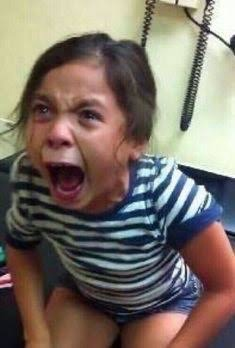
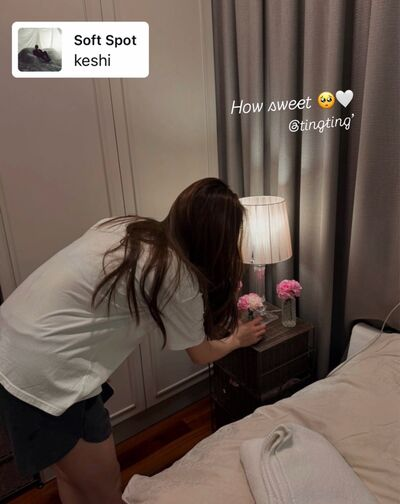
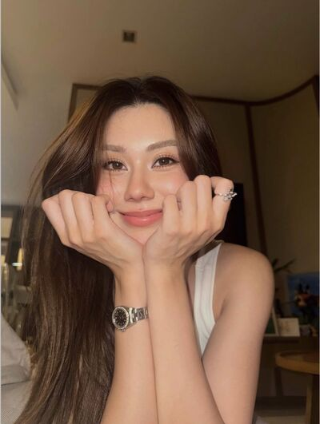
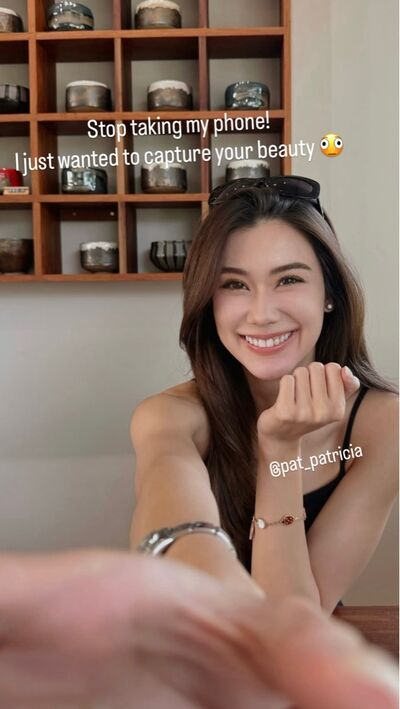
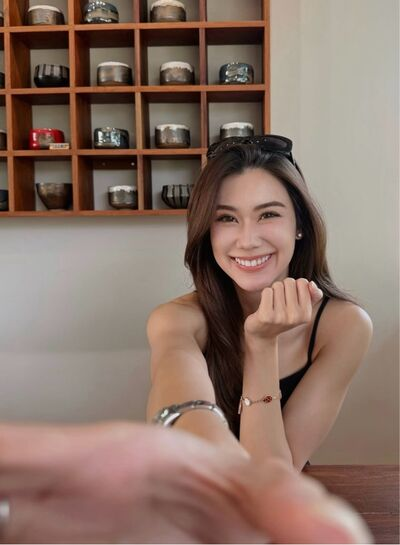
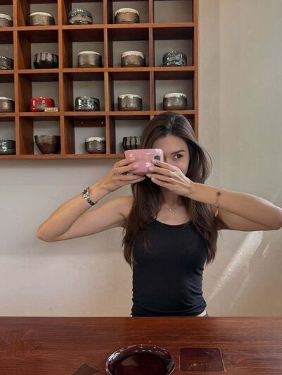
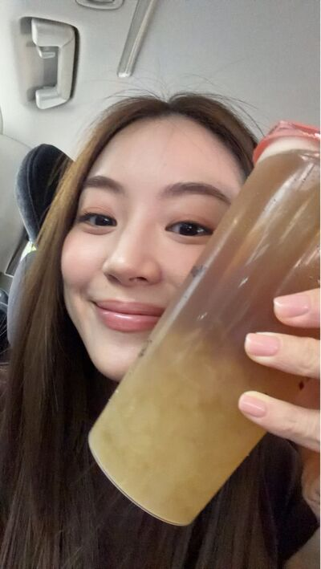
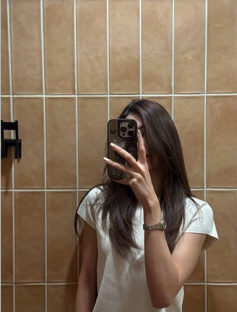

# Never Without You — Chapter 13

English translation · October 1, 3–4 and 23

## Character and alias key

- tt’ — TingTing / Ting / Muay.
- Patricia🌻 — Patricia / Pat / P’Pat.
- JJAPP — Japp.
- BEll — Bell.
- Namfon — Namfon / P’Fon.
- font_pcp — Font, distinct from the coworker Namfon.
- lalin — Lalin.
- khim09 — Khim.
- eclaire — Claire / P’Claire.
- หม่าม้า — Mom, TingTing’s mother (display name retained).

Mentioned: Sean / P’Sean, Mike from IT, Nong Chan, P’Art, P’Duen, Aunt Ying, TingTing’s father, and Patricia’s mother.

## Translation notes

P’ is an affectionate or respectful honorific for someone older. Muay is Patricia’s nickname for TingTing. “55555” and its variations are Thai internet laughter. Kub is a playful masculine polite particle. “Cast as her child” expresses TingTing’s frustration at Patricia treating her like a daughter rather than a potential lover. The “pussy—heart” typo joke recreates a deliberately suggestive Thai misspelling of “heart”; the subsequent correction is retained. “Beating extra eggs into the story” preserves the embellishment joke. A “half-full glass” here means remaining open to learning. Sean renders ฌอน.

Original English messages are retained, including their grammatical quirks. The original Thai ship hashtag is retained. Eight pictures reference chat_image_001.jpg through chat_image_008.jpg in your local img folder. The ninth manifest entry is a call-interface icon, not a photograph: its unanswered-call label has been recovered from saved HTML and rendered as text. Pictures have not been inspected, downloaded, or translated. Characters’ percentages, alcohol claims, and death jokes are fictional dialogue, not factual assessments or advice.

## Full translated chat transcript

---

October 1st  
Thursday

---

### Patricia🌻

*6:18 a.m.*

**tt’**  
Morning kubbb

**Patricia🌻**  
Oh? Why are you up early today?

**Patricia🌻**  
I haven’t even called to wake you yet.

**tt’**  
Woke up on my own. Guess I’m getting used to it too.

**Patricia🌻**  
You should’ve got used to it ages ago. It’s been two months, Muay.

**tt’**  
55555555555

**Patricia🌻**  
Maybe I don’t need to call anymore.

**tt’**  
Noooo.

**tt’**  
Call me. Please.

**tt’**  
Or can’t you be bothered? 😠

**Patricia🌻**  
Caught me.

**tt’**  
Honestly, you.

**Patricia🌻**  
55555555

**tt’**  
You don’t have to call, then.

**Patricia🌻**  
Sulking already.

**tt’**  
Of course I’m sulking.

**Patricia🌻**  
I’ll call. No sulking.

**tt’**  
😠

**tt’**  
Before I shower, how’s your mom?

**Patricia🌻**  
Still okay. No new symptoms.

**Patricia🌻**  
But she says she still gets tired easily.

**tt’**  
🫠

**tt’**  
Are you still stressed?

**Patricia🌻**  
Worried.

**Patricia🌻**  
But I’m doing the best I can. Watching her diet, making sure she takes her medication, taking her to the doctor regularly.

**tt’**  
Mm. Tell me if I can help.

**Patricia🌻**  
🫳

**tt’**  
Shall we find a café to take her to on Sunday? Somewhere with a nice atmosphere.

**tt’**  
I think she’d like it.

**Patricia🌻**  
Sure.

**Patricia🌻**  
She didn’t go anywhere last week either. We can get her out a little.

**tt’**  
Okay. I’ll find somewhere.

**Patricia🌻**  
Thank you, Muay.

**tt’**  
My pleasure.

**tt’**  
Showering first. See you soon.

**Patricia🌻**  
Okaaay, kub.

### Unknown Elders (5)

*9:14 a.m.*

**JJAPP**  
Why so cheerful this morning? @tt’

**JJAPP**  
Yesterday you flounced home without waiting for anyone. Today you arrive walking with her from miles away, Muay.

**JJAPP**  
Whatever happened yesterday?

**tt’**  
🫪

**BEll**  
All I know is the IT boy went home with his head hanging.

**JJAPP**  
55555555

**JJAPP**  
You never wait to hear her out. Just sulk.

**tt’**  
Sulk first.

**tt’**  
She’ll make it up to me later 🙂‍↕️

**JJAPP**  
So P’Pat really did coax you.

**BEll**  
Aaaaah. #แพทถิง is real.

**Patricia🌻**  
Could I not? She went home without even waiting for me.

**tt’**  
5555555

**BEll**  
But why make it up to her? What did you do wrong, Pat?

**JJAPP**  
Exactly.

**JJAPP**  
What did P’Pat do wrong? Just went out to talk to the IT guy. What did she do wrong?

**tt’**  
Stop right there, P’Japp.

**JJAPP**  
5555555

**tt’**  
And why ask that, P’Bell? Wrong is wrong. No reason needed 😠

**Patricia🌻**  
Bell and Japp, don’t make trouble for me.

**BEll**  
5555555

**Namfon**  
Poor Pat. 555555

**JJAPP**  
What? Are you this scared of Muay now?

**Patricia🌻**  
Not scared.

**Patricia🌻**  
I just don’t want to do things she doesn’t like.

**JJAPP**  
P’Pat. Serious question.

**JJAPP**  
Really serious.

**tt’**  
What are you asking, P’Japp?

**JJAPP**  
I’m asking P’Pat. What are you scared of, Ting?

**tt’**  
Behave. This isn’t a joke.

**JJAPP**  
5555555

**BEll**  
What are you asking, Japp?

**Patricia🌻**  
Exactly. What’s the question?

**JJAPP**  
Nothing. Just talking nonsense. 5555555

**BEll**  
What? I don’t know anything, but I really want to know now.

**JJAPP**  
555555

**JJAPP**  
I don’t even know myself. Working too hard. Brain short-circuited.

**BEll**  
The end.

### JJAPP

*9:28 a.m.*

**JJAPP**  
Can’t I ask if P’Pat has feelings for you?

**tt’**  
Don’t.

**tt’**  
If she doesn’t, I’m the one who hurts. The bitterness is mine too.

**JJAPP**  
555555555555555

**JJAPP**  
But P’Pat is so extra. Everything she does.

**JJAPP**  
You know she was really stressed when you left early yesterday?

**tt’**  
I have some idea 🙂‍↕️

**JJAPP**  
Oh, Ting.

**tt’**  
5555555555555

**JJAPP**  
Has she really not fallen for you?

**JJAPP**  
Such girlfriend behaviour.

**tt’**  
She said if a man pursues her and I don’t approve, she won’t talk to him.

**tt’**  
What do you think?

**JJAPP**  
I think half of her has fallen already.

**tt’**  
🫪

**JJAPP**  
The other half’s still standing there liking men.

**tt’**  
You’re awful, P’Japp.

**tt’**  
I want to die!!!!

**JJAPP**  
5555555555555

**JJAPP**  
Kidding.

**JJAPP**  
I keep telling Font it looks like P’Pat likes you already.

**JJAPP**  
Maybe she just doesn’t realise. Why not gently bring it up?

**tt’**  
I’m scared.

**tt’**  
Her best friend says she’s 99.99% straight.

**tt’**  
She’s told me she likes us this way. Doesn’t want anything to change.

**JJAPP**  
Oh, P’Pat. We’re talking about someone’s heart.

**tt’**  
I’m scared I’ll tell her, she won’t like me that way, and everything will fall apart 😞

**JJAPP**  
But if you don’t tell her, she might never understand her own feelings.

**JJAPP**  
Don’t you have to take a risk with this stuff?

**tt’**  
I don’t want to.

**tt’**  
She means more to me than that. Having her is better than not. Nothing I could trade would be worth it.

**tt’**  
Unless she shows she likes me as more than a younger sister, I don’t dare tell her, P’Japp.

**JJAPP**  
Poor Muay. Caught in the straight-girl trap.

**tt’**  
🫠

### Unknown Elders (5)

*5:16 p.m.*

**BEll**  
Gossip before it’s time to head home.

**Namfon**  
Head home? It’s only five, Bell.

**BEll**  
I’ve put my work down already, P’Fon.

**Namfon**  
5555555

**BEll**  
After Pat rejected the IT kid yesterday, people are wondering whether someone already owns the marketing princess’s pussy—heart.

**tt’**  
Just heart, P’Bell.

**tt’**  
Don’t go that deep. My heart can’t take it 🙂‍↔️

**JJAPP**  
555555555555

**JJAPP**  
Muay’s always fast with this stuff.

**Patricia🌻**  
Dirty-minded, Muay.

**tt’**  
🫪

**BEll**  
Typo, typo. A typo, you know. 5555555555

**Namfon**  
Why do we spend our days trying not to laugh at things like this?

**BEll**  
Can I say sorry, P’Fon?

**Namfon**  
5555555

**JJAPP**  
Anyway, is there someone, P’Pat?

**JJAPP**  
Who owns your pussy—heart?

**Patricia🌻**  
Heart!!

**JJAPP**  
Hehe.

**Patricia🌻**  
Japp, you little—

**tt’**  
555555555

**BEll**  
Everyone wants to know about Pat.

**BEll**  
Actually, people want to know about Ting too.

**Patricia🌻**  
Really? People like Ting?

**JJAPP**  
Won’t answer about herself. Wants to know about Muay instead.

**BEll**  
Plenty. But no one dares. Find out she’s Khun Kasem’s daughter and they all retreat.

**tt’**  
555555555

**tt’**  
Good thinking. Dad’s strict 😠

**JJAPP**  
Really strict? Better ask P’Pat. @Patricia🌻

**Patricia🌻**  
Not as strict as I expected.

**tt’**  
Not strict at all. He chatted with her too.

**BEll**  
That faaaar.

**Namfon**  
Really, Pat?

**Patricia🌻**  
Really. 55555

**BEll**  
So you could court Muay, then. Getting past Khun Kasem shouldn’t be hard now.

**JJAPP**  
Hey, P’Bell. That’s some strong shipping. Keep going, though.

**BEll**  
5555555

**BEll**  
Bet Pat skips that question.

**Patricia🌻**  
If someone pursued you, Muay, would you talk to them?

**Namfon**  
She really skipped it. 555555

**tt’**  
No. Not interested in romance right now. Focusing on work.

**BEll**  
Oh, our celebrity.

**tt’**  
55555555

**Patricia🌻**  
Really?

**JJAPP**  
Why so curious, P’Pat?

**BEll**  
Her kid, isn’t she?

**tt’**  
Really.

**tt’**  
Answer for yourself, P’Pat. Does someone own your heart yet?

**JJAPP**  
Yeah. Circle back and answer your own question first.

**Patricia🌻**  
Of course not.

**Patricia🌻**  
You ask like you don’t know. We just talked about it yesterday.

**BEll**  
Wait. Anyone else think these two are acting strange?

**BEll**  
Asking each other about their hearts. No need to ask anymore, is there? If you want to flirt, go ahead. I permit it.

*[Read by 4]*

**BEll**  
No one thinks it’s strange? Just me?

**JJAPP**  
They do. They’re just quiet, P’Bell.

**JJAPP**  
Waiting for the Care Bear couple to announce themselves.

**BEll**  
Ooh.

**Patricia🌻**  
Enoooough.

**Patricia🌻**  
Teasing for fun is enough. Don’t take it so seriously.

**tt’**  
Yes, everyone. Just for laughs. Who’s taking it seriously? 🙂‍↔️

### JJAPP

*5:29 p.m.*

**tt’**  
I don’t want to live anymore, P’Japp.

**tt’**  
Tell Font to come to the building right now. Collect my body and cremate it.

**tt’**  
No thriving. Let me sob first.

**tt’**  

**JJAPP**  
55555555

**JJAPP**  
This is what happens when you won’t confess outright.

**tt’**  
I told you I’m scared.

**JJAPP**  
It’ll hurt, but it’ll be over, Muay.

**tt’**  
No. Don’t want it to end.

**JJAPP**  
Then keep sobbing.

**tt’**  
🫠

### khim09

*8:16 p.m.*

**Patricia🌻**  
Khim.

**Patricia🌻**  
If Ting gets a partner one day, do you think she’ll stay the same?

**khim09**  
Why ask, Pat? Scared she’ll get a partner?

**Patricia🌻**  
Not scared.

**Patricia🌻**  
Of course I’d be happy for her.

**khim09**  
Then why ask?

**Patricia🌻**  
I just want to know if she’ll stay the same.

**khim09**  
Scared she’ll change?

**Patricia🌻**  
Mm.

**Patricia🌻**  
Once you’re dating, you naturally give your partner more time.

**Patricia🌻**  
Like you. Nong Chan comes first in everything.

**khim09**  
Of course.

**khim09**  
How could a friend come before my wife?

**Patricia🌻**  
I know. Normal. I understand.

**khim09**  
You understand when it’s me.

**khim09**  
But not when it’s Ting?

**Patricia🌻**  
Don’t be ridiculous. I understand with Ting too.

**Patricia🌻**  
Just scared.

**Patricia🌻**  
A life with less Ting in it would be so lonely.

**Patricia🌻**  
If she gets a partner, I probably won’t need to call to wake her. Maybe someone will drive her around. She won’t drive me home. Weekends will be with her partner and family.

**Patricia🌻**  
Lots of things would change. Thinking about it makes my heart sink.

**khim09**  
You’ve thought about this a lot.

**khim09**  
Are you stressed?

**Patricia🌻**  
Not stressed. 55555

**Patricia🌻**  
It’s a fact of life. People come and go.

**khim09**  
Wow. Philosophical resignation. You’re seriously stressed.

**Patricia🌻**  
55555

**khim09**  
No denial.

**khim09**  
Seriously, Pat. What’s wrong?

**khim09**  
Scared you’ll lose your privilege?

*[Read]*

**khim09**  
Or scared someone else will get that privilege instead of you?

**Patricia🌻**  
No.

**Patricia🌻**  
Not scared someone else will get it.

**Patricia🌻**  
If Ting wants to be this lovely to someone, that’s her right.

**Patricia🌻**  
And I’m happy for the people around her who get to know her and experience how lovely she is.

**khim09**  
Then you’re scared of losing Ting?

**Patricia🌻**  
Not that either.

**Patricia🌻**  
Not exactly.

**Patricia🌻**  
I know she won’t disappear just because she has a partner or someone more important than me comes along.

**Patricia🌻**  
We’d still be close. Maybe not as close, but we’d still be special to each other.

**Patricia🌻**  
Or at least she's special to me

**khim09**  
You really can’t stop being romantic.

**khim09**  
I’m not even Ting and reading that made me melt.

**Patricia🌻**  
Because it’s beautiful, our relationship

**khim09**  
Ok ok princess, I got it

**Patricia🌻**  
Smartass.

**khim09**  
5555555

**Patricia🌻**  
Don’t know if you’ll understand, but what I have with Ting is so good.

**Patricia🌻**  
I just want us to stay this way as long as possible.

**Patricia🌻**  
So when I think it's going to change even just a bit, it feels pretty weird

**Patricia🌻**  
Actually my heart is kinda heavy right now just by the thought of it

**khim09**  
Are you getting immersed in a novel right now?

**Patricia🌻**  
No. 55555

**khim09**  
Had to check in case you’re whipping things up.

**Patricia🌻**  
I’m not whipping anything up. I really feel this.

**khim09**  
Okay. Ting’s very special.

**khim09**  
And you’re not scared she’ll date someone or get closer to someone than you.

**khim09**  
Don’t care if someone new comes into her life. Just scared what you have now will change.

**Patricia🌻**  
Yes.

**Patricia🌻**  
Why fear her dating or getting closer to someone? If she meets someone good, I’d only be happy for her.

**khim09**  
Oh. Okaaay.

**Patricia🌻**  
What?

**khim09**  
Nothing. Go on.

**Patricia🌻**  
In the end I’d understand and accept it. Everything changes with time.

**Patricia🌻**  
Just a little sad thinking about it. But okay. I’ll get through it.

**khim09**  
You sound like you’re preparing to have your heart broken, Pat.

**khim09**  
Do you realise?

**Patricia🌻**  
555555

**Patricia🌻**  
Heartbroken? I’m not heartbroken.

**Patricia🌻**  
Just sad.

**Patricia🌻**  
Because Ting really is so special.

### khim09

*8:59 p.m.*

**khim09**  
You’ve stressed my friend out, Ting.

**khim09**  
Getting a partner already?

**tt’**  
Huh? Who is?

**khim09**  
55555555555

**khim09**  
Exactly. Who the hell is? Where did Pat get that elaborate idea?

**khim09**  
She’s thinking all the way to you having less time for her once you’re dating. Secretly pouring her heart out to me.

**tt’**  
Oh. Probably because we talked at work about people liking me but being too scared of Dad to approach.

**tt’**  
But is she crazy? Who’s getting a partner?

**tt’**  
If it isn’t P’Pat, who could I date?

**khim09**  
Yeah. My friend’s crazy.

**khim09**  
And so serious. Had to ask if she was immersed in a novel. Worried she was whipping something up.

**tt’**  
55555555

**tt’**  
What’s wrong with her? I wait every day for her to ask me out. Why hasn’t she? 😡

**khim09**  
555555

**khim09**  
Pat’s unhinged, isn’t she?

**khim09**  
Everything she said made me want to ask if she’d considered she likes you.

**khim09**  
But I know she’d immediately deny it. I’m scared of sinking your ship.

**khim09**  
With someone like Pat, you have to catch her being gay so conclusively she can’t argue or wriggle out.

**khim09**  
But it looks promising. She’s really stuck on the thought of you changing.

**khim09**  
Kid, maybe that 0.01% has become 0.1%.

**tt’**  
P’Khim.

**tt’**  
When will the world end?

**tt’**  
I want to be P’Pat’s girlfriend already.

**tt’**  
I promise I’ll love her the very best I can 🫠

**khim09**  
We have to chip away slowly.

**khim09**  
She’s been straight her whole life. Almost thirty years. She can’t suddenly recognise and accept loving a woman in a few days.

**khim09**  
And I don’t think she likes women right now. I mean, women probably don’t attract her.

**khim09**  
She just likes you.

**tt’**  
Stop.

**tt’**  
I’m going to scream.

**tt’**  
Aaaaaah. Screamed. Couldn’t hold it in.

**khim09**  
55555555555

**khim09**  
You’re so special to her. Not my words. Pat’s.

**tt’**  
She’s so special to me too.

**tt’**  
Someone I’ll appreciate forever.

**khim09**  
Caught her romantic bug?

**tt’**  
5555555555

**tt’**  
Caught everything from her now.

**tt’**  
Just waiting for her to catch my gay bug.

**tt’**  
Then we can finally date.

---

October 3rd  
Saturday

---

### Patricia🌻

*5:48 p.m.*

**tt’**  
Leaving to pick you up now.

**Patricia🌻**  
Nearly six and only just leaving the house.

**Patricia🌻**  
Normally I’d be getting ready to shower and watch a movie in bed with Mom.

**tt’**  
5555555555

**tt’**  
You’re too much of an introverted homebody, Miss Patricia.

**Patricia🌻**  
😭

**tt’**  
Pack your things properly. You’re sleeping at my house tonight 🙂‍↕️

**Patricia🌻**  
You look happy.

**tt’**  
5555555

**Patricia🌻**  
A little worried about Mom, Muay.

**tt’**  
🫠

**Patricia🌻**  
But it’s okay. I’ll keep calling her.

**tt’**  
Is she okay with you sleeping at my place?

**tt’**  
If not, I can drive you home. You don’t have to stay over.

**Patricia🌻**  
But you’re drinking. How will you drive?

**tt’**  
I can skip drinking.

**Patricia🌻**  
You want to drink so much. How could you not?

**Patricia🌻**  
It’s fine. I talked to Mom. She’s okay.

**Patricia🌻**  
I’m just worried. Don’t overthink it 🫳

**tt’**  
🫠

**Patricia🌻**  
We agreed, didn’t we? I’m staying at your house.

**tt’**  
Mm. I’ll hurry over.

**Patricia🌻**  
Drive safely. Don’t speed.

**tt’**  
Yes, ma’am 🫡

### JJAPP

*7:14 p.m.*

**font_pcp**  
Baby.

**font_pcp**  
P’Pat’s so beautiful today. Someone just tried to buy her a drink too.

**font_pcp**  
Ting immediately told the server, “No, thanks. We can buy our own. Please send it back to the table that ordered it.”

**JJAPP**  
Muay’s something else. 555555

**JJAPP**  
Didn’t P’Pat scold her?

**font_pcp**  
No. Smiling and laughing.

**font_pcp**  
Shaking her head like she was exasperated. But she looked pleased.

**font_pcp**  
Probably likes having a gay kid fend off unwanted admirers.

**JJAPP**  
555555555

**JJAPP**  
Shame. If I could’ve come today, I’d tease them mercilessly.

**font_pcp**  
Plenty of good-looking men, but P’Pat really isn’t interested in anyone.

**font_pcp**  
So devoted to my friend. Only job is looking after Nong Ting.

**font_pcp**  
She really is lovely. Such a kind older sister. Not very talkative. Mostly listens.

**font_pcp**  
But I understand Ting completely. With us, she’s like an angel among demons.

**JJAPP**  
5555555555

**JJAPP**  
That’s P’Pat. Kind, relaxed, just smiling.

**JJAPP**  
Muay must be smiling now. P’Pat’s serving all this.

**font_pcp**  
No smile.

**font_pcp**  
About to bite the head off every man who walks past. Anyone makes eyes at P’Pat, she stares them down.

**font_pcp**  
Can’t even sit still. 555555555

**JJAPP**  
5555555

**JJAPP**  
I can picture her face.

**font_pcp**  
P’Pat had to tell her to drink so she’d stop acting crazy.

**font_pcp**  
So annoyed. The gay kid is very unhappy.

**JJAPP**  
How does P’Pat not know Muay likes her?

**font_pcp**  
I’m confused too.

**font_pcp**  
Her jealousy and possessiveness are so obvious.

**font_pcp**  
And P’Pat lets her be possessive. Doesn’t mind at all. Tell me they’re dating and I’d believe it.

**JJAPP**  
55555555

**JJAPP**  
If she doesn’t realise she likes Ting, she probably doesn’t realise Ting’s behaviour is jealousy either.

**font_pcp**  
I’m so exhausted for Ting.

**JJAPP**  
No one approaches Ting?

**font_pcp**  
Who would, with that face like thunder?

**font_pcp**  
Lalin’s sitting there exercising her charms. Husband’s absent, she’s delighted.

**JJAPP**  
Are you delighted?

**font_pcp**  
Is my husband here?

**JJAPP**  
Baby, don’t be delighted with anyone. Don’t want to sob like Ting.

**JJAPP**  
Don’t, Font. I love you so much.

**font_pcp**  
Come cling to my leg and beg.

**JJAPP**  
Baaaby 🥺

**font_pcp**  
Fine, fine. Such a pest.

**JJAPP**  
Satisfied now, young miss?

**font_pcp**  
555555555555

**JJAPP**  
Tell me when you’re nearly done so I can pick you up.

**font_pcp**  
Okay, baby.

### prettybabies (3)

*8:33 p.m.*

**lalin**  
See that just now? @font_pcp

**font_pcp**  
You did it on purpose, Lalin?

**font_pcp**  
Suddenly announcing P’Claire asked if Ting was drinking a lot and how she’d get home.

**lalin**  
Of course. Been wanting to test our straight older sister for ages.

**font_pcp**  
5555555555

**font_pcp**  
Ting’s glaring, but doesn’t dare pick up her phone.

**font_pcp**  
Scared P’Pat will see. 55555555

**lalin**  
But P’Claire really messaged. Didn’t make it up.

**lalin**  
She really worries about Ting. Asked if someone was driving her home. So I said she came with P’Pat.

**font_pcp**  
Ouch.

**lalin**  
Ouch indeed. Disappeared.

**font_pcp**  
So cruel, Lalin.

**lalin**  
She has to know.

**font_pcp**  
P’Pat did seem interested. Saw her telling Ting it was nice P’Claire still worried about her.

**font_pcp**  
What does our straight P’Lalin think?

**lalin**  
I think…

**lalin**  
She really is 99.99% straight.

**lalin**  
Not a hint of jealousy, possessiveness, or guarding against a rival.

**lalin**  
Just fragrance. So fragrant. Everywhere. I surrender. Beautiful and smells amazing.

**lalin**  
And those soft puppy eyes on Ting. No wonder she wants to die.

**font_pcp**  
55555555555555

**font_pcp**  
Then patted her head when she hiccupped. The beautiful older sister is dangerous.

**font_pcp**  
Dead yet? @tt’

**font_pcp**  
Been waiting ages to collect your body.

*10:16 p.m.*

**tt’**  
Nearly dead, but not yet.

**tt’**  
So tipsy.

**tt’**  
Arrived.

**tt’**  
P’Pat nagged the whole way. Drank so much I went red.

**font_pcp**  
555555555

**font_pcp**  
Started at the bar. The moment you went red, the stop-drinking decree came down.

**font_pcp**  
Lalin home yet? @lalin

**tt’**  
Probably passed out in P’Art’s car. Serves her right.

**tt’**  
What 99.99% straight? It’s 99.90% now 😡

**font_pcp**  
Seriously?

**font_pcp**  
Huge difference, P’?

**tt’**  
555555555555

**tt’**  
Showering first. P’Pat’s about to drag me into the bathroom.

**tt’**  
Even Mom doesn’t scold this much 🫠

**font_pcp**  
55555555

**font_pcp**  
But the beautiful older sister really was strict. “Muay. Stop drinking. Stop.”

**font_pcp**  
Everyone stopped. Not just Muay. The whole table.

**font_pcp**  
Drinking immediately became a sin once the beautiful older sister disapproved.

**tt’**  
5555555

**font_pcp**  
So this is being cast as her child. Mom on duty for real. I get it.

**tt’**  
Your child, Font. Go die 🤬

**font_pcp**  
555555555

### khim09

*10:28 p.m.*

**Patricia🌻**  
Miss Mom.

**khim09**  
Paaaat.

**Patricia🌻**  
5555555555555

**khim09**  
I believe you love your dear mom most now.

**Patricia🌻**  
Most in the world.

**Patricia🌻**  
But I called her earlier. She’s asleep now.

**Patricia🌻**  
At Ting’s house now. Took forever getting her to shower.

**Patricia🌻**  
Tipsy and sliding off the sofa. Refused to move. Kept wanting her phone. Deserves a smack. Reeks of booze.

**khim09**  
Give her a little time to be drunk. She just drank.

**Patricia🌻**  
No. Smelly.

**Patricia🌻**  
Shower so she can sleep comfortably.

**Patricia🌻**  
And she went red after drinking so much, then kept drinking. Had to tell her to stop.

**Patricia🌻**  
Looked like she’d argue at first. Said it again and she went still.

**khim09**  
Why scold her? She went there to drink. Of course she’d drink.

**Patricia🌻**  
I let her at first. But she had too much.

**Patricia🌻**  
Her parents were still waiting up. Even though I drove her home.

**Patricia🌻**  
If I let her get any drunker, they’d worry terribly.

**khim09**  
You’re acting like a wife, Pat.

**Patricia🌻**  
A wife? Hardly.

**Patricia🌻**  
More like her mom.

**khim09**  
5555555555

**khim09**  
Oh, Ting.

**Patricia🌻**  
Nong Font said I was like her mom too. 5555555

**khim09**  
Right. Keep going.

**Patricia🌻**  
Why does Ting hate it when I say she’s like my child? It’s funny. 555555

**khim09**  
It’s late. Go to sleep.

**khim09**  
Can’t be bothered talking to an idiot.

**Patricia🌻**  
Hey. You idiot, Khim.

**khim09**  
555555555

### IG: pat_patricia

*11:17 p.m.*

### khim09

*11:24 p.m.*

**khim09**  
Ting. What did you do?

**tt’**  
Perfect timing, P’Khim. P’Pat’s showering.

**khim09**  
What did you do to give the princess another romantic episode?

**tt’**  
555555555

**tt’**  
Arranged flowers for her.

**tt’**  
Stole Mom’s flowers. Didn’t think of it beforehand.

**khim09**  
She must be dying of happiness.

**khim09**  
Thinks she’s in the Disney universe.

**tt’**  
You’re awful, P’Khim. 555555555

**tt’**  
But yes. She loved it.

**tt’**  
Looked at me with those soft eyes. Worth the trouble 🫠

**khim09**  
You know her weak spots. So good at triggering her romantic side.

**khim09**  
Pat’s floating away now.

**tt’**  
I know she likes it, so I wanted to do it.

**khim09**  
You know her well. Good job.

**khim09**  
Meanwhile Pat knows nothing. Determined to make you her child.

**tt’**  
God, I fucking hate being cast as her child, P’Khim 🤬

**khim09**  
555555555

**tt’**  

**tt’**  
Who wants to be the child of someone this beautiful?

**tt’**  
Wife. Nothing else.

**tt’**  
She looked at me something like this when she saw the flowers. Nearly died. Couldn’t breathe.

**khim09**  
Will she actually kill you one day?

**tt’**  
555555555

**khim09**  
She really is beautiful. Did her makeup to lure men?

**tt’**  
P’Khim!!!!!

**khim09**  
5555555555555

**tt’**  
She wasn’t luring anyone. Didn’t look at a single man!!!! 😡

**tt’**  
But the men at the bar were staring hungrily. Wanted to stab their eyes with a fork 🤬

**khim09**  
Hilarious. Why aren’t you dating already?

**khim09**  
Pat won’t look at anyone. Ting only wants to look at Pat.

**tt’**  
True. Seriously. She only had eyes for me. Not bragging. Confident 🙂‍↕️

**khim09**  
55555555

**khim09**  
You can be confident. We’re the real deal.

**khim09**  
Why won’t your energies tune into each other so love can happen?

**tt’**  
That damn straight barrier.

**tt’**  
Without it, she’d be mine already.

**khim09**  
55555555

**khim09**  
Rooting for you, kid. I’ll help however I can.

**tt’**  
I mean it, P’Khim.

**tt’**  
If I can’t have her, no one should hope to 😡

**khim09**  
Paaat. Listen to me.

**khim09**  
If you won’t catch my gay bug, prepare to be a single mother forever.

**khim09**  
Probably won’t get a husband. Ting will club all your men over the head.

**tt’**  
55555555555555

**khim09**  
Sleeping with Pat tonight? Think you’ll sleep?

**tt’**  
P’Khiiiim.

**tt’**  
I’m so nervous. Scared I’ll have a heart attack.

**khim09**  
55555555

**khim09**  
Warning: she likes snuggling in her sleep.

**khim09**  
If you’re scared of dying, give her a bolster to snuggle. Otherwise she’ll snuggle you.

**tt’**  
🫪

**khim09**  
But if you want to take advantage of my friend, burn all the bolsters.

**tt’**  
55555555555555

**khim09**  
Your choice, Nong Ting. I’ve done everything I can on my end.

**tt’**  
Love you, P’Khim.

**khim09**  
Burned them yet?

**tt’**  
Not even ashes left.

**khim09**  
That’s my kid.

**khim09**  
Being a good person won’t get you any, I’m telling you.

**tt’**  
P’Khiiiim.

**khim09**  
Hehehehe.

### prettybabies (3)

*11:43 p.m.*

**tt’**  
You guys. Can’t sleep.

**tt’**  
P’Pat’s beside me. I’m going to have a heart attack 🫪

**lalin**  
Not drunk anymore?

**tt’**  
Instantly sober. All the alcohol got sucked out of me.

**tt’**  
Heart’s pounding. Help 🫪

**lalin**  
555555555

**lalin**  
Font’s probably asleep.

**tt’**  
Probably.

**lalin**  
Won’t P’Pat scold you for using your phone? She’s trying to sleep.

**tt’**  
Spoke too soon. Just got scolded.

**tt’**  
Scolding me about everything now.

**tt’**  
Maybe she really wants to be my mom.

**tt’**  
Fine. Sleeping 😡

**lalin**  
5555555

**lalin**  
How will you sleep with the beautiful older sister beside you?

**tt’**  
Right?

**lalin**  
Want even more trouble sleeping?

**tt’**  
What?

**lalin**  
That story of P’Pat’s you reposted.

**lalin**  
P’Claire broke down.

*[Read]*

**tt’**  
You never usually tell me about Claire.

**tt’**  
Why today?

**lalin**  
Scared she can’t cope.

**lalin**  
She feels like an outsider in your life now.

---

October 4th  
Sunday

---

### Patricia🌻

*12:07 a.m.*

**Patricia🌻**  
Muay, where did you go? You’ve been gone ages.

**tt’**  
Go to sleep first. I’m in the guest room.

**Patricia🌻**  
Not sleeping with me?

**tt’**  
I’ll come back in a bit.

**Patricia🌻**  
Something wrong? Where’s the room? Want me to come?

**tt’**  
It’s okay. Sleep. It’s late.

**Patricia🌻**  
Is it about Claire?

*[Read]*

**Patricia🌻**  
I saw your chat with Lalin.

**Patricia🌻**  
Sorry.

**tt’**  
It’s okay. We were right beside each other. Not strange you saw.

**Patricia🌻**  
Are you talking to her? I won’t interrupt.

**tt’**  
Not yet. Thinking whether I should call.

**tt’**  
Go to sleep. I changed rooms so I wouldn’t disturb you.

**Patricia🌻**  
Do you want to talk to her?

*[Read]*

**Patricia🌻**  
If you do, call her.

**Patricia🌻**  
You’re hesitating because she matters to you, aren’t you?

**Patricia🌻**  
If she still matters, take good care of that bond. I don’t want you regretting it later.

**tt’**  
Mm.

**tt’**  
Could you not sleep yet? Wait for me?

**Patricia🌻**  
Of course.

**Patricia🌻**  
I’m not sleeping yet. Of course I have to wait for you to sleep together.

**Patricia🌻**  
Talk until you feel better. No rush. I can wait.

**tt’**  
Mm. Thank you, P’Pat.

**Patricia🌻**  
Anytime, kiddo 🫳

### prettybabies (3)

*12:28 a.m.*

**tt’**  
Talked to Claire. She’s so hurt. Still apologised for putting me in an awkward position.

**tt’**  
Awful. In the end I’m still the same. Never wanted to see her hurt.

**tt’**  
Never wanted her to be an outsider either 😞

### khim09

*8:24 a.m.*

**khim09**  
Were there bolsters at Ting’s house last night?

**Patricia🌻**  
No. None at all. So strange.

**khim09**  
5555555555

**Patricia🌻**  
What are you laughing at?

**Patricia🌻**  
Why ask?

**khim09**  
Nothing. You like sleeping hugging a bolster.

**khim09**  
What did you do without one?

**Patricia🌻**  
Nothing. What was I supposed to do?

**Patricia🌻**  
But Ting was really stressed about Claire. Hugged me until she fell asleep.

**khim09**  
Oh. Okay. Understood.

**Patricia🌻**  
What do you understand?

**khim09**  
She was stressed about Claire. So she hugged you until she fell asleep.

**Patricia🌻**  
What’s with you, Khim? Making no sense.

**khim09**  
555555

**khim09**  
Probably not fully awake.

**Patricia🌻**  
Sigh. You exhaust me.

### khim09

*8:29 a.m.*

**khim09**  
So Ting’s a proactive gay.

**khim09**  
An offensive player. Didn’t wait for her to snuggle. Hug first, gain the advantage.

**tt’**  
5555555

**tt’**  
P’Pat told you?

**khim09**  
Yeah. Asked her. Checking your work.

**khim09**  
Her answer stunned me. The kid’s more advanced than we thought.

**tt’**  
Actually, didn’t mean to. I was upset about something.

**tt’**  
Stressed. P’Pat kept comforting me, so I burrowed into her and hugged her myself.

**tt’**  
So last night was sooo soft, fragrant, comfortable. Fell right asleep 🙂‍↕️

**khim09**  
What was sooo soft?

**tt’**  
🫪

**khim09**  
5555555555555555

**khim09**  
Does Pat ever know anything?

**khim09**  
Your kid’s all “sooo soft” now, Pat.

**tt’**  
🫪🫪🫪🫪🫪

### eclaire

*9:12 a.m.*

**eclaire**  
Hey, you.

**eclaire**  
About last night. You don’t have to hide your story. Or remove me from Close Friends.

**tt’**  
But you’ll see it.

**eclaire**  
It’s okay. Don’t want you feeling awkward or uncomfortable.

**eclaire**  
Sorry. Didn’t think Lalin would tell you.

**tt’**  
Will you be okay, Claire?

**eclaire**  
I will be.

**eclaire**  
I want to see you live your life

**eclaire**  
I think you're happiest when you're with her

**eclaire**  
I'll be watching you be happy baby :)

**tt’**  
Claire

**tt’**  
Don't ever cry again

**tt’**  
I really don't like your tears

**eclaire**  
Okkk

### IG: tingting’

*1:17 p.m.*

eclaire liked your story

IG: khim09: She still doesn’t know you’re flirting?

IG: tingting’: Still doesn’t. 55555555 So many friends have asked if she’s my girlfriend 🫠

IG: khim09: Pat, you idiot.

IG: tingting’: Don’t insult P’Pat. Even if I agree, you still can’t insult her 😡

### Family 🏠 (3)

*1:26 p.m.*

**tt’**  

**tt’**  

**tt’**  
With P’Pat and her mom.

**หม่าม้า**  
I see P’Pat’s face more than my own daughter’s now.

**tt’**  
555555555

**tt’**  
Heading home soon.

**หม่าม้า**  
But it’s good, sweetheart. P’Pat can look after you. Yesterday I quietly asked whether you drank a lot.

**หม่าม้า**  
She said a lot, but you obeyed when she told you to stop. No arguing.

**tt’**  
See? I’m a good girl 🙂‍↕️

**หม่าม้า**  
What is P’Pat raising my girl on?

**tt’**  
She’s raised me with her kindness 🫠

**หม่าม้า**  
I’m liking your P’Pat more and more.

**tt’**  
You’ll love her the way I do, Mom 🙂‍↕️

**หม่าม้า**  
Yes, my little girl.

### Patricia🌻

*3:06 p.m.*

**Patricia🌻**  
Mom loved today. Thank you, Muay.

**Patricia🌻**  
She’s sitting here in such a good mood. The matcha was delicious.

*3:57 p.m.*

**tt’**  
555555

**tt’**  
I’ll take her again.

**tt’**  
I’m home, kub.

**Patricia🌻**  
Tired? Always taking Mom and me here and there.

**tt’**  
Not tired.

**tt’**  
You’re the tired one. Out of the house two days running.

**Patricia🌻**  
How did you know?

**tt’**  
Of course I know!!

**Patricia🌻**  
55555555

**Patricia🌻**  
Let me rest next week.

**tt’**  
55555555555

**tt’**  
Have to let you. Missed your mom so much. Started fussing over her the moment you saw her.

**tt’**  
Don’t dare invite you out too often now. Like a little kid attached to her mom.

**Patricia🌻**  
555555

**Patricia🌻**  
She’s all I have left.

**tt’**  
🫠

**Patricia🌻**  
No, no. No drama.

**Patricia🌻**  
Let’s talk about you. You and Claire are okay now? No bad feelings?

**tt’**  
We understand each other better after last night.

**tt’**  
Why did you tell me to talk to her?

**Patricia🌻**  
I didn’t tell you to. I said if you wanted to, call her.

**Patricia🌻**  
And you called. Because she’s so important to you, right?

**tt’**  
Mm. Very.

**Patricia🌻**  
Then it’s good you talked it through.

**Patricia🌻**  
If she can be that hurt because of you, you must matter so much to her too.

**tt’**  
Still have her name on your list?

**Patricia🌻**  
555555

**Patricia🌻**  
Why? Want me to cross it off?

**tt’**  
No. Just wondering if you still dislike her.

**Patricia🌻**  
Depends on Claire.

**Patricia🌻**  
If she makes you happy, I’ll like her.

**Patricia🌻**  
But if she hurts you again, I’ll dislike her again.

**Patricia🌻**  
Of course it's not about her

**Patricia🌻**  
It’s definitely not personal

**Patricia🌻**  
After all, I’ll dislike anyone who makes you feel sad

**tt’**  
🫠

**Patricia🌻**  
That's how special you are to me na, my little Privilege 🫳

**tt’**  
Can I love you, P’Pat?

**Patricia🌻**  
Don’t you already?

**tt’**  
555555

**Patricia🌻**  
Wonder how long we can stay this way.

**Patricia🌻**  
But I really like us. Us right now.

**Patricia🌻**  
Thank you for becoming happiness in my life, Muay.

**tt’**  
A long time. We’ll be like this forever.

**tt’**  
Because I like us now too.

**Patricia🌻**  
But we'll never know what the future holds

**tt’**  
What do you mean?

**Patricia🌻**  
I don't know

**Patricia🌻**  
Maybe someday one of us might have their person

**Patricia🌻**  
Their own person

**Patricia🌻**  
Or anything

**tt’**  
That's absolutely not me

**tt’**  
You?

**Patricia🌻**  
I don’t think so

**Patricia🌻**  
I’m not particularly looking for someone

**tt’**  
So you mean that “one of us” is me????

**Patricia🌻**  
You might get a partner.

**tt’**  
So you’re scared I’ll get a partner?

**Patricia🌻**  
Not scaaared.

**tt’**  
Liar. P’Khim told me everything.

**Patricia🌻**  
😭

**tt’**  
What are you scared of? How would I get a partner, spending all my time with you?

**Patricia🌻**  
Not scared you’ll date. Just scared things will change.

**Patricia🌻**  
And they definitely will. I just have to accept it.

**tt’**  
They won’t.

**tt’**  
At least I won’t change.

**Patricia🌻**  
You’re such a baby

**Patricia🌻**  
So naive

**tt’**  
And you’re now in a wise man mode?

**Patricia🌻**  
55555

**Patricia🌻**  
Are you still a half-full glass, Ting?

**tt’**  
Why? What are you teaching today? Go ahead.

**Patricia🌻**  
Life taught me that however certain we feel about our feelings, unexpected things can happen anytime.

**Patricia🌻**  
They affect so much that something we were once completely sure of becomes something beyond our control.

**Patricia🌻**  
When Mom got sick, I let someone special slip out of my life.

**Patricia🌻**  
Now I really don't want it to be either of us

**Patricia🌻**  
I don't think I can afford to lose you

**Patricia🌻**  
But I will if that happens

**Patricia🌻**  
And you too, you'll have to cope with that, ok?

**tt’**  
Don’t want to answer. Don’t want to talk about this anymore.

**tt’**  
I don't wanna lose you

**Patricia🌻**  
The future’s uncertain, Muay.

**Patricia🌻**  
I don’t mean we have to disappear from each other’s lives. But if what we give each other becomes less, we just have to accept it. That’s all.

**tt’**  
No. I won’t accept it.

**Patricia🌻**  
Muaaay.

**tt’**  
Why?

**tt’**  
Will you make me less special? Leave me and go somewhere?

**Patricia🌻**  
Not at all.

**Patricia🌻**  
But I told you, things sometimes happen that we don’t expect.

**tt’**  
We just get through them together.

**tt’**  
Whatever happens. We just get through it together.

**tt’**  
If we don’t let go of each other, what can anyone do to us?

*[Read]*

**tt’**  
Don’t type anything else to convince me. Stop.

**Patricia🌻**  
Okay. I give in.

**tt’**  
Don’t say that again. I don’t like it.

**tt’**  
Even if it’s true, or something you’ve experienced, don’t talk about it.

**tt’**  
I’m not that person. The one you let slip away. If it were me, I wouldn’t go anywhere. Even if you dropped me, I wouldn’t disappear.

**tt’**  
Unless you tell me to leave yourself, I’m not going anywhere.

**tt’**  
What about you? Are you going anywhere?

**Patricia🌻**  
No. I’m not.

**tt’**  
I won't ask you to promise this, but please stay, ok?

**Patricia🌻**  
Ok, I will

**Patricia🌻**  
As long as you want me, I will stay

**tt’**  
That’s all. Enough. No more talking about this.

**Patricia🌻**  
Can’t win an argument with you today. Tried to teach you, got taught instead.

**tt’**  
I’m declining today’s lesson 😡

**Patricia🌻**  
555555

**Patricia🌻**  
But you’re right.

**Patricia🌻**  
Even if I dropped you, if you didn’t disappear, I really would still have you.

**Patricia🌻**  
Never thought about it that way. You’re too clever, Muay.

**tt’**  
Right?

**tt’**  
I won’t ask who that person was. Even if I’m curious, I don’t want to know.

**tt’**  
Don’t want to know who’s been special to you. Just knowing I’m special now is enough.

**Patricia🌻**  
Number one special.

**Patricia🌻**  
Be happy now. You keep scolding me.

**tt’**  
55555555

**tt’**  
I’m unhappy.

**Patricia🌻**  
I’m sorry.

**Patricia🌻**  
Just wanted you to think ahead. Didn’t mean for us to argue.

**Patricia🌻**  
And I’m not planning to disappear or make you less special.

**tt’**  
I understand. But forget the future.

**tt’**  
Just don’t let go. Okay?

**Patricia🌻**  
Okay 🥺

---

October 23rd  
Friday

---

### Patricia🌻

*8:24 a.m.*

**Patricia🌻**  
Leaving now.

**Patricia🌻**  
Are you awake yet?

*9:13 a.m.*

**tt’**  
Just woke up.

**tt’**  
I want to come 🫠

**Patricia🌻**  
No need.

**Patricia🌻**  
I have help. Go with your family. Your mom will sulk, you’re always with me.

**tt’**  
5555555

**tt’**  
Okay. I’ll pick you up this evening. Tell me if you need anything.

**Patricia🌻**  
Okaaay, kub.

**tt’**  
Two events today. You’ll be exhausted. That menace Duen 😡

**Patricia🌻**  
Muay. You’re always calling P’Duen things like that.

**tt’**  
I don’t like her. Seeing Aunt Ying today too. I’ll give her an introduction first.

**Patricia🌻**  
55555

**Patricia🌻**  
Tell it reasonably. Don’t embellish too much.

**tt’**  
With P’Duen, just telling the truth is horrifying enough. Like beating ten extra eggs into the story already.

**Patricia🌻**  
5555555555

**tt’**  
Her boss doesn’t know. Only her subordinates know. Time her boss knew what’s been happening 😡

**Patricia🌻**  
All right. Go for it.

**tt’**  
I’ll shower first. Talk later.

**Patricia🌻**  
Okay.

*10:27 a.m.*

**tt’**  

**tt’**  
We’re out now.

**tt’**  
Topped up on sugar for you. No need to find anything sweet to drink.

*11:39 a.m.*

**Patricia🌻**  
Can you do that? I’m working hard here.

**Patricia🌻**  
You’re not working at all. Why are you topping up on sugar?

**tt’**  
5555555555

**tt’**  
Want anything? I’ll buy it so you can eat as soon as work’s done.

**Patricia🌻**  
Krispy Kreme 🥺

**tt’**  
Okay. Original?

**Patricia🌻**  
Yes.

**tt’**  
Anything else?

**Patricia🌻**  
Enough. I’ll get scolded for too many sweets.

**tt’**  
55555555

**tt’**  
A one-day exception. Worked hard all day. Unlimited sweetness allowed.

**Patricia🌻**  
Can’t think of anything now. Working a moment.

**tt’**  
I’ll choose. Buy a few things and you can eat whatever you want.

**Patricia🌻**  
Thank youuu 🥺

*5:09 p.m.*

**tt’**  
How’s it going?

**tt’**  
Nearly home.

**tt’**  
I’ll drive over to you.

*5:22 p.m.*

**Patricia🌻**  
Tiiired.

**tt’**  
How tired? Let me see your face.

**Patricia🌻**  

**tt’**  
Where’s your face? 🧐

**Patricia🌻**  
55555555

**Patricia🌻**  
Come see for yourself.

**tt’**  
Time to speed.

**Patricia🌻**  
Muay. Drive safely.

**tt’**  
555555555

**tt’**  
I’ll call when I arrive.

**Patricia🌻**  
Okaaay, kub.

**Patricia🌻**  
Waiting for treats.

**tt’**  
Wants to see me? No.
Wants treats? Yes.

**Patricia🌻**  
555555555555

**Patricia🌻**  
Want to see you too.

**tt’**  
😠

**Patricia🌻**  
Wants treats a little 🤏
Wants to see Muay a lot 🤍

**tt’**  
🫪

*6:13 p.m.*

**tt’**  
Traffic. Sick of Bangkok 🤬

**Patricia🌻**  
Your own house is in Sukhumvit, you know.

**tt’**  
5555555555

**tt’**  
Wait a moment.

**Patricia🌻**  
Okay. It’s fine. I can wait.

**Patricia🌻**  
Call when you’re done. No more phone while driving.

**tt’**  
Yes, ma’am.

*6:42 p.m.*

**tt’**  
I’m heeere. Where are you?

**tt’**  
[Call — not answered]

**Patricia🌻**  
One moment, Muay.

**tt’**  
Busy?

**Patricia🌻**  
I happened to run into someone I know. Can you wait a little?

**tt’**  
Oh, sure. Haven’t got out yet. I’ll wait in the car.

**Patricia🌻**  
Sorry.

**tt’**  
It’s fine. Take your time.

**tt’**  
A friend?

**Patricia🌻**  
No.

**Patricia🌻**  
My ex.

*[Read]*

**Patricia🌻**  
I’ll call when I’m done, Muay.

**tt’**  
Ok

### khim09

*6:49 p.m.*

**tt’**  
P’Khim.

**tt’**  
Who’s P’Pat’s ex?

**tt’**  
The one you said looked like he stepped out of a novel?

**khim09**  
Yes.

**khim09**  
Why ask?

**khim09**  
Did she mention him?

**tt’**  
They’re together.

**khim09**  
Huh?

**tt’**  
She said she happened to run into someone she knew.

**tt’**  
Her ex.

**khim09**  
She’s with P’Sean?

**khim09**  
Right now?

**tt’**  
Mm.

**tt’**  
His name’s Sean?

**tt’**  
Is he the special person she let slip out of her life?

*[Read]*

**tt’**  
P’Khim.

**khim09**  
How do you know about that?

**tt’**  
She mentioned it before.

**khim09**  
Yes. That’s him.

**tt’**  
If he really was special in her life,

**tt’**  
does that mean she loved him so much?

**khim09**  
Right now, I don’t know.

**tt’**  
What about then?

**khim09**  
Knowing won’t help, Ting.

**khim09**  
It’s just the past.

**tt’**  
So much, right?

**tt’**  
She was hurt to let this person slip out of her life, wasn’t she?

**khim09**  
Ting.

**khim09**  
P’Sean is the past.

**khim09**  
You’re Pat’s present.

**tt’**  
What present? Her little sister?

**tt’**  
And that past you’re talking about is her ex. Someone she loved.

**tt’**  
Love as in real love.

**tt’**  
The kind I’ve always wanted from her.

*[Read]*

**tt’**  
Don't you think maybe the past comes knocking now?

.

.

.

## Author’s note

After this chapter, you’re on your own. Find good cover 🙂‍↔️
Everything so far was only the appetiser. Next come the tears.
PatTing’s first half is feel-good. The second half is feel-goodbye 😭😭😭
Kidding, kidding. Let’s see how it goes. 55555

Thank you to everyone who loves and reads PatTing. You give me so much encouragement 🙏🙏🙏
