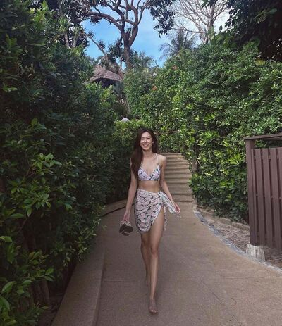
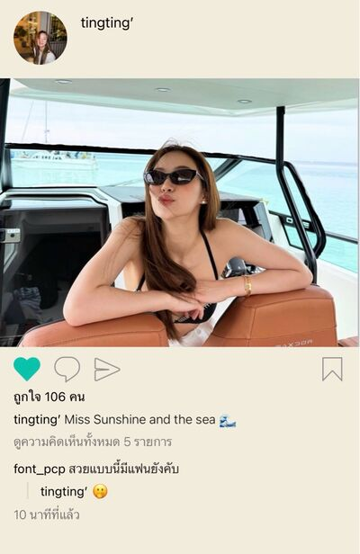
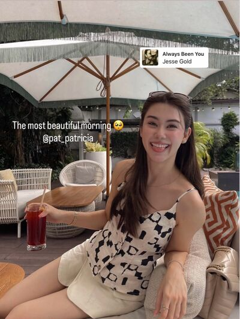
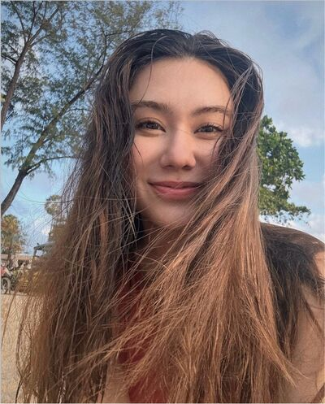
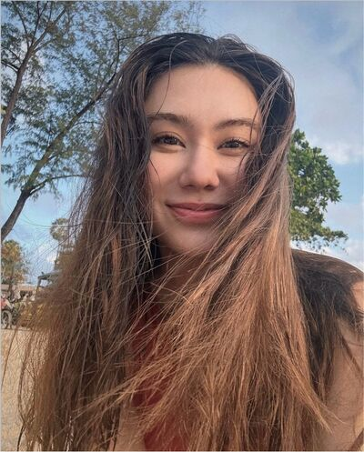

# Never Without You — Chapter 14

English translation · October 23, 26 and 31; November 1 and 6

## Character and alias key

- tt’ — TingTing / Ting / Muay.
- Patricia🌻 — Patricia / Pat / P’Pat.
- SEAN — Sean / P’Sean, Patricia’s former boyfriend.
- khim09 — Khim.
- 🌕 — Chan / Nong Chan / P’Chan, Khim’s partner.
- font_pcp — Font, distinct from the coworker Namfon.
- lalin — Lalin.
- JJAPP — Japp.
- BEll — Bell.
- Namfon — Namfon / P’Fon.
- Duen — P’Duen.
- หม่าม้า — Mom, TingTing’s mother (display name retained).
- ปะป๊า — Dad, TingTing’s father (display name retained).

Mentioned: Claire / P’Claire, Aunt Ying, P’Sita, Khun Jet, and Patricia’s mother.

## Translation notes

P’ is an affectionate or respectful honorific for someone older. Muay is Patricia’s nickname for TingTing. “55555” and its variations are Thai internet laughter. Kub is a playful masculine polite particle. “Final boss,” body-collection jokes, and dramatic death wishes express the friends’ lovesick banter. “Wild-boar breathing” is the coworkers’ nickname for Duen’s loud sighing. “Whipping things up” refers to Patricia amplifying her romantic feelings through fiction. “Unknown Elders” and “Moon and Sun, Sunflower and the Gay Friend (4)” retain the project’s group-name conventions. The source’s cf no cc shorthand is retained (confirmation, no cancellation). One message attributed to 🌕 refers to “P’Chan” teasing; the source name is retained rather than silently corrected.

Original English messages are retained. Seven photographs reference the JSON’s exact filenames, chat_image_002.jpg through chat_image_008.jpg. The first manifest entry, chat_image_001.png, is a call-interface icon: its 00:33:15 duration has been recovered from saved HTML and rendered as a call notice. No picture files have been inspected, downloaded, or translated. Relationship opinions, medical concerns, and threats are fictional character dialogue, not factual assessments or advice.

## Full translated chat transcript

---

October 23rd  
Friday

---

### Patricia🌻

*7:02 p.m.*

**Patricia🌻**  
I’m done.

**Patricia🌻**  
Where are you, Muay? Still in the car?

**tt’**  
In the car.

**Patricia🌻**  
Want to come walk around, or should I come to the car?

**tt’**  
Still with him?

**Patricia🌻**  
Yes.

**Patricia🌻**  
But we’re done talking.

**tt’**  
You just happened to meet. What’s there to talk about?

**tt’**  
Twenty minutes.

**Patricia🌻**  
Finding somewhere to sit took time too. Didn’t talk long. Didn’t want to keep you waiting.

**Patricia🌻**  
Just catching up. Haven’t seen each other for ages.

**tt’**  
Call when you’re done. I’ll pick you up at the entrance.

**Patricia🌻**  
That’s what I’m saying. I’m done.

**tt’**  
But he’s still with you, isn’t he?

**Patricia🌻**  
Yes. Just waiting to see me off with you.

**tt’**  
He needs to see you off too?

**Patricia🌻**  
Or what would you prefer? Want to walk around some more?

**Patricia🌻**  
Tell me. I’ll ask him to leave now.

**tt’**  
Tell him to leave.

**Patricia🌻**  
And will you walk around?

**tt’**  
Up to you.

**Patricia🌻**  
Are you in a bad mood?

**Patricia🌻**  
Low blood sugar, Muay?

**tt’**  
Yeah. I’ll eat all the treats in the car myself.

**tt’**  
Bought you so much.

**Patricia🌻**  
Hey.

**Patricia🌻**  
What’s wrong?

**tt’**  
Has he left?

**Patricia🌻**  
Not yet.

**tt’**  
Then no more talking. Call when he leaves.

**tt’**  
Don’t want to interrupt.

**Patricia🌻**  
Oh.

### prettybabies (3)

*7:14 p.m.*

**tt’**  
I hate every man on earth. Go die, all of you 🤬

**font_pcp**  
Every time you appear. Are you seriously okay, my friend?

**tt’**  
This isn’t a joke. My time to die might really have come.

**font_pcp**  
Why now?

**font_pcp**  
Another man looking at P’Pat?

**tt’**  
No.

**tt’**  
Her ex showed up.

**tt’**  
An ex who seems very important too 😞

**font_pcp**  
Laliiiin. @lalin

**font_pcp**  
Heeeelp.

**font_pcp**  
We need your helppppp

**tt’**  
Talk later. P’Pat’s calling me over.

**font_pcp**  
Oh.

**font_pcp**  
Thought the straight older sister had thrown you aside.

**font_pcp**  
This is “not a joke”?

**font_pcp**  
Seriously?

**font_pcp**  
Tell me when you’re actually dying. You get me here for nothing every time.

**lalin**  
Fooled by the gay kid again.

**font_pcp**  
555555555

### Patricia🌻

*8:13 p.m.*

**Patricia🌻**  
[Call — 00:33:15]

*8:46 p.m.*

**Patricia🌻**  
Sugar bar’s full. Good mood now?

**Patricia🌻**  
Even kept you company on the phone until you got home.

**tt’**  
😠

**Patricia🌻**  
Whaaat?

**Patricia🌻**  
Still? You ate two Krispy Kremes.

**Patricia🌻**  
Bought me three, ate two yourself, and still pulling that face. Just you wait.

**tt’**  
55555555

**tt’**  
You fed me.

**Patricia🌻**  
Your face was sour as a slapped arse.

**tt’**  
🫠

**Patricia🌻**  
Half the bubble tea too.

**Patricia🌻**  
Thought you didn’t like it.

**tt’**  
If you offer it, I’ll eat anything.

**Patricia🌻**  
You didn’t have to.

**tt’**  
You were making it up to me.

**tt’**  
Scared you’d be hurt if I didn’t eat it.

**Patricia🌻**  
Oh, really.

**tt’**  
Isn’t it true? 🤔

**Patricia🌻**  
Yes. I really was making it up to you.

**Patricia🌻**  
Even though I still don’t know why you’re angry with me.

**tt’**  
Going to shower. Full. Sleepy.

**Patricia🌻**  
555555555

**Patricia🌻**  
Running away, you stubborn thing.

**tt’**  
Not stubborn 🙂‍↔️

**Patricia🌻**  
Muay.

**Patricia🌻**  
What are you angry with me about?

**Patricia🌻**  
Could you tell me?

*[Read]*

**Patricia🌻**  
Even a little.

**tt’**  
Just a little, then.

**Patricia🌻**  
Yes. A little is enough.

**tt’**  
I don’t like waiting for people.

**tt’**  
Unless it’s you or your friends, I don’t want to waste time waiting.

**Patricia🌻**  
Okay. I understand.

**Patricia🌻**  
Sorry I made you wait for someone else.

**Patricia🌻**  
And thank you for telling me.

**tt’**  
Sorry for being unreasonable too.

**tt’**  
And thank you for understanding.

**Patricia🌻**  
Why call yourself unreasonable?

**tt’**  
Because it’s not really your fault.

**Patricia🌻**  
It is my fault for asking you to wait.

**Patricia🌻**  
I didn’t think either. He isn’t someone you need to spend your time on.

*[Read]*

**Patricia🌻**  
Gone to shower?

**tt’**  
Not yet.

**Patricia🌻**  
Oh. You went quiet.

**tt’**  
Is he very special to you?

*[Read]*

**tt’**  
Very, right?

**Patricia🌻**  
Why ask about that?

**tt’**  
You mentioned him before.

**Patricia🌻**  
Yes. He was very special to me.

**Patricia🌻**  
Back then.

**Patricia🌻**  
Now I’d say he used to be special.

**Patricia🌻**  
Haven’t seen him for ages. It isn’t the same.

**tt’**  
That’s why you warned me, right?

**tt’**  
Said you didn’t want me regretting things with Claire later.

**tt’**  
Because you regretted letting him slip away?

**Patricia🌻**  
Yes.

**tt’**  
Did it hurt a lot?

**Patricia🌻**  
It did.

**Patricia🌻**  
A lot.

**tt’**  
But you haven’t seen him for ages. No need to see him again, right?

**Patricia🌻**  
555555

**tt’**  
What’s funny? Seeing him again?

**Patricia🌻**  
No. Just laughing.

**Patricia🌻**  
At what you said. Still angry about waiting?

**tt’**  
Yes. Don’t like it.

**Patricia🌻**  
Sooorry.

**tt’**  
I don’t like him. Not you. Don’t apologise for him.

**Patricia🌻**  
You don’t even know him. Don’t dislike him yet.

**tt’**  
Don’t want to know him.

**Patricia🌻**  
Okay. Better stop talking about this.

**tt’**  
I want to talk.

**Patricia🌻**  
What is with you, Muay?

**Patricia🌻**  
Why talk if you don’t like him?

**tt’**  
I want to know about you.

**Patricia🌻**  
Okay. What do you want to know? Ask.

**tt’**  
Why did you break up?

**tt’**  
Was he awful? Did he hurt you?

**Patricia🌻**  
No. Not at all.

**Patricia🌻**  
It wasn’t a bad breakup.

**Patricia🌻**  
I don’t hate him. He doesn’t hate me.

**Patricia🌻**  
We just had to break up.

**tt’**  
Because your mom was ill?

**Patricia🌻**  
Yes.

**tt’**  
Why?

**Patricia🌻**  
I just didn’t have emotional availability to handle any serious relationship back then

**Patricia🌻**  
That’s why we broke up

**Patricia🌻**  
And I was fortunate enough that he understood me

**tt’**  
Does that mean you two still loved each other when you broke up?

**Patricia🌻**  
Well

**Patricia🌻**  
You can say that

*[Read]*

**tt’**  
Do you still love him now?

**Patricia🌻**  
Hmm.

**Patricia🌻**  
Not anymore.

**Patricia🌻**  
It’s been four years, Muay. It isn’t love anymore.

**Patricia🌻**  
More like the goodwill we still have for each other.

**tt’**  
Mm.

**Patricia🌻**  
Well, Muay? Anything else you want to know?

**tt’**  
That’s all.

**Patricia🌻**  
Asking like you’re screening him for me.

**tt’**  
Do I need to?

**tt’**  
Will you start talking to him again?

**Patricia🌻**  
No need. Why screen him?

**tt’**  
You won’t talk to him?

**Patricia🌻**  
I mean I already know him. You don’t need to screen him. 5555

**tt’**  
So you will talk to him?

**Patricia🌻**  
Muay. What are these questions? Don’t know how to answer now.

**tt’**  
Why? Can’t I ask?

**Patricia🌻**  
No, it’s just I don’t know what to say.

**Patricia🌻**  
Don’t know if I will or won’t.

**Patricia🌻**  
I don’t know the future. Don’t want to say anything uncertain.

**tt’**  
I understand.

**tt’**  
Let’s shower.

**Patricia🌻**  
Okay.

### prettybabies (3)

*9:29 p.m.*

**tt’**  
I really want to die now.

**tt’**  
P’Pat seems to love him so much.

**tt’**  
I mean used to love him so much.

**tt’**  
Just thinking it hurts.

**tt’**  
Feels like I’m losing to something, someone. Some bastard I don’t even know.

**tt’**  
Why can’t you be an evil piece of shit? Acting so good, how’s she supposed to hate you, you ex?

**tt’**  
Even kind and understanding when she dumped you.

**tt’**  
Better if they broke up because he hurt her. Broke up still in love? Why break up? Go love each other to death.

**font_pcp**  
It’s real now, Lalin. @lalin

**lalin**  
The straight world’s final boss has arrived.

**lalin**  
Not some young suitor. Not someone new or distant. The favourite ex.

**tt’**  
Favourite.

**tt’**  
Favourite for four years.

**tt’**  
Four years broken up and still wishing each other well.

**tt’**  
Bump into each other and still have to find somewhere to sit and talk.

**tt’**  
If there’s nothing left, can’t you just say hello and move on? What’s there to talk about?

**lalin**  
Four years broken up?

**tt’**  
Yeah. She said they split when her mom got sick.

**tt’**  
Four years ago. Two years after her dad passed away.

**font_pcp**  
Remembers everything.

**tt’**  
But it’s no use.

**tt’**  
Still not her favourite.

**font_pcp**  
There it is.

**font_pcp**  
Gay kid showing symptoms.

**tt’**  
😞

**lalin**  
Why split? When you said they were still in love?

**tt’**  
She said she didn’t have emotional availability when Mom was ill.

**tt’**  
She loves her mom so much. I can picture her having no time or feelings left to share with anyone when Mom was that ill.

**tt’**  
Probably invested her whole life in her mom.

**lalin**  
But a partner supporting you at a time like that might be better.

**tt’**  
Depends on the person, maybe.

**font_pcp**  
Yeah. If my mom was ill, I’d want P’Japp beside me.

**tt’**  
Don’t know. But P’Pat said that’s why.

**tt’**  
And she was lucky her ex understood.

**lalin**  
So only P’Pat wanted the breakup?

**tt’**  
Yes.

**lalin**  
And he agreed to break up nicely, even though I’m guessing he did nothing wrong.

**lalin**  
An oddly strong relationship.

**tt’**  
They split while both still loved each other. What do you think?

**tt’**  
She even said he used to be very special to her.

**font_pcp**  
Wait. They just happened to meet one day. Maybe it’s nothing.

**font_pcp**  
Calm down first, gay kid.

**tt’**  
I’m trying to think that. That’s why I asked if she’d talk to him again.

**lalin**  
Good. Better to ask.

**tt’**  
But she couldn’t even answer. Didn’t say yes or no. Just that the future’s uncertain.

**font_pcp**  
OMG.

**lalin**  
So she’s not closing the door.

**tt’**  
Mm.

**tt’**  
If there’s no potential, you just say no.

**tt’**  
You don’t give a noncommittal answer like that.

**font_pcp**  
Ting’s smart about everything today. Reads every scene perfectly.

**lalin**  
Hit a nerve and achieved enlightenment.

**font_pcp**  
My frieeend.

**tt’**  
Can’t even screen this one.

**tt’**  
She said no need. She knows him already.

**font_pcp**  
Deaaad.

**font_pcp**  
My friend’s deaaad.

**lalin**  
P’Pat’s the definition of a straight girl playing with hearts.

**tt’**  
Done playing with mine. Going back to the ex now?

**lalin**  
Hold on, Ting. Don’t go that far yet.

**lalin**  
The future really is uncertain. Maybe they’ll talk, maybe they won’t.

**lalin**  
But right now, you’re still special to P’Pat. That ex isn’t.

**tt’**  
Mm.

**tt’**  
Have to appreciate the present, right?

**tt’**  
We’re still special to each other now. That’s good enough.

**tt’**  
How lucky am I to have her to appreciate? Okay. Keep going.

**font_pcp**  
What did P’Pat do to my friend? Falls down, gets up so fast.

**lalin**  
So when’s she dying?

**tt’**  
55555

**tt’**  
P’Pat taught me well. Like she knew what I’d face.

### SEAN

*9:41 p.m.*

**SEAN**  
Pat.

**SEAN**  
It really is your old LINE.

**Patricia🌻**  
Told you I hadn’t changed it.

**SEAN**  
I messaged back then and you never read or answered. Thought you’d changed accounts.

**SEAN**  
So when I changed mine, I didn’t add you.

**Patricia🌻**  
I probably had you blocked then, P’Sean.

**SEAN**  
Oh. You blocked me?

**Patricia🌻**  
Yes. I did.

**SEAN**  
Why?

**Patricia🌻**  
Guilt, maybe. Didn’t want to see you.

**Patricia🌻**  
And scared I’d apologise. Didn’t want to start anything again when I was the one who ended it.

**SEAN**  
So you cut me out by blocking me.

**SEAN**  
Such a Pat way to solve things.

**Patricia🌻**  
Taking a dig at me?

**SEAN**  
555555

**SEAN**  
Mom’s well?

**SEAN**  
Haven’t seen her for ages. Four years.

**Patricia🌻**  
There are things to worry about, actually. Her latest checkup still showed risks.

**SEAN**  
Tell me if I can help, Pat.

**SEAN**  
I can. Happy to, too.

**Patricia🌻**  
Thank you.

**Patricia🌻**  
Mom says hello.

**SEAN**  
Tell her I’m single.

**Patricia🌻**  
Don’t think that’s what Mom wants to know.

**SEAN**  
Then I’ll tell you.

**SEAN**  
Been single a while. And I’m glad I bumped into you today.

**SEAN**  
Never thought we’d cross paths again. Wasn’t going at first. Somehow felt like browsing for books.

**SEAN**  
Can I call it the destiny of bookworm lovebirds?

**SEAN**  
It was once our thing, remember?

*[Read]*

**Patricia🌻**  
Doesn’t ring any bell, sorry 🤷🏻‍♀️

**SEAN**  
lol

**SEAN**  
You were the one who said it.

**Patricia🌻**  
You know already. Why ask?

**Patricia🌻**  
How could I forget? I said it myself.

**SEAN**  
Have you forgotten, then,

**SEAN**  
that I never wanted to break up with you?

**Patricia🌻**  
No.

**Patricia🌻**  
And I haven’t forgotten I broke up with you because I wanted to be alone to give Mom my time.

**Patricia🌻**  
It’s still like that now.

### khim09

*10:04 p.m.*

**Patricia🌻**  
Khim.

**Patricia🌻**  
Bumped into P’Sean today.

**khim09**  
Whaaaat?

**khim09**  
How did you meet him?

**Patricia🌻**  
He was at the mall where I had the event.

**khim09**  
How was it?

**khim09**  
How are you? Meeting your ex after all these years.

**Patricia🌻**  
A bit shocked. Didn’t expect to see him.

**Patricia🌻**  
He asked to sit and talk briefly. Seems so much more grown-up.

**khim09**  
Can he get more grown-up? He was always mature.

**khim09**  
Not just his thinking. His body too. So big, sir.

**Patricia🌻**  
555555

**Patricia🌻**  
Mm. Both grown. Thinking and body. So muscular. Who’s he training to fight?

**khim09**  
God. Going for as big as a baby’s head, is he?

**Patricia🌻**  
We don’t follow each other, so I had no idea how he was. Seeing him made it stranger, I guess.

**Patricia🌻**  
Once, I knew this person.

**Patricia🌻**  
Better than anyone.

**khim09**  
But you don’t now.

**Patricia🌻**  
I do. There’s just a gap I don’t know anymore. That’s why it’s strange.

**Patricia🌻**  
Khim, I still feel guilty. Thought I wouldn’t feel anything, but seeing him today, I still do.

**khim09**  
Why feel guilty? Four lifetimes have passed.

**khim09**  
You thought it was the right decision then. Leave it. It’s passed.

**khim09**  
P’Sean even got a new girl. Why overthink it?

**Patricia🌻**  
He’s single now.

*[Read]*

**Patricia🌻**  
He said he’s been single a while.

**khim09**  
Really? He told you?

**Patricia🌻**  
Mm.

**khim09**  
What are you thinking, Pat?

**khim09**  
Want to get back with P’Sean?

**Patricia🌻**  
No. I don’t.

**Patricia🌻**  
Right now, I mean. I told you I’m not looking for a partner. Life fits together so well. I really am content like this.

**Patricia🌻**  
Just feel like a bad person. I neglected him so much then. Gave all his time to Mom.

**khim09**  
Your mom was ill. What could you do?

**khim09**  
But he never blamed you. So understanding. Helped look after Mom too.

**Patricia🌻**  
Mm.

**khim09**  
But a princess like you is obsessed with being good. Felt you couldn’t give him enough or care for him as before. Worried it was unfair, so killed the relationship instead.

**khim09**  
You’re strange, Pat, honestly.

**Patricia🌻**  
5555

**Patricia🌻**  
I couldn’t balance it. And I’d never choose him before Mom.

**Patricia🌻**  
Better not to have him. Let him find someone who can give him a hundred percent.

**Patricia🌻**  
It really is such a me way of solving things.

**khim09**  
But you’re not getting back together, right?

**khim09**  
Met today, and that’s it. Right?

*[Read]*

**khim09**  
Right, Pat?

**Patricia🌻**  
Yeees. Not dating.

**Patricia🌻**  
Why? Don’t want me back with him?

**khim09**  
Quick answer? I do. P’Sean’s good and loves you so much.

**khim09**  
But if I really think deeply and analyse it, no.

**khim09**  
Believe me. Even back together, if the same thing happens again, you’ll leave him anyway.

**Patricia🌻**  
How do you know?

**khim09**  
Is it true?

**Patricia🌻**  
It is.

**khim09**  
Then don’t go back into that cycle.

**khim09**  
Find someone you can’t lose even when you have to give Mom your time.

**Patricia🌻**  
Does someone like that exist?

**khim09**  
Maybe. Maybe not. But it definitely isn’t P’Sean.

**Patricia🌻**  
Ok sounds fair

**khim09**  
And another thing. Thinking of dating? Considered you won’t have time for Ting?

**Patricia🌻**  
55555555

**Patricia🌻**  
Yeah. No time. She’s sulking already.

**khim09**  
Do you know what she’s sulking about?

**Patricia🌻**  
Making her wait while I talked to him.

**khim09**  
Why make her wait? Not her business.

**Patricia🌻**  
At first she said wait, take my time. Found out he was my ex and got angry.

**khim09**  
555555555

**Patricia🌻**  
But I tried to hurry. Didn’t want her waiting long. Felt bad.

**Patricia🌻**  
Picking me up and buying treats. I understand her being annoyed.

**khim09**  
You understand too. You’re something else, Pat.

**Patricia🌻**  
What?

**khim09**  
Try not understanding sometimes. Wonder a little why she’s angry with you.

**Patricia🌻**  
Of course I understand. Made her wait.

**Patricia🌻**  
For my ex, whom she doesn’t even know.

**khim09**  
Okay. Absolutely okay.

**khim09**  
Such a good older sister to Nong Ting. Understands everything.

**Patricia🌻**  
5555555

**Patricia🌻**  
If it’s Ting, I’m ready to understand everything.

**Patricia🌻**  
Khim. P’Sean followed my Instagram.

**khim09**  
Now?

**Patricia🌻**  
Mm.

**khim09**  
Why?

**Patricia🌻**  
Don’t know. How would I?

**khim09**  
Someone on a mission? Seriously?

**Patricia🌻**  
Sounds conceited, but I think he wants to come back.

**khim09**  
Mm. Not exactly beyond my expectations.

**Patricia🌻**  
He still remembered that bookworm lovebirds thing

**Patricia🌻**  
He knew how to tease me, annoying ah

**khim09**  
He didn't know just how to tease you

**khim09**  
He knew you, who you were

**khim09**  
And unfortunately, too well

**Patricia🌻**  
Exactly

### khim09

*10:38 p.m.*

**khim09**  
Ting, still up?

**tt’**  
Yes.

**tt’**  
Can’t sleep.

**khim09**  
Just talked to Pat. About P’Sean.

**khim09**  
Want to know?

**tt’**  
Should I?

**khim09**  
You should.

**tt’**  
Tell me, then.

**tt’**  
But I know why they broke up already.

**khim09**  
She told you?

**tt’**  
Mm. I asked.

**khim09**  
Okay. Skip that.

**khim09**  
Current situation, then. She’s still insisting she doesn’t want a partner.

**khim09**  
Still very focused on her present life. Life with Mom and you.

**khim09**  
That’s good. Your good news.

**tt’**  
🫠

**khim09**  
But bad news number one…

**tt’**  
Number one means there’s a number two?

**tt’**  
Three and four too?

**khim09**  
Two’s enough. 555555

**tt’**  
I want to die.

**khim09**  
Wasn’t too worried at first because P’Sean had a partner. Now I know he’s single.

**tt’**  
And they have to bump into each other while he’s single.

**tt’**  
But I didn’t even think about single or not. Just knowing he’s special to her was enough to dislike him.

**khim09**  
Single means the way’s clear, kid. That’s the bad news.

**tt’**  
Mm. Number two?

**khim09**  
Number two’s important. The beginning of every disaster.

**khim09**  
Pat’s personality. Unavoidable. No way around it if you like someone like her.

**tt’**  
Why?

**khim09**  
She’s sensitive. Easily touched. Know how to reach her and one moment could turn no feelings into feelings.

**khim09**  
And P’Sean knows her well. Every string. How to touch it, pull it, make it tug at her heart.

**khim09**  
If he makes a move, she could let herself fall. Especially with that emotional obligation to him.

**tt’**  
What obligation?

**khim09**  
Still feels guilty for breaking up with him.

**tt’**  
Why feel guilty?

**khim09**  
She’s a good person.

**tt’**  
Doesn’t have to be that good. Try being bad.

**tt’**  
So good she’s becoming a nun?

**khim09**  
555555

**tt’**  
P’Pat exhausts me.

**khim09**  
But you like that she’s good, don’t you?

**tt’**  
Mm. Could she be good only to me? Not so good to everyone else.

**khim09**  
Something you won’t like hearing.

**khim09**  
P’Sean isn’t “everyone else” to Pat.

**tt’**  
P’Khim, I already want to die every hour.

**tt’**  
Don’t make it every second.

**khim09**  
So you know what you’re facing.

**khim09**  
But don’t stress too much. Like I said, her focus is more on you now.

**khim09**  
Only thing to do: don’t make her want a partner. Take all her time. Not one second left for P’Sean.

**khim09**  
He’s following her again. Get yourself into her Instagram lots. Let him see her life isn’t empty, and who’s keeping it full.

**khim09**  
If he knows how much you matter to her, he won’t dare push much against you.

**khim09**  
Because anyone important to Pat is important to him too.

**tt’**  
Weirdly negative positive energy, P’Khim. Feels good, but dangerous.

**tt’**  
Like I have a chance to win, but I’ll lose anyway.

**khim09**  
5555555

**khim09**  
I’m rooting for you with everything I’ve got.

**khim09**  
Blocking P’Sean’s scenes too. Want my friend to catch the gay bug already.

**tt’**  
55555555

**tt’**  
Thank you. Really. I know you’re helping me.

**khim09**  
Oh, one more tip. Win her dear mom over lots.

**khim09**  
When you bought her supplements, Pat told me she was overwhelmed.

**khim09**  
Number one devoted daughter.

**tt’**  
She really is sensitive.

**khim09**  
Even sleeping at your place, she messaged me that she missed Mom.

**tt’**  
5555555

**tt’**  
She really is lovely. Makes me unable to stop loving her. Don’t want to stop either.

**khim09**  
Hey. Beach trip? P’Sean’s probably on a mission now. Better get Pat away first.

**khim09**  
Mom loves the sea. Hasn’t been in ages.

**khim09**  
Interested? Plan it in our four-person group. I’ll drag Chan along.

**tt’**  
Yes. Let’s go.

**khim09**  
But persuading her to go is your homework. 555555

**tt’**  
Okay. Got it.

**khim09**  
I’ll secretly work the back channel with her dear mom too. If Mom wants to go, Pat won’t dare refuse.

**tt’**  
Love you, P’Khim.

**khim09**  
Be her privilege for a long time, okay?

**khim09**  
Honestly, I love Pat’s life with you in it.

**tt’**  
🫠

---

October 26th  
Monday

---

### Unknown Elders (5)

*9:17 a.m.*

**BEll**  
P’Duen’s really stressed lately.

**BEll**  
New project’s a mess. It’s a big one.

**JJAPP**  
Thought so. Wild-boar breathing first thing in the morning.

**BEll**  
No peace all day today, guaranteed.

**tt’**  
Want to stuff something up her nose.

**tt’**  
Went to ask about work and she snapped at me.

**tt’**  
Hey. I thought I was the only person in the world allowed to throw a fit.

**Namfon**  
55555555

**Namfon**  
That’s P’Duen. I’ve had plenty of it.

**tt’**  
🤬

**Patricia🌻**  
Did you snap back, Muay?

**JJAPP**  
Here we go. Police raid.

**tt’**  
No 😠

**tt’**  
I held it together 😤

**tt’**  
And said yes, of course 🙂‍↕️

**Patricia🌻**  
5555555

**Patricia🌻**  
Good girl 🫳

**tt’**  
Can a good girl ask for a reward? 🥺

**Patricia🌻**  
What is it? Ask.

**JJAPP**  
What? Care Bear couple getting sweet in the group?

**JJAPP**  
We tease and you say we’re too serious. Look what you do.

**BEll**  
Yeah. This auntie doesn’t understand.

**Patricia🌻**  
We can talk privately.

**tt’**  
🫪

**JJAPP**  
Neither denying nor agreeing. P’Pat’s a pro.

**BEll**  
5555555555

### Patricia🌻

*9:28 a.m.*

**Patricia🌻**  
Well? What do you want?

**tt’**  
Let’s go to the beach.

**Patricia🌻**  
Where did the beach come from, Muay?

**tt’**  
Secretly found out your mom likes the sea. I want to take her.

**tt’**  
For a break. You haven’t been in ages either, right?

**Patricia🌻**  
Khim told you? That “secretly found out”?

**tt’**  
Yes. 55555

**Patricia🌻**  
Wondered where else you’d find out.

**Patricia🌻**  
You want to go?

**tt’**  
Of course.

**tt’**  
Your mom wants to go. P’Khim and P’Chan too. Only waiting for your yes. Everyone else is ready.

**Patricia🌻**  
Wait. Seriously?

**tt’**  
Seriously.

**Patricia🌻**  
When did you discuss this?

**tt’**  
Over the weekend.

**Patricia🌻**  
Khim’s the mastermind, right?

**tt’**  
🫢

**Patricia🌻**  
Muay. Talking to Khim without telling me now.

**tt’**  
Whaaat? I want to go together. Ask you first and you’ll say no, no.

**tt’**  
Your mom wants to go. Call and ask if you don’t believe me.

**tt’**  
Just say yes and I’ll book the hotel.

**Patricia🌻**  
Muaaay.

**tt’**  
Pleeease.

**tt’**  
This weekend.

**Patricia🌻**  
Let me talk to Mom first.

**tt’**  
Okay. Ask her.

**Patricia🌻**  
What about you? Asked your parents?

**tt’**  
All done. No problem.

**Patricia🌻**  
Fast, Muay. It really is only me left.

**tt’**  
555555555

**tt’**  
All of it was just waiting for the right moment to ask you.

**Patricia🌻**  
So you made a show of holding it together.

**Patricia🌻**  
P’Duen snaps and you instantly keep your cool.

**tt’**  
Yes 🙂‍↕️

**Patricia🌻**  
Just you wait.

**tt’**  
Whyyy?

**Patricia🌻**  
Scheming now. Got tricks.

**tt’**  
555555

**Patricia🌻**  
I’ll talk to Mom. She probably does want to go. It’s been so long.

**tt’**  
Tell me. I’ll handle the rest.

**Patricia🌻**  
Okay. Thank you, Muay.

**tt’**  
My pleasure 🤍

### Moon and Sun, Sunflower and the Gay Friend (4)

*12:07 p.m.*

**tt’**  
All booked, everyone. @All

**Patricia🌻**  
Booked during work too.

**tt’**  
5555555555

**khim09**  
cf no cc na ja

**Patricia🌻**  
You idiot. Still talking.

**khim09**  
Oh, Ting, look how she insults me. Is this really your beautiful, kind older sister?

**Patricia🌻**  
Don’t need to be kind to you. Taught Ting to be as crafty as you.

**khim09**  
Taught nothing. Comes naturally to the kid.

**tt’**  
55555555555

**Patricia🌻**  
Muay.

**tt’**  
🫠

**khim09**  
Scolding again. Why scold her?

**khim09**  
Your dear mom wants to go too.

**Patricia🌻**  
😭

**🌕**  
P’Paaat. Let’s go on a trip.

**tt’**  
Yes. Let’s go.

**🌕**  
P’Chan’s just teasing. Don’t mind it.

**khim09**  
Do you mind me, then?

*[Read by 3]*

**khim09**  
Chan. Answer.

**Patricia🌻**  
5555555

**khim09**  
Pat, what are you laughing at? You bastard.

**Patricia🌻**  
You. Serves you right.

**🌕**  
Got revenge for you. @Patricia🌻

**khim09**  
Oh, darling. Always embarrassing me in front of my friend.

**tt’**  
Truly entertaining.

**khim09**  
See? Told you.

**khim09**  
Waiting for you to officially join the gang, kid 🤜

**tt’**  
🤛 Yes, P’.

**Patricia🌻**  
Sigh.

### SEAN

*8:07 p.m.*

**SEAN**  
Pat, free this Saturday?

**SEAN**  
There’s an exhibition I’m interested in. Want to invite you.

**Patricia🌻**  
Not free.

**SEAN**  
Didn’t even think.

**SEAN**  
Asking days in advance, you know.

**Patricia🌻**  
Because I’m genuinely busy. Not pretending to turn you down.

**SEAN**  
That’s a relief. Thought you’d shut the door.

**Patricia🌻**  
I haven’t opened it either.

**SEAN**  
But haven’t chased me away.

**SEAN**  
Will any moment if I don’t stop.

**Patricia🌻**  
55555

**Patricia🌻**  
Always joking to cover yourself.

**SEAN**  
Next Saturday, then? Free?

**Patricia🌻**  
Not free.

**SEAN**  
Now you’re teasing.

**Patricia🌻**  
555555

**SEAN**  
Where are you going this Saturday?

**Patricia🌻**  
Pattaya.

**Patricia🌻**  
Taking Mom to the beach.

**SEAN**  
Oh, good. She can have a break.

**Patricia🌻**  
Yes. Last time she went was probably with you. So long ago.

**SEAN**  

**SEAN**  
This time?

**Patricia🌻**  
Yes.

**Patricia🌻**  
Why keep that?

**SEAN**  
You probably know why.

**SEAN**  
It doesn’t just capture you. My feelings are in it too.

**SEAN**  
Our memories.

*[Read]*

**SEAN**  
You can make me break up with you. Can’t make me delete your photos. You know that, right?

**Patricia🌻**  
Keep it if you want. I’m not saying anything.

**SEAN**  
The sunset we waited for was beautiful, wasn’t it?

**Patricia🌻**  
Yes. So beautiful.

**SEAN**  
Makes me want to lie reading on the beach. Somewhere quiet and peaceful.

**Patricia🌻**  
Let me go first, then.

**SEAN**  
How many books are you taking?

**Patricia🌻**  
One’s enough. Only two days.

**SEAN**  
55555

**SEAN**  
Just you two?

**Patricia🌻**  
No. Khim and Chan, and a younger friend I’m close to.

**SEAN**  
Okay. Have fun.

**Patricia🌻**  
Thank you.

---

October 31st  
Saturday

---

### Patricia🌻

*7:14 a.m.*

**Patricia🌻**  
Morningg

**tt’**  
Morning kubbb

**Patricia🌻**  
Up early.

**tt’**  
Excited. 555555

**tt’**  
Scared I’d be late picking you up too.

**Patricia🌻**  
Mom’s excited too. All ready and waiting for you.

**tt’**  
Whaaat?

**tt’**  
Ready already?

**Patricia🌻**  
555555

**tt’**  
Better hurry and shower.

**Patricia🌻**  
No rush. We can wait. Come at the agreed time.

**tt’**  
Have to hurry. Don’t want you waiting long. We can have breakfast too.

**tt’**  
Going now. See you soon.

**Patricia🌻**  
Okaaay, kub.

### Unknown Elders (5)

*7:56 a.m.*

**BEll**  
Latest news. P’Duen’s furious. Discussed work till late last night.

**BEll**  
Watch yourselves if she messages.

**Namfon**  
😭

*8:15 a.m.*

**tt’**  
Even on a day off, have to watch out for the wild boar 😤

**JJAPP**  
Careful, Muay. P’Pat’s bound to draw the short straw.

**tt’**  
Bring it on.

**BEll**  
Talks to Pat. Gets told off by Muay.

**JJAPP**  
55555555555

**Patricia🌻**  
You should be on your way now.

**BEll**  
Where are you going?

**tt’**  
Pattayaaa.

**BEll**  
Honeymoon?

**tt’**  
🫪

**Patricia🌻**  
Still claiming it. There are five of us. What honeymoon?

**tt’**  
555555555

**JJAPP**  
You look happy, Muay.

**tt’**  
Extremely 🙂‍↕️

### Family 🏠 (3)

*9:16 a.m.*

**tt’**  

**tt’**  
Reporting in. With P’Pat and her mom.

**หม่าม้า**  
You’re sitting in front?

**tt’**  
Yes 🙂‍↕️

**หม่าม้า**  
Why not give the elder the front seat, sweetheart?

**tt’**  
I have to help P’Pat navigate.

**tt’**  
When it’s the three of us, I always sit beside her.

**หม่าม้า**  
If she’s okay with it, it’s fine.

**tt’**  
I asked P’Pat before, Mom. She said it was okay 🫠

**หม่าม้า**  
Okay, then. Just worried it might look rude.

**ปะป๊า**  
Lost all your points.

**tt’**  
Daaad.

**ปะป๊า**  
🤣

**หม่าม้า**  
And sharing a room with her and her mom, don’t do anything inappropriate.

**tt’**  
What inappropriate things, Mom??? 🫪🫪🫪🫪🫪

**หม่าม้า**  
Getting the room dirty or making a mess. What were you thinking, little girl?

**tt’**  
Oh, Mom. I’m so clean. What did you expect me to think, saying it like that? 😤

**หม่าม้า**  
All right 😂

### khim09

*2:13 p.m.*

**tt’**  
P’Khim, she’s changed outfits. I want to die 🫪

**khim09**  
5555555555555

**khim09**  
Congratulations, kid. Finally seeing Pat’s true beautiful-older-sister form.

### prettybabies (3)

*2:47 p.m.*

**tt’**  
I’m going to die.

**tt’**  

**tt’**  
🫪🫠🫪🫠🫪🫠🫪🫠🫪🫠

**font_pcp**  
Beautiful older sister bullying the gay kid again.

**lalin**  
P’Pat’s legs are longer than my future.

**font_pcp**  
Lalin. 555555555555

**tt’**  
So beautiful. I want to die 🫠

**tt’**  
Going on a boat soon. I booked everything. So capable 🙂‍↕️

**font_pcp**  
Young Miss Ting takes such thorough care of her.

**tt’**  
Exactly. I’m from a good family too, you know.

**lalin**  
And is that ex from a good family? Know your enemy’s background yet, Ting?

**tt’**  
Don’t know. Don’t want to.

**tt’**  
Haven’t even seen a photo.

**font_pcp**  
Better not show her, Lalin.

**lalin**  
555555555

### B2B marketing (6)

*3:29 p.m.*

**Duen**  
I need the updated strategy plan and timeline urgently, Pat. I have to discuss it further. @Patricia🌻

### Unknown Elders (5)

*3:33 p.m.*

**BEll**  
There it is. Work’s here. @Patricia🌻

*3:41 p.m.*

**JJAPP**  
Probably hasn’t seen it.

**JJAPP**  
Muay, you there? @tt’

**BEll**  
Probably neither of them’s checking.

**JJAPP**  
And P’Duen demands urgent work on Saturday.

**BEll**  
Probably only just confirmed it. But how’s anyone supposed to know when she’ll reach an agreement?

**BEll**  
Can’t expect us on standby all weekend, right?

**JJAPP**  
Of course not. But what can we do?

**Namfon**  
Both really disappeared.

**JJAPP**  
Probably on a boat. Asked my girlfriend.

**BEll**  
Paaaaat.

### IG: tingting’

*3:58 p.m.*

### Unknown Elders (5)

*4:02 p.m.*

**BEll**  
Really on a boat. Ting just posted. 5555555555

**Namfon**  
P’Duen’s chased her twice now.

**JJAPP**  
I’ll call. Didn’t want to at first. Knew Muay would blow up.

**JJAPP**  
But if I don’t, P’Pat gets blown up at instead.

**BEll**  
Yeah. Call.

### B2B marketing (6)

*4:03 p.m.*

**Duen**  
Pat, have you acknowledged this? @Patricia🌻

*4:06 p.m.*

**Patricia🌻**  
Sorry, P’Duen. I’m occupied right now. Could I send it by seven this evening?

**Duen**  
I need it now. Told you it’s urgent.

**Patricia🌻**  
I don’t have my laptop with me.

**Duen**  
And that has to be my problem, Pat?

**Duen**  
Khun Jet and I discussed this until midnight. Still working today because everyone understands it’s urgent. Maybe you don’t understand.

**Duen**  
There’s only one of me. Two hands. Want me to do everything?

**Duen**  
Are you doing the work or not? It’s a day off, so I even spared you a phone call.

*[Read by 5]*

**tt’**  
P’Pat and I are on a boat in the middle of the sea. We genuinely can’t find equipment to work on. Didn’t expect to carry a laptop everywhere on a day off, even onto a boat. My apologies, P’Duen.

**tt’**  
And everything you just typed—don’t regret it later 🙂

*[Read by 5]*

### Patricia🌻

*5:36 p.m.*

**Patricia🌻**  
Muay, finished talking?

*5:47 p.m.*

**tt’**  
Yes. In P’Khim’s room, right?

**Patricia🌻**  
Yes.

**tt’**  
Let’s take pictures.

**Patricia🌻**  
Still taking pictures?

**tt’**  
Of course. You said you liked sunset light.

**tt’**  
Come on. I’ll come get you.

**Patricia🌻**  
Okay.

### Family 🏠 (3)

*6:10 p.m.*

**ปะป๊า**  
Call me back when you’re free.

*6:14 p.m.*

**tt’**  
Not free yet.

**ปะป๊า**  
TingTing.

**tt’**  
Want to discuss P’Duen? I’ll type it right now.

**tt’**  
I don’t like her talking to P’Pat like that.

**tt’**  
If she thinks she can treat people however she wants, I can treat her however I want too.

**tt’**  
I don’t need to follow any rules. I don’t care.

**tt’**  
It’s not just today that makes me reject her. She’s not fit to lead a team.

**tt’**  
If you want to scold me, save it for when I’m home. Told Aunt Ying everything already. Call her for the details.

**tt’**  
Thank you. And I hope you’ll listen to the voice of a little employee.

**ปะป๊า**  
A little employee? Ease up, you little menace.

**ปะป๊า**  
What little employee dares do what you did?

**tt’**  
I dared because I know I’m not one 🙃

### IG: pat_patricia

*7:18 p.m.*

SEAN liked your photo

### khim09

*8:24 p.m.*

**khim09**  
Your dear mom asleep yet?

**tt’**  
Nearly. P’Pat’s about to turn off the TV. Probably tired.

**khim09**  
Want to keep going in my room?

**tt’**  
Sure. But P’Pat will probably read in bed. Heard her mention it.

**khim09**  
Leave her. Let her lie there whipping things up.

**tt’**  
55555555

**khim09**  
You were fierce today. Pat went still. Scared of you.

**khim09**  
Normally she’d scold you, right? Silent this time.

**tt’**  
I was furious. Thought if she told me to calm down, I’d snap at her for sure.

**tt’**  
Like, not now.

**khim09**  
She could tell. That’s why she stayed quiet. 555555

**tt’**  
Still don’t know what I’ll face when I get home.

**tt’**  
But I’m really annoyed. Someone had to put her in her place.

**khim09**  
5555555

**khim09**  
Been hearing about that woman ages. Pat always complains about her.

**khim09**  
She really needed it.

**tt’**  
P’Pat’s worried Dad will scold me. Don’t care. Let him.

**tt’**  
I know I did what I should. She didn’t deserve words like that.

**khim09**  
Take my friend as your wife. I give her to you.

**tt’**  
55555555

**khim09**  
But sleeping with her dear mom tonight, right?

**tt’**  
Yes. I’m alone. 55555

**khim09**  
As expected.

**khim09**  
Come if you want another drink. Sit and talk with Chan and me.

**tt’**  
Sure.

### Patricia🌻

*11:14 p.m.*

**Patricia🌻**  
Muay, still not back?

**tt’**  
Not yet. Talking to P’Khim and P’Chan’s fun.

**Patricia🌻**  
It’s late.

**Patricia🌻**  
Drinking a lot?

**tt’**  
Not much. Sleep first. Don’t wait. It’s okay.

**Patricia🌻**  
Will you really be okay over P’Duen?

**tt’**  
It’s fine. Worst case, unemployed.

**Patricia🌻**  
Muaaay.

**tt’**  
55555555

**Patricia🌻**  
Not funny. I’m stressed.

**tt’**  
Stressed about what?

**Patricia🌻**  
If you really lose your job,

**Patricia🌻**  
we won’t see each other.

**tt’**  
🥺

**Patricia🌻**  
Puppy eyes again.

**tt’**  
Want to see me?

**Patricia🌻**  
We’re used to seeing each other every day.

**tt’**  
I won’t lose my job.

**Patricia🌻**  
You’re sure?

khim09: If you’re going to talk to Ting this much, come talk in my room.

**Patricia🌻**  
Tell Khim to mind her own business.

**tt’**  
5555555555555555

**tt’**  
She says you’re not gentle at all.

**Patricia🌻**  
Why be gentle with you, you bitch?

**Patricia🌻**  
And you’re sure you won’t lose your job?

**tt’**  
Talked to Aunt Ying. Actually got told off a little. Shouldn’t have spoken myself. Better to go straight to her privately.

**tt’**  
But she said she’d find a way to move P’Duen into work that suits her skills. Without much communication with people.

**tt’**  
She’s genuinely capable, but with communication skills like that, better to work alone. Good for her and the company. Win-win.

**Patricia🌻**  
Move her to another job?

**tt’**  
Yes. Aunt Ying was already looking for another role when we met that day. Obviously she shouldn’t lead anyone.

**tt’**  
I just sped things up. Now it’s more about what Dad will do with me.

**tt’**  
But I’m his only daughter. He’s kind to me. I knew that, so I dared.

**Patricia🌻**  
Sigh.

**Patricia🌻**  
So stubborn.

**tt’**  
I don’t like it. Look what she said to you.

**tt’**  
Who is she to talk to you like that? All I want is to say good things to you. Someone like Duen deserves execution 😡

**Patricia🌻**  
🥺🫳

**Patricia🌻**  
Doing everything for me, spoiling me completely. A super privilege now?

**tt’**  
Yes. Anything. Everything for you 🙂‍↕️

**Patricia🌻**  
555555

**Patricia🌻**  
Don’t drink too much. Come back to bed soon.

**Patricia🌻**  
Have Chan walk you back. Or call me to fetch you if you’re drunk.

**tt’**  
Coming back soon. Not that drunk. Sleep, P’Pat.

**tt’**  
Good night beautiful 🤍

**Patricia🌻**  
Nite ka 🤍

---

November 1st  
Sunday

---

### IG: tingting’

IG: khim09: Your girlfriend’s beautiful, Ting.

IG: tingting’: P’Khim, stop!!! This is getting a little too… you know 🫪🫪🫪🫪🫪🫪

### Unknown Elders (5)

*9:46 a.m.*

**JJAPP**  
Muay, how did yesterday end?

**tt’**  
Better wait for the grown-ups to discuss it, P’Japp. I’m nearly getting beheaded as it is.

**JJAPP**  
5555555555

**tt’**  
P’Pat just whispered, “Only just realised the grown-ups need to talk?”

**tt’**  
But yesterday she wouldn’t speak. Sat completely silent.

**Patricia🌻**  
Don’t expose me, Muay.

**tt’**  
5555555555

**BEll**  
How will we face P’Duen? Don’t want Monday to come.

**BEll**  
Bound to be awkward.

**tt’**  
Bear with it. She’ll be gone soon.

**BEll**  
Gone? Where?

**Namfon**  
Spoilers, Ting?

**tt’**  
🫢

**JJAPP**  
And you told us to wait for the grown-ups.

**tt’**  
555555555

**BEll**  
Let’s celebrate, everyone. We’re free.

**JJAPP**  
Karaoke? Want to be a great singer.

**tt’**  
I’ll be the out-of-tune one.

**JJAPP**  
5555555

**Namfon**  
Let’s go.

**Namfon**  
We haven’t gone anywhere together since Ting joined.

**JJAPP**  
Make sure you drag P’Pat along, Muay. She likes escaping.

**Patricia🌻**  
Japp, you little—

**JJAPP**  
555555

**tt’**  
Of course. Trust me, P’ 🫡

### Patricia🌻

*4:44 p.m.*

**Patricia🌻**  
Tell me when you’re home, Muay.

*5:39 p.m.*

**tt’**  
I’m hooome.

**tt’**  

**tt’**  
Where did this picture come from? 🫪

**Patricia🌻**  
Only just saw it?

**tt’**  
Yes.

**Patricia🌻**  
Wow, Muay.

**tt’**  
Only just went through the photos. 55555555

**tt’**  
How did you take it on there?

**Patricia🌻**  
You left your phone with me. Took a picture for fun.

**Patricia🌻**  
Keep it. Don’t delete it.

**tt’**  
Wasn’t going to 🫪

**Patricia🌻**  
5555555

**Patricia🌻**  
Thank you for inviting us to the beach. Mom came back so refreshed.

**tt’**  
And you?

**Patricia🌻**  
So refreshed.

**tt’**  
5555555

**tt’**  
Let’s go again. Often.

**Patricia🌻**  
Yes. Didn’t realise my body needed nature this much.

**Patricia🌻**  
But going there made me realise how much.

**tt’**  
See? You were so hesitant at first. Nearly didn’t go.

**Patricia🌻**  
Can I apologise?

**tt’**  
5555555

**Patricia🌻**  
So karaoke with them?

**tt’**  
Of course.

**tt’**  
Don’t you want to?

**Patricia🌻**  
Can’t be bothered 😭

**tt’**  
No wonder P’Japp put her hopes in me.

**Patricia🌻**  
5555555

**tt’**  
Come on. Let’s go. Fun. Everyone’s been stressed with P’Duen for so long. Let off steam.

**Patricia🌻**  
Will you drink again?

**tt’**  
Am I allowed? 🫪

**Patricia🌻**  
This lot’s trouble. All heavy drinkers.

**tt’**  
Then I’m drinking 🙂‍↕️

**Patricia🌻**  
Who’s driving?

**tt’**  
You. Stay at my house.

**Patricia🌻**  
Not again. Just got back from the beach.

**tt’**  
🫠

**Patricia🌻**  
Have P’Sita drop you off Friday, then pick you up.

**Patricia🌻**  
I can get home myself.

**tt’**  
Have P’Sita take you home too, then.

**Patricia🌻**  
No. Don’t want to trouble her.

**tt’**  
It’s fine.

**Patricia🌻**  
No.

**Patricia🌻**  
That’s the deal. If you’re drinking, don’t drive there. Otherwise I’m not coming.

**tt’**  
Fine, fine 🫠

---

November 6th  
Friday

---

### prettybabies (3)

*6:13 p.m.*

**font_pcp**  
Was going to tell Ting to stop P’Japp.

**font_pcp**  
On second thought, better have P’Japp stop Ting drinking too much.

**lalin**  
5555555

**font_pcp**  
Still laughing. Barely started at the family company and she’s already eliminated someone.

**font_pcp**  
Only Ting could do it.

**lalin**  
Yeah. P’Claire told me too. She was laughing at Ting.

**lalin**  
Apparently Dad wasn’t pleased, but couldn’t help laughing at his daughter’s mischief. 555555

**font_pcp**  
Her parents still talk to P’Claire regularly?

**lalin**  
Yes. Normally. Talking about Ting.

**tt’**  
😠

**tt’**  
I did a good deed for the team.

**tt’**  
That’s why we’re having karaoke today. See? Everyone’s happy. Everyone loves me now.

**lalin**  
Does everyone include P’Pat?

**font_pcp**  
Lalin, don’t devastate the gay kid.

**tt’**  
Go die 🤬

**lalin**  
Hey, just asking. 5555555

**tt’**  
Does older-sister love count? 🫠

**font_pcp**  
55555555

**lalin**  
Nothing developed on the beach trip?

**tt’**  
Everything developed except our status. Let’s put it that way.

**font_pcp**  
I’m dead. Dying for my friend.

**lalin**  
555555555

**tt’**  
I feel so much closer to her mom. P’Khim and P’Chan too.

**tt’**  
It’s all so good. Like I really get to be in her life.

**tt’**  
And we’re so much closer. P’Pat’s affectionate. Lots of touching lately. I die every second 🫪

**lalin**  
Touching how?

**tt’**  
Linking arms, holding hands, head pats. Everything. Happens naturally. Nothing forced.

**lalin**  
Girlfriends as in girl friends.

**font_pcp**  
My friend never gets to enjoy it uninterrupted.

**tt’**  
Don’t care. Let me continue.

**font_pcp**  
5555555

**tt’**  
When she eats something good, she’ll spoon some up and feed me a taste.

**tt’**  
Sometimes P’Khim gives me teasing looks.

**font_pcp**  
Everyone knows. But P’Pat says she feels nothing.

**tt’**  
Right?

**lalin**  
And my friend still never actually dies.

**font_pcp**  
Been waiting to cremate her. Fire’s gone out a hundred times.

**tt’**  
Don’t want to die yet. Want to keep loving her 🫠

**lalin**  
Did the final boss really arrive? Doesn’t seem to have shaken anything.

**tt’**  
Don’t summon him 🤬

**font_pcp**  
55555555

### JJAPP

*9:26 p.m.*

**JJAPP**  
Baby. Think I’ve caused trouble.

**JJAPP**  
Ting’s arguing with P’Pat right now.

**JJAPP**  
Was tipsy and having fun. Sober now.

**font_pcp**  
What happened? What did you do, P’Japp?

**JJAPP**  
Just posted a story and tagged the place 😭

**font_pcp**  
Then? Hurry up.

**JJAPP**  
Guessing P’Pat’s ex saw her repost my story and knew we were doing karaoke here.

**JJAPP**  
So he’s coming to drive her home. Ting refuses. Wants her driver to take her.

**JJAPP**  
But Ting’s fairly drunk. P’Pat thinks she’s being drunk and whiny, so she’s scolding her as usual. Telling her not to be stubborn.

**JJAPP**  
But I think Ting just doesn’t want the ex picking her up. That’s why she’s pushing back harder.

**font_pcp**  
Yes. Exactly.

**JJAPP**  
Muay’s about to cry.

**font_pcp**  
Oh my goood.

**font_pcp**  
What happened next?

**font_pcp**  
P’Jaaap.

*9:43 p.m.*

**JJAPP**  
They’ve left.

**font_pcp**  
What? How did it end?

**font_pcp**  
Who did P’Pat go with?

**JJAPP**  
With Ting.

**font_pcp**  
That’s a relief.

**JJAPP**  
But her ex picked them up. Taking Ting home first, then P’Pat.

**font_pcp**  
Whaaaaat?

**JJAPP**  
5555555555

**font_pcp**  
How did it end up there? What is this?

**JJAPP**  
They argued until the ex arrived. Ting said send him away. P’Pat was confused, and felt bad troubling him.

**JJAPP**  
When P’Pat got stricter, Muay gave in. Otherwise they’d stand arguing forever and never leave.

**font_pcp**  
Feels bad troubling her ex. Right. Sure.

**font_pcp**  
How does Ting survive? Plays with my friend’s heart for three months, now says she feels bad troubling her ex. What are you saying?

**JJAPP**  
I think she feels bad because that’s her personality. Nothing to do with him being her ex.

**JJAPP**  
Car’s already waiting. Can’t send him away.

**font_pcp**  
You can if you care about Ting’s feelings.

**JJAPP**  
She doesn’t know Ting likes her.

**font_pcp**  
Then realise already, before my friend actually dies!!!

### prettybabies (3)

*9:57 p.m.*

**font_pcp**  
Lalin, brace for a wave of sorrow. Going to hit you in the face. @lalin

**lalin**  
Why?

**font_pcp**  
Ting’s with P’Pat and her ex. They’re taking her home.

**lalin**  
Holy shit!!!

**lalin**  
Seriously speaking of the devil.

**font_pcp**  
Exactly. That’s why Ting said don’t summon him!!!

*10:33 p.m.*

**tt’**  
I don’t like it at all.

**tt’**  
I don’t like P’Pat at all.

**font_pcp**  
Don’t know how to answer when she’s like this. Help. @lalin

**lalin**  
Ting. Breathe. Count one to five. Slowly collect yourself.

**tt’**  
I don’t like it at all.

**tt’**  
Wish I were a man.

**tt’**  
Maybe things would be easier.

**font_pcp**  
No, no. Ting. Stop.

**font_pcp**  
We’re gay. That’s the best thing in our lives. Stop right now.

**tt’**  
Don’t want to like a straight girl anymore.

**tt’**  
Am I really special, you guys?

**tt’**  
To P’Pat, I’m special.

**tt’**  
But if her ex is special too,

**tt’**  
does that mean I’m really special?

### khim09

*10:41 p.m.*

**tt’**  
P’Khim, I met her ex.

**khim09**  
Hey. How?

**tt’**  
He picked us up today. Took me home too.

**tt’**  
Now he’s taking her home.

**khim09**  
P’Sean, your gentleman timing is terrible.

**tt’**  
P’Pat scolded me too. Just for asking her to sit in the back with me.

**tt’**  
She said it looked bad. Her ex isn’t a chauffeur.

**khim09**  
Pat was just being Pat.

**khim09**  
I want to put my foot on my forehead.

**tt’**  
Why? Can’t her ex sit driving alone in front? Just have P’Pat sit in the back with me.

**khim09**  
What did P’Sean say?

**tt’**  
He said it was okay. She could sit with me.

**khim09**  
Yeah. Pat overcomplicates everything. Always thinking for other people.

**tt’**  
Won’t she think for me? About how I feel?

**tt’**  
When I spoke, she still had to look at her ex to ask if it was okay.

**tt’**  
I’m the one who’s not okay. Why won’t she look at me?

**khim09**  
Oh, Ting.

**tt’**  
I don’t like it, P’Khim.

**tt’**  
I don’t like P’Pat at all.

**tt’**  
Like in her eyes,

**tt’**  
I’m not the only one anymore.

.

.

.

## Author’s note

Thank you for all the popularity you’ve given this story. It means so, so much. But I need to disappear for work now. I have a family to look after. See you when work’s done. If you miss PatTing, reread for now 🙏😭
