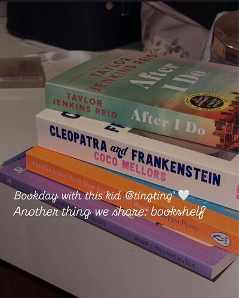
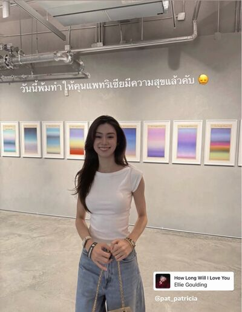
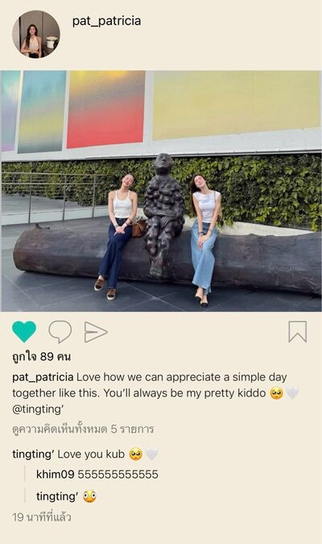

# Never Without You — Chapter 15

English translation · November 6–7 and 9

## Character and alias key

- tt’ — TingTing / Ting / Muay.
- Patricia🌻 — Patricia / Pat / P’Pat.
- khim09 — Khim.
- SEAN — Sean / P’Sean, Patricia’s former boyfriend.
- font_pcp — Font, distinct from the coworker Namfon.
- lalin — Lalin.
- BEll — Bell.
- JJAPP — Japp.
- Namfon — Namfon / P’Fon.

Mentioned: Claire / P’Claire, P’Duen, P’Sita, Aunt Ying, P’Toey, Patricia’s mother, and TingTing’s parents.

## Translation notes

P’ is an affectionate or respectful honorific for someone older. Muay is Patricia’s nickname for TingTing. “55555” and its variations are Thai internet laughter. Kub/krub and ka are polite particles used affectionately or playfully in the existing English messages. The recurring “pull yourself together” cue refers to controlling one’s temper. “Whipping up feelings” is the friends’ joke about Patricia amplifying emotions through fiction. The monkey reaction is a playful image of being overwhelmed with shy excitement. The Care Bear/caring-heart exchange preserves the coworkers’ wordplay. “Unknown Elders” follows the project’s established group-name convention.

Original English messages are retained, including the source’s short Wicked song quotations and playful spellings. The theatre references and characters’ feelings are translated as supplied, not checked against real-world events. Three pictures reference chat_image_001.jpg through chat_image_003.jpg in your local img folder. Image contents have not been inspected, downloaded, or translated. The source’s 23:19 timestamp contains an extra space; it is rendered as 11:19 p.m. without changing its position.

## Full translated chat transcript

---

November 6th  
Friday

---

### khim09

*11:02 p.m.*

**khim09**  
Home yet?

**khim09**  
Still with P’Sean?

**Patricia🌻**  
How do you know I’m with him?

**Patricia🌻**  
Ting talked to you?

**Patricia🌻**  
Khim.

**khim09**  
Yeah.

**Patricia🌻**  
About what?

**khim09**  
Let me ask what you did to Ting first.

**Patricia🌻**  
Nothing. Just had P’Sean take her home because she’d been drinking.

**khim09**  
How did he get there?

**Patricia🌻**  
Talk later. Not home yet.

**khim09**  
Front seat or back right now?

**Patricia🌻**  
Front.

**Patricia🌻**  
Why ask?

**Patricia🌻**  
Ting’s upset about that, isn’t she?

**khim09**  
Should she be?

**Patricia🌻**  
I’ll talk when I’m home.

**khim09**  
Okay.

### Patricia🌻

*11:16 p.m.*

**Patricia🌻**  
Muay, asleep yet?

**Patricia🌻**  
I’m home.

*11:19 p.m.*

**Patricia🌻**  
Could you talk to me?

**Patricia🌻**  
I know you’re awake. However upset you are, you usually wait till I’m home.

*11:24 p.m.*

**Patricia🌻**  
Muay, can’t we talk?

**Patricia🌻**  
I’m sorry.

**tt’**  
Sorry for what?

**tt’**  
You don’t think it’s wrong.

**tt’**  
Why apologise?

**Patricia🌻**  
Because I know I hurt you and made you feel bad. And I really am sorry.

**Patricia🌻**  
But can we talk it through? I have my reasons. If you have yours, just tell me.

*[Read]*

**Patricia🌻**  
Please, Muay. You promised to tell me when something’s wrong.

**tt’**  
I just wanted us to go home together.

**tt’**  
Like normal.

**tt’**  
Without him.

**tt’**  
Why have him drive when I could take you home?

**tt’**  
And I just wanted you to sit in the back with me.

**tt’**  
Not leave me alone.

**Patricia🌻**  
I wanted us to go home together normally too.

**Patricia🌻**  
I didn’t call him over, Muay. I told you.

**tt’**  
But he came.

**tt’**  
And you didn’t tell him to leave.

**tt’**  
I told you to send him away. You kept saying he was nearly there. His problem. Who asked him to come?

**Patricia🌻**  
Are you sober now?

**Patricia🌻**  
We’re talking with you fully clearheaded, right?

**tt’**  
Stop making my drinking the issue. I was drunk, but I understood everything.

*[Read]*

**Patricia🌻**  
Muay, could you calm down first? You’ve been snapping at me since the bar. Can’t we talk nicely?

**Patricia🌻**  
I apologised. I’ll apologise as many times as you want. But could you not snap like this?

**Patricia🌻**  
You know I’m scared when you lose your temper.

**tt’**  
Scared? You still scolded me.

**Patricia🌻**  
I didn’t want to argue in front of everyone. Just told you firmly to go home.

**Patricia🌻**  
But when you’re angry and raise your voice, I really am scared.

*[Read]*

**Patricia🌻**  
I’m sorry

**Patricia🌻**  
Can we just talk and hear each other first?

**tt’**  
I’m sorry.

**Patricia🌻**  
Could you pull yourself together for me first?

**tt’**  
Mm.

**tt’**  
I have 🫠

**Patricia🌻**  
Thank you.

**Patricia🌻**  
Thank you.

**tt’**  
What do you keep thanking me for?

**Patricia🌻**  
Glad you’ve stopped letting your temper take over 🫳

**tt’**  
😞

**Patricia🌻**  
I really wanted to go home with you. The situation just didn’t allow it then.

**Patricia🌻**  
You hadn’t called P’Sita. P’Sean had arrived. You’d been drinking. I didn’t want it getting any later.

**Patricia🌻**  
Didn’t want us wasting time arguing in front of the team either. We spoiled the mood for everyone.

**Patricia🌻**  
I wanted to get you out and home quickly. That’s all I thought, Muay.

**Patricia🌻**  
As for P’Sean, I couldn’t send him away. It’d be rude. He only meant well, offering a ride. I didn’t want to hurt his feelings.

**Patricia🌻**  
The front and back seats—I just thought leaving him driving alone in front would look inappropriate.

**Patricia🌻**  
Basic manners, Muay. Nothing to do with not wanting to sit with you.

**Patricia🌻**  
We usually sit together. You drive or I drive, we sit side by side. Why think I wanted you alone?

**tt’**  
Because we normally sit together.

**tt’**  
So today wasn’t normal anymore, right?

**Patricia🌻**  
It wasn’t. Because it was a situation I hadn’t expected either.

**Patricia🌻**  
I’m sorry my decision then hurt your feelings. But I really didn’t mean to. I’ve never wanted to hurt you.

**tt’**  
Why so many reasons?

**tt’**  
Nothing but reasons, reasons, reasons.

**Patricia🌻**  
Oh.

**Patricia🌻**  
We have to talk reasonably.

**tt’**  
No.

**tt’**  
I just wanted us to go together. Sit together.

**tt’**  
Can’t you do that for me?

*[Read]*

**tt’**  
Not at all?

**Patricia🌻**  
Okay, okay.

**Patricia🌻**  
No more reasons. Throwing my brain away.

**Patricia🌻**  
Next time I’ll go with you. Sit with you too. Okay?

**tt’**  
Mm.

**Patricia🌻**  
Sorry about today.

**Patricia🌻**  
Made up now?

**tt’**  
Yes.

**Patricia🌻**  
🫳

**tt’**  
Am I unreasonable?

**Patricia🌻**  
🧐

**tt’**  
I am?

**Patricia🌻**  
Answer and you’ll sulk again.

**tt’**  
Could you not stop indulging me?

**Patricia🌻**  
I won’t.

**Patricia🌻**  
Look. Typed all those reasons. You said no once, and I still gave in.

**tt’**  
🫠

**Patricia🌻**  
But can I ask one thing?

**tt’**  
What?

**Patricia🌻**  
Could you not snap at me?

**Patricia🌻**  
It hurts me too.

**tt’**  
I’m sorry.

**tt’**  
So, so sorry.

**tt’**  
But I’m hurt too.

**Patricia🌻**  
You cried in the car, didn’t you?

**tt’**  
Mm.

**Patricia🌻**  
Why did you cry?

**tt’**  
I don’t like it.

**tt’**  
Don’t like you putting anyone before me.

**tt’**  
Don’t want anyone more special than me either.

**Patricia🌻**  
I haven’t put anyone before you.

**Patricia🌻**  
And I haven’t found anyone more special than you.

**Patricia🌻**  
But I’m sorry I made you cry. I’ll be more careful.

**tt’**  
Could you not be so kind to everyone?

**Patricia🌻**  
Who am I kind to?

**tt’**  
Everyone.

**Patricia🌻**  
What can I do? It’s my personality.

**tt’**  
Can’t you dial it down?

**tt’**  
Being really kind just to me is enough.

**Patricia🌻**  
What’s with you today? So whiny.

**Patricia🌻**  
Maybe no more drinking next time.

**tt’**  
😞

**Patricia🌻**  
Muaaay.

**Patricia🌻**  
I know. I’ll be kindest to you. Okay?

**tt’**  
Okay. You said it.

**Patricia🌻**  
Yes.

**Patricia🌻**  
I don’t know how I could be any kinder to you already.

**tt’**  
🫠

**Patricia🌻**  
Do you realise?

**tt’**  
I do.

**tt’**  
And I like it.

**tt’**  
I just wanted to have you as my Privilege too, and no one can have you like I do 😤

**Patricia🌻**  
Spoiled.

**tt’**  
You like spoiling me.

**Patricia🌻**  
Who likes it? Who?

**tt’**  
You don’t? 😞

**Patricia🌻**  
Hey. Now you’re teasing. Getting a bit much, Muay.

**tt’**  
5555555

**Patricia🌻**  
Showered yet?

**tt’**  
No. I was waiting for you to get home.

**Patricia🌻**  
See? Waiting for me, but wouldn’t answer. Had to apologise before you’d reply.

**tt’**  
Playing hard to get 🙂‍↔️

**Patricia🌻**  
So spoiled by me coaxing you.

**tt’**  
But don’t I always stop sulking when you coax me?

**Patricia🌻**  
Still arguing back 😭

**tt’**  
5555555

**Patricia🌻**  
Go shower. Late already. You’ll never get any sleep.

**tt’**  
Okay. Be back.

### khim09

*11:55 p.m.*

**Patricia🌻**  
I’m here. Still waiting? 5555

**khim09**  
Gone ages, Pat. Thought P’Sean dragged you into the woods.

**Patricia🌻**  
Are you crazy? How could he do that?

**khim09**  
Talking nonsense, sweetie.

**khim09**  
I know he’s the ultimate gentleman. Wouldn’t do anything indecent.

**Patricia🌻**  
Talking with Ting.

**Patricia🌻**  
Took ages to understand each other. Exhausting.

**khim09**  
You understand each other now?

**khim09**  
She didn’t seem capable of understanding anything when she messaged me.

**Patricia🌻**  
That bad?

**khim09**  
Yeah.

**khim09**  
Seemed angry with you.

**Patricia🌻**  
She was. Not anymore.

**Patricia🌻**  
But why am I being blamed? When P’Sean offered to pick me up, I said no need. He immediately said he was nearly there. No rush, he could wait.

**khim09**  
Oh. You refused already?

**Patricia🌻**  
Of course. I didn’t ask him to fetch me.

**Patricia🌻**  
Then Ting found out and got annoyed. Told me to send him away.

**khim09**  
She knew you refused?

**Patricia🌻**  
Yes.

**khim09**  
Didn’t tell me a word. Little menace.

**Patricia🌻**  
Didn’t tell the whole story. Went looking for backup from you first.

**Patricia🌻**  
How was I supposed to send him away? “Go awaaay,” like that?

**khim09**  
55555555555555

**khim09**  
Ting’s fierce. Send him away outright.

**Patricia🌻**  
Drunk. So whiny.

**Patricia🌻**  
I offered: if she didn’t want to go with him, call P’Sita. I’d wait with her, then go with P’Sean.

**Patricia🌻**  
She protested. Wanted me with her. So wait for P’Sita, drop me first, then Ting. Such a mess.

**Patricia🌻**  
And she’d been drinking. You understand? So emotional. Once she started fussing, everyone went quiet. Awkward again.

**Patricia🌻**  
So I cut through it. Let P’Sean take her home, then me. That’s all.

**Patricia🌻**  
Everyone gets home, but faster. Others don’t have to sit through our awkwardness. P’Sita doesn’t have to work. P’Sean’s feelings aren’t hurt.

**khim09**  
But Ting’s tears fall.

**Patricia🌻**  
You knew she cried?

**khim09**  
Yeah.

**Patricia🌻**  
Was I really wrong, Khim?

**khim09**  
Not really.

**khim09**  
You thought about everyone. A middle-ground solution. Very you.

**Patricia🌻**  
What would you do in my situation? Tell me.

**khim09**  
In your situation?

**khim09**  
Me and a close younger friend?

**Patricia🌻**  
Yes. What else?

**khim09**  
I’d say, “What’s wrong, sweetheart? Stop and listen.”

**khim09**  
“We can go separately. We’re not saying goodbye to die. See you Monday.”

**Patricia🌻**  
You’re cruel.

**khim09**  
If it were me. 555555555

**khim09**  
I understand why you don’t understand what the hell all this is.

**khim09**  
Even without understanding, you were very patient.

**Patricia🌻**  
What do you understand?

**khim09**  
I don’t either. Ting was drunk.

**Patricia🌻**  
I was just trying to resolve the situation. Didn’t even know why she was so angry at first.

**khim09**  
And now you know?

**Patricia🌻**  
Wanted to go together. Doesn’t want me putting anyone before her.

**Patricia🌻**  
(Aww 🥺)

**khim09**  
Bitch, still taking a moment to melt.

**Patricia🌻**  
I really did melt when she said it. 55555555

**khim09**  
See? You being like this is why she dares fuss. Understand?

**Patricia🌻**  
But I didn’t put anyone before Ting. Just wanted her home quickly. It was past ten already.

**khim09**  
Was the front/back-seat thing what hurt her?

**Patricia🌻**  
I just didn’t want P’Sean feeling like a chauffeur.

**khim09**  
More worried he’d feel like a chauffeur than she’d be alone.

**khim09**  
She said you even looked to ask him if it was okay. Scolded her that he wasn’t a chauffeur.

**Patricia🌻**  
Looked? About sitting in the back with her?

**Patricia🌻**  
And I scolded her that he wasn’t a chauffeur?

**Patricia🌻**  
Ting told you?

**khim09**  
Yeah.

**Patricia🌻**  
I only said in a completely normal voice that both of us in the back would make him look like a chauffeur.

**Patricia🌻**  
Definitely didn’t scold. Looked at him because he was part of the conversation. So I’d know if he minded.

**Patricia🌻**  
But he didn’t. Even laughed and said it was fine. Go sit with Ting.

**Patricia🌻**  
I sat in the back with her in the end. Moved to the front after dropping her off.

**khim09**  
So who scolded Ting?

**Patricia🌻**  
Not me.

**Patricia🌻**  
Okay, I admit scolding her today. For fussing in the karaoke room. Not in front of P’Sean.

**khim09**  
Again, Ting.

**khim09**  
Drunk and inventing stories, Ting?

**Patricia🌻**  
She was upset with me. Ordinary speech equals scolding. Somehow I’m the punching bag 😭

**khim09**  
55555555

**Patricia🌻**  
I didn’t want her alone. Just didn’t make sense then.

**Patricia🌻**  
Nothing to do with it being P’Sean or not.

**Patricia🌻**  
Normal manners, Khim. You pick Mom and me up, I sit beside you. Mom sits behind.

**Patricia🌻**  
Never leave you alone in front as the driver.

**Patricia🌻**  
I didn’t know that could hurt Ting. You’ve never been hurt about it.

**khim09**  
Yeah. True.

**Patricia🌻**  
But I know it matters to her now. I’ll be more careful. Won’t leave her alone.

**khim09**  
Pat.

**khim09**  
What do you actually know?

**Patricia🌻**  
Know what?

**khim09**  
Are you too good a person?

**khim09**  
Why do you love Ting so much?

**Patricia🌻**  
Of course I love her.

**Patricia🌻**  
How many times have I said she’s so special to me?

**khim09**  
Stop being princess for just a sec friend

**Patricia🌻**  
What?

**khim09**  
Yes. Whaaaat?

**Patricia🌻**  
Oh, get off TikTok.

**khim09**  
555555

**khim09**  
Sleep, Pat. Long day’s over. Rest.

**Patricia🌻**  
Okay. Won’t argue with you. Tired. Let me rest. Tomorrow.

**khim09**  
555555

**khim09**  
Ting exhausted you, huh?

**Patricia🌻**  
So much.

**Patricia🌻**  
Sad. She kept snapping when I only meant well.

**Patricia🌻**  
Told her I was hurt. Didn’t say how badly.

**khim09**  
Again. Scared to look immature. Dramatic.

**Patricia🌻**  
Yeah.

**Patricia🌻**  
Think she’s the only one who can cry? I’ll cry at her too 😭

**Patricia🌻**  
But I can’t. I’m older. Must be cool. Must be calm 🧘🏻‍♀️

**khim09**  
55555555555

**khim09**  
Poor Pat. Being the older sister has you by the throat.

**Patricia🌻**  
Mm. It’s fine. I can be hurt. She can’t 😭

---

November 7th  
Saturday

---

### khim09

*12:41 a.m.*

**khim09**  
Ting. Kid. We need to talk.

**tt’**  
What, P’Khim?

**khim09**  
Why is hearing it from Pat so different from hearing it from you?

**tt’**  
You talked to her?

**khim09**  
At length. In detail. Believe me.

**tt’**  
Then that’s that.

**tt’**  
Want facts? Talk to her. Want feelings? Talk to me.

**khim09**  
So you know, you little thing.

**tt’**  
🫠

**tt’**  
I know. Still hurt.

**khim09**  
You said she scolded you about P’Sean. Thought she really did.

**khim09**  
She said her voice was perfectly normal.

**tt’**  
Her disagreeing in front of her ex already feels like scolding.

**tt’**  
Hurts my dignity as her special person. Unacceptable 😠

**khim09**  
Yeah. Really telling it for the feelings.

**tt’**  
I feel neglected. Do you understand?

**tt’**  
Used to be just me. Suddenly her ex appears. I don’t like it.

**tt’**  
Why pick her up? Why let him take her home? She wouldn’t let anyone else.

**khim09**  
Told you. He isn’t “anyone else” to her.

**khim09**  
And anyone else wouldn’t pick her up to begin with.

**tt’**  
Exactly. That’s why I’m angry.

**khim09**  
I understand your side.

**khim09**  
But I understand hers too.

**khim09**  
What did Pat do wrong? As your older friend, what did she do wrong?

**tt’**  
🫠

**khim09**  
She really loves you. Be kind. Don’t snap at her so much.

**khim09**  
Remember. With you, she’s a Disney princess in her bubble. A million times sensitive.

**tt’**  
Sorry 😞

**khim09**  
Hey, don’t apologise to me. 5555

**khim09**  
Just wanted you to know. Maybe you’re so used to her kindness you forget she’s a tenderhearted woman too.

**khim09**  
Especially tender when it’s about you. Trust me.

**tt’**  
I feel awful, P’Khim. I really did snap at her.

**tt’**  
She even said she’s scared of me.

**tt’**  
Like that time I was annoyed about P’Duen.

**khim09**  
See?

**khim09**  
She has so much love for you.

**khim09**  
Even if it isn’t the love you want, it’s as pure as one person’s love for another can be.

**khim09**  
Try to understand her. That’s falling for a kind straight girl for you.

**tt’**  
Never felt this guilty even when P’Pat scolds me.

**tt’**  
Thank you for setting me straight, P’Khim.

**khim09**  
5555555

**khim09**  
How could she scold you?

**khim09**  
Doesn’t even dare tell you she’s really hurt. Secretly complaining to me.

**khim09**  
Not a slip of the tongue. Deliberately telling you.

**khim09**  
But don’t tell her. Just us. Okay?

**tt’**  
She’s really hurt?

**khim09**  
If she could cry at you, she would’ve.

**tt’**  
😞

**khim09**  
Look after my friend’s heart.

**tt’**  
Yes. Thank you, P’Khim.

### Patricia🌻

*12:49 a.m.*

**tt’**  
P’Pat.

*12:55 a.m.*

**Patricia🌻**  
Yes, kub. What is it? Finished showering.

**tt’**  
I’m sorry. I was unreasonable.

**tt’**  
Really sorry 😞

**Patricia🌻**  
You apologised already. We made up.

**tt’**  
Want to apologise again. My words and tone weren’t nice.

**tt’**  
Were you really hurt?

**Patricia🌻**  
Nooo. You apologised, so I’m not hurt anymore.

**tt’**  
🫠

**Patricia🌻**  
Don’t stress, Muay.

**tt’**  
Can I come see you tomorrow? Want to see you.

**Patricia🌻**  
Coming to take me out?

**tt’**  
We can stay at your place.

**tt’**  
I know you don’t want to go anywhere. Getting home late today is tiring enough.

**tt’**  
Ask you out and you’ll get stressed again.

**Patricia🌻**  
55555555

**tt’**  
See? Laughing like that. Definitely true.

**Patricia🌻**  
It is. But just coming to my house? Won’t you be bored?

**tt’**  
No.

**tt’**  
I’ll borrow a novel. Try being an introvert reading at home and whipping up feelings.

**Patricia🌻**  
Muaaay.

**Patricia🌻**  
Stop talking to Khim already.

**tt’**  
55555555555

**tt’**  
Please? I’ll come over.

**Patricia🌻**  
If you won’t be bored, come.

**tt’**  
Okk see youuu

**Patricia🌻**  
See you kiddo

**Patricia🌻**  
Good night ka 🫳

**tt’**  
G9 kub 🤍

### SEAN

*9:03 a.m.*

**SEAN**  
How was yesterday, Pat? You and her okay now?

**Patricia🌻**  
We’re okay.

**Patricia🌻**  
Sorry for Ting yesterday. She didn’t thank you for the ride. Not normally like that. Probably the drinking.

**SEAN**  
It’s fine. No offence taken. Could see she was upset. 5555

**Patricia🌻**  
P’Sean, please ask before picking me up next time. Don’t come if I haven’t agreed.

**SEAN**  
I was nearby. Thought I could take you. Otherwise you’d go home yourself, right?

**Patricia🌻**  
Yes. I usually do.

**Patricia🌻**  
But last night, without you, I would’ve gone with her.

**SEAN**  
She didn’t have a car either?

**Patricia🌻**  
She has a driver.

**SEAN**  
Oh. Didn’t think. I interfered, then.

**Patricia🌻**  
Yes. That’s why she got upset with me.

**SEAN**  
Sorry. I’ll ask next time.

**Patricia🌻**  
What next time?

**Patricia🌻**  
Probably won’t be one. We’re not together anymore. You don’t have to look after me like before.

**SEAN**  
Yes. Four years broken up. I know, Pat.

**SEAN**  
When you said break up, I really did. We really cut ties.

**SEAN**  
But bumping into each other again must have a reason.

**SEAN**  
I admit I’m glad to see you. Deep down, I know I didn’t forget us. Just left us there.

**SEAN**  
Where you told me to leave us.

**SEAN**  
Don’t you want to go back and pick it up, even a little?

*[Read]*

**SEAN**  
We haven't finished our story yet

**SEAN**  
It was just one storm, and we were left stranded

**SEAN**  
But it was still there

**SEAN**  
It's still here

**Patricia🌻**  
I don't know

**Patricia🌻**  
I don't know if I can ever make it work

**Patricia🌻**  
I ruined us once, and I don't wanna do it twice

**Patricia🌻**  
And I really don't know if it's still here for me, sorry

*[Read]*

**Patricia🌻**  
I’m sorry.

**SEAN**  
Not accepting it.

**Patricia🌻**  
P’Sean.

**SEAN**  
Not accepting it.

**Patricia🌻**  
What?

**SEAN**  
Accepted enough apologies from you. Let me give one.

**Patricia🌻**  
What? You’ll apologise to me?

**SEAN**  
Yes. Sorry.

**SEAN**  
Sorry I might get annoying from now on. Don’t want us parting a second time.

**SEAN**  
Exhibition today? Last day.

**Patricia🌻**  
The one you mentioned last week?

**SEAN**  
Yes.

**Patricia🌻**  
I’m busy.

**SEAN**  
Rejected again?

**Patricia🌻**  
Really busy. Not pretending.

**Patricia🌻**  
Plans with Ting. She’s coming over.

**SEAN**  
Very close? I never knew her.

**Patricia🌻**  
Yes. Very.

**Patricia🌻**  
P’Sean, I’m serious. I don’t want a partner right now.

**SEAN**  
It’s okay. Neither do I.

**SEAN**  
If there’s something interesting I think you’d enjoy, I’ll invite you again.

**Patricia🌻**  
Wouldn’t it be better to invite someone else?

**SEAN**  
I can never find another "culture vulture partner" as good as you

**SEAN**  
And apparently vice versa

**SEAN**  
Cause we know that's when we best speak our own language

**Patricia🌻**  
Ok, you're trying very hard

**Patricia🌻**  
I get it now

**SEAN**  
lol

**SEAN**  
Have a lovely weekend krub

### IG: pat_patricia

*1:44 p.m.*

### prettybabies (3)

*2:03 p.m.*

**font_pcp**  
Ting, with P’Pat? @tt’

**tt’**  
Yes.

**font_pcp**  
So you’ve properly made up. No more sulking.

**tt’**  
Yes 🙂‍↕️

**font_pcp**  
OMG. So easy. Yesterday, “So angry. Don’t like P’Pat at all!!”

**tt’**  
Now not angry. Like P’Pat so much!! 🙂‍↔️

**lalin**  
What’s wrong with you two!!!

**font_pcp**  
55555555

**tt’**  
Talked till late yesterday. No time to tell you. Woke up and rushed to see her 🫠

**lalin**  
How did she make it up to you?

**tt’**  
With reasons. Didn’t stop sulking.

**tt’**  
So she indulged me. Instantly fine.

**lalin**  
How?

**tt’**  
Next time she’ll go with me. Sit with me. No manners for anyone. No worrying about inconveniencing anyone.

**font_pcp**  
So she was just being polite yesterday?

**tt’**  
Reasonably speaking, yes.

**tt’**  
But I don’t have reasons 😡

**lalin**  
We should know what Ting’s like, Font.

**font_pcp**  
Still not okay with it. Why let the ex pick her up?

**tt’**  
She didn’t ask. He came himself.

**tt’**  
She told him not to.

**font_pcp**  
What!!!

**lalin**  
55555555

**font_pcp**  
Plot twist.

**font_pcp**  
Tell the whole story next time, you gay kid.

**tt’**  
I was hurt!!!

**tt’**  
But I hurt P’Pat too. Snapped at her yesterday 😞

**tt’**  
So I’m here making it up to her.

**font_pcp**  
How? Bothering her at home?

**tt’**  
Letting her read at home. Actually wanted to take her out 😡

**lalin**  
What kind of making up is that?

**lalin**  
Starting to pity P’Pat. This girl’s selfish in every way.

**font_pcp**  
5555555

**tt’**  
Phone down. P’Pat scolded me. “Weren’t you going to read?”

**font_pcp**  
Yes, ma’am.

### khim09

*2:23 p.m.*

**Patricia🌻**  
Khim, I want to go to the exhibition P’Sean invited me to.

**Patricia🌻**  
But can I go with Ting?

**khim09**  
Why ask me? Go. Go ahead.

**Patricia🌻**  
He asked again this morning. Said I was busy. Would it look bad if I ended up going?

**Patricia🌻**  
But last day. I want to go 😭

**khim09**  
A little bad. But not wrong.

**khim09**  
Don’t worry about him that much. Plans with Ting came first.

**Patricia🌻**  
Right? I can go?

**khim09**  
Yes. You can.

**khim09**  
Does Ting know he invited you?

**Patricia🌻**  
No. Didn’t tell her.

**khim09**  
Tell her he asked, but you refused because you had plans with her. Now you want to go. Can she take you?

**Patricia🌻**  
Have to go that far?

**khim09**  
555555555

**khim09**  
You know she sulks.

**Patricia🌻**  
Exactly why I didn’t tell her about P’Sean. She’d sulk again.

**Patricia🌻**  
I feel like she doesn’t like him.

**khim09**  
5555555

**khim09**  
Say what I told you. She won’t sulk. She’ll rush you there.

**Patricia🌻**  
Really? I’ll tell her, then.

**khim09**  
Yes. Tell her.

### IG: tingting’

*3:42 p.m.*

IG: khim09: Fast, Ting. So fast.

IG: tingting’: 55555555555

IG: khim09: She shared the story too. P’Sean will see.

IG: tingting’: Good. Let him know who’s who 😠

### IG: pat_patricia

*5:02 p.m.*

SEAN liked your photo

### khim09

*5:08 p.m.*

**khim09**  
How was it? In heaven?

**khim09**  
Slipping in a confession to my friend. In heaven?

**tt’**  
Heaven.

**tt’**  
Turned into a monkey 🫪

**khim09**  
5555555555

**tt’**  
Like a date, P’Khim. P’Pat’s so lovely.

**tt’**  
She’s so immersed in this stuff. Seeing her so happy about something makes me adore her. Want to take her everywhere 🫠

**khim09**  
Very. Wanted to go since he asked. Good thing you had plans first.

**khim09**  
Otherwise she might’ve gone with him. Without you. 555555

**tt’**  
🤬🤬🤬🤬🤬

**tt’**  
Driving home first. Going to settle accounts with P’Pat. How dare she think of going with someone else 😡

**khim09**  
Enough. She hasn’t gone. Don’t hurt my friend too much, kid.

**tt’**  
555555555

**tt’**  
Kidding.

**khim09**  
But told you to steal lots of her time. None left for P’Sean.

**khim09**  
He knows where to invite a homebody like her to make her want to go.

**tt’**  
Annoying.

**tt’**  
Why do they know each other so well?

**khim09**  
Oh, kid.

**khim09**  
Four years broken up, but three years dating. Of course they know each other well.

**tt’**  
P’Khim.

**tt’**  
Didn’t want to know how many years.

**tt’**  
Didn’t want to know how well they know each other.

**khim09**  
Oh. I’m soooorry.

### SEAN

*5:15 p.m.*

**SEAN**  
How was it? Good?

**Patricia🌻**  
Good. I liked it.

**Patricia🌻**  
Art, some quiet time with myself. Nice.

**SEAN**  
Thought you’d like it.

**SEAN**  
Good you went. It was the last day.

**Patricia🌻**  
Wasn’t planning to go. But you saying last day stayed in my head, so I asked her to go.

**SEAN**  
What? Worried I’m overthinking?

**Patricia🌻**  
Are you?

**SEAN**  
Not at all. Not overthinking.

**SEAN**  
Just thinking a little.

**Patricia🌻**  
No. Not allowed.

**SEAN**  
555555

**SEAN**  
Not thinking. Good you found time. Otherwise you’d miss it.

**SEAN**  
But another event next time—can we go together?

**Patricia🌻**  
Can I see first?

**SEAN**  
See if you’re free, or if you want to go?

**Patricia🌻**  
Skip

**SEAN**  
55555

**SEAN**  
Okay. I’ll ask again.

### Patricia🌻

*6:01 p.m.*

**Patricia🌻**  
Muaaay.

**Patricia🌻**  
Still not home?

**tt’**  
I’m home.

**Patricia🌻**  
Oh. Didn’t tell me.

**tt’**  
Sulking.

**Patricia🌻**  
Huh? About what?

**Patricia🌻**  
You were fine leaving. What did I do? 😭

**tt’**  
Did you want to go with him?

**tt’**  
Today’s exhibition.

**Patricia🌻**  
Not with him. But yes, I wanted to go to the exhibition.

**Patricia🌻**  
I saved it to go with you 🥺

**tt’**  
Tell me if you want to go somewhere. I’ll take you everywhere.

**tt’**  
Just tell me.

**tt’**  
Because I don’t know.

**tt’**  
I really don’t know everywhere you’d want to go.

**Patricia🌻**  
Okay. I’ll tell you when I want to go somewhere.

**tt’**  
Don’t go with anyone else. Don’t let anyone else take you.

**Patricia🌻**  
You’re so possessive, Muay.

**Patricia🌻**  
Only-child trait?

**tt’**  
Can I be possessive over you?

**tt’**  
Am I allowed?

**Patricia🌻**  
You are.

**Patricia🌻**  
But depends on the situation.

**Patricia🌻**  
Don’t sulk yet. I don’t want to promise, then have something unexpected like yesterday and be unable to do it.

**Patricia🌻**  
So a yes with a footnote. Okay?

**tt’**  
So you’ll keep him in your life?

*[Read]*

**tt’**  
You said he used to be special.

**tt’**  
Really only used to?

**Patricia🌻**  
Really only used to.

**Patricia🌻**  
But I have no reason to chase him out of my life now.

**Patricia🌻**  
And he isn’t in it that much. Just an ex.

**tt’**  
Using reasons again.

**Patricia🌻**  
Muay.

**Patricia🌻**  
Do you dislike P’Sean that much?

**tt’**  
If I say yes,

**tt’**  
what will you do?

*[Read]*

**tt’**  
Don’t answer if it’s stressing you out. Just saying.

**tt’**  
No. I don’t dislike him. Just spoiled like an only child. 55555

**tt’**  
Want to be the most special. Most important.

**tt’**  
Want you to choose me first.

**Patricia🌻**  
I do choose you first. Didn’t go with him. Went with you.

**tt’**  
Mm.

**tt’**  
You really liked going together today?

**Patricia🌻**  
Of course.

**Patricia🌻**  
So much.

**Patricia🌻**  
Want to go again. With you.

**tt’**  
🫠

**Patricia🌻**  
Muay, can you not sulk? It stresses me out. Talking feels so uncomfortable.

**tt’**  
Not sulking anymore. It’s over.

**Patricia🌻**  
🫳

**tt’**  
We should’ve met earlier.

**tt’**  
Then I’d know you better.

**Patricia🌻**  
It’s fine. We only just met, but know each other plenty already.

**Patricia🌻**  
Get to know more little by little. No rush. I’m with you almost every day now.

**tt’**  
Unreasonable again, aren’t I? 😞

**Patricia🌻**  
Noooo.

**Patricia🌻**  
Just the youngest child? 🧐

**tt’**  
P’Pat 😠

**Patricia🌻**  
5555555555

**Patricia🌻**  
No. Not unreasonable. Just tell me what’s wrong. I’ll find a way to make it up to you.

**tt’**  
🫠

**Patricia🌻**  
Thank you for today, Muay. I was so happy. Glad I went with you.

**Patricia🌻**  
Pictures together too. Clever of you to bring a tripod 🫳

**tt’**  
Right? I’m so clever 🙂‍↕️

**Patricia🌻**  
555555

**Patricia🌻**  
No more sulking. Not allowed. Okay?

**Patricia🌻**  
Because I like being with you most.

**tt’**  
I like being with you too 🫠

**Patricia🌻**  
🤍🫳

---

November 9th  
Monday

---

### Unknown Elders (5)

*9:06 a.m.*

**BEll**  
Care Bear couple made up. Arrived holding hands today. @JJAPP

**Namfon**  
Thought we’d have to sit quietly all day.

**BEll**  
5555555555

**BEll**  
Muay went all out Friday.

**BEll**  
All out snapping at Pat.

**JJAPP**  
Knew Saturday already, P’Bell.

**JJAPP**  
Actually made up Friday night.

**BEll**  
Oh. Fast.

**tt’**  
Of course. P’Pat coaxed me 🙂‍↕️

**JJAPP**  
What will you do when she doesn’t, Muay?

**tt’**  
That day won’t come 😠

**BEll**  
Confident.

**JJAPP**  
Of course. Even with all that snapping, she still coaxed her.

**Namfon**  
Pat loses to Ting every way.

**BEll**  
Care Bears, caring hearts.

**JJAPP**  
5555555

**Patricia🌻**  
Keep teasing.

**JJAPP**  
Why so good at making up with her?

**Patricia🌻**  
Because I care so much.

**BEll**  
Aaaaah.

**BEll**  
Care Bears, caring hearts. Now cares so much.

**JJAPP**  
Muay, don’t die yet. Get up first.

**Namfon**  
555555

**tt’**  
🫪

### prettybabies (3)

*11:07 a.m.*

**tt’**  
You guys. What should I do for P’Pat’s birthday this year?

**tt’**  
Just realised it’s nearly her birthday. Mine too, obviously.

**font_pcp**  
Maybe work first right now, P’?

**tt’**  
😡

**font_pcp**  
55555555

**tt’**  
Oh. Old lady Duen announced to the team today she has an update Friday.

**font_pcp**  
Leaving already?

**tt’**  
Yes.

**tt’**  
Aunt Ying said they found someone.

**font_pcp**  
Did all this happen because she went after P’Pat?

**tt’**  
I didn’t like her to begin with.

**tt’**  
But yes. What she did to P’Pat made me dislike her so much 😡

**lalin**  
Really can do everything for the beautiful older sister.

**tt’**  
Exactly. Conjure anything. As long as she wants it 🫠

**font_pcp**  
Did she ask for the P’Duen thing?

**tt’**  
No.

**lalin**  
Conjured too much. Beyond requirements.

**font_pcp**  
5555555

**font_pcp**  
My friend’s ready before her darling even asks.

**tt’**  
I love her.

**tt’**  
Especially now, feels like I have to earn points.

**lalin**  
Competing with her ex?

**tt’**  
Yes.

**tt’**  
P’Khim said three years together. Know each other so well.

**tt’**  
Hate it. Don’t want to lose to anyone over P’Pat.

**tt’**  
Want to know her best. Be the first person she thinks of when she wants something.

**tt’**  
Used to feel like that. Until the ex came back.

**tt’**  
Why the fuck did he come back, that musclehead 🤬

**font_pcp**  
5555555555555

**lalin**  
To test the straight system, maybe.

**lalin**  
Whether it’s 99.90%

**lalin**  
or 100% after all.

**tt’**  
Can’t I even have that 0.1%?

**font_pcp**  
My friend’s knocked out.

**lalin**  
But it’s good, Ting. You’ll know. Otherwise it just stays hanging like this.

**lalin**  
You still won’t dare confess. If they get back together, you’ll know there’s no chance.

**lalin**  
But if they don’t, maybe you’ll dare tell her how you feel.

**tt’**  
Still scared. She keeps saying she doesn’t want anything to change. Likes this.

**tt’**  
And I promised not to do anything that affects our relationship.

**lalin**  
Suppose she really looks ready to get back with him. If you have to see them dating again,

**lalin**  
can you accept that? Accept not fighting for your feelings?

**tt’**  
I’m scared, Lalin. Scared everything will change if I tell her.

**tt’**  
Like me and Claire now.

**lalin**  
Fight, you die. Don’t fight, you die.

**lalin**  
Why not try fighting a little?

**tt’**  
🫠

**font_pcp**  
She keeps making it up to you, again and again.

**font_pcp**  
And she didn’t go to that exhibition with her ex. Went with you, right?

**tt’**  
Yes.

**tt’**  
She even said in the work group today she cares about me so much.

**font_pcp**  
Oh. Feeling fired up now.

**font_pcp**  
You’re from a fine family too, gay kid.

**tt’**  
But without her ex inviting her, I wouldn’t know she wanted that exhibition.

**font_pcp**  
How could you know if she doesn’t tell you?

**tt’**  
She didn’t have to tell her ex.

**font_pcp**  
What am I supposed to say now?

**lalin**  
How many months have you known her?

**tt’**  
Three.

**tt’**  
I know it hasn’t been that long. Can’t know her as well as her ex.

**tt’**  
But I hate it. Still hate it.

**tt’**  
Knowing someone knows P’Pat better than I do.

**tt’**  
But these three months have made me so happy.

**tt’**  
And I think she’s been so happy too.

**tt’**  
I love us now. Don’t want anything to change.

**tt’**  
Really don’t.

**tt’**  
Her ex shouldn’t have come back.

### SEAN

*7:11 p.m.*

**SEAN**  
Pat, free Saturday?

**Patricia🌻**  
Not sure. Let me see.

**SEAN**  
Preparing to be busy already?

**Patricia🌻**  
55555

**SEAN**  
Why not ask where I’m inviting you first?

**Patricia🌻**  
Have to ask?

**SEAN**  
Do you hate me?

**Patricia🌻**  
Are you crazy?

**SEAN**  
Wicked the musical. Saturday, seven thirty.

**SEAN**  
Want to go together?

*[Read]*

**SEAN**  
Or have tickets already?

**Patricia🌻**  
No.

**SEAN**  
I have two.

**Patricia🌻**  
P’Sean, I’m not playing.

**SEAN**  
Who’s playing?

**Patricia🌻**  
Are you serious?

**SEAN**  
lol

**Patricia🌻**  
Really, are you serious????

**SEAN**  
Hard to get these tickets.

**SEAN**  
You probably know.

**Patricia🌻**  
Of course. Didn’t buy in time. That’s why I’m not going.

**SEAN**  
Will you go, then? Found them for you.

**Patricia🌻**  
Oh, P’Seaaaan.

**SEAN**  
5555555

**Patricia🌻**  
Can I answer in a bit?

**SEAN**  
Still have to think?

**SEAN**  
Starting to think you really hate me.

**Patricia🌻**  
Hardly. But wait.

**SEAN**  
Okay.

### khim09

*7:20 p.m.*

**Patricia🌻**  
Khim. P’Sean has wicked tickets 😭

**khim09**  
It's time to try defying gravityyyyyy

**khim09**  
Reaaally!!???

**Patricia🌻**  
Yeeees.

**khim09**  
Fuck. How did he get them?

**Patricia🌻**  
Don’t know. His friends, probably.

**Patricia🌻**  
P’Toey, maybe. In the industry.

**khim09**  
OMG the wicked witch of the west. Is that you!!??

**Patricia🌻**  
Don’t. I want to see it.

**khim09**  
I’d sooner buyyyyyy

**Patricia🌻**  
Defyyyying gravity

**khim09**  
Kiss me goooooodbye

**Patricia🌻**  
I’m defying gravity

**Patricia🌻**  
And you can’t pull me downn

**khim09**  
Stealing my part agaaain.

**Patricia🌻**  
55555555

**khim09**  
Glinda, come with me

**Patricia🌻**  
Enooough.

**khim09**  
5555555

**khim09**  
P’Sean’s seriously on a mission.

**khim09**  
I surrender to this move. All your heartstrings must be twitching. Dying to go, aren’t you?

**Patricia🌻**  
😭

**Patricia🌻**  
Thought I wouldn’t get to see it.

**Patricia🌻**  
What do I do, Khim?

**khim09**  
What do you mean? Want it this much, go.

**khim09**  
How many musicals have you seen with him? Not the first.

**Patricia🌻**  
I mean, how do I keep Ting from sulking?

**khim09**  
Oh.

**khim09**  
55555555555

**khim09**  
That I don’t know.

**Patricia🌻**  
😭

**khim09**  
Tell her, “I opened my eyes and my name was Dorothy. Own The Wizard of Oz in several covers. Chew it up for meals in my spare time.”

**khim09**  
“Grew up, understood the world more, met the witch of the west. Been green ever since, sweetheart.”

**khim09**  
“I’m truly that invested. Let me see it.”

**Patricia🌻**  
You idiot.

**khim09**  
555555555

**khim09**  
Sing defying gravity for her. Bitch, you’ve been lip-syncing it since ten, probably.

**Patricia🌻**  
5555555555

**Patricia🌻**  
Will she understand me? 😭

**khim09**  
P’Sean’s crafty.

**khim09**  
Knows you’ll hesitate and refuse to go anywhere with him.

**khim09**  
So he found something he knows you can’t refuse.

**Patricia🌻**  
Told you the first day he messaged.

**Patricia🌻**  
He’s so annoying!!!

**khim09**  
Pat, that “annoying” of yours. Heard your tone from day one.

**Patricia🌻**  
Look at him, though.

**khim09**  
55555555

**Patricia🌻**  
All my strings are twitching like you said. That’s why he’s annoying.

**khim09**  
Dead.

**khim09**  
One or the other. Someone’s dying this time.

### Patricia🌻

*7:43 p.m.*

**Patricia🌻**  
Muaaay.

**Patricia🌻**  
Want to talk about something. Could you not get angry?

**tt’**  
Angry about what?

**Patricia🌻**  
Maybe not angry. But scared you’ll sulk.

**tt’**  
What is it, P’Pat?

**Patricia🌻**  
Scared just hearing the question.

**tt’**  
Why? Something I’d have to sulk about?

**Patricia🌻**  
Maybe.

**tt’**  
What is it? Tell me first.

**Patricia🌻**  
You know wicked, right?

**tt’**  
Wicked, the movie? The green one?

**Patricia🌻**  
Yes.

**tt’**  
Seen it around. Never watched.

**Patricia🌻**  
It’s a musical too. Loved it since I was little.

**Patricia🌻**  
They’re staging it in Thailand. Didn’t get tickets. Booking was ages ago. Before I met you.

**tt’**  
Oh. So you miss out?

**Patricia🌻**  
I didn’t get tickets, but P’Sean found some for me.

**Patricia🌻**  
Saturday. Seven-thirty show.

**Patricia🌻**  
Wanted to ask if you’d sulk if I wanted to go 🥺

**tt’**  
With him, or alone?

**Patricia🌻**  
With him. He found two tickets.

**tt’**  
He found them for you himself?

**Patricia🌻**  
Yes.

**tt’**  
He knows you like it?

**Patricia🌻**  
Yes. He knows.

**tt’**  
Do you want to go?

**tt’**  
Of course you do. That’s why you’re asking.

**Patricia🌻**  
I do.

**Patricia🌻**  
Loved it ages. Want to see it once. I’m invested in it.

**Patricia🌻**  
Love defying gravity too. So, so much 🥺

**tt’**  
Whipping it up again.

**Patricia🌻**  
5555555

**tt’**  
Going would make you happy?

**Patricia🌻**  
Very happy.

**Patricia🌻**  
Nothing to do with P’Sean. Don’t sulk. I really just want the show 😭

**tt’**  
Would you be sad if you couldn’t go?

**Patricia🌻**  
Yes. Was sad when I missed the booking then too.

**tt’**  
If you’d be sad, go.

**tt’**  
I want you happy.

**Patricia🌻**  
🥺

**tt’**  
Don’t be scared of me anymore.

**tt’**  
Don’t want to hurt you again.

**Patricia🌻**  
Thank you, Muay.

**Patricia🌻**  
Such a relief.

**tt’**  
555555

**tt’**  
Enjoy it. Tell me about it afterward.

**Patricia🌻**  
Absolutely. Wait for it. Booking three hours of you listening to me gush.

**tt’**  
One hour for the plot, two for you whipping up feelings?

**Patricia🌻**  
555555555

**Patricia🌻**  
That’s what happens when I get immersed.

**tt’**  
That’s nice.

**tt’**  
You look so happy.

**Patricia🌻**  
Thought I wouldn’t see it. Thinking I can go makes me excited.

**Patricia🌻**  
Wish you could come too.

**tt’**  
I want to.

**tt’**  
But only two tickets.

**tt’**  
And he found them. You going with him makes sense.

**Patricia🌻**  
Another show together? If there’s something good, I’ll take you.

**tt’**  
Will I understand? Don’t really like watching this stuff.

**Patricia🌻**  
You will. Let’s go together. Try it. Maybe you’ll like it.

**tt’**  
Okay. If we get the chance.

### khim09

*8:17 p.m.*

**tt’**  
P’Khim.

**tt’**  
You know about P’Pat?

**khim09**  
Wicked, right?

**tt’**  
Yes.

**khim09**  
Know. She talked to me before talking to you.

**khim09**  
Scared you’d be angry.

**tt’**  
Am I allowed to be?

**tt’**  
Dying to be angry.

**tt’**  
Asking if she can go. That excited already, how could I say no?

**khim09**  
You’re not angry with her?

**tt’**  
Mm. Told her to go.

**tt’**  
Said she wants it, loves it, is so invested. Didn’t want to stop her.

**tt’**  
If she’ll be happy, I want her to go.

**khim09**  
Hey. She must be over the moon now.

**tt’**  
Telling me the story right now.

**khim09**  
555555

**khim09**  
She loves it. Gets immersed so easily.

**tt’**  
P’Khim, I want to know her like he does.

**tt’**  
He doesn’t have to wait for her to say where she wants to go or what she wants.

**tt’**  
Just takes her there.

**khim09**  
Don’t compare like that. You can’t compare.

**khim09**  
Different timing in life. You only just met her.

**tt’**  
True.

**tt’**  
They knew each other before me. I’m the one who doesn’t know her as well.

**tt’**  
Don’t even know she wants this. How can I compete?

**tt’**  
Maybe it’s no surprise if she makes her ex special too.

**tt’**  
Because I don’t feel special at all anymore, P’Khim.

.

.

.

## Author’s note

If you want to curse someone out, curse P’Sean. But can you, when he’s this handsome and good? I wouldn’t 😔

Please root for P’Pat and my baby Ting.
Thank you to everyone who came to read 🙏😭
