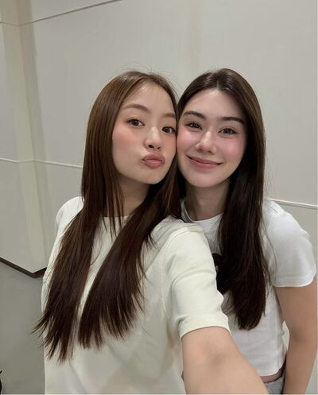
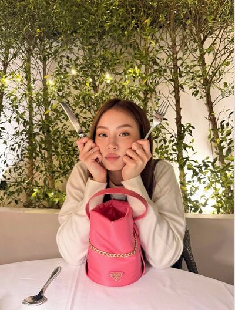
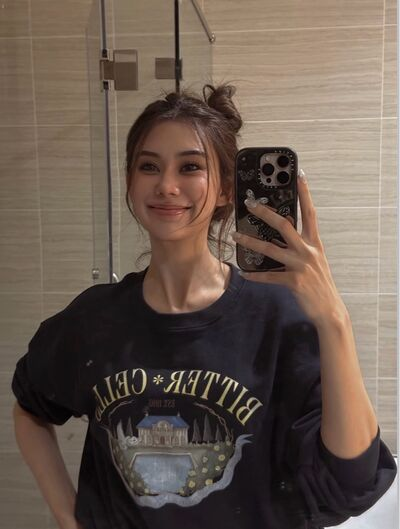
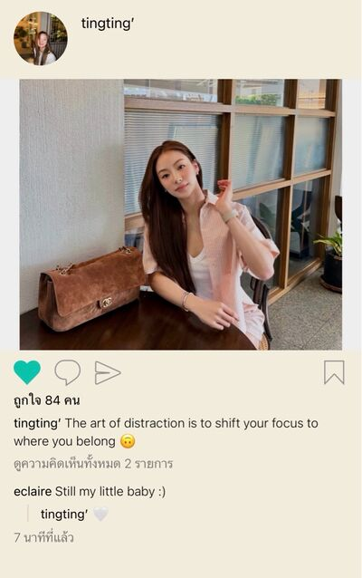
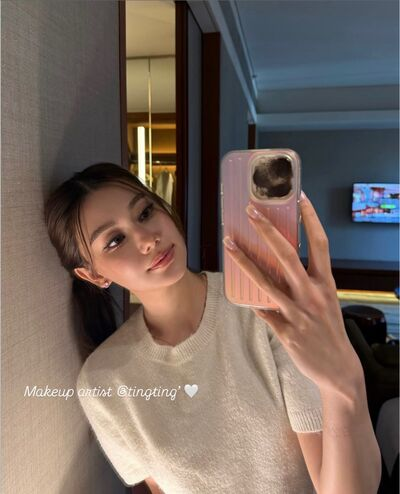

# Never Without You — Chapter 16

English translation · November 10, 14–15, 21 and 25

## Character and alias key

- tt’ — TingTing / Ting / Muay.
- Patricia🌻 — Patricia / Pat / P’Pat.
- JJAPP — Japp.
- khim09 — Khim.
- 🌕 — Chan / Nong Chan / P’Chan, Khim’s partner.
- font_pcp — Font.
- lalin — Lalin.
- eclaire — Claire / P’Claire.
- SEAN — Sean / P’Sean, Patricia’s former boyfriend.

Mentioned: TingTing’s parents, Patricia’s mother, and the unnamed IT suitor.

## Translation notes

P’ is an affectionate or respectful honorific for someone older. Muay is Patricia’s nickname for TingTing. “55555” and its variations are Thai internet laughter. Kub and kub-pom are playful masculine polite responses. “Whipping up feelings” is the friends’ joke about Patricia’s immersion in romantic fiction. Nong identifies someone younger. “Half fallen” and the world-ending percentages continue the friends’ romantic teasing; they are character speculation, not objective assessments. “Sisters” and “younger sister” here describe a close, age-based nonfamilial bond, not biological siblings. Dropping P’ and calling Patricia simply Pat is an important change in intimacy in this chapter. Existing English messages remain as supplied.

Six pictures reference the JSON’s exact paths: chat_image_002.jpg, chat_image_003.jpg, chat_image_004.jpg, chat_image_007.jpg, chat_image_008.jpg and chat_image_009.jpg, all inside img/. The 001.png, 005.png and 006.png entries are call-interface icons, not pictures. Their labels have been recovered from saved HTML: two unanswered calls and a 00:02:11 call. Pictures have not been inspected, downloaded, or translated. Threats and dramatic death wishes are fictional dialogue, not advice or endorsement. The author’s mention of P’Na is retained without inferring who that person is.

## Full translated chat transcript

---

November 10th  
Tuesday

---

### Patricia🌻

*6:31 a.m.*

**Patricia🌻**  
[Call — not answered]

**Patricia🌻**  
Oh, awake already?

**Patricia🌻**  
Why reject the call, Muay?

**tt’**  
I’m up.

**tt’**  
Showering first.

**Patricia🌻**  
Okay. You didn’t answer, so I thought something was wrong.

**tt’**  
Nothing.

**tt’**  
See you soon.

**Patricia🌻**  
Okaaay, kub.

### prettybabies (3)

*6:36 a.m.*

**tt’**  
You guys, I’m so upset with P’Pat 🫠

*7:48 a.m.*

**tt’**  
Great. No one’s awake.

**tt’**  
🤬

### Patricia🌻

*9:13 a.m.*

**Patricia🌻**  
Muay.

**Patricia🌻**  
Something wrong?

**Patricia🌻**  
A problem with work?

**tt’**  
No.

**Patricia🌻**  
🧐

**tt’**  
What?

**Patricia🌻**  
You’re acting strange.

**tt’**  
I’m not.

**tt’**  
Normal.

**Patricia🌻**  
Fine. Not strange. Won’t bother you. Back to work.

### prettybabies (3)

*9:32 a.m.*

**font_pcp**  
Sulking about what now? What did the beautiful older sister do?

**tt’**  
She’s going to a musical with her ex.

**font_pcp**  
Hey. Can she? No, she can’t.

**font_pcp**  
How can she go?

**tt’**  
Well, she’s going.

**font_pcp**  
How could we allow it, gay kid?

**font_pcp**  
We’re her close younger friend.

**tt’**  
Cheering me on or kicking me when I’m down?

**font_pcp**  
555555

**tt’**  
Awful 😡

**lalin**  
Why’s P’Pat going? She wants to?

**lalin**  
Thought going home with the ex was manners. What’s going on?

**tt’**  
Tell you later. Work first. P’Pat might peek.

**tt’**  
She knows I’m upset with her.

**font_pcp**  
Bet five baht she knows you’re sulking.

**tt’**  
Why?

**font_pcp**  
Because you sulk at her every day, Ting.

**tt’**  
🫠

### JJAPP

*12:49 p.m.*

**Patricia🌻**  
Japp, where are you with Muay?

**JJAPP**  
She wants treats. Walking around buying some.

**JJAPP**  
Want anything, P’Pat?

**Patricia🌻**  
What treats? Why wouldn’t she let me come?

**JJAPP**  
Maybe she’d rather walk with me.

**Patricia🌻**  
Japp, you little—

**JJAPP**  
55555555

**Patricia🌻**  
Seriously, Japp.

**Patricia🌻**  
What’s wrong with her?

**JJAPP**  
Don’t know. How would I?

**JJAPP**  
You’re closer to her than I am.

**Patricia🌻**  
Asked. She won’t tell me.

**JJAPP**  
Won’t tell you. Would she tell me?

**Patricia🌻**  
Just ask why she wouldn’t let me come.

**JJAPP**  
Okay. I’ll casually ask.

*12:55 p.m.*

**JJAPP**  
Something going on between you two?

**Patricia🌻**  
What?

**JJAPP**  
You and Ting.

**JJAPP**  
A problem?

**Patricia🌻**  
No.

**Patricia🌻**  
We talked last night. But she’s strange this morning.

**Patricia🌻**  
Why? What is it? What did she say?

**JJAPP**  
She said…

**JJAPP**  
She wants to try living without P’Pat in every part of her life.

**Patricia🌻**  
She said that?

**JJAPP**  
Yes.

**Patricia🌻**  
Why?

**JJAPP**  
Don’t know. Asked. No answer.

**JJAPP**  
Told me to stop asking. Doesn’t want to talk.

**Patricia🌻**  
I’m in trouble again, aren’t I?

**JJAPP**  
5555555555

**JJAPP**  
What did you do to her?

**Patricia🌻**  
Can’t think. Let me think.

**Patricia🌻**  
But whatever she buys, pay first. Get it from me later.

**JJAPP**  
Why treat her? She’s that rich.

**Patricia🌻**  
Nothing to do with rich or not.

**Patricia🌻**  
Just want to buy her something. Look after her. Be a good older sister.

**JJAPP**  
Don’t look after me?

**Patricia🌻**  
You’re grown, Japp. Feed yourself.

**Patricia🌻**  
But I treated you when you were new too.

**JJAPP**  
55555555555

**JJAPP**  
Muay’s grown too, isn’t she? Only four years younger than me.

**Patricia🌻**  
Doesn’t look grown.

**Patricia🌻**  
Still sulking and refusing to talk.

**JJAPP**  
Because it’s you.

**JJAPP**  
She doesn’t sulk with others. Tells them off outright.

**Patricia🌻**  
55555

**Patricia🌻**  
Exactly. Still not grown.

### khim09

*4:34 p.m.*

**Patricia🌻**  
Khim, asked Ting to dinner and she won’t come 😭

**Patricia🌻**  
Don’t know what she’s upset about. Strange kind of sulking.

**khim09**  
Strange how?

**Patricia🌻**  
Still talks, but won’t go anywhere I invite her.

**Patricia🌻**  
Had Japp ask. She said she wants to try life without me in everything.

**khim09**  
She actually said that?

**Patricia🌻**  
Yeah.

**Patricia🌻**  
I’m stressed. Trying to make it up to her.

**Patricia🌻**  
Think it’s P’Sean?

**khim09**  
But you said she let you go.

**Patricia🌻**  
Yeah. That’s why I don’t know. Normal yesterday.

**khim09**  
Something else? Maybe nothing to do with you.

**khim09**  
Overthinking, Pat?

**Patricia🌻**  
Really?

**Patricia🌻**  
But she’d probably tell me if it was something else.

**khim09**  
Think a lot of yourself.

**Patricia🌻**  
Why can’t I, when it’s Ting?

**khim09**  
5555555555

**khim09**  
Sensitive? Just asking. Heartstrings twitching?

**Patricia🌻**  
You idiot.

**Patricia🌻**  
Not talking to you. Get lost, Khim.

**khim09**  
Spiralling again, princess.

### khim09

*4:48 p.m.*

**khim09**  
Hey. Sulking at Pat?

**tt’**  
Not sulking.

**khim09**  
You are.

**tt’**  
🫠

**tt’**  
Trying not to.

**khim09**  
But so obvious she knows anyway.

**tt’**  
Don’t want it obvious. That’s why I don’t want to be around her too much.

**khim09**  
She knows you said you want to try life without her.

**tt’**  
How?

**tt’**  
P’Japp told her?

**khim09**  
Yes.

**khim09**  
But Pat asked herself.

**tt’**  
Why the fuck tell her, P’Japp? 🤬

**tt’**  
No wonder Japp said P’Pat paid for the treats. Secretly talking.

**khim09**  
My friend’s upset now.

**tt’**  
She asked me to dinner. I refused.

**khim09**  
Exactly.

**khim09**  
Pat senses feelings quickly. Tiny change in you, she knows.

**tt’**  
Why doesn’t she know I like her, then?

**khim09**  
Probably outside her frame of reference. 55555555

**khim09**  
But you haven’t told her either, right?

**tt’**  
😞

**khim09**  
Up to you. Just letting you know.

**tt’**  
Mm.

**tt’**  
But I knew she knew. Asked what was wrong first thing this morning.

**khim09**  
If it’s P’Sean,

**khim09**  
tell her you don’t want her going.

**tt’**  
Don’t want to make her choose.

**tt’**  
She’d be the uncomfortable one again.

**khim09**  
You know what she’d choose if you asked, right?

**tt’**  
Me, probably.

**tt’**  
But she’d be so sad missing the show.

**tt’**  
Then I’d be sad too, making her unhappy.

**khim09**  
Yeah.

**khim09**  
Clever kid.

**tt’**  
That’s why I won’t ask her to choose.

**tt’**  
I really want her happy, P’Khim.

**khim09**  
If you really want her happy,

**khim09**  
don’t think you’re not special to her.

### khim09

*7:04 p.m.*

**tt’**  

**tt’**  
We made up. Okay? 😠

**khim09**  
555555555555

### Patricia🌻

*7:47 p.m.*

**Patricia🌻**  
Call if you’re lonely, Muay. I’ll keep you company.

*7:56 p.m.*

**tt’**  
It’s fine. Shower first. Tell you when I’m home.

**Patricia🌻**  
Yes, ma’am.

**tt’**  
Why copy me? Kub one minute, kub-pom the next 🫪

**Patricia🌻**  
You like hearing it.

**tt’**  
I do.

**Patricia🌻**  
That’s why I say it.

**tt’**  
Driving first. I’ll crash otherwise 🫪

**Patricia🌻**  
5555555555

*8:42 p.m.*

**tt’**  
I’m home.

**Patricia🌻**  
Shower first? I’m done.

**tt’**  
It’s fine. Talk first so you can spend time with your mom later.

**Patricia🌻**  
Thank you for not sulking anymore 🥺

**tt’**  
🫠

**tt’**  
Didn’t want to sulk.

**Patricia🌻**  
Thank you for understanding.

**Patricia🌻**  
Really. Thank you, Muay.

**tt’**  
Don’t want to be unreasonable. Sorry.

**Patricia🌻**  
It’s okay 🫳

**Patricia🌻**  
Glad you asked me to dinner. Still trying to find a way to make it up to you.

**Patricia🌻**  
Thought it was about going with P’Sean.

**tt’**  
If I had tickets too, would you drop his and go with me?

**Patricia🌻**  
You have tickets?

**tt’**  
No.

**Patricia🌻**  
Startled me. Thought you did.

**tt’**  
Don’t want to find them. You’d be startled like this.

**tt’**  
And don’t want to duplicate what he did.

**Patricia🌻**  
You really don’t like him, do you?

**tt’**  
Yes. Like I dislike that bland-faced IT boy.

**Patricia🌻**  
See? Upset about P’Sean but wouldn’t tell me.

**tt’**  
Telling you now 🫠

**Patricia🌻**  
Shocked when I heard from Japp. Never thought you’d say that.

**tt’**  
It’s not that I don’t want you in my life. Just said it to her.

**Patricia🌻**  
Why think that?

**tt’**  
If you have to give more time to someone else, I have to distract myself.

**tt’**  
Otherwise I’ll want you all the time, but you won’t be free.

**tt’**  
Where did you ever go on weekends without me?

**Patricia🌻**  
But you know, right?

**Patricia🌻**  
I’ve never not wanted you in my life.

**Patricia🌻**  
Someone coming in doesn’t mean you have to leave. Understand?

**tt’**  
You’re letting him in?

**Patricia🌻**  
No. Not like that. Just saying so you won’t think that way.

**tt’**  
Could you not let him in?

**tt’**  
Anywhere that’s my place. Don’t bring him into it?

**Patricia🌻**  
Yes. Your place is yours.

**Patricia🌻**  
No one can replace you.

**tt’**  
Really?

**Patricia🌻**  
Of course.

**tt’**  
Am I being unreasonable now?

**Patricia🌻**  
Noooo 🫳

**tt’**  
🫠

**tt’**  
Will you be with him long?

**Patricia🌻**  
At the show?

**tt’**  
Yes.

**Patricia🌻**  
Not long. Just the show. Home afterward.

**tt’**  
Can I pick you up?

**tt’**  
I’ll wait.

**Patricia🌻**  
You want to fetch me?

**tt’**  
Yes. Let me.

**Patricia🌻**  
Okay. I’ll call straight after the show.

**Patricia🌻**  
Picking me up and dropping me off is your job alone.

**Patricia🌻**  
Good? Or not? Sounds like labour exploitation? I’ll drive instead. But you come to me first.

**tt’**  
5555555

**tt’**  
I can drive.

**tt’**  
Of course I can pick you up and take you home. My job 🙂‍↕️

**Patricia🌻**  
Okay. Waiting for you Saturday. Not going home with anyone else.

**tt’**  
Not sulking anymore. But you can keep coaxing me. Won’t complain 🙂‍↔️

**Patricia🌻**  
I already am. Always. Every day.

**tt’**  
And I always stop sulking. Every day too.

**Patricia🌻**  
Fighting back?

**tt’**  
5555555

**Patricia🌻**  
How can you compare that?

**tt’**  
Why not? You make me sulk.

**tt’**  
If you didn’t, would I sulk?

**Patricia🌻**  
😭

**Patricia🌻**  
Sorry. My fault. I’m sorry.

**tt’**  
55555555

**tt’**  
Fine. Won’t tease anymore.

**tt’**  
Don’t overthink. Enjoy it. See you afterward.

**Patricia🌻**  
Thank you, Muay 🥺

**tt’**  
You’re really special to me

**tt’**  
I hope you know that

**Patricia🌻**  
Of course, I know

**Patricia🌻**  
And you too, you’re special to me kiddo 🫳

**tt’**  
🤍

### prettybabies (3)

*9:48 p.m.*

**tt’**  
You guys.

**tt’**  
Made up with P’Pat 🫠

**font_pcp**  
I’m going crazy.

**lalin**  
Haven’t even heard the details of why you fought.

**lalin**  
Next thing I know, made up again.

**font_pcp**  
5555555555555555

**font_pcp**  
A day in the gay kid’s life.

**tt’**  
Don’t want to be unreasonable and put her in a difficult position.

**lalin**  
Why be unreasonable in the first place?

**tt’**  
It hurt 😡

**tt’**  
But I try to understand. It’s her happiness.

**tt’**  
So I asked her to dinner myself. Refused when she asked first.

**font_pcp**  
Since when has Ting ever coaxed anyone?

**tt’**  
Right?

**font_pcp**  
Everyone’s always coaxing her.

**lalin**  
P’Claire would cry if she knew. “Where did I go wrong?”

**font_pcp**  
Where she doesn’t love you, sis.

**lalin**  
Why so harsh?

**tt’**  
Yeah. Why say that?

**tt’**  
Feels like it’s reflecting back at me 😡

**font_pcp**  
Oh. 55555555

**font_pcp**  
Not yet, gay kid. Until the beautiful older sister reveals her answer, there’s always a chance.

**tt’**  
Wish she’d reveal she loves me.

**tt’**  
Don’t want her liking anyone else.

**tt’**  
When she says I’m special, I really want to be special.

**tt’**  
More special than anyone. Most special to her.

**lalin**  
When she says it, does she make you feel special?

**tt’**  
Yes.

**tt’**  
Doesn’t do this with everyone.

**tt’**  
But there could be one other person special to her too.

**font_pcp**  
The ex.

**tt’**  
Mm. Want him to really be only formerly special, like she says.

**tt’**  
Stay in the past.

**lalin**  
Still not confessing, then?

**tt’**  
Not yet.

**tt’**  
Still scared thinking about it. Don’t want to.

**tt’**  
Forget it. Birthday instead. Where should I take her?

**tt’**  
Want to fly her to Broadway. Annoyed with that bastard. Think you’re so great? Pathetic 🤬

**font_pcp**  
5555555555

**font_pcp**  
She really holds a grudge.

**tt’**  
Yeah. Don’t like it. Feels like losing. Ex 1, Ting 0.

**tt’**  
Birthday. I’ll get him back 🤬

**lalin**  
Doesn’t our clever gay kid know what P’Pat wants to do for her birthday?

**tt’**  
I do. Just don’t know if I can impress her enough.

**tt’**  
Want to buy every book in the world. Let her whip up feelings all day.

**font_pcp**  
5555555

**tt’**  
But I’ve picked somewhere. River City. See the exhibitions, then dinner by the river.

**tt’**  
Dress beautifully. Order flowers too. Sunflowers as the centrepiece. Just thinking makes me shy 🫠

**font_pcp**  
She’s prepared.

**lalin**  
Revenge for the musical.

**lalin**  
Actual gift? What?

**tt’**  
Commissioned a sunflower necklace. Mom helped discuss it. Told her to pick beautiful diamonds. Should suit her.

**font_pcp**  
Diamond necklace now. Not even dating.

**lalin**  
Does the beautiful older sister know how ready the gay kid is to spoil her?

**tt’**  
Have to ask her to take leave first. Otherwise none of this happens.

**lalin**  
Why? Weekday?

**tt’**  
Yes. Wednesday.

**font_pcp**  
Not spending your birthday with your parents?

**tt’**  
Twenty-one years with them. Can I spend twenty-two with the beautiful older sister first? 🫪

**font_pcp**  
Tiiing.

**lalin**  
5555555555

**lalin**  
Can picture Dad’s exasperated face.

**tt’**  
555555

**tt’**  
They’re used to it now. Say P’Pat’s name and they let me do anything.

**font_pcp**  
Replaced P’Claire in everything, huh?

**tt’**  
No

**tt’**  
Claire’s always had her own place in my family

---

November 14th  
Saturday

---

### Moon and Sun, Sunflower and the Gay Friend (4)

*6:14 p.m.*

**khim09**  

**khim09**  
Found a lost child. Anyone want to take her home? @Patricia🌻

**tt’**  
Why ask if you’re tagging her like that? Too funny, P’Khim.

**khim09**  
555555555

**Patricia🌻**  
How did you end up together?

**tt’**  
Third-wheeling P’Khim and P’Chan.

**🌕**  
What third wheel? Told you, you’re our child.

**khim09**  
Chan. Told you to ask if I’m ready to raise a kid first.

**khim09**  
Can’t suddenly push out a child. I live hand to mouth. Where’s the money to raise a socialite kid?

**🌕**  
Oh, stop.

**tt’**  
555555

**Patricia🌻**  
When did you make plans? Didn’t tell me, Muay.

**tt’**  
Lonely. Called P’Khim for dinner while waiting to pick you up.

**Patricia🌻**  
Lonely and calling Khim now?

**khim09**  
Sound disappointed, Pat.

**Patricia🌻**  
Of course. She should call me, not you.

**khim09**  
Excuse me. Where exactly are you right now?

**tt’**  
Met him yet?

**Patricia🌻**  
Yes. In the car. Tell you when I arrive.

**tt’**  
Eaten?

**Patricia🌻**  
Yes. With Mom at home.

**tt’**  
Mm. Call me when you’re done.

**Patricia🌻**  
Okaaay, kub.

**tt’**  
Let’s see. Pretty makeup today?

**Patricia🌻**  

**Patricia🌻**  
Knew you’d ask. Took one already.

**tt’**  
Beautifuuul 🫠

**tt’**  
Too beautiful. Wipe it all off 😡

**Patricia🌻**  
Can’t do that. 555555

**tt’**  
Want to do your makeup already. Still haven’t tried.

**tt’**  
I’ll go makeup shopping while I wait.

**Patricia🌻**  
Still don’t have enough?

**tt’**  
No. Only colours for me. Need to find yours.

**Patricia🌻**  
Okay. Talk later, Muay.

**tt’**  
Okay.

**khim09**  
Wait. Why are Chan and I suddenly the extras?

**khim09**  
That’s supposed to be Ting’s role.

**tt’**  
555555555555

**Patricia🌻**  
Look after Ting, Chan. @🌕

**🌕**  
I’ll take good care of her, P’Pat.

### Patricia🌻

*7:06 p.m.*

**Patricia🌻**  
I’m here, Muay.

**Patricia🌻**  
Still with Khim?

**tt’**  
Yes.

**tt’**  
Eating. I’ll walk around waiting afterward.

**Patricia🌻**  
It’s ages until the end. Where will you wait?

**tt’**  
It’s fine. Walk around, then wait in the car.

**Patricia🌻**  
Isn’t that too much trouble?

**tt’**  
No. I can wait for you.

**Patricia🌻**  
Thank you, Muay 🥺

**Patricia🌻**  
Look after yourself. Call if anything happens.

**tt’**  
Mm.

**tt’**  
Will you come if I call?

**Patricia🌻**  
Of course, if something’s wrong.

**tt’**  
What if nothing’s wrong? Just want you?

**Patricia🌻**  
I’ll hurry to you.

**tt’**  
🫠

**tt’**  
Don’t stay with him long. Hurry to me after the show.

**Patricia🌻**  
Yes. Straight to you.

**tt’**  
Enjoy it. I’m waiting to hear you whip up feelings. Don’t get immersed with anyone else. With me.

**Patricia🌻**  
5555555

**Patricia🌻**  
Okay. See you.

*10:18 p.m.*

**Patricia🌻**  
It’s finished.

**Patricia🌻**  
[Call — 00:02:11]

### prettybabies (3)

*10:26 p.m.*

**tt’**  
I told her not to pat anyone else’s head.

**tt’**  
So she lets someone else pat hers instead.

**tt’**  
I’ve never even patted her head.

**tt’**  
Who is he?

**font_pcp**  
My friend got hit again?

**font_pcp**  
Ex attack?

**tt’**  
Don’t like P’Pat again.

**tt’**  
How nice to everyone can she get?

**lalin**  
Beautiful older sister being herself.

**tt’**  
😞

### khim09

*10:47 p.m.*

**Patricia🌻**  
Ting’s upset with me again 😭

**khim09**  
What set her off now?

**Patricia🌻**  
Don’t know.

**Patricia🌻**  
She talks, but just goes through the motions. Bad mood. So she’s probably sulking again.

**khim09**  
Mood swings lately, maybe.

**khim09**  
Be patient. Storm should’ve passed. Maybe P’Sean’s face annoys her.

**Patricia🌻**  
Why does she dislike him so much, Khim?

**Patricia🌻**  
I don’t understand.

**Patricia🌻**  
He can’t have done much to her. Barely met. Only that ride home.

**Patricia🌻**  
Didn’t meet today. I left him and got straight into her car.

**khim09**  
Don’t know.

**khim09**  
But from her perspective, like a kid possessive over her things.

**khim09**  
Ask yourself how special you make P’Sean, for her to dislike him so much.

**Patricia🌻**  
Khim. But P’Sean is P’Sean.

**Patricia🌻**  
How can I cut him off? Never did anything bad to me. Only I did to him.

**Patricia🌻**  
I’m not making him more special than Ting.

**Patricia🌻**  
Doesn’t mean I have to ignore him completely.

**Patricia🌻**  
He’s one of the good people in my life, Khim.

**khim09**  
Yeah. I know.

**khim09**  
Know you have a deep connection.

**khim09**  
Ting probably knows too. That’s why she’s like this.

### Patricia🌻

*11:38 p.m.*

**Patricia🌻**  
Drive safely, Muay. It’s late.

*11:52 p.m.*

**tt’**  
I’m home.

**Patricia🌻**  
Upset with me?

**tt’**  
No.

**Patricia🌻**  
Came out immediately and called you after the show.

**tt’**  
Mm.

**Patricia🌻**  
You are upset. Everything I said in the car got short answers.

**tt’**  
I don’t understand what you’re talking about. Never seen it.

**Patricia🌻**  
I told you the story that day.

**tt’**  
Don’t know. Don’t remember.

**Patricia🌻**  
Did I do something you dislike?

**tt’**  
You didn’t do it.

**Patricia🌻**  
Then why are you this angry with me?

*[Read]*

**Patricia🌻**  
Muay, we’ve been fighting so often lately.

**Patricia🌻**  
Something on your mind? Can you tell me?

**tt’**  
Why let him pat your head?

**Patricia🌻**  
You saw?

**tt’**  
Why let him?

**Patricia🌻**  
I didn’t ask him to. He just did. Didn’t expect it either.

**tt’**  
Mm.

**Patricia🌻**  
That’s why you’re angry?

**tt’**  
Yes.

**tt’**  
I don’t like it.

*[Read]*

**tt’**  
Am I wrong to dislike it?

**Patricia🌻**  
No. But I didn’t mean it either, Muay.

**Patricia🌻**  
Didn’t tell him to pat my head.

**tt’**  
But you let him.

**tt’**  
If it were someone else, would you stand still and let them?

*[Read]*

**Patricia🌻**  
Okay. I’m sorry.

**Patricia🌻**  
I’ll be more careful. Okay?

**tt’**  
Do you like him?

**tt’**  
Like him so much?

**Patricia🌻**  
I don’t like him. Not that way.

**Patricia🌻**  
But I don’t dislike him either. Do you understand?

**tt’**  
But I don’t like him at all.

**tt’**  
Don’t want to talk about him either.

**tt’**  
Feels like he’s all that’s in my head now. I hate it.

**Patricia🌻**  
Okay. Stop talking about him.

**tt’**  
Could you stop seeing him?

**tt’**  
Don’t see him again?

*[Read]*

**tt’**  
Can’t you?

**Patricia🌻**  
I’ll try to see him as little as possible. Only when really necessary.

**tt’**  
What could be necessary again?

**Patricia🌻**  
Don’t know.

**tt’**  
Mm. Forget it.

**tt’**  
Necessary, then necessary.

**Patricia🌻**  
Muay.

**tt’**  
Just have to distract myself. That’s all.

**tt’**  
Excuse me. I’m going to shower and rest.

**Patricia🌻**  
Wait. We haven’t resolved anything. You’re still upset with me.

---

November 15th  
Sunday

---

*12:15 a.m.*

**Patricia🌻**  
Gone already?

**Patricia🌻**  
[Call — unanswered]

*12:22 a.m.*

**Patricia🌻**  
Ok, good night then

**Patricia🌻**  
Hope we can talk tomorrow

### eclaire

*12:43 a.m.*

**tt’**  
Still up?

**eclaire**  
Yeah

**eclaire**  
Is something going on?

**tt’**  
I’m not feeling well and I just wanted to talk to you

**eclaire**  
Baby, what’s wrong?

**tt’**  
I don’t like feeling so small

**tt’**  
And that I’m not the only one who gets special treatment from her

**eclaire**  
You're being jealous

**eclaire**  
She has someone else?

**tt’**  
Her ex.

**eclaire**  
Want to tell me?

**tt’**  
Do you want to listen?

**eclaire**  
Free tomorrow. All day.

**tt’**  
Can we meet?

**eclaire**  
Of course. Shall I pick you up?

**tt’**  
Mm.

**eclaire**  
You can wait until tomorrow to talk?

**tt’**  
I can.

**eclaire**  
Then sleep now. It’s late.

**tt’**  
Thank you, Claire.

**eclaire**  
Nothing at all. You always have me, TingTing.

**tt’**  
I understand what you told me now.

**tt’**  
It's actually not easy

**tt’**  
To accept that someone we love doesn't love us back

**tt’**  
I'm sorry

**eclaire**  
It's okay, baby

**eclaire**  
Let's meet tomorrow, ok?

**tt’**  
Ok

### Patricia🌻

*8:03 a.m.*

**Patricia🌻**  
Morningg

**Patricia🌻**  
Muay, awake yet?

*9:17 a.m.*

**Patricia🌻**  
Still asleep?

**Patricia🌻**  
Going anywhere with your parents today?

IG: tingting’

*1:21 p.m.*

### khim09

*1:24 p.m.*

**Patricia🌻**  
Khim, Ting hasn’t replied since last night.

**Patricia🌻**  
But just posted on Instagram.

**Patricia🌻**  
She’s really angry with me?

**khim09**  
Let me see.

**Patricia🌻**  
Claire commented too. Don’t know if they’re together.

**Patricia🌻**  
Caption sounds like she’s sulking at me.

**khim09**  
Not “sounds like,” Pat. She really is.

**khim09**  
Claire’s that older friend she’s close to?

**Patricia🌻**  
Mm.

**khim09**  
Still my little baby, huh?

**khim09**  
Maybe Ting found a new beautiful older sister.

*[Read]*

**khim09**  
What, Pat? Hit a nerve?

**Patricia🌻**  
I’m hurt.

**Patricia🌻**  
Won’t talk to me, but can go out with someone else.

**Patricia🌻**  
Keeps saying she doesn’t want anyone more special to me.

**Patricia🌻**  
Isn’t she the one making someone more special than me?

**Patricia🌻**  
At least I’ve never done this to her, Khim. Never ignored her. Always talk. Always make it up to her.

**Patricia🌻**  
She’s so cruel to me.

**khim09**  
Oh. Serious now.

**khim09**  
Suddenly my friend’s the hurt one.

**Patricia🌻**  
And it’ll still be me coaxing her again.

**Patricia🌻**  
Maybe she’s the only one allowed to be hurt.

**khim09**  
Pat. calm!!

**Patricia🌻**  
Try being me.

**Patricia🌻**  
Want to see if you could stay calm.

**khim09**  
But you’d normally be calmer than this.

**khim09**  
Seriously. You okay?

**Patricia🌻**  
Don’t know. Don’t like it. Feel neglected, maybe.

**Patricia🌻**  
What would you do?

**khim09**  
I wouldn’t have indulged Ting like you to begin with.

**khim09**  
Spoiled her into this yourself. Who can you blame?

**Patricia🌻**  
Mm.

**Patricia🌻**  
I admit it. But let me be sad for a while.

**khim09**  
Yeah. Staying out of this. Probably too sensitive.

**Patricia🌻**  
Yeah. I’ll talk to Ting myself.

### Patricia🌻

*7:03 p.m.*

**Patricia🌻**  
Muay.

**Patricia🌻**  
You haven’t replied for almost a day.

*7:47 p.m.*

**Patricia🌻**  
You once said to me you didn’t feel you were special

**Patricia🌻**  
I feel the same way now

*[Read]*

**Patricia🌻**  
I’m sorry.

**Patricia🌻**  
But if you don’t want us as close anymore, just tell me properly.

**Patricia🌻**  
Don’t disappear like this. I have feelings too.

**tt’**  
It’s not that I don’t want us close.

**Patricia🌻**  
Why won’t you talk, then?

**tt’**  
Don’t want to talk yet.

**Patricia🌻**  
Then I won’t talk yet either.

**tt’**  
No.

**Patricia🌻**  
You said you don’t want to.

**tt’**  
I’m hurt.

**Patricia🌻**  
Know I haven’t said a word to P’Sean since yesterday? He messaged. Didn’t answer.

**Patricia🌻**  
Only waiting to talk to you. Waiting since last night. Messaged repeatedly today. Did nothing all day. Only thought about you.

**Patricia🌻**  
Then I open Instagram and see you can go out with someone else. Think I’m hurt?

**tt’**  
Sorry.

**Patricia🌻**  
I don’t want an apology. Just want you to know I can be hurt too.

**Patricia🌻**  
When we fight, I can keep making it up to you. Give in to anything. Just come talk to me.

**Patricia🌻**  
Sorry I hurt you. I’ll try not to go anywhere with P’Sean. See him as little as possible.

**Patricia🌻**  
But please don’t get angry and do this again. It really hurts.

**Patricia🌻**  
Not just you. I don’t want you making anyone more special than me either.

**tt’**  
I haven’t made anyone more special than you.

**Patricia🌻**  
But you were with Claire today?

**tt’**  
Mm.

**tt’**  
Talking to her about you. I was hurt.

**Patricia🌻**  
Pat.

**Patricia🌻**  
You can just call me Pat.

**tt’**  
Why?

**Patricia🌻**  
Don’t want her to be the only one you call just by her name anymore.

**tt’**  
But we’re six years apart.

**Patricia🌻**  
Don’t want to call me that?

**tt’**  
I do.

**Patricia🌻**  
Then do it.

**tt’**  
Pat.

**Patricia🌻**  
Yes?

**tt’**  
🫠

**Patricia🌻**  
What?

**tt’**  
Not used to it.

**Patricia🌻**  
Why can you call her that? Used to her?

**tt’**  
Mm. Called her that from the start.

**Patricia🌻**  
Wanted it before. Now I let you, you won’t. Don’t know how to indulge you anymore.

**tt’**  
Are you angry with me, P’Pat?

**Patricia🌻**  
Why?

**tt’**  
You’re scary. So stern.

**Patricia🌻**  
Should I be angry? You disappear, but can spend time with your older friend.

**tt’**  
I apologised 🫠

**Patricia🌻**  
Want to sulk for once.

**Patricia🌻**  
Am I allowed?

**tt’**  
Sorry 😞

**Patricia🌻**  
Not accepting.

**tt’**  
Whaaat?

**Patricia🌻**  
Sulking. I’m sulking now.

**tt’**  
🫠

**tt’**  
But I’m hurt too. Not without a reason.

**Patricia🌻**  
Fighting back?

**tt’**  
It’s true. Never let anyone pat my head. Only ask you.

**Patricia🌻**  
🥺

**tt’**  
And Claire—if you dislike her, I could stop seeing her.

**Patricia🌻**  
Not that I dislike her. Just felt neglected. Waited all day, opened Instagram to that. Who wouldn’t?

**Patricia🌻**  
Call it even this time? Let’s make up.

**tt’**  
Fine. No more scolding.

**Patricia🌻**  
Not scolding. Just hurt.

**tt’**  
I’m hurt too 😠

**tt’**  
No more letting people pat your head. Anyone does it again, I’ll cut all their hands off. Just watch.

**Patricia🌻**  
5555555

**tt’**  
Not a joke 😡

**Patricia🌻**  
Okay, okay.

**tt’**  
And I’ve booked you for our birthday. Booked everything else too.

**Patricia🌻**  
Understood, kub-pom.

**Patricia🌻**  
Prepared your gift too. Not finished yet.

**tt’**  
A gift for me too?

**Patricia🌻**  
Of course. Your birthday. How could I not?

**tt’**  
Not finished means you’re making it yourself?

**Patricia🌻**  
Yes. Myself.

**tt’**  
🫪

**tt’**  
What is it? Want to know.

**Patricia🌻**  
Not telling. Wait till your birthday.

**tt’**  
Fine.

**tt’**  
I have a gift for you too.

**Patricia🌻**  
What? A hint?

**tt’**  
Not telling. But you’ll love it.

**Patricia🌻**  
Really?

**tt’**  
Really 🙂‍↕️

**Patricia🌻**  
Waiting now. Eagerly.

**tt’**  
But let me do your makeup first already.

**tt’**  
Waited so long yesterday, I bought practically everything.

**Patricia🌻**  
555555

**Patricia🌻**  
Next Saturday?

**tt’**  
Okay.

**tt’**  
I’ll pick you up at home.

**Patricia🌻**  
Okay.

### prettybabies (3)

*7:18 p.m.*

**tt’**  
You guys. I’m in such a good mood.

**tt’**  
Feels like P’Pat’s jealous of me and Claire 🫪

**font_pcp**  
What?

**font_pcp**  
Say that again?

**lalin**  
Imagining things, gay kid?

**tt’**  
Went out with Claire today. Didn’t reply to P’Pat. Just told me she’s hurt I made someone more special than her.

**tt’**  
Sulking at me too 🫠

**font_pcp**  
What does that mean? @lalin

**tt’**  
Told me to call her just Pat too. Doesn’t want Claire the only one I call by her name.

**font_pcp**  
Whaaat?

**font_pcp**  
Lalin, what the hell does that mean!!!

**tt’**  
Has she fallen for me? 🫠

**lalin**  
Strange.

**lalin**  
She didn’t care about P’Claire before, did she?

**tt’**  
Right? I think she’s strange too.

**font_pcp**  
Don’t tell me it’s really happening.

**tt’**  
World really ending?

**tt’**  
But she looked really upset. Really hurt.

**tt’**  
Even seemed unhappy when I wouldn’t call her Pat.

**tt’**  
Normally she uses reason. Emotional today. Stealing all my work.

**tt’**  
But I like it. Really feel special now 🫪

**font_pcp**  
Gay kid has so much hope.

**font_pcp**  
So will I collect your body or not? So confused.

**font_pcp**  
This pair keeps wrong-footing me.

**lalin**  
5555555555555

**tt’**  
What do you think, Lalin? 🫠

**lalin**  
Strange. She must feel something for you.

**lalin**  
If she’ll let you call her just Pat because she’s comparing herself to P’Claire.

**lalin**  
The world might really end, Ting.

**lalin**  
Maybe straight people can fall after all.

**tt’**  
🫪🫪🫪🫪🫪🫪🫪

### eclaire

*8:04 p.m.*

**eclaire**  
How are you?

**eclaire**  
Feeling better?

**tt’**  
I’m okay. Thank you so much for today.

**eclaire**  
You’re jealous. But she really cares about you.

**eclaire**  
Saw her messaging to make it up to you all the time.

**tt’**  
Mm. Talked to her.

**tt’**  
We understand each other.

*[Read]*

**eclaire**  
Good for you

**tt’**  
Thank you

**tt’**  
You’ve always been there for me

**eclaire**  
You can always count on me bb :)

**tt’**  
🤍

---

November 21st  
Saturday

---

### khim09

*9:13 a.m.*

**khim09**  
What birthday gift are you giving Ting? Keeps secretly asking me. Says she doesn’t believe I don’t know.

**Patricia🌻**  
55555555

**Patricia🌻**  
If I tell you, don’t tell her.

**khim09**  
Won’t.

**Patricia🌻**  
Painting her a picture. Working on it, not done. Finish tomorrow, hopefully. Nearly our birthday.

**Patricia🌻**  
Thought about buying something. But she probably has everything money buys.

**Patricia🌻**  
So wanted to make something. Think she’d like that more.

**khim09**  
A picture of what?

**Patricia🌻**  

**Patricia🌻**  
Something like this.

**khim09**  
Oh. Miss Sunflower and her Sunshine, huh.

**Patricia🌻**  
Yes 🥺

**Patricia🌻**  
Like you named it for me.

**khim09**  
555555555

**khim09**  
So romantic, Pat.

**khim09**  
Have to be this romantic? Younger friend, not girlfriend.

**Patricia🌻**  
555555

**Patricia🌻**  
Only have her now. No girlfriend or boyfriend.

**Patricia🌻**  
Want to make it for Ting.

**khim09**  
For a younger friend, or for Ting?

**Patricia🌻**  
For Ting, who’s my younger friend.

**khim09**  
Any other younger friends?

**khim09**  
Only one in your life?

**khim09**  
Have Nong Khim and Nong Chan ever been in your eyes?

**Patricia🌻**  
Nong Khim? You idiot.

**khim09**  
5555555555555

**Patricia🌻**  
And Chan’s your partner. Look after her yourself.

**khim09**  
Talking to you is exhausting. Going to my wife.

**khim09**  
Poor Ting. Older friend like you.

**Patricia🌻**  
Don’t say that.

**Patricia🌻**  
Don’t want to feel I’m a bad older sister to her.

**khim09**  
Fine. There you go.

**khim09**  
Don’t worry, Pat. Best older sister in the world.

**khim09**  
The absolute best. No one as good as you, you idiooot.

**Patricia🌻**  
555555555

### SEAN

*2:17 p.m.*

**SEAN**  
Free yet? You said busy, so haven’t talked.

**Patricia🌻**  
Something you need, P’Sean?

**SEAN**  
Nothing. Want to invite you to dinner.

**Patricia🌻**  
I can’t. Sorry.

**SEAN**  
Tomorrow. Busy?

**Patricia🌻**  
Yes.

**Patricia🌻**  
Not available at all lately.

**SEAN**  
You mean not available for me?

**Patricia🌻**  
Yes. Sorry.

**SEAN**  
It’s okay. I’ll wait till you’re available.

**SEAN**  
Not rushing anywhere. If I need to wait, I’ll wait.

**Patricia🌻**  
P’Sean, I’m busy on my birthday.

**Patricia🌻**  
Don’t know if you were going to ask, but letting you know.

**SEAN**  
Going with her?

**Patricia🌻**  
Yes. Plans with Ting.

**SEAN**  
Okay.

IG: pat_patricia

*2:56 p.m.*

SEAN liked your story

### khim09

*5:33 p.m.*

**tt’**  
P’Khim, she came over today. I did her makeup too.

**khim09**  
Saw her story.

**tt’**  
Felt like I’d die.

**khim09**  
Why? 55555555

**tt’**  
Her face was so close.

**tt’**  
And she kept looking into my eyes.

**tt’**  
Accidentally looked at her lips. Don’t know if she noticed 🫠

**khim09**  
She didn’t. Does Pat ever know a fucking thing?

**tt’**  
5555555555555

**tt’**  
Same lipstick too. Sorry for sneaking an advantage over your friend. Only chance I have 🙂‍↕️

**khim09**  
55555555555

**khim09**  
Hey. Sneaky indirect kiss?

**tt’**  
🫪

**tt’**  
Hands shook putting lipstick on her. Only looking at her lips 🫠

**khim09**  
Should grab her and kiss her once. Maybe she’ll stop being straight.

**tt’**  
Don’t say that. Might do it.

**khim09**  
Don’t. I’m joking.

**khim09**  
Do it and she isn’t okay with it, you’ll definitely cry.

**tt’**  
🫠

**tt’**  
But she talked to her ex while with me too.

**tt’**  
Saw him message.

**khim09**  
How was it? What about?

**tt’**  
Dinner invitation. She refused.

**tt’**  
But kept apologising. Don’t know why she’s so worried about inconveniencing him.

**khim09**  
Oh, kid. My friend has manners.

**tt’**  
Wish she didn’t. Don’t want her being lovely to anyone. Especially her ex.

**khim09**  
But she refused him. Pretty clear she doesn’t feel anything for him.

**tt’**  
Told him busy on her birthday because she’s meeting me.

**khim09**  
See? You really are so special.

**tt’**  
I know.

**tt’**  
Still uncomfortable. Hate it. Refuses him, but still lets him stay here.

**khim09**  
Hard to talk about, Ting.

**khim09**  
Honestly, she can’t cut him off.

**khim09**  
Especially without a relationship label. She’ll see him as an older friend who wishes her well. She wishes him well too.

**tt’**  
What if she lets him stay until they get that label, P’Khim?

**tt’**  
Where will I be then?

**khim09**  
Here we go.

**khim09**  
My mouth’s gone dry.

**tt’**  
I know she treats me specially.

**tt’**  
But I also know her ex can become her special person again.

**tt’**  
If I hadn’t been unreasonable and stopped her seeing him, maybe they’d be together already.

**khim09**  
Yes. There’s a chance.

**khim09**  
He’s not some nobody. Dated her before, so obviously her type.

**tt’**  
Exactly. I know. You said he stepped out of a novel.

**tt’**  
Don’t want them together, P’Khim. Don’t want to be an extra.

**khim09**  
But she’s doing everything she can for you, I think.

**khim09**  
Saved her birthday for you too. Don’t know what else to say.

**tt’**  
Know what, P’Khim?

**tt’**  
Feels like I’m always losing to her ex.

**tt’**  
Even when it feels like she chooses me. However special she makes me feel.

**tt’**  
Unless she says I’m more than a younger sister, that’s all I can be. Just her younger sister.

**khim09**  
World, end. Please. You can end now.

---

November 25th  
Wednesday

---

### Patricia🌻

*7:45 a.m.*

**Patricia🌻**  
Morninggg, birthday girl 🫳

**Patricia🌻**  
I’ll wish you properly when we meet.

*8:46 a.m.*

**tt’**  
Morning HBD kubb

**Patricia🌻**  
Strange. Never wished someone happy birthday on my birthday before.

**tt’**  
Me neither. 55555

**Patricia🌻**  
But it’s nice 🥺

**tt’**  
Right? Glad we share a birthday.

**Patricia🌻**  
Even more glad I met you.

**tt’**  
🫠

**Patricia🌻**  
We’ve known each other all the way to our birthday.

**Patricia🌻**  
Grown up much yet?

**tt’**  
What do you think?

**Patricia🌻**  
Maybe not.

**tt’**  
5555555555555

**Patricia🌻**  
🧐

**tt’**  
A little.

**Patricia🌻**  
Really?

**tt’**  
Mm. More patient, maybe.

**tt’**  
Before, I’d be even more unreasonable.

**Patricia🌻**  
Even more?

**tt’**  
What? 😠

**Patricia🌻**  
5555555

**Patricia🌻**  
Go shower. Waiting for you to pick me up.

**tt’**  
See you. Dress beautifully.

**Patricia🌻**  
How beautiful?

**tt’**  
Your absolute best. A dress is fine.

**Patricia🌻**  
Wow. What are you taking me to do?

**tt’**  
Secret 🤫

**Patricia🌻**  
Muay, what if our outfits don’t match?

**tt’**  
55555555

**Patricia🌻**  
Didn’t warn me. Do I have an outfit? Now I’m nervous.

**tt’**  
Black dress. You look beautiful in black.

**Patricia🌻**  
Black, then.

**tt’**  
Yes.

**Patricia🌻**  
Okay. See you, kub.

**tt’**  
Yes, ma’am 🫡

### SEAN

*9:11 a.m.*

**SEAN**  
Happy birthday. Wishing you a happy year, doing what you want, and good health for Mom.

**Patricia🌻**  
Thank you.

**SEAN**  
Completely busy today?

**Patricia🌻**  
Yes. Busy.

**SEAN**  
Still home?

**Patricia🌻**  
Yes. Why?

**SEAN**  
Can I drop off a gift?

**Patricia🌻**  
At my house?

**SEAN**  
Yes. It’s okay you’re busy. But I want to give you a birthday present.

**Patricia🌻**  
What time would you come?

**SEAN**  
Around eleven?

**Patricia🌻**  
One moment. I’ll confirm.

### Patricia🌻

*9:20 a.m.*

**Patricia🌻**  
Muay, what time are you coming? Eleven, right?

*9:33 a.m.*

**tt’**  
Yes. Around then.

**tt’**  
Why?

**Patricia🌻**  
P’Sean’s dropping off a gift. I’ll tell him to come before you.

**tt’**  
What gift? Why bring it?

**Patricia🌻**  
Don’t know. Just said he’d drop it off.

**tt’**  
Could you not let him come?

**Patricia🌻**  
Just dropping off a present. Not going anywhere together.

**tt’**  
I know. But don’t let him come?

*[Read]*

**tt’**  
Could you not, P’Pat?

**Patricia🌻**  
Does it have to go that far, Muay?

**tt’**  
Just today. Please don’t let him see you.

**Patricia🌻**  
I suppose I can.

**Patricia🌻**  
But I don’t understand. Does it really have to go that far?

**Patricia🌻**  
Just bringing a present.

**tt’**  
Can’t he bring it another day?

**tt’**  
Our birthday. Our special day. Just us two.

**tt’**  
Can’t you not see him today?

*[Read]*

**tt’**  
You can’t?

**tt’**  
Not again?

**Patricia🌻**  
No. I don’t understand, Muay.

**tt’**  
Why? Is he so important?

**tt’**  
He has to come no matter what?

**Patricia🌻**  
Wait. Not like that at all.

**Patricia🌻**  
Just don’t understand what’s happening.

**tt’**  
Don’t even want him involved with you. Any day.

**tt’**  
When will he leave? Why does he keep bothering you?

**Patricia🌻**  
What’s wrong? I don’t understand anymore.

**tt’**  
He’s so important you can’t cut him off, right?

**tt’**  
How long will you keep him in your life?

**Patricia🌻**  
Could we not fight about P’Sean?

**Patricia🌻**  
I’m starting to feel really uncomfortable.

**tt’**  
Want him to come?

**Patricia🌻**  
No. I don’t.

**Patricia🌻**  
Just don’t understand why you’re so against him seeing me.

**Patricia🌻**  
Why dislike him so much?

**Patricia🌻**  
Did he do something bad to you? Say something awful?

**tt’**  
More important than me?

**Patricia🌻**  
You’re more important, of course.

**tt’**  
Then don’t let him come.

**Patricia🌻**  
Muay, could you give me the real reason you dislike him?

**tt’**  
If I tell you,

**tt’**  
could you not let him come?

**Patricia🌻**  
If you really have a reason, I won’t let him.

*[Read]*

**Patricia🌻**  
Muay.

**tt’**  
I love you, P’Pat.

*[Read]*

**tt’**  
Please don’t let him see you.

**tt’**  
Could you not let him?

**tt’**  
P’Pat.

**Patricia🌻**  
What do you mean?

**Patricia🌻**  
When you say love, what do you mean?

*[Read]*

**tt’**  
I love you

*[Read]*

**tt’**  
As a lover

**Patricia🌻**  
Like Khim likes Chan?

**tt’**  
Mm.

**Patricia🌻**  
Since when?

**tt’**  
The start.

**Patricia🌻**  
From the start?

**Patricia🌻**  
You’ve loved me like that all along?

**tt’**  
Mm.

**Patricia🌻**  
Why didn’t you tell me?

**tt’**  
I was scared.

*[Read]*

**tt’**  
P’Pat.

**tt’**  
Please don’t go quiet.

**tt’**  
I’m scared.

*[Read]*

**tt’**  
P’Pat.

**Patricia🌻**  
I like men. Never liked women.

**Patricia🌻**  
All this time, I’ve seen you as a younger sister.

**Patricia🌻**  
We’re just sisters. Close sisters.

**tt’**  
But we didn’t do it like sisters do

**tt’**  
What I’ve done with you, I’ve never done with anyone else

**tt’**  
Have you?

**Patricia🌻**  
No

**Patricia🌻**  
But still they're just sister things

**tt’**  
No

**tt’**  
They're not

**tt’**  
Sisters don't talk like we talk

**tt’**  
Don't treat each other like we do

**tt’**  
If you think all we’ve done is sister things

**tt’**  
Then you’re just living in your fantasy

*[Read]*

**Patricia🌻**  
Isn’t that harsh, Muay?

**Patricia🌻**  
Everything I’ve done came from my heart. I’ve always been genuine with you.

**tt’**  
And what you said to me—you think that was gentle?

**tt’**  
Think I don’t feel anything?

**Patricia🌻**  
Sorry.

**Patricia🌻**  
I’m sorry.

**tt’**  
All this time, only I felt it?

**tt’**  
Only me who liked you?

**Patricia🌻**  
I like you too, Muay.

**Patricia🌻**  
Just not that way.

**tt’**  
Then you don’t like me.

.

.

.

## Author’s note

Thank you to everyone who came to read 🥺🙏

Nothing to say right now. But waiting to read the comments. Just wanted everyone to know P’Na patted my head too. So happy 😭😭😭😭😭😭😭
