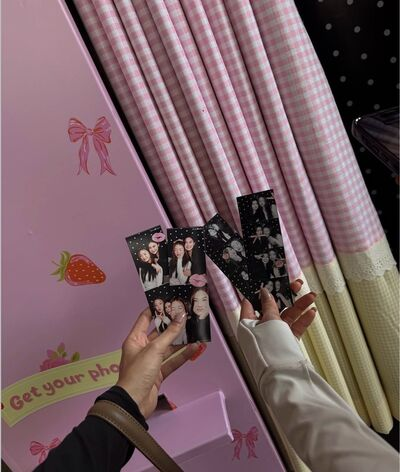
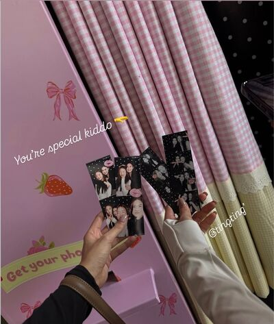
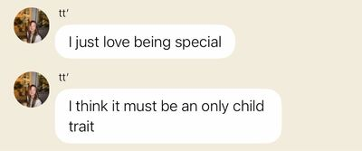
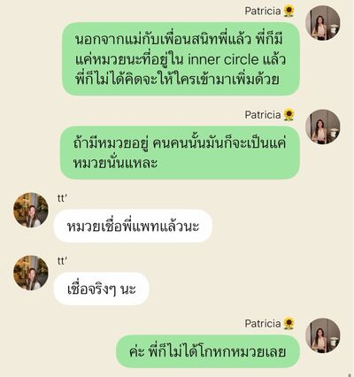
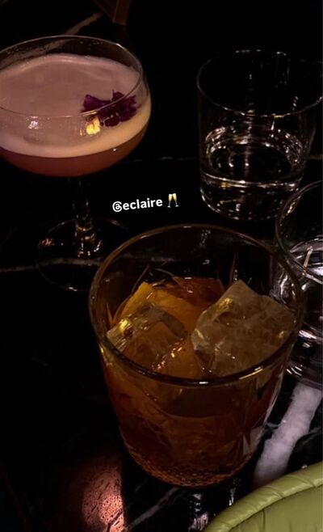

# Never Without You — Chapter 18

English translation · November 30; December 1 and 4

## Character and alias key

- tt’ — TingTing / Ting / Muay.
- Patricia🌻 — Patricia / Pat / P’Pat.
- khim09 — Khim.
- SEAN — Sean / P’Sean, Patricia’s former boyfriend.
- eclaire — Claire / P’Claire.
- lalin — Lalin.
- font_pcp — Font, distinct from the coworker Namfon.
- BEll — Bell.
- JJAPP — Japp.
- Namfon — Namfon / P’Fon.
- P. — Phrom / P’Phrom, the new team lead.
- หม่าม้า — Mom, TingTing’s mother (display name retained).
- ปะป๊า — Dad, TingTing’s father (display name retained).

Mentioned: P’Sita, P’Duen, Chan, and Patricia’s mother.

## Translation notes

P’ is an affectionate or respectful honorific for someone older. Muay is Patricia’s nickname for TingTing; its withdrawal is significant in their conversations. Sisterly terms describe a close nonfamilial bond, not biological siblings. “55555” and its variations are Thai internet laughter. “Whipping up feelings” continues the friends’ joke about Patricia and romantic fiction. PIC means the person in charge of a task. The 25% sugar remark follows the characters’ November 25 birthday. “Moms” in the author’s notes addresses protective fans as well as expressing the author’s affection for her characters. P’Na in the closing note is retained without identifying that person.

The group names retain the established renderings “Moon and Sun, Sunflower and the Gay Friend” and “Unknown Elders,” including all participant-count changes. Existing English messages and group-exit events are retained as supplied. Five photographs reference the JSON’s exact filenames, chat_image_002.jpg through chat_image_006.jpg, inside your local img folder. The 001.png entry is a call-interface icon; its unanswered-call label has been recovered from the saved HTML and rendered as text. Pictures have not been inspected, downloaded, or translated. The drunken-kiss scene is translated as written, without adding explicit detail or treating the characters’ reactions as an endorsement.

## Full translated chat transcript

---

November 30th  
Monday

---

### Moon and Sun, Sunflower and the Gay Friend (4)

*6:29 p.m.*

tt’ left the group

### Moon and Sun, Sunflower and the Gay Friend (3)

### khim09

*6:41 p.m.*

**khim09**  
Ting, something wrong?

**khim09**  
Saw you leave the group.

**tt’**  
Ask your friend.

**khim09**  
What did Pat do?

**tt’**  
Getting back with her ex, probably.

**tt’**  
But whatever. What she does has nothing to do with me.

**khim09**  
Ting, seriously. Why are you this angry with her?

**khim09**  
I understand being hurt about P’Sean.

**khim09**  
But not why you’re so angry you wouldn’t come when her mom was ill.

**khim09**  
She wanted you there most that day. Cried so hard. Mom was enough stress. With you too, she couldn’t cope.

**khim09**  
She was so hurt. You know you matter to her.

**tt’**  
Who said I didn’t go?

**tt’**  
You talk like you don’t know how much I love your friend. What I’d do for her.

**tt’**  
She’s my most special person. How special can she make me? Ask her first.

**khim09**  
You came?

**khim09**  
Why tell her you weren’t coming anymore?

**tt’**  
Went and saw her with her ex. Comforting each other like that.

**tt’**  
What did you want me to go in and do?

**tt’**  
Seriously. What was I supposed to be there for?

**tt’**  
No place for me there.

**tt’**  
Would you go in? Really stand there like an extra?

*[Read]*

**tt’**  
Why call me if she already has someone caring for her?

**tt’**  
Knows how I love her. Why call me to see that?

**tt’**  
I know how much her mom matters.

**tt’**  
So much she probably forgot I have feelings to look after too.

**tt’**  
Am I wrong to be hurt?

**tt’**  
Too hurt to stay there.

**khim09**  
Okay. I understand.

**khim09**  
You’re not wrong. Not wrong to be unable to bear it.

**khim09**  
Does Pat know you went?

**tt’**  
No.

**tt’**  
Doesn’t need to know either.

**khim09**  
She does.

**khim09**  
She needs to.

**khim09**  
She lost her temper and spoke sarcastically because she was still hurt you said everything meant nothing.

**khim09**  
She cares so much. Tell her and it wouldn’t turn out like this. Trust me.

**tt’**  
Leave her be, P’Khim.

**tt’**  
Don’t want to care anymore.

**tt’**  
Don’t want to keep understanding her either.

**tt’**  
Whatever she thinks or does, let her.

**tt’**  
I’m tired.

**khim09**  
Ting, please. Think carefully.

**tt’**  
I have.

**tt’**  
World won’t end, P’Khim.

**tt’**  
Only my heart’s breaking because of her.

**tt’**  
That 0.1% can never be mine.

**tt’**  
Let her like men the way she does.

**tt’**  
I’m done.

### khim09

*6:50 p.m.*

**khim09**  
Pat, with P’Sean, right?

**khim09**  
Reply when you can talk. Want to discuss Ting.

### SEAN

*7:04 p.m.*

**SEAN**  
Pat, talk to me when you’re feeling better.

**SEAN**  
I’m worried.

### khim09

*7:17 p.m.*

**khim09**  
[Call — unanswered]

*7:30 p.m.*

**khim09**  
Pat, your dear mom called.

**khim09**  
Says you cried all the way from P’Sean’s car to home. He doesn’t know what’s wrong either. Only that it’s Ting.

**khim09**  
Mom asks, you say nothing. You’re fine. Don’t worry about Pat.

**khim09**  
Crying like that, who wouldn’t worry, idiot?

**khim09**  
Answer me right now, Pat.

**Patricia🌻**  
Ting saw P’Sean pick me up today.

**Patricia🌻**  
She thinks I’m disgusted by her.

**Patricia🌻**  
With P’Sean because I’m disgusted by her.

**khim09**  
Oh.

**khim09**  
No wonder she said that.

**Patricia🌻**  
Said what, Khim?

**Patricia🌻**  
Talked to you?

**khim09**  
Says she’s tired.

**khim09**  
She’s done.

*[Read]*

**khim09**  
Saw her leave the group, right?

**Patricia🌻**  
She really left, then.

**khim09**  
What did you talk about?

**khim09**  
Pat.

**Patricia🌻**  
She said she…

**Patricia🌻**  
Can’t appreciate me anymore.

**Patricia🌻**  
Never wanted to be sisters either.

**khim09**  
That’s why you’re crying?

**Patricia🌻**  
Didn’t want to tell her what Mom said. All that family nonsense.

**Patricia🌻**  
But otherwise she’d think I wanted P’Sean for myself.

**Patricia🌻**  
Just wanted her to know I have conditions too. Mom’s expectations to carry.

**Patricia🌻**  
Think I’m not stressed? Everything right now. Mom’s ill, Khim.

**Patricia🌻**  
The younger girl I love most, always beside me…

**Patricia🌻**  
I don’t have her anymore either.

**Patricia🌻**  
What does she want me to do? What do I do?

**Patricia🌻**  
Could she ask once if I’m okay? If I want her support?

**Patricia🌻**  
Ask me first? Ask about Mom?

**Patricia🌻**  
Before saying all that?

**Patricia🌻**  
Could she worry about me first?

**Patricia🌻**  
About my feelings?

**Patricia🌻**  
Before leaving me?

**Patricia🌻**  
Can’t she act like the past meant even a little?

**khim09**  
Pat. Slowly.

**khim09**  
Know what you carry. Know your reasons with P’Sean.

**Patricia🌻**  
Never disgusted by her, Khim. Never thought her loving me was disgusting.

**Patricia🌻**  
Just can’t return her feelings. That hurts me too.

**Patricia🌻**  
Does she understand I’m hurt by this too?

**Patricia🌻**  
She’s hurt I don’t love her that way. Does she know I’m hurt losing the younger girl I gave my heart to most?

**Patricia🌻**  
Nearly four months. Talked every day. Nothing left now.

**Patricia🌻**  
Not even a little affection left for each other.

**Patricia🌻**  
Does she think this is easy for me?

**Patricia🌻**  
Don’t want to give my heart to anyone anymore, Khim.

**Patricia🌻**  
Really scared. If they feel more in the end,

**Patricia🌻**  
everything becomes meaningless like this.

**Patricia🌻**  
Don’t want closeness. Don’t want to open my heart.

**Patricia🌻**  
Don’t want this again.

**Patricia🌻**  
Really.

**khim09**  
Pat, listen first.

**khim09**  
Listen about Ting, then think again. Okay?

**Patricia🌻**  
Don’t want to discuss her anymore.

**Patricia🌻**  
Let me grieve and let it end. How she wants it to end.

**khim09**  
She came to the hospital, Pat.

**khim09**  
She came that day.

*[Read]*

**khim09**  
Really came all the way. Seeing you with P’Sean made it unbearable to stay.

**khim09**  
But she came. She worries. Don’t think she doesn’t.

**khim09**  
Wouldn’t have come while you were fighting if she didn’t.

**Patricia🌻**  
She came to me that day?

**Patricia🌻**  
Told you?

**khim09**  
Yes. Just now.

**khim09**  
Said don’t tell you. You didn’t need to know.

**khim09**  
But you deserve to know.

*[Read]*

**khim09**  
Since she confessed, I’ve talked almost entirely from your side.

**khim09**  
Know you’re hurting. I’m your friend. Wanted you to keep going first.

**khim09**  
Can I talk from her side now? I probably understand her feelings better than you.

**khim09**  
She loves you as a girlfriend, a lover. Not an older sister. Not getting it is her world collapsing. Understand?

**khim09**  
She’s heartbroken. Can’t expect reasoned judgment and a compromise outcome.

**khim09**  
Especially Ting. Has she ever not got what she wanted?

**khim09**  
Even removed the team leader she disliked.

**khim09**  
Very little ability to handle disappointment.

**khim09**  
Hurts in her own way. This is how she handles it. See her side too.

**khim09**  
Told you. If she can’t bear it and cuts contact, it’s her right.

**khim09**  
If you can’t love her that way, she leaves. She isn’t wrong, Pat.

**Patricia🌻**  
Mm.

**Patricia🌻**  
But she really came?

**Patricia🌻**  
Had no idea, Khim. Never knew.

**khim09**  
How could you?

**khim09**  
Without me talking to her today, I wouldn’t know. Neither would you.

**khim09**  
You’d part without knowing anything.

**khim09**  
Too fucking painful, I thought. Wanted you to know.

**khim09**  
Maybe changes something. Even if not, you know she worries.

**khim09**  
That everything meant something to her too.

**khim09**  
Not nothing, like she keeps saying.

### Baby’s Daddy&Mommy (3)

*8:04 p.m.*

**หม่าม้า**  
Claire, sweetheart. Did Ting and P’Pat fight badly? Not talking anymore?

**eclaire**  
Probably stopped seeing each other, Mom.

**หม่าม้า**  
Do you know what about?

**หม่าม้า**  
She still won’t tell me.

**eclaire**  
Maybe not ready.

**eclaire**  
Don’t dare tell you if she hasn’t. Scared she’d be angry. Sorry.

**หม่าม้า**  
It’s okay. Look after her for me, sweetheart.

**eclaire**  
Of course.

**ปะป๊า**  
She asked me to transfer her. Starting tomorrow. Otherwise won’t work. Spoiled, isn’t she?

**eclaire**  
Transfer teams?

**ปะป๊า**  
Yes. Won’t listen. Back to a spoiled kid again, maybe.

**หม่าม้า**  
She’s hurting, darling.

**ปะป๊า**  
How will she grow up wanting everything her way? Thought she’d changed.

**eclaire**  
I’ll try talking, Dad.

**ปะป๊า**  
Can you manage? Can’t withstand our little girl, probably. Never listens unless it’s P’Pat.

**หม่าม้า**  
Try, Claire. She’ll talk to you more than us.

**หม่าม้า**  
Won’t say anything about P’Pat. Probably too hurt.

**eclaire**  
Okay.

### eclaire

*8:29 p.m.*

**eclaire**  
TingTing.

**eclaire**  
Asked Dad to transfer you?

**tt’**  
Yes.

**tt’**  
Don’t want to see her. Work with her anymore.

**eclaire**  
A transfer affects so much. Isn’t it too sudden?

**tt’**  
If it’s hard, I just won’t work.

**tt’**  
Told him. Can’t arrange it, I won’t go.

**eclaire**  
Give them time to replace you.

**tt’**  
Don’t want to see P’Pat.

**tt’**  
Can’t bear it.

**tt’**  
She’s cruel.

**eclaire**  
But who’ll do your work if you don’t go?

**tt’**  
The team. Plenty of people.

**tt’**  
Worked without me before. Can keep going. Handle this much themselves.

**eclaire**  
No more work from tomorrow, no matter what?

**tt’**  
Yes.

**tt’**  
Don’t try changing my mind, Claire. Won’t change.

**tt’**  
P’Pat’s capable. She’ll find a way. Does everything. Doesn’t need me.

**eclaire**  
Still miss her, right? That’s why the sarcasm.

**tt’**  
Mm.

**tt’**  
But don’t want to miss her.

**tt’**  
Want to forget her.

**tt’**  
Everything.

---

December 1st  
Tuesday

---

### SEAN

*7:39 a.m.*

**SEAN**  
Pat, ready to talk?

**Patricia🌻**  
Not yet. Don’t want to.

**SEAN**  
Okay.

**SEAN**  
Going to stay with Mom. Leaving now.

**Patricia🌻**  
Okay.

**Patricia🌻**  
Thank you, P’Sean. Just troubling you for a week.

**SEAN**  
Can be longer.

**SEAN**  
I can always look after you and Mom. You know.

**Patricia🌻**  
Yes.

### B2B marketing (6)

*8:40 a.m.*

tt’ left the group

### B2B marketing (5)

### Unknown Elders (5)

*8:41 a.m.*

tt’ left the group

### Unknown Elders (4)

*8:46 a.m.*

**BEll**  
P’Phrom just whispered Ting’s transferred.

**BEll**  
Branding, probably. Leaves us today. Don’t know when she starts there.

**BEll**  
Discussing what to do with her work today.

**JJAPP**  
Hey. Gone already, P’Bell?

**BEll**  
Yes. Didn’t see her leave the groups?

**Namfon**  
Wow. No time to prepare. Saw her yesterday.

**BEll**  
Hasn’t cleared her desk. Maybe see her once more before she goes.

**JJAPP**  
Maybe won’t come. Send someone else.

**BEll**  
Possible.

### JJAPP

*8:50 a.m.*

**JJAPP**  
P’Pat, there yet?

**JJAPP**  
Heard about Ting?

**Patricia🌻**  
Not yet.

**Patricia🌻**  
What about her? Haven’t read the group.

**JJAPP**  
She transferred teams.

*[Read]*

**JJAPP**  
Are you okay?

**Patricia🌻**  
Japp.

**Patricia🌻**  
Think she hates me?

**JJAPP**  
Crazy. Why would she?

**Patricia🌻**  
Scared she hates me.

**Patricia🌻**  
That’s why she transferred.

**JJAPP**  
No. Not that far, probably.

**JJAPP**  
Just hurting. Scared seeing you will be too much.

**Patricia🌻**  
Mm.

**JJAPP**  
Overthinking?

**Patricia🌻**  
Can I tell you something?

**Patricia🌻**  
Don’t tell anyone? Don’t want people knowing.

**JJAPP**  
Of course. Tell me. Won’t tell anyone.

*[Read]*

**JJAPP**  
Trust me, P’Pat. Really won’t.

**Patricia🌻**  
Yesterday she saw my ex and me downstairs.

**Patricia🌻**  
He was waiting to take me home.

**Patricia🌻**  
Saw us walking holding hands.

**JJAPP**  
Oh, god.

**JJAPP**  
Still just an ex, or what?

**Patricia🌻**  
We’re talking things through.

**Patricia🌻**  
He wants us back together. Mom likes him.

**JJAPP**  
Oh. Scared she hates you because of this?

**Patricia🌻**  
I know I hurt her badly.

**Patricia🌻**  
Finding out she transferred,

**Patricia🌻**  
scared she hates me now.

**JJAPP**  
Hard to say. But don’t think she hates you.

**JJAPP**  
But yes, she’s hurt. Anyone would be.

**JJAPP**  
Seeing that. No one survives.

**JJAPP**  
If you plan to get back with him, good she transferred.

**JJAPP**  
Good way out for everyone.

### BEll

*9:14 a.m.*

**BEll**  
How’s Pat? Don’t dare look.

**JJAPP**  
Don’t dare stare either.

**JJAPP**  
But think she’s crying.

**JJAPP**  
Really bad this time. Ting wants nothing anymore.

**BEll**  
My Care Bear couple.

**BEll**  
Only Bears left, probably. No Care.

**JJAPP**  
Don’t say those words.

**JJAPP**  
P’Pat won’t cope.

**BEll**  
Oh. Got up and left.

**JJAPP**  
Let her be alone. Who could cope?

**BEll**  
Ting wouldn’t look at her. Even pretended not to hear her calling.

**BEll**  
Packed her things, took the Care Bear off her bag, slammed it down and left.

**JJAPP**  
Her voice shook calling Ting already.

**JJAPP**  
Probably wanted to cry then.

**JJAPP**  
Let’s work. Stressed.

**BEll**  
P’Fon’s biting her nails.

**JJAPP**  
😭

### Patricia🌻

*9:27 a.m.*

**Patricia🌻**  
Ting.

**Patricia🌻**  
I’m sorry.

**Patricia🌻**  
Know you came to the hospital now.

**Patricia🌻**  
My fault. Knew nothing. I’m sorry.

**Patricia🌻**  
Sorry for my words. Losing my temper.

**Patricia🌻**  
Could you not hate me?

**Patricia🌻**  
Please don’t hate me.

*[Read]*

**Patricia🌻**  
Could you take the Care Bear back?

**Patricia🌻**  
Don’t want it returned.

**Patricia🌻**  
Can’t you take it?

**Patricia🌻**  
I really wanted to buy it for you.

**tt’**  
Don’t want it anymore.

**tt’**  
You bought it. You own it. Do what you want.

**Patricia🌻**  
Can’t you at least keep it?

**Patricia🌻**  
It used to matter to us.

**tt’**  
Don’t want to keep it.

**tt’**  
Nothing to do with us.

**Patricia🌻**  
Please don’t do this, Ting.

**tt’**  
Do what? What am I doing?

**tt’**  
Not doing anything.

**tt’**  
Only you keep hurting me like this.

*[Read]*

*9:41 a.m.*

**Patricia🌻**  
You didn’t keep your promise either

**Patricia🌻**  
You said you’d keep our relationship close to your heart

*[Read]*

**tt’**  
Cause some promises

**tt’**  
Weren’t worth keeping

**tt’**  
It was you who made our relationship mean nothing

**tt’**  
So don't talk to me about this

**tt’**  
You cannot blame me for this

**Patricia🌻**  
You said you wouldn’t leave.

**Patricia🌻**  
Unless I asked you to, you wouldn’t go.

**Patricia🌻**  
I haven’t asked you once.

**Patricia🌻**  
Are you leaving already?

**tt’**  
Choosing him

**tt’**  
is telling me to leave, isn’t it?

**Patricia🌻**  
I didn’t want to choose him either.

**tt’**  
Then why choose?

*[Read]*

**Patricia🌻**  
Sorry.

**Patricia🌻**  
I’m sorry.

**Patricia🌻**  
But I’m still here, Ting. Right here.

**Patricia🌻**  
Waiting for you here.

**tt’**  
Why?

**tt’**  
Don’t keep what you promised.

**tt’**  
Why do what I never asked you to promise?

**tt’**  
Don’t.

**tt’**  
Don’t stay.

**tt’**  
Cause I don’t want you anymore

*[Read]*

### prettybabies (3)

*9:54 a.m.*

**font_pcp**  
Ting, P’Japp says you returned the Care Bear? @tt’

**tt’**  
Yeah. On my way home.

**tt’**  
Collected my things. Gave it back.

**font_pcp**  
Transfer wasn’t enough?

**font_pcp**  
Want nothing anymore?

**tt’**  
What else should I want?

**tt’**  
After what she did, what else?

**tt’**  
Want me enduring seeing her date her ex? Happy then?

**font_pcp**  
Gay kid’s armed and ready. Help. @lalin

**lalin**  
Fight who?

**font_pcp**  
P’Pat. Returned the matching Care Bear.

**font_pcp**  
P’Japp said she cried.

**lalin**  
Collecting the straight older sister’s body instead?

**tt’**  
She cried?

**font_pcp**  
You didn’t know?

**tt’**  
No. Didn’t look.

**tt’**  
Didn’t want to.

**tt’**  
Didn’t dare.

**tt’**  
Don’t want to soften for her.

**font_pcp**  
Tiiing.

**lalin**  
Didn’t want to. Did you soften?

**tt’**  
No.

**tt’**  
Won’t soften. Won’t go back. Wants a man? Date him. I’m done.

**lalin**  
But crying over the returned bear? She must be bad too.

**font_pcp**  
Terrible.

**font_pcp**  
P’Japp said terrible.

**font_pcp**  
After you left, she walked out. Probably couldn’t work. Don’t know if she’s back yet.

**tt’**  
Don’t tell me. Don’t want to know.

**font_pcp**  
Gay kid’s scared she’ll soften.

**tt’**  
Why cry? Her choice. Who forced her?

**tt’**  
Mom wants a family? Go have one.

**tt’**  
Don’t want someone devoted to Mom and family anymore. Just someone who loves me.

**tt’**  
Don’t like P’Pat at all.

**lalin**  
Oh. P’Pat loves Mom. Has to make a family for her.

**lalin**  
Green-flag quality turned red flag.

**font_pcp**  
Yeah. Going insane.

**lalin**  
Listen to you. She really starts a family, you’ll cry again.

**font_pcp**  
Unfollowed her yet?

**tt’**  
Yes.

**tt’**  
But she still follows me.

**font_pcp**  
Hey. Serious.

**tt’**  
Of course. Why the hell stay?

**tt’**  
Put our picture in a drawer too. Don’t want to see it.

**font_pcp**  
Which?

**tt’**  

**font_pcp**  
Want to die for you.

**font_pcp**  
Used to be that good?

**lalin**  
When the gay kid still hoped she’d fall.

**tt’**  
Enough.

**tt’**  
I mean it.

**tt’**  
Don’t want to like her anymore.

**tt’**  
Even Claire never hurt me this badly.

**lalin**  
How compare to her?

**lalin**  
She likes you. You don’t like her.

**lalin**  
Ask her how much you’ve hurt her.

**font_pcp**  
Back at yourself this time. How much have you hurt the beautiful older sister?

**tt’**  
You guys.

**tt’**  
Feel awful about Claire.

**tt’**  
Understand how I hurt her before.

**tt’**  
But always beside me. However much I hurt her, never disappears.

**tt’**  
Every time I’m hurt, I have her.

**font_pcp**  
Strange. What’s this? What’s happening?

**tt’**  
Nothing like P’Pat.

**tt’**  
Says I’m special. Hurts me every time.

**tt’**  
I can give her everything. Want her happiest.

**tt’**  
Why still do this?

**lalin**  
To be fair, Ting.

**lalin**  
Speaking as a straight person who probably understands her better than you.

**lalin**  
She never asked or demanded anything from you.

**lalin**  
Driving her, old lady Duen, anything.

**lalin**  
Your stories—she refused everything first, right?

**tt’**  
Yes.

**tt’**  
Even taking her home and treating her to dinner, I had to spring it on her.

**tt’**  
Afterward she said she’d let me give more and more. Felt like taking advantage.

**tt’**  
But I wanted to. I got things from her too.

**tt’**  
That’s all I thought.

**tt’**  
We used to appreciate each other like that

**lalin**  
Yes. That’s what I mean.

**lalin**  
You willingly did things for each other. No asking. No demands.

**lalin**  
You did it because you loved her.

**lalin**  
And everything she did was because she loved you as a younger sister.

**lalin**  
She’s never not loved you

**lalin**  
She didn’t owe you anything

*[Read]*

**tt’**  
It doesn’t change the fact that she chose him over me anyway

### Unknown Elders (4)

*10:04 a.m.*

**BEll**  
What about Ting’s work?

**BEll**  
Didn’t stay to hand over.

**Patricia🌻**  
I’ll talk to P’Phrom. Messaged me already. Tell you afterward.

**BEll**  
Where are you, Pat?

**BEll**  
Away from the desk, still working. Amazing.

**Patricia🌻**  
5555

### JJAPP

*10:09 a.m.*

**JJAPP**  
P’Pat, holding up?

**Patricia🌻**  
Want to say no. But can I?

**Patricia🌻**  
Have to, Japp.

**Patricia🌻**  
Made you worry. Sorry. Going back soon.

**JJAPP**  
Don’t come yet if you can’t cope.

**Patricia🌻**  
Can’t. Need to discuss Ting’s work.

### B2B marketing (5)

*10:41 a.m.*

**Patricia🌻**  
As discussed, P’Phrom, I’ll check Ting’s projects and speak to the teams she worked with, then compile a summary sheet of everything ongoing/pending/done by Friday. @P.

**Patricia🌻**  
I’ll suggest a PIC for each task based on the work and everyone’s strengths. Please review and assign the PICs afterward.

**P.**  
Thank you so much, Pat.

### Unknown Elders (4)

*11:02 a.m.*

**BEll**  
Ting, sweetheart. Know what you’ve left us?

**Namfon**  
Not “us.” What she’s left Pat 🥲

**Patricia🌻**  
55555

**JJAPP**  
P’Paaat. Don’t laugh.

**JJAPP**  
Mountain of work waiting.

**JJAPP**  
How follow her projects? Can’t access her email. Still here, just another team.

**Patricia🌻**  
Mm. Shared-drive files and reading through emails myself.

**BEll**  
Couldn’t you leave a work list first, Young Miss Ting?

**JJAPP**  
Dumped everything. Wants nothing. Not even us.

**BEll**  
Auntie’s going crazy.

**Patricia🌻**  
Leave it. It’s okay. Keep working, it’ll be done.

**JJAPP**  
Tell me if I can help.

**Patricia🌻**  
Mm. Thank you, Japp.

**JJAPP**  
Thanks, but won’t let me help. I know.

**Patricia🌻**  
I can manage. You have lots too.

**JJAPP**  
The old “yes, of course” P’Pat’s back.

**Patricia🌻**  
🙂

### SEAN

*5:13 p.m.*

**SEAN**  
Coming to pick you up with Mom.

**SEAN**  
Don’t want her alone. More comfortable together.

**Patricia🌻**  
Okay.

**Patricia🌻**  
She’s normal today? Chest pain or tiredness?

**SEAN**  
Normal. No complaints. All medication taken. Changed the dressing too.

**Patricia🌻**  
P’Sean.

**Patricia🌻**  
Really, thank you for looking after Mom.

**Patricia🌻**  
Thank you for being here.

**SEAN**  
My pleasure.

**Patricia🌻**  
So much right now. Don’t know if I could handle it alone.

**SEAN**  
You have me. Know you have lots to handle. One thing at a time.

**SEAN**  
Anything too much, tell me. I can help.

**Patricia🌻**  
Thank you.

**Patricia🌻**  
Staying with Mom all week—your company’s definitely okay?

**SEAN**  
Of course. My company. If I’m okay, who wouldn’t be?

**SEAN**  
Can work at your house. Don’t worry.

**Patricia🌻**  
Can’t take long leave. Sorry. Handling Ting’s work too.

**SEAN**  
Why apologise? I can manage.

**SEAN**  
And work—like I said, too much trouble? Quit and work with me.

**SEAN**  
Not just salary. Could give you a percentage per job too. Money’s no problem. You know.

**Patricia🌻**  
I know. But I don’t want to. Not now.

**SEAN**  
Okay.

**SEAN**  
Then Ting. Bad fight? Been days. Still no better?

**SEAN**  
Mom asks all day. Don’t know what to say. Don’t know the story.

**Patricia🌻**  
I’ll talk to her about Ting myself.

**SEAN**  
Okay.

**SEAN**  
Call when we arrive.

**Patricia🌻**  
Okay.

### eclaire

*6:16 p.m.*

**tt’**  
Claire. Dad’s definitely angry.

**eclaire**  
Why?

**tt’**  
Work.

**eclaire**  
But he transferred you? You collected your things today.

**tt’**  
Mm. Because I stubbornly refused to keep working there. No matter what.

**tt’**  
At dinner, didn’t say a word to me.

**tt’**  
Don’t want to be home.

**eclaire**  
Where do you want to go?

**tt’**  
Don’t know. Don’t want to be alone.

**tt’**  
Drinks?

**eclaire**  
Want to drink?

**tt’**  
Mm.

**eclaire**  
Won’t your parents be upset?

**tt’**  
Don’t tell them.

**tt’**  
Just say I’m with Claire. They won’t mind.

**eclaire**  
But agree first? Not too much.

**eclaire**  
I know you’re hurting over her. Don’t want you drinking yourself senseless, TingTing.

**tt’**  
Not hurting over her. Just stressed about Dad.

**eclaire**  
Okay. Just Dad.

**eclaire**  
But not too drunk. Okay?

**tt’**  
Fine.

**eclaire**  
I’ll tell Mom and pick you up. Wait.

**tt’**  
Mm.

### khim09

*7:22 p.m.*

**Patricia🌻**  
Home.

**Patricia🌻**  
P’Sean picked me up with Mom. Dinner on the way too.

**Patricia🌻**  
Haven’t let Mom cook lately. Don’t want her exerting herself at all.

**khim09**  
Yeah. Rest for now.

**khim09**  
He stays with her all day?

**Patricia🌻**  
Yes. Until the first week’s over.

**khim09**  
Pat, what are you and P’Sean now?

**khim09**  
See each other almost every day?

**Patricia🌻**  
Every day. Helps with Mom.

**khim09**  
And still picks you up.

**Patricia🌻**  
Mm.

**khim09**  
That’s why I’m asking what you are.

**Patricia🌻**  
Haven’t discussed it.

**Patricia🌻**  
The label.

**khim09**  
Opening your heart because of Mom?

**Patricia🌻**  
Yes.

**khim09**  
Stay like this without loving him?

**Patricia🌻**  
Probably learn to love him, eventually.

**khim09**  
Not a good answer, Pat.

**Patricia🌻**  
What do you want me to do?

**Patricia🌻**  
At dinner she said again she was so happy he was here.

**Patricia🌻**  
Happy I have someone reliable looking after me. Seeing that, she could die at peace.

**Patricia🌻**  
Before, worried Ting disappeared. P’Sean came and she felt relieved.

**Patricia🌻**  
Don’t want her worrying. Fighting with Ting stressed her out.

**Patricia🌻**  
Don’t know if I stressed her into getting ill. Don’t want her stressed about me anymore. Understand, Khim?

**khim09**  
Pat, are you okay?

**Patricia🌻**  
I’m not okay.

**Patricia🌻**  
So much in my head. Trying to make it all work as best I can. Really trying my hardest.

**Patricia🌻**  
Worried about Mom. Not comfortable doing this to P’Sean either.

**Patricia🌻**  
And Ting. Returned the Care Bear. Terrified she hates me. Had to find somewhere to cry.

**Patricia🌻**  
Before I finished crying, rushed to take on her work. So much work. So many responsibilities.

**Patricia🌻**  
Can’t do it anymore, Khim. I’m tired.

**khim09**  
Yeah. Really not okay. I believe you.

**khim09**  
Haven’t even touched anything. Floodgates opened themselves.

**khim09**  
Which thing affects you most now? Handle the biggest first.

*[Read]*

**Patricia🌻**  
Shouldn’t have called P’Sean that day.

**Patricia🌻**  
Shouldn’t have, Khim.

**Patricia🌻**  
If I’d only dared call Ting first,

**Patricia🌻**  
none of this would’ve happened.

**Patricia🌻**  
At least maybe we’d still be in each other’s lives.

**khim09**  
Your biggest thing now

**khim09**  
is Ting, then.

**Patricia🌻**  
Am I a bad daughter?

**Patricia🌻**  
Mom’s ill.

**khim09**  
No. Not at all, Pat.

**khim09**  
Know Mom’s most important.

**khim09**  
But she’s relatively safe now. Ting’s become what shakes you most.

**khim09**  
Not strange she’s your biggest thing. You’re not wrong.

**Patricia🌻**  
Khim.

**Patricia🌻**  
Feels like I’m losing her.

**Patricia🌻**  
Really won’t have her in my life.

**khim09**  
Told her your special sisterly relationship matters more to you than romance.

**khim09**  
It really does.

**khim09**  
I believe P’Sean barely has a place in your head now.

**Patricia🌻**  
Can it not be Ting?

**Patricia🌻**  
Please not Ting?

**Patricia🌻**  
Don’t want to lose her, Khim.

**Patricia🌻**  
Didn’t know she came to hospital.

**Patricia🌻**  
Didn’t know she’d come for me.

**Patricia🌻**  
Regret saying that to her.

**khim09**  
I understand. You didn’t know. You’re hurt.

**khim09**  
But can’t do more now.

**khim09**  
Don’t love her that way, can’t change anything.

**khim09**  
At least you know she still worries. Even on her most painful day.

**khim09**  
Means you’re so special to her too.

**khim09**  
Even ending like this, everything before was real and meant something to both of you.

**Patricia🌻**  
Really can’t have her at all, Khim?

**Patricia🌻**  
Have to go on without her?

**khim09**  
Even returned her Care Bear.

**khim09**  
Same team, had to transfer out.

**khim09**  
What do you think, Pat?

*[Read]*

**khim09**  
Know it hurts. But you have to accept this.

**khim09**  
Thought you could talk once she cooled down. But if she chooses to leave, respect her decision.

**Patricia🌻**  
Mm.

**Patricia🌻**  
Told me not to stay and wait.

**Patricia🌻**  
Doesn’t want me anymore.

**khim09**  
Sigh.

**Patricia🌻**  
Awful.

**Patricia🌻**  
Saw our picture on my bookcase and cried again.

**khim09**  
What picture?

**Patricia🌻**  
Posted it on my story before.

*[Read]*

**Patricia🌻**  

**khim09**  
Remember now.

**Patricia🌻**  
Ate together that day. Photos afterward.

**Patricia🌻**  
Said she put hers by her desk.

**Patricia🌻**  
Don’t know if she’s thrown it away.

**khim09**  
Pat, sorry.

**khim09**  
Acting so much like you broke up with your husband.

**Patricia🌻**  
You said it yourself.

**Patricia🌻**  
My relationship with Ting matters more than mine with P’Sean.

**khim09**  
Yeah. I did. But really this much?

*[Read]*

*7:48 p.m.*

**khim09**  
Where did you go?

**khim09**  
Holding up?

**khim09**  
Hey. Pat.

*7:53 p.m.*

**Patricia🌻**  

**Patricia🌻**  

**Patricia🌻**  
What we talked that day

**khim09**  
Right, you went back to the past

**Patricia🌻**  
Though she's not here anymore

**Patricia🌻**  
I hope she knows she’s still special to me

**Patricia🌻**  
And that I never lied

**Patricia🌻**  
She is and will always be my special kiddo

**Patricia🌻**  
I really hope she knows that

IG: tingting’

*8:17 p.m.*

### khim09

*8:24 p.m.*

**Patricia🌻**  
Khim.

**Patricia🌻**  
Ting’s drinking with Claire.

**khim09**  
Really can’t let go, can you?

**Patricia🌻**  
She likes drinking too much.

**khim09**  
With her older friend, though.

**khim09**  
Someone looking after her.

**Patricia🌻**  
How nice.

**khim09**  
What’s nice?

**Patricia🌻**  
Claire.

**Patricia🌻**  
So lucky she still gets to be in Ting’s life.

**Patricia🌻**  
Hurt her with words then, but she wasn’t angry enough to cut her out like me.

**khim09**  
Pat.

**khim09**  
Sorrow’s in your veins.

**khim09**  
Not Ting who needs a drink. You, you bastard.

**Patricia🌻**  
Khim.

**Patricia🌻**  
I don’t like Claire at all.

**khim09**  
Huh?

**khim09**  
Why don’t you like her?

**Patricia🌻**  
Don’t know.

**Patricia🌻**  
Just her getting to be there with Ting

**Patricia🌻**  
makes me dislike her.

### prettybabies (3)

*9:16 p.m.*

**lalin**  
Ting’s causing so much trouble. @font_pcp

**font_pcp**  
Why? What more could she do?

**font_pcp**  
Gay kid still has energy left?

**font_pcp**  
With P’Claire, isn’t she?

**lalin**  
Exactly. With her. Drunk out of her mind.

**lalin**  
She tried dragging her home. Won’t go. Ridiculous.

**font_pcp**  
Oh.

**font_pcp**  
Can she get her home? Need help? Ask her.

**lalin**  
One moment.

*9:23 p.m.*

**lalin**  
Can take her home. Probably sleeping at hers tonight. Closer to the bar.

**lalin**  
Good she hasn’t puked.

**font_pcp**  
The state of everything. Really pity P’Claire.

**font_pcp**  
Waited so long to collect her body. In the end an older gay sister collects the gay kid.

### eclaire

*10:13 p.m.*

**eclaire**  
Lalin. Ting kissed me.

**lalin**  
Whaaat?

**eclaire**  
Probably drunk.

**eclaire**  
She cried first. I comforted her.

**eclaire**  
Hugged her.

**lalin**  
And she kissed you?

**eclaire**  
Mm.

**eclaire**  
Said stressed over work and fighting with Dad.

**eclaire**  
But no. I know it’s her.

**lalin**  
P’Pat?

**eclaire**  
Before kissing me, she asked…

**lalin**  
What?

**eclaire**  
“Can’t you love Muay?”

**lalin**  
P’Pat, then.

**eclaire**  
Mm.

**eclaire**  
Called herself Muay. Probably thought I was her.

**lalin**  
Why let her kiss you?

**lalin**  
Drunk or not, that’s not right.

**eclaire**  
It was the first time I felt her love

**lalin**  
But it wasn’t the love that belonged to you

**eclaire**  
Still, I could feel her love

**eclaire**  
Her kiss

**eclaire**  
Her touch

**lalin**  
Are you crazy?

**eclaire**  
No

**eclaire**  
I just love her

**lalin**  
I tell you what

**lalin**  
You're gonna get hurt

**eclaire**  
I'll take it

**lalin**  
You’re crazy, P’Claire.

**lalin**  
She’s taking advantage of you. Realise?

**eclaire**  
Don’t tell her, Lalin.

**eclaire**  
Don’t want her to feel bad. Just did it because she was drunk.

**lalin**  
And you? Do you feel bad?

*[Read]*

**lalin**  
Know she’s replacing P’Pat with you?

**eclaire**  
You know how long I’ve loved her.

**eclaire**  
How much I’ve hurt.

**eclaire**  
A little more won’t kill me.

**eclaire**  
At least I still have her now.

**eclaire**  
One day, maybe she’ll love me.

**lalin**  
Speaking as your younger friend now. Not Ting’s friend.

**lalin**  
Know you love her. Love yourself too.

**lalin**  
Don’t act like you’re worth this little. Hurts me for you.

---

December 4th  
Friday

---

### eclaire

*8:46 a.m.*

**tt’**  
In P’Sita’s car. Woke late today too 🫠

**eclaire**  
Will you make it?

**tt’**  
No. Whatever. Already woke late.

**tt’**  
Try again tomorrow.

**eclaire**  
Starting the new team today?

**tt’**  
Yes.

**tt’**  
Don’t know who I’ll meet.

**eclaire**  
Will you get along with them?

**tt’**  
Don’t know.

**tt’**  
Claire, don’t want to work.

**eclaire**  
Tell your parents? Not ready, take a break for now?

**tt’**  
No. Dad will say I can’t handle anything.

**tt’**  
Hate that.

**eclaire**  
Talking to you again?

**tt’**  
Yes. Said I’d work today, so he spoke.

**eclaire**  
Try first. Maybe more fun than before.

**tt’**  
Mm.

**eclaire**  
I’ll fetch you tonight. Dinner.

**tt’**  
Okay. See you.

**eclaire**  
Okay.

### Unknown Elders (4)

*12:13 p.m.*

**BEll**  
Pat, want anything? I’ll bring it. @Patricia🌻

**JJAPP**  
Yeah. Eat something. 100% sugar bubble tea? I’ll buy.

**BEll**  
Even 200%, if you want.

**Patricia🌻**  
25%, please.

**JJAPP**  
Hey. Why 25?

**BEll**  
I’m not thinking anything.

**JJAPP**  
You nudged me first, P’Bell.

**Namfon**  
Why? About Ting?

**BEll**  
P’Fooooon.

*[Read by 3]*

**Namfon**  
Sorry 🥲

**JJAPP**  
Anything besides tea? @Patricia🌻

**Patricia🌻**  
Just that. Can’t think what I want.

**Patricia🌻**  
Thank you, Japp.

**JJAPP**  
I’ll find more food. Can’t live on water every day.

**JJAPP**  
Working nonstop like this, you’ll die. Where’s the energy from?

**Patricia🌻**  
5555

### SEAN

*5:44 p.m.*

**SEAN**  
Nearly there. Finished work?

*6:06 p.m.*

**SEAN**  
I’ll wait downstairs. Buying Mom something to eat first too.

**SEAN**  
Call when done.

### prettybabies (3)

*6:14 p.m.*

**tt’**  
Boring. No one free to teach me. Have to figure everything out.

**tt’**  
Crazy? What work are they doing?

**lalin**  
You left without a handover. Still dare complain?

**tt’**  
Different matter 😡

**lalin**  
Same matter, spoiled kid.

**font_pcp**  
P’Japp’s still complaining today. Not even the one compiling your work.

**tt’**  
Want to curse everyone out.

**tt’**  
One older coworker seemed nice. All talk about helping. Ask something, can’t help.

**tt’**  
Don’t want to ask anyone now. Do it myself. Idiots 🤬

**font_pcp**  
Why? No kind beautiful older sister in the team?

*[Read by 2]*

**font_pcp**  
What? Did I say something wrong?

**lalin**  
Hit the gay kid’s nerve, maybe.

**tt’**  
No.

**tt’**  
Don’t need one either. Can manage myself. No help.

**lalin**  
Yes, yes. Clever.

### SEAN

*6:26 p.m.*

**Patricia🌻**  
Sorry, P’Sean. Lost track of time working.

**Patricia🌻**  
Hurrying down.

**SEAN**  
Take your time. No rush.

**Patricia🌻**  
Mom eaten?

**SEAN**  
Yes. A little to tide her over.

**Patricia🌻**  
Medication too?

**SEAN**  
Yes.

**Patricia🌻**  
Okay. Coming down.

### prettybabies (3)

*6:35 p.m.*

**tt’**  
God. Want to kill someone.

**tt’**  
So many places. Why not wait elsewhere? Why here? Why go home together?

**tt’**  
Transferred and still have to see this.

**tt’**  
Want to ban him from the building. Hate his face.

**tt’**  
Not even a shred of his xy chromosomes in my building.

**font_pcp**  
What the hell?

**font_pcp**  
What xy? Which man?

**font_pcp**  
Don’t tell me P’Pat’s ex.

**tt’**  
Yeah. Always have to show his face and collect her?

**tt’**  
Your beautiful older sister can’t get home herself now, probably.

**font_pcp**  
When did she become mine????

**tt’**  
So fucking annoyed.

**tt’**  
Should’ve walked to Claire’s car. Shouldn’t have asked her to come down for drinks.

**lalin**  
Does P’Pat know you saw?

**tt’**  
Yes. Turned and saw me.

**tt’**  
Beside that bastard at first. Saw me and moved away.

**tt’**  
Why move? Want him, stay. Stand close. Hug him. Love him that much…

**font_pcp**  
My friend’s dead.

**tt’**  
Not dead at all.

**tt’**  
Don’t even want to care. Why bump into each other?

**lalin**  
This is not wanting to care? What if she did?

**font_pcp**  
I’m deaaad. 555555555

**lalin**  
You’re with P’Claire, Ting?

**tt’**  
Yes.

**lalin**  
Then focus on being with her.

**lalin**  
Stop talking about P’Pat.

**font_pcp**  
Oooof.

### khim09

*6:52 p.m.*

**Patricia🌻**  
Khim.

**Patricia🌻**  
Saw Ting at the office leaving today.

**khim09**  
How did you meet?

**Patricia🌻**  
Back at work, probably.

**khim09**  
Saw P’Sean and your mom too?

**Patricia🌻**  
Yes.

**khim09**  
Here we go.

**khim09**  
Don’t tell me holding hands with him again.

**Patricia🌻**  
No.

**Patricia🌻**  
Haven’t since that day.

**Patricia🌻**  
Turned and saw her by the lifts. Moved away from P’Sean immediately.

**Patricia🌻**  
Scared she’d see, Khim. Don’t want her seeing it.

**khim09**  
But she did, right?

**Patricia🌻**  
Mm.

**khim09**  
Had to move away, Pat?

**khim09**  
Did nothing wrong. Just standing with him. You and Ting aren’t involved anymore.

**Patricia🌻**  
Don’t know. Automatic.

**Patricia🌻**  
Only know I didn’t want her seeing this.

**Patricia🌻**  
Don’t want to hurt her anymore.

**Patricia🌻**  
But maybe she isn’t hurt anymore.

**Patricia🌻**  
Maybe she doesn’t care about me now.

**Patricia🌻**  
Just walked past.

**khim09**  
Before worrying about Ting, consider P’Sean might feel bad?

**khim09**  
Not holding hands, moving away when you see her?

**Patricia🌻**  
Didn’t think, Khim. No time to think.

**khim09**  
This is strange.

**Patricia🌻**  
What’s strange?

**khim09**  
You and Ting.

**khim09**  
Know she’s special, but your care’s reaching a level I don’t understand anymore.

**khim09**  
And your actions don’t seem to consider the man beside you.

**khim09**  
Then disliking Claire without even knowing her.

**khim09**  
Not like you. Disliking someone without reason.

**khim09**  
Maybe there is a reason we don’t know. Need to talk more carefully.

**Patricia🌻**  
Dinner with Mom and P’Sean first. Later.

**khim09**  
Okay.

### tt’

*7:42 p.m.*

**tt’**  
When we meet outside, don’t act like we know each other.

**tt’**  
Don’t want to know you.

**tt’**  
Don’t want to see.

**tt’**  
Don’t want to know anything anymore.

**tt’**  
Tell your person not to talk to me too. I hate him.

**Patricia🌻**  
Sorry.

**Patricia🌻**  
Just wanted to help, Ting.

**tt’**  
Don’t help me.

**tt’**  
We’re strangers.

**tt’**  
Just people sharing a world.

**tt’**  
Don’t do anything for each other. Unnecessary.

### khim09

*7:54 p.m.*

**Patricia🌻**  
I dropped Ting.

**Patricia🌻**  
And she disappeared.

**Patricia🌻**  
I lost her, Khim.

.

.

.

## Author’s note

Ting’s moms, keep your voices down. P’Pat’s mom is hurting here. Don’t pile on, okay? Anyone grinding her down, I’ll smack them 😡😡😡😡😡😡😡

Oh, Mom loves you, P’Pat 😭😭😭😭😭
Others don’t love you? Their business. I love you. I’ll protect you 😡

Thank you to everyone reading PatTing and waiting for this chapter. So happy. Such wonderful encouragement 🙏🥺
P.S. I love P’Na. Does P’Na love me? 😣
