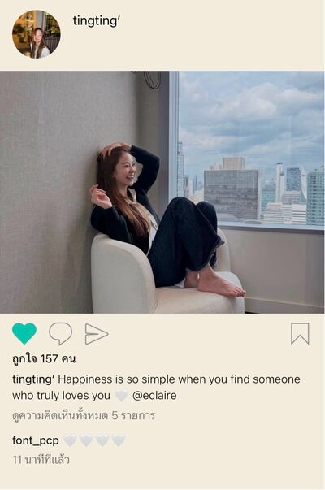

# Never Without You — Chapter 19

## Character and alias key

- **tt’** — TingTing (Ting / Muay)
- **Patricia🌻** — Patricia (Pat / P’Pat)
- **eclaire** — Claire (P’Claire)
- **khim09** — Khim
- **lalin** — Lalin (Lin)
- **font_pcp** — Font
- **SEAN** — P’Sean, Patricia’s boyfriend
- **JJAPP** — Japp
- **BEll** — Bell
- **หม่าม้า / ปะป๊า** — Ting’s mother (“Mom”) and father (“Dad”)

## Translation notes

- Thai internet laughter (`55555…`) is retained exactly as in the source.
- Original English messages, emoji, mentions, and repeated wording are preserved.
- “พี่ไม่ทราบ”-style group names are rendered using the exported group names; participant counts are retained.
- The chapter contains one shared image, placed at its recorded position: `img/chat_image_001.jpg`.

## Full translated chat transcript

---

### December 4th — Friday

#### khim09

*8:06 p.m.*

**khim09**
What happened? What did you do?

*8:53 p.m.*

**Patricia🌻**
I hurt Ting again.

**Patricia🌻**
I made Ting sad again.

**khim09**
What? What did you do?

*[read]*

**khim09**
Pat.

**Patricia🌻**
I’m so tired, Khim.

**Patricia🌻**
Nothing I do is right.

**Patricia🌻**
Everything I do is wrong.

**Patricia🌻**
I just wanted to step in and help, and I couldn’t even do that.

**Patricia🌻**
Ting really must hate me now.

**khim09**
What? I don’t know anything. Update me first.

**khim09**
And why are you so convinced Ting hates you?

**khim09**
Stop freaking yourself out, Pat. You’re determined to make her hate you, huh?

**Patricia🌻**
I just wanted to help her when the staff spilled water on her.

**Patricia🌻**
But Ting told me not to interfere.

**Patricia🌻**
She even messaged to say that if we ran into each other, I shouldn’t act like we knew each other.

**Patricia🌻**
Because she and I are just strangers.

**Patricia🌻**
Just people sharing the same world.

**khim09**
Whoa.

**khim09**
She really said that?

**Patricia🌻**
Yeah.

**Patricia🌻**
And you’re telling me not to think Ting hates me?

**Patricia🌻**
None of the things she says sound like someone who ever had good feelings for me.

**Patricia🌻**
I thought I’d already felt sad enough.

**Patricia🌻**
But I can still feel even sadder than before.

**Patricia🌻**
I never thought the words “people sharing the same world” could make me feel this awful.

**khim09**
Well, if someone else had said it, you probably wouldn’t have felt anything.

**khim09**
But it came from Ting’s mouth, so it shook you completely.

**Patricia🌻**
Yeah.

**Patricia🌻**
There’s really nothing left between us.

**Patricia🌻**
It’s awful.

**khim09**
But every word she said really did sting.

**khim09**
She picked them specifically to say to you.

**Patricia🌻**
Because I made her sad first.

**Patricia🌻**
It’s my fault from the start.

**Patricia🌻**
I don’t like myself at all.

**Patricia🌻**
I hate that I’ve become the person who makes Ting sad.

**khim09**
You’re saying action = reaction?

**khim09**
It’s not. Don’t blame yourself, Pat.

**khim09**
You’re not wrong for not being able to return Ting’s feelings. You must not give up your position on this.

**Patricia🌻**
I don’t know, Khim.

**Patricia🌻**
Let me be wrong, if it means I can fix something.

**Patricia🌻**
If I hadn’t pried on my birthday, it probably wouldn’t have turned out like this.

**Patricia🌻**
Or if, when Mom was sick, I had just called Ting first, things might have gone better.

**Patricia🌻**
Everything happened because I made all the wrong decisions.

**khim09**
Ugh, Pat. What has Ting done to you?

**khim09**
Stop playing the self-blaming villain first.

**khim09**
As soon as you found out she came to see you at the hospital, you lost it, then came back with “I can be sad, but she mustn’t be sad.”

**khim09**
At first you were even going to stop talking about Ting.

**Patricia🌻**
That’s all I wanted, Khim.

**Patricia🌻**
I just wanted to know whether the past meant anything to Ting.

**Patricia🌻**
Whether Ting still worried about me at all.

**khim09**
Yeah, back then she worried about you.

**khim09**
But now I don’t know whether she still does.

*[read]*

**khim09**
And did you two meet again, or was that the time under the building in the evening?

**khim09**
How did a staff member spill water on you?

**Patricia🌻**
We met again while I was eating.

**khim09**
The meal with your mom and P’Sean, right?

**Patricia🌻**
Yes.

**Patricia🌻**
Ting came to the same restaurant.

**khim09**
Oh my god.

**khim09**
I get that there’s only one mall there, but out of ten restaurants, you had to go to the same one?

**Patricia🌻**
It’s a place we used to go together.

**Patricia🌻**
A place Ting likes to eat.

**khim09**
And who was the nosy one who chose that restaurant?

**Patricia🌻**
Me.

**khim09**
I concede.

**khim09**
Even now, you’re still the older sister who understands her best.

**khim09**
I concede, Paaat.

**Patricia🌻**
Ting said she hates P’Sean too.

**khim09**
Why?

**khim09**
But I shouldn’t ask. Just you being with P’Sean is enough to make her hate him.

**Patricia🌻**
P’Sean saw Ting speaking to me in a not-so-nice tone, so he got up and told her they could speak nicely.

**khim09**
That’s when Ting told you not to interfere, right?

**Patricia🌻**
Yeah.

**khim09**
This one really wants to protect you from everything. Does she realize she’ll make things worse for you?

**khim09**
And did Ting freak out when P’Sean said that?

**Patricia🌻**
She didn’t yell, but she looked really angry.

**Patricia🌻**
She looked at P’Sean and me, then left the restaurant.

**Patricia🌻**
She walked out holding Claire’s hand.

**Patricia🌻**
Khim, do you know?

**Patricia🌻**
When I stood there watching Ting leave with Claire,

**Patricia🌻**
it made me feel that Ting and I

**Patricia🌻**
really can never go back to how we used to be.

**Patricia🌻**
I’ve lost another good person in my life.

**khim09**
Yeah, speaking of Claire.

**khim09**
I think we need to talk.

*8:54 p.m.*

**khim09**
Pat.

**khim09**
Where did you go?

*9:20 p.m.*

**Patricia🌻**
I was talking to Mom.

**Patricia🌻**
Mom’s worried about Ting.

**Patricia🌻**
Sigh.

**Patricia🌻**
I cried to Mom again.

**Patricia🌻**
I’d sworn I wouldn’t cry in front of Mom. I couldn’t keep it in again.

**Patricia🌻**
I don’t want Mom to stress about me and Ting.

**khim09**
But your mom was right there in the middle of it today.

**khim09**
Right? She saw everything, didn’t she?

**Patricia🌻**
Yes. That’s why she’s worried.

**khim09**
What did your mom say?

**Patricia🌻**
Mom didn’t look okay with what Ting said today. She wants to know even more what happened.

**Patricia🌻**
She asked me what I did to make her speak to me like that...

**khim09**
And what did you tell her? Did you tell her it was because you rejected Ting?

**Patricia🌻**
I didn’t tell her. I didn’t want to answer a lot of questions. It’s Ting’s business too; I don’t know whether she’d be comfortable with me telling Mom.

**Patricia🌻**
So I just said I’d made a promise to Ting about something important to her.

**Patricia🌻**
But I couldn’t keep the promise, so we fought. I deserve Ting being upset with me.

**khim09**
Yes, Pat accepts everything as usual.

**khim09**
The universe is smiling 🙂

**Patricia🌻**
Mom also said, as always, that I should go apologize and talk it out nicely. If Ting was still heated, I should let things cool down.

**khim09**
Your daughter is already cold enough to be ice, ma’am.

**Patricia🌻**
But I did tell Mom that apologizing wouldn’t help.

**Patricia🌻**
Because Ting probably won’t forgive me anymore.

**Patricia🌻**
Ting doesn’t want me anymore.

**khim09**
You’re giving up so easily.

**Patricia🌻**
I’m not giving up, but there’s really nothing I can do.

**Patricia🌻**
I don’t want us to hate each other any more than this.

**Patricia🌻**
Even this much, I can barely take.

**Patricia🌻**
I wish you could see the way Ting looked at me. It isn’t like Ting at all, Khim.

**khim09**
It is Ting, though.

**khim09**
Just Ting when she’s so angry at you that she doesn’t want you anymore, Pat.

**Patricia🌻**
It’s not.

**khim09**
Not how?

**Patricia🌻**
I don’t know. I just know it isn’t.

**Patricia🌻**
And Mom has never seen Ting like this either—irritable and in a bad mood. Normally, Ting is always cheerful when she’s with Mom.

**Patricia🌻**
So I don’t want Mom to think Ting is like that for no reason.

**Patricia🌻**
There is a reason, and that reason is me.

**khim09**
You’re crazy, Pat.

**khim09**
The kid tells you not to interfere, that you’re just strangers, just people sharing the same world, and you can still protect her.

**khim09**
I’m not saying you should hate her, but don’t go blaming yourself for everything.

**khim09**
Are you going to go back to being that crazy girl who carries the whole world again?

**khim09**
Don’t you remember when you lived like a robot?

**Patricia🌻**
I’m not trying to carry the world. I don’t want to go back to being a robot.

**Patricia🌻**
I just don’t want anyone to see Ting as a kid who isn’t lovable.

**Patricia🌻**
Because I know—I know this isn’t who Ting really is.

**Patricia🌻**
The Ting I know is a really, really good kid.

**khim09**
Pat, seriously.

**Patricia🌻**
P’Sean is calling. Talk later.

**khim09**
Okay, okay.

#### eclaire

*9:28 p.m.*

**eclaire**
Have you stopped crying yet?

*9:33 p.m.*

**eclaire**
TingTing?

**tt’**
I can’t stop crying. I’m angry.

**tt’**
I don’t like him at all. I don’t want to see his face.

**tt’**
Let alone him talking to my face

**tt’**
I hate that man

**eclaire**
I could tell

**tt’**
Never hate anyone like him

**tt’**
That prick pushed my buttons!!

*[read]*

*9:46 p.m.*

**tt’**
Claire, are you busy?

**eclaire**
Not busy.

**eclaire**
Of course I’m free to talk to you.

**tt’**
You weren’t replying.

**eclaire**
I was just thinking.

**eclaire**
About why you hate him that much.

**eclaire**
You don’t even know that man, do you?

*[read]*

**eclaire**
But never mind. I just need to know you hate him.

**eclaire**
And I won’t like anyone who makes you sad either, no matter who they are.

**tt’**
You know what?

**tt’**
He used to say the same thing to me.

**tt’**
He said that if anyone made me sad, he wouldn’t like that person.

**tt’**
I wonder now whether he dislikes himself too.

**tt’**
Because he’s the one who made me sad the most.

#### lalin

*10:37 p.m.*

**eclaire**
Have you talked to Ting at all?

**lalin**
The last time was when she messaged to curse Pat’s ex.

**lalin**
The one who happened to run into her at her office building.

**lalin**
But she was with P’Claire then, right?

**eclaire**
Yeah.

**eclaire**
And then they ran into each other again when we were going to eat.

**lalin**
Huh, she ran into Pat?

**eclaire**
Yes, all together—her mom and her ex too.

**eclaire**
Or maybe they’re together now. I don’t know whether they’re dating.

**eclaire**
Ting walked into the restaurant, but when she saw him, she turned right around.

**eclaire**
Then a staff member followed and accidentally spilled water on her.

**eclaire**
Pat was about to get up to help Ting, but Ting snapped at her not to interfere.

**lalin**
She really has a sharp mouth, that Ting.

**lalin**
I know she speaks before she thinks, but I didn’t think it would be this bad.

**lalin**
How was Pat?

**eclaire**
I don’t know. I wasn’t looking.

**eclaire**
The next thing I knew, her boyfriend walked over and told Ting to speak nicely.

**lalin**
He said that to her?

**eclaire**
He said it gently.

**lalin**
But she really was speaking badly.

**lalin**
She probably just said whatever would make her feel better.

**eclaire**
No, Lin.

**eclaire**
I wanted her to feel better too.

**eclaire**
But the truth is, whatever Ting says out loud, Ting is the one who ends up hurting that much.

**lalin**
Why? Did she say something to you, P’Claire?

**eclaire**
The reason Ting is speaking so badly is that she’s still sad.

**eclaire**
Because she loved him so much that she still can’t stop being sad.

**eclaire**
Didn’t you see Ting when she was angry at me? Even when she was really angry because I said bad things about Pat, she was only angry at me for one day.

**eclaire**
Because, for her, I don’t have feelings that strong.

**eclaire**
Not even a little compared to Pat, Ting’s Pat.

**lalin**
I warned you.

**eclaire**
Yeah, it’s fine. I can still endure it.

**lalin**
Using the word “endure” already says it all, doesn’t it?

**lalin**
What kind of relationship requires enduring just to stay together?

**eclaire**
But if I’m not here, who’s going to look after Ting?

**eclaire**
I want Ting to love me too, but I also worry about her...

**lalin**
There’s still me and Fon.

**eclaire**
And do you and Fon think you can make Ting eat?

**eclaire**
Do you think that if you said something now, Ting would listen to you?

**lalin**
Yeah, probably not.

**lalin**
Forget listening—she barely even comes out to talk.

**eclaire**
Today, as soon as she ran into Pat, she told me to go home, that she wasn’t eating. She sat crying and cursing her boyfriend the whole way.

**eclaire**
I have to sit and watch her eat at home before she’ll eat a little. Dad and Mom are worried too.

**lalin**
She’s like a child. If you have to follow her around and take care of her this much, can you handle it?

**lalin**
There has to be a day when we let her grow up on her own too.

**lalin**
Ting acts like this because she knows you’re there. Try disappearing for a while—she’ll come to her senses.

**eclaire**
And how am I supposed to disappear, Lin?

**eclaire**
When I love Ting this much?

---

### December 5th — Saturday

#### SEAN

*8:17 a.m.*

**SEAN**
How are you, Pat? Feeling better?

**Patricia🌻**
Yes.

**Patricia🌻**
I guess I’m feeling better.

**SEAN**
Did you fight with her or something? Mom said you broke a promise to her, which is why she’s angry.

**Patricia🌻**
I don’t want to talk about it, P’Sean.

**SEAN**
Okay, it’s fine. I’ll know only as much as you want to tell me.

**SEAN**
But you really care about her a lot, don’t you? You didn’t respond to anything.

**SEAN**
I know you two are very close, but wasn’t what she said to you yesterday going too far?

**SEAN**
She didn’t seem to care about you at all, even though you just wanted to help.

**Patricia🌻**
Can we not talk about Ting?

**Patricia🌻**
P’Sean doesn’t know Ting the way I do.

**Patricia🌻**
Please don’t judge her just because of what you saw yesterday.

**SEAN**
I don’t want to judge anyone, but you won’t tell me anything.

**SEAN**
We used to be able to talk about everything, didn’t we, Pat?

**SEAN**
If we’re going to date, I want us to be able to talk about everything like before.

**Patricia🌻**
I understand.

**Patricia🌻**
I want us to be able to talk about everything too.

**Patricia🌻**
But right now, I’m not ready to talk about Ting. Please understand me.

**SEAN**
Okay.

**SEAN**
Do you want to go anywhere this weekend? I’ll take you.

**Patricia🌻**
Can I rest? I don’t want to go anywhere. I want to stay home with Mom.

**SEAN**
Of course.

**Patricia🌻**
P’Sean.

**Patricia🌻**
On weekdays, you don’t need to pick me up from work anymore. I’ll go home by myself.

**SEAN**
Why? I can pick you up.

**Patricia🌻**
I don’t want to be a bother.

**SEAN**
You’re not a bother at all.

**Patricia🌻**
I just want to live my normal life first.

**SEAN**
Oh, okay.

**SEAN**
So when will we see each other? Or should we wait until next Saturday, when I have to take Mom to the doctor?

**Patricia🌻**
Yes, we can wait until Saturday.

**SEAN**
Okay.

#### prettybabies (3)

*10:11 a.m.*

**font_pcp**
Ting.

**font_pcp**
Are you still alive? Give us a status update.

**font_pcp**
Lin said you went to see Pat again yesterday, huh? @tt’

**lalin**
And ask whether she’s eaten today.

**font_pcp**
🥹

**tt’**
I ate. Got scolded by Dad.

**lalin**
Good. About time.

**lalin**
I was wondering how long Mom could hold Dad back.

**font_pcp**
Did you throw a tantrum, Ai Ting?

**tt’**
I didn’t throw any tantrum at all.

**tt’**
I’ve been quietly in my room, even.

**lalin**
Is Claire still there?

**tt’**
She went home yesterday already.

**font_pcp**
Yeah, and how was yesterday? The Pat thing.

**tt’**
Can you stop asking? I don’t want to talk. Just seeing the name annoys me.

**tt’**
It makes me think of that muscle-bound jerk again. So annoying—annoying face. What’s so great about him anyway?

**tt’**
He must be great, huh. Must be so happy. The family Mom wants me to have. The three of them going out to eat, looking complete with nothing missing.

**tt’**
With a man there to take care of and protect her. They must be really happy.

**tt’**
She could quit and have kids, you know. Go build the family she wants.

**font_pcp**
(I ask one short question and you answer with a whole essay, then say you don’t want to talk. What is this 😭)

**lalin**
Wasn’t mocking Pat in front of her enough?

**lalin**
If you wanted to hurt her, I think you’ve hurt her plenty already.

*[read (2)]*

**lalin**
Ting, if you can’t handle it, say you can’t. Stop mocking Pat and us.

**lalin**
The way you’re taking your emotions out on us doesn’t go far—it all comes back to you.

**lalin**
Every word that comes out of your mouth, the person who gets hurt is you. Pat isn’t going to come and feel anything about it.

**font_pcp**
Ai Lin, that’s pretty direct.

**lalin**
It has to be said directly like this, or she’ll never realize.

**tt’**
I don’t want to be like this either.

**tt’**
But it’s the only way I can keep going without her.

**tt’**
I don’t want her to know I’m sad. I don’t want her to know how much it hurts to see her choose someone else.

**tt’**
I will never let her see me weak.

**tt’**
She can live without me, so why can’t I live without her?

#### Baby’s Daddy&Mommy (3)

*11:24 a.m.*

**หม่าม้า**
Claire, sweetheart, Mom’s leaving Ting with you. She won’t go out even when we invite her.

**หม่าม้า**
She got scolded by Dad this morning, so she’s probably still sad.

**ปะป๊า**
And she still has the nerve to mock me, saying she’ll just stay home eating all day so I won’t have to nag.

**ปะป๊า**
Look at this kid.

**eclaire**
I’ll take her out of the house myself. Ting can’t stay home—she’ll get restless.

**ปะป๊า**
Exactly. When has she ever wanted to stay home?

**ปะป๊า**
But today, when we invited her to visit Grandma and Grandpa, she pretended not to want to go.

**หม่าม้า**
Please take care of her, Claire.

**eclaire**
Okay, Mom.

#### khim09

*12:04 p.m.*

**Patricia🌻**
Mom must really want to know about Ting. This morning, she came and asked whether I’d talked to Ting yet.

**Patricia🌻**
Probably because I seem calmer. She’s probably worried.

**khim09**
If you won’t tell them, of course the adults are going to want to know.

**Patricia🌻**
Yeah. Mom probably thinks I did something terrible.

**Patricia🌻**
She even asked whether it was about money—did I borrow money from Ting and not pay it back? Mom has savings if I need money.

**khim09**
Holy shit 5555555555

**Patricia🌻**
I was confused for a second, then asked Mom whether she even knows her own daughter.

**khim09**
I adore your mom so much. She’s probably trying to figure out what could make you two fight.

**khim09**
Mom asks like she doesn’t know her own daughter, 1, and like she doesn’t know Ting, 2.

**khim09**
But then again, from an adult’s perspective, they probably really can’t imagine what could make you two fight so fiercely.

**Patricia🌻**
Probably. Money does seem like something that can make people fight.

**khim09**
What do you think would happen if Mom found out Ting likes you as more than a sister?

**Patricia🌻**
She’d probably be confused. Mom probably wouldn’t expect it.

**Patricia🌻**
I did introduce her as my little sister from the start.

**khim09**
Do you think your mom could accept it if you had a girlfriend?

**Patricia🌻**
When would I ever have a girlfriend?

**khim09**
Yes, ma’am. I get it—you’re straight.

**khim09**
Can’t have a girlfriend; it has to be a man only.

**khim09**
I’m just asking your opinion.

**Patricia🌻**
I don’t know. I can’t guess either.

**Patricia🌻**
But with you and Nong Chan, Mom doesn’t seem to mind, so she’d probably accept it.

**khim09**
That’s parents for you. When it’s not their own child, they understand everything.

**khim09**
When it’s their own child, they think differently.

**khim09**
By the way, why don’t you act normal so Mom will stop asking about Ting?

**khim09**
You work hard at making your mom worry, then say you’re afraid of stressing her. Ridiculous.

**Patricia🌻**
I’m trying.

**Patricia🌻**
But ever since Ting’s gone, life feels so quiet.

**Patricia🌻**
I don’t know what to talk to Mom about. I can’t focus on reading anything.

**Patricia🌻**
All day, I just scroll on my phone like someone with ADHD.

**khim09**
Scrolling for what? What’s on your phone?

**Patricia🌻**
Nothing. I’m probably just addicted to my phone.

**Patricia🌻**
Because I used to talk to Ting all day.

#### IG: tingting’

*2:37 p.m.*

**Picture shared in the conversation**

#### khim09

*2:38 p.m.*

**Patricia🌻**
Ting’s with Claire again.

**khim09**
How do you know?

**khim09**
Oh, you said Claire’s name and I remember now. I was wondering what I’d forgotten; I thought about it forever.

**khim09**
Come here, Pat. Talk to me properly.

**Patricia🌻**
I saw it on IG.

**Patricia🌻**
Why? What do you want to talk about?

**khim09**
Claire, obviously. Yesterday I was going to talk, and you disappeared to talk to P’Sean.

**khim09**
And what does it matter that Ting’s with Claire? How is it different from her being with anyone else?

**Patricia🌻**
Ting isn’t with anyone else, though. Every time I see her post on IG, she’s with Claire.

**khim09**
And if she went to be with someone else, would you feel anything? Would you dislike that person like you dislike Claire?

**Patricia🌻**
Who else would there be?

**khim09**
Anyone. Ting’s friends.

**Patricia🌻**
Why would I dislike Ting’s friends?

**khim09**
Then why don’t you like Claire?

**khim09**
You don’t like her just because she gets to be with Ting, right?

**Patricia🌻**
Yeah, exactly. She made Ting sad before but still gets to be with Ting. It’s not fair.

**Patricia🌻**
And look at Ting’s caption. She must really love Claire.

**Patricia🌻**
I wonder whether she ever thought that about me.

**khim09**
You’re comparing yourself to Claire, Pat, and then asking about fairness?

**khim09**
Do you feel anything about what you just typed?

**Patricia🌻**
Feel what?

**khim09**
Do you really not feel anything at all?

**khim09**
Are you okay, Pat?

**Patricia🌻**
Why? What am I supposed to feel?

**khim09**
That it’s not like you.

**khim09**
That something in you might have changed.

**khim09**
Honestly, have you ever thought for a second that you might have caught the gay?

**khim09**
Do you love Ting more than a sister, Pat? These things can slip, you know.

*[read]*

**khim09**
What you feel about Claire might not just be protectiveness over a close little sister. You might be jealous that Ting is with her.

**khim09**
At first, I thought you were shaken so badly because I understood Ting really is important in your life.

**khim09**
But thinking about it, P’Sean was also very important in your life when you broke up with him.

**khim09**
But with P’Sean, you didn’t seem shaken much. You were just sad, accepted reality, and it ended. With Ting, you look like you’re dying.

**khim09**
You sit looking at her IG. You sit there jealous when she says she loves someone else. It’s strange, Pat.

**khim09**
Have you slipped without realizing it? Think carefully.

**Patricia🌻**
I’m not jealous that Ting says she loves someone.

**khim09**
Then what does “not fair” mean? What has to be fair? I’m confused by you.

**khim09**
Ting won’t let you be in her life because you don’t like her that way, so she left. It should have ended right there.

**khim09**
But you don’t look like it’s over. What fairness are you asking for, if not because you’re jealous of Claire?

**khim09**
Is what bothers you now that you know Ting loves and is happy with someone else?

**khim09**
Think about the things Ting used to do with you, the things Ting used to say to you. Imagine if she did them with Claire—how would you feel?

**Patricia🌻**
It’s Ting’s right.

**khim09**
I already know it’s Ting’s right...

**khim09**
I’m asking how you’d feel, not whose right it is.

*[read]*

**Patricia🌻**
It would hurt.

**Patricia🌻**
But can’t we be sad that a little sister we used to be so close with has gotten close to someone else instead?

**Patricia🌻**
Isn’t it normal that when we give our heart to someone, we want it back?

**khim09**
Yes, it’s normal.

**khim09**
But you need to distinguish what kind of heart you gave. A heart that genuinely thinks of her as a little sister,

**khim09**
or a heart that has already fallen in love without realizing it.

**khim09**
Because if you really think of Ting as just a sister, you wouldn’t need to care where Ting goes or who she’s with.

**khim09**
Just knowing she’s okay should be enough. You’d each live your own lives.

**Patricia🌻**
I don’t like women, Khim. How could I like Ting that way?

**Patricia🌻**
Okay, I don’t like Claire because of Ting, but that doesn’t mean I have to be jealous of Claire, right?

**Patricia🌻**
Can’t a person feel hurt by a little sister they were close to?

**khim09**
Have you ever felt your heart flutter because of Ting?

**khim09**
When it was just the two of you together.

**khim09**
When you stayed over at her place, or when she did your makeup.

**khim09**
When you had to be close. Did your heart ever race, or did anything ever feel strange?

*[read]*

**khim09**
Well?

**Patricia🌻**
No.

**Patricia🌻**
I said I don’t like her that way. What would make my heart race?

**khim09**
Okay, if you don’t like her, you don’t. I don’t want to force anyone.

**Patricia🌻**
No, it’s not like it used to be.

**khim09**
Huh? You’ve felt your heart flutter because of Ting?

**Patricia🌻**
It’s not really heart-fluttering, but it felt good.

**khim09**
Good how?

**khim09**
It must have been different from normal for you to bring it up.

**Patricia🌻**
It felt good in a way that made me think, “She’s so cute.” When she arranged flowers for me when I stayed over at her place, I felt Ting was romantic.

**Patricia🌻**
But it was probably just being impressed. It probably wasn’t the heart-racing you mean.

**khim09**
It’s exactly these small things, Pat, that make you slip without realizing it.

**Patricia🌻**
That night, Ting was stressed about Claire too. I remember.

**Patricia🌻**
At the time, I told Ting to call Claire and talk, because I knew Claire was important to her.

**Patricia🌻**
And she really is important. That’s why Ting can’t be without her.

**khim09**
Sounding resentful like a husband who’s been left. If you don’t get heart flutters, you don’t. Up to you.

**khim09**
I knew it. If I can’t pin you down, you’ll never admit it.

**khim09**
Straight people are so stupid.

**Patricia🌻**
What’s stupid about me? I said I don’t like her.

**Patricia🌻**
If I liked her, I’d have liked her long ago, wouldn’t I? Why would I see her as a little sister?

**khim09**
Have you ever thought that Claire might not just be Ting’s older sister? What if she’s gay?

**khim09**
Suddenly, when you’re not around, she goes back to being close with Claire like this. It might be because Claire loves Ting in a way you can’t.

**khim09**
Ting’s “truly love” could mean something about the current situation too.

*[read]*

**khim09**
You don’t think that?

**Patricia🌻**
Probably.

**Patricia🌻**
It’s probably the kind of love Ting wants.

**Patricia🌻**
That’s why it’s real for Ting.

**khim09**
Oh my god.

**khim09**
I’m telling you to fight, not to sulk.

**Patricia🌻**
Fight for what? I can’t fight.

**Patricia🌻**
If Ting means what you say,

**Patricia🌻**
then my love isn’t worth as much as Claire’s love anyway.

#### eclaire

*8:42 p.m.*

**tt’**
Thank you for going out with me all day.

**eclaire**
I wanted to be with you anyway. You don’t need to thank me.

**tt’**
Mm, that’s true.

**tt’**
But you were tired from having to pick me up and drop me off, so I should thank you.

**tt’**
I don’t want to thank you anymore. I don’t like the word “thank you” at all.

**eclaire**
Why?

**eclaire**
Is it because of her?

*[read]*

**eclaire**
Then you don’t have to thank me. I can take care of you.

**tt’**
You’ve always taken care of me.

**eclaire**
Yes, because I love you.

*[read]*

**eclaire**
Just saying. You don’t have to answer.

**tt’**
Am I a bad person?

**eclaire**
No. You’re just sad.

**eclaire**
When you stop being sad, you’ll go back to being yourself.

**tt’**
Dad just keeps scolding me. He doesn’t understand me at all.

**eclaire**
Because it’s about work. Dad just wants you to take responsibility for your work.

**tt’**
I went back to work already. What more does he want?

**eclaire**
Give Dad a little more time. He’ll stop scolding soon. Trust me.

**tt’**
Mm.

**tt’**
Claire.

**tt’**
Can you not leave me? I don’t want to be alone at all.

**eclaire**
I’ve never thought about leaving you, TingTing.

**tt’**
Stay with me.

**eclaire**
I am with you. I’m not going anywhere.

**tt’**
I want to be happy. I don’t want to cry anymore.

**tt’**
It hurts so much. When will it stop hurting?

**eclaire**
Everything will get better.

**eclaire**
You just have to give yourself time.

**tt’**
Did it take you long?

*[read]*

**tt’**
A very long time?

**eclaire**
I don’t know either whether it was long.

**eclaire**
But even now, it still hasn’t stopped hurting.

**tt’**
I’m sorry.

**eclaire**
You don’t need to apologize. It was all my own doing.

**eclaire**
Do you want to go anywhere tomorrow? You shouldn’t stay home.

**eclaire**
I don’t want you to be alone either.

**tt’**
Mm, let’s go.

**eclaire**
Should we invite Dad and Mom too? Go together—maybe Dad will feel better.

**tt’**
Fine. I don’t know what he’d even scold me for.

**eclaire**
You just keep being stubborn. That’s why he wants to scold you more.

**eclaire**
Today, you wouldn’t go to Grandma and Grandpa’s either, so Dad likes it even less.

**tt’**
I don’t want to go. When I go, I sulk, and then they ask me this and that. I don’t want to answer.

**eclaire**
Then why do you have to sulk? Just act normal.

**tt’**
I’m in a bad mood—how am I supposed to act normal?

**tt’**
And they like to complain that whenever things don’t go their way, I’m stubborn and selfish.

**tt’**
What does Dad know about what I’ve been through? He doesn’t even know anything, and he still takes other people’s side.

**tt’**
As soon as he sees I have a problem, he decides first that I’m the one at fault, that I did something wrong. Pat’s the cruel one.

**tt’**
Talking about this annoys me again. Boring.

**eclaire**
Why don’t you tell Dad and Mom what happened?

**tt’**
I don’t want to tell.

**tt’**
Telling them wouldn’t change anything.

**tt’**
In the end, Dad and Mom will still think I’m the one at fault.

**eclaire**
Why do you think that?

**eclaire**
What parents like seeing someone make their child sad? Dad and Mom will take your side.

*[read]*

**eclaire**
TingTing?

**eclaire**
Or do you not want to talk about this?

**tt’**
Because deep down, I know.

**tt’**
That feelings can’t be forced.

**tt’**
I know she didn’t do anything wrong.

**eclaire**
She did wrong.

**eclaire**
She was wrong for making you sad.

**tt’**
You’re probably the only one who’d tell me that, Claire.

**tt’**
Let me ask you something.

**tt’**
Was I wrong, all this time?

**tt’**
For making you sad.

*[read]*

**tt’**
If I wasn’t wrong,

**tt’**
then what was Pat wrong for?

---

### December 9th — Wednesday

#### prettybabies (3)

*11:43 a.m.*

**tt’**
I want to kill someone.

**tt’**
So annoying. I actually wanted to focus on work and be in a good mood, but all I get is stupid stuff.

**tt’**
Should I just curse him out? That idiot.

**tt’**
Is he still sane? Why does he like making people do redundant work? If there’s something he wants, just say so. Weirdo.

**font_pcp**
The daily life of a violent gay kid. I’m going crazy.

**font_pcp**
Does she really want to be in a good mood? She’s been in a bad mood since Monday.

**tt’**
Look at this.

**tt’**
At first, he told one of the seniors on the team to do the presentation + agenda for the forum, but he didn’t like any of it, so he told me to try too.

**tt’**
I’ve been working on it since Monday. When I submitted it, he wanted a bit of that person’s and a bit of this person’s. I don’t know what. In the end, two people worked on it and neither got it done.

**font_pcp**
He = the boss. There’s no one better than this, bestie.

**lalin**
She’s the company owner’s daughter. Everyone calls her whatever, except Dad.

**font_pcp**
55555555

**tt’**
If he wants something a certain way, just say so. Not “go try it first,” then when the time comes, order changes here and there.

**tt’**
When is the work supposed to get done? Is he going to keep revising it? And waste two people’s manpower on some tiny little task.

**tt’**
They’re actually insane. What are they thinking? I’m doing well not to curse back in the group. Delusional.

**lalin**
Has your life ever been satisfied with anything, gay kid?

**font_pcp**
55555555

**tt’**
Well, you guys try working and see. You’ll run into it yourselves.

**font_pcp**
Not doing it.

**lalin**
Right, we’re rich. Why would we?

**tt’**
And then you’re going to criticize me, huh? 😡

**lalin**
Just finding you annoying.

**font_pcp**
55555555

**lalin**
Honestly, from what you’ve told us, she does deserve to be cursed.

**lalin**
Go ahead and curse her.

**tt’**
Still. Still angry.

**tt’**
I haven’t replied to him yet either.

**tt’**
So irritated.

**lalin**
What are you waiting for? Curse her.

**tt’**
He’s my boss. How can I curse him?

**font_pcp**
Whaaat

**font_pcp**
Is there anyone Ting can’t curse?

**lalin**
555555555

**tt’**
If I curse, it’ll become a problem.

**tt’**
I’m new too. I don’t know who would take my side. It’d make the team atmosphere worse.

**tt’**
The work isn’t moving anyway. Everything’s a mess. Nothing is good.

**lalin**
She has some sanity.

**font_pcp**
How? I thought she was going to swing.

**font_pcp**
A rich kid like Ting has never cared about anything, has she?

**lalin**
Or did someone on the team talk you down?

**tt’**
No.

**tt’**
I’m not close with anyone. I don’t talk to anyone on personal LINE.

**tt’**
If there’s anyone who could talk me down,

**tt’**
it’d probably be my former senior teammate.

**font_pcp**
Awww

**font_pcp**
The gay kid dares to admit she misses her.

**tt’**
I don’t miss her.

**tt’**
I just remember some of the things she taught me.

**tt’**
And I know it’s exactly like what she said.

**tt’**
The outside world is like that.

**lalin**
Pat must be happy now that what she taught is finally useful.

**font_pcp**
Bestie now 😎 Doing the cool pose. Can live just fine without her.

**font_pcp**
But don’t take off the glasses.

**lalin**
Take them off once and it’s like this 🥲

**lalin**
Tears falling inside.

**font_pcp**
5555555555

**tt’**
Lin, you’re right.

**tt’**
She didn’t owe me anything

**tt’**
She actually gave me something

#### BEll

*12:09 p.m.*

**BEll**
Are you coming down?

**BEll**
If you’re coming, don’t bring Pat to the food court.

**BEll**
Stop her immediately if she’s thinking of eating.

**JJAPP**
Why?

**BEll**
I just walked past and saw Ting.

**BEll**
She was sitting eating alone.

**JJAPP**
Okay, but we eat at the food court anyway, don’t we?

**BEll**
True.

**JJAPP**
555555555

**JJAPP**
Maybe we’ll go to the som tam place and eat spicy.

**BEll**
Whatever. Just keep your distance. I’m warning you.

**JJAPP**
Okay, sure.

*12:13 p.m.*

**JJAPP**
Reporting to you. Invited you to eat som tam too.

**BEll**
Good. I don’t want a war yet. Things are hard enough already.

**JJAPP**
555555555

**JJAPP**
Oh, P’ came to tell me just now that the new hire is coming next Monday.

**BEll**
Already? Nice.

**BEll**
Pat interviewed her, right? How was she?

**JJAPP**
I asked that day, and she seemed okay. She seems to understand the work.

**JJAPP**
She’ll probably learn fast. Probably won’t be as much of a menace as a certain kid.

**BEll**
A certain kid—just say her name.

**JJAPP**
555555

**JJAPP**
But saying it or not, I’m not angry at Ting.

**JJAPP**
If it weren’t for her, we’d still be stuck with P’Duen.

**BEll**
True. Who else could take down P’Duen if not Ting?

**JJAPP**
Let’s call it even. When she was on the team, it was fun. The team had so much energy.

**JJAPP**
Cut to now: just corpses sitting working.

**BEll**
Harsh, but true.

**JJAPP**
Also, the person who took her crap, Pat, isn’t even a little angry at her.

**JJAPP**
So who are we to be angry at her?

#### eclaire

*12:26 p.m.*

**eclaire**
You’ve eaten, right? How are you today?

**tt’**
Eating now.

**tt’**
There’s something a little infuriating. My boss is annoying.

**tt’**
She assigned two people to do the same work and still can’t choose. She keeps ordering changes back and forth, wasting both our time.

**eclaire**
Then tell her: if she wants it a certain way, say so from the start. Who can guess her mind?

**tt’**
Mm, everyone thinks that, but where could I say it?

**eclaire**
Why can’t you say it? If you don’t say it, how will she know?

**eclaire**
She’ll keep acting the same if you don’t tell her to adjust.

**tt’**
And how am I supposed to tell her to adjust? I’m not her boss.

**eclaire**
You are her boss. Your dad pays her salary.

**tt’**
Yes, my dad pays her salary, not me.

**eclaire**
What’s the difference?

**tt’**
Enough. I don’t want to argue anymore. I’m tired. Talking to you doesn’t get through.

**eclaire**
I’m not trying to argue. I just don’t want you working while irritated.

**tt’**
You don’t want me irritated?

**eclaire**
Yes.

**tt’**
If that’s what you want,

**tt’**
then you just have to tell me to endure it. To calm down.

**tt’**
Tell me to suck it up.

**eclaire**
Suck it up?

**tt’**
Mm.

**tt’**
Suck it up.

**tt’**
Keep it in.

**tt’**
Store it away.

**tt’**
And grow up a little.

---

### December 12th — Saturday

#### SEAN

*8:11 a.m.*

**SEAN**
I’m heading in now.

**Patricia🌻**
Okay. Mom and I are done.

**SEAN**
After the doctor, do you want to go for a walk?

**SEAN**
It’d be good to let Mom get some fresh air.

**Patricia🌻**
I’ll ask Mom first.

**SEAN**
Okay. We can decide when we meet.

**Patricia🌻**
Okay.

#### khim09

*11:43 a.m.*

**Patricia🌻**
We’re done at the doctor’s. Mom’s doing okay.

**khim09**
Your mom is amazing.

**Patricia🌻**
She said she misses you and Chan.

**khim09**
And does she miss little Ting too, hmm?

**Patricia🌻**
You buffalo.

**khim09**
5555555555555

**Patricia🌻**
But she probably does miss her.

**Patricia🌻**
Today, when I asked whether she wanted to go anywhere, she said she wanted to go to the mall with the garden on top.

**khim09**
Central Park, right?

**Patricia🌻**
Yeah.

**Patricia🌻**
The place Ting took Mom to.

**khim09**
The place you posted the song “daylight” on your story?

**khim09**
Something like “with my sunshine,” right?

**Patricia🌻**
Sunday with my sunshine

**Patricia🌻**
You have such a good memory.

**khim09**
Of course. I remember I used to tease you 5555555.

**khim09**
Now I can’t even tease you. There’s no one to tease.

**Patricia🌻**
P’Sean doesn’t count, I guess.

**khim09**
Not fun. Why tease?

**khim09**
Not that he’s not fun—he just gives me nothing to tease.

**khim09**
What did you post on IG? Where did you go with P’Sean? I haven’t seen any moments to gossip about.

**Patricia🌻**
What is there to tell? We just went to the doctor.

**khim09**
Then you’ll go on a date at the mall after. There must be something to tell if the old flame is burning again.

**Patricia🌻**
What date? Mom’s going too.

**khim09**
See? You’re so dry. What am I supposed to tease you with?

**khim09**
I guess there’s nothing exciting anymore. Just the same old people.

**Patricia🌻**
There doesn’t need to be anything exciting.

**Patricia🌻**
Life is just like this, right? As long as you’re not dead yet, you should be grateful.

**khim09**
Oh welcome back

**khim09**
The master of appreciation!!

**khim09**
But I don’t want to see your face. Go. Get out of my friend’s body!!

**Patricia🌻**
Stop being ridiculous, Khim.

**khim09**
I’m not being ridiculous.

**khim09**
You’re the one who’s ridiculous.

**khim09**
If you want to live like this, suit yourself, Pat.

#### SEAN

*4:47 p.m.*

**SEAN**
Khim, can I ask you something?

**SEAN**
Does Pat have some issue with Ting?

**khim09**
Why? What did Pat tell you?

**SEAN**
I only know that she didn’t keep a promise to her, so they fought.

**SEAN**
But I don’t know what promise.

**khim09**
Yeah, that’s all I know too.

**SEAN**
No way. Pat tells you everything.

**khim09**
I do know, P’. Why come asking me and make me lie? 5555

**SEAN**
So you can’t tell me.

**khim09**
Pat will curse me. If you want to know, pry it out of her yourself. It shouldn’t be beyond your ability, P’Sean.

**SEAN**
I don’t know. Today, I just wanted to pick up the Care Bear, and Ting didn’t even like that.

**SEAN**
At first, I didn’t know it was Ting’s. I thought it was Pat’s, so I was going to pick it up to look.

**khim09**
Really? How did she not like it?

**SEAN**
So much that, before I even touched it, she told me not to touch it.

**khim09**
She told you directly not to touch it?

**SEAN**
Yes. At first, I was confused, wondering why.

**SEAN**
Because Pat’s voice when she spoke didn’t sound okay either. When I looked at her face, she looked like she was about to cry. I was really confused.

**SEAN**
Probably because she saw me confused, she said it was Ting’s and told me to put it away in the cabinet.

**khim09**
Going to cry again. Is this kid okay?

**SEAN**
That’s why I came to ask what you two fought about. Ting seems to affect Pat more than I thought.

**khim09**
And when it happened, didn’t you ask her why Ting wouldn’t let you touch it?

**khim09**
Even if it’s Ting’s, why can’t you touch it? It’s in Pat’s house.

**SEAN**
I asked, but Pat didn’t answer. I didn’t want to pressure her. She didn’t look good; I was afraid of making her cry.

**SEAN**
I want to know because I’m worried. I don’t want them fighting. If there’s anything I can help with, I want to help.

**khim09**
I think if Pat won’t answer, it means you probably can’t help much more than this.

**khim09**
That’s all I can say, P’.

*5:30 p.m.*

**khim09**
What happened to your heart, friend?

**khim09**
What’s with the Care Bear?

**Patricia🌻**
Did P’Sean talk to you?

**khim09**
Surprised? Your boyfriend is that worked up.

**Patricia🌻**
Worked up about what?

**khim09**
If he didn’t want to know so badly that it itched in his heart, he wouldn’t come ask me behind your back.

**khim09**
And why did you stop him from touching it? It’s just a Care Bear, Pat. What are you being possessive about?

**Patricia🌻**
It’s Ting’s.

**khim09**
It’s yours now. Ting gave it back to you.

**khim09**
Stop being attached.

**Patricia🌻**
What do you want from me, Khim?

**khim09**
I just want to know what’s so precious about a Care Bear that even P’Sean can’t touch it.

**khim09**
Are you crazy? He’s your fiancé.

**khim09**
And Ting is just a little sister you’re not dating anymore, not in each other’s lives anymore.

**khim09**
Do you have a problem with prioritizing, Pat? Seriously.

**Patricia🌻**
I just think that if Ting found out I let P’Sean touch her Care Bear,

**Patricia🌻**
Ting wouldn’t like it. She’d be sad and angry.

**Patricia🌻**
I just don’t want to make her sad anymore, Khim.

**khim09**
PAT!!!

**khim09**
I’m seriously starting to wonder whether you’re okay.

**khim09**
What does Ting have to do with you now? P’Sean could squeeze that Care Bear until its face is flattened, and she wouldn’t know.

**Patricia🌻**
Ting doesn’t know, but I do.

**Patricia🌻**
All this time, I didn’t know I was making Ting sad.

**Patricia🌻**
But now I know, and I don’t want to make her sad anymore.

**khim09**
Really? You don’t want to that much?

**khim09**
So much that you’d almost cry just because P’Sean was going to touch a Care Bear?

**khim09**
It’s been over a week, Pat. You still can’t get over it?

**khim09**
When you broke up with P’Sean, I saw you adjust to a new routine in less than a week.

**Patricia🌻**
Back then, I had to take care of Mom. Where would I find time to be sad for long?

**khim09**
You have to take care of Mom now too, don’t you?

**khim09**
So why do you have time to be sad for long this time?

*[read]*

**khim09**
Or is it still about Ting now?

**khim09**
The most important thing in your heart.

**Patricia🌻**
You don’t have to understand me, Khim. I’m just doing what makes me comfortable.

**khim09**
1%

**Patricia🌻**
1% of what?

**khim09**
No.

**khim09**
10%

**Patricia🌻**
What?

**khim09**
The percentage that the world will end.

**khim09**
And how would you end up liking a woman?

**Patricia🌻**
Are you still not done with this?

**khim09**
Oh, you buffalo. How dare you ask me that.

**khim09**
Please look at your own state first.

**khim09**
You won’t even let your fiancé touch a doll because you’re afraid the sharp-mouthed kid will be sad to death.

**khim09**
“Ting doesn’t know, but I do.”

**khim09**
“I just don’t want to make her sad anymore, Khim.”

**khim09**
“All this time, I didn’t know I was making Ting sad.”

**khim09**
“But now I know, and I don’t want to make her sad anymore.”

**khim09**
Please read these sentences in my mocking tone too.

**khim09**
And then there’s you feeling hurt when Ting said she loves Claire.

**khim09**
“She must really love Claire. I wonder whether she ever thought that about me.”

**khim09**
Blah blah blah

**khim09**
Don’t go around claiming you’re 100% straight. You’re a fake.

**Patricia🌻**
And this is you not wanting to force anyone?

**Patricia🌻**
How could you know me better than I know myself?

**khim09**
Tsk tsk

**khim09**
A straight person arguing about liking women with a gay person.

**khim09**
Tell me: how was going to Central Park today?

**khim09**
Were you as happy as when you went with Ting?

*[read]*

**khim09**
Answer now. Don’t think too long.

**khim09**
Give me your first feeling. Your brain definitely won’t lie to you.

**khim09**
But if you take time to adjust your feelings, then you’re lying to me.

**Patricia🌻**
What the hell is wrong with you?

**khim09**
Wait. What are you angry about?

**Patricia🌻**
I don’t like it. Can you not act like it’s funny?

**khim09**
I’m not having fun.

**khim09**
I’m just happy, Pat.

**khim09**
I just want you to like Ting.

**khim09**
Because I know you two would be so happy together.

**khim09**
Look at the past. Do you remember how happy you were when you had Ting?

*[read]*

**Patricia🌻**
It’s not.

**Patricia🌻**
I love Ting like a little sister, really.

**Patricia🌻**
I’ve always seen Ting as my little sister. How could I love her like a lover, Khim?

**khim09**
I already said people can slip.

**khim09**
Think carefully, Pat.

**Patricia🌻**
I don’t think I love Ting the way I loved P’Sean.

**Patricia🌻**
It’s not the same.

**Patricia🌻**
It’s not the same no matter what.

**khim09**
Are you sure?

**Patricia🌻**
Mm.

**khim09**
I’m asking seriously. Is it that hard to think you could like a woman?

**Patricia🌻**
I don’t know.

**Patricia🌻**
It might not be hard.

**Patricia🌻**
But when it’s Ting, I just want it to be a good kind of love.

**Patricia🌻**
I want it to be a love we can give each other for a long time.

**Patricia🌻**
You know how fragile romantic love is.

**Patricia🌻**
I don’t think I love Ting that way. Otherwise, I’d have stopped loving her by now.

**khim09**
Do you know?

**khim09**
The more you talk, the more you sound like you love her like a lover.

**khim09**
Can you not confuse the love you have for P’Sean with romantic love?

**khim09**
I know—you’ve only ever had one husband in your life, so you probably can’t tell them apart.

**khim09**
But what you’ve said is romantic love.

**khim09**
You just might not have loved P’Sean as much as you love Ting. That’s all.

*[read]*

**khim09**
Ah, confused.

**khim09**
Big confusion.

**khim09**
My friend is having a sexuality crisis.

**khim09**
Take it and think about it.

**khim09**
But don’t forget what I said about Claire, okay? Remember Ting’s caption?

**khim09**
You can be straight. It’s your business if you want to think of her as just a sister.

**khim09**
But remember my words: if you realize it later,

**khim09**
it might be too late, Pat.

## Author’s note

What’s going on, P’Pat? 🧐
Can Pat and Ting handle each other? Because Mom can’t anymore. Hurry up and love each other, kids. 🙏😭
Thank you to everyone who came to read, whether you’ve followed from the beginning or came from the celebrity post. Thank you so much, truly. There are so many readers—far beyond my dreams. Thank you LON for conjuring me up. 🙏😭
P.S. You all love me, right? Love me back a little too. 😔😭
