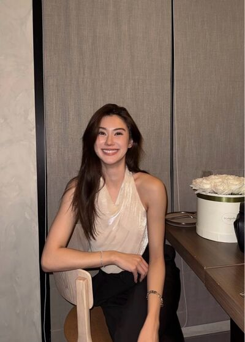

# Never Without You — Chapter 2

## Character and alias key

- **tt’** — TingTing / Ting / Muay — the new hire, on her second day; the company owner’s daughter
- **Patricia🌻** — Patricia / Pat / P’Pat — on the B2B marketing team; looking after Ting
- **Duen** — P’Duen — the team lead Ting can’t stand
- **JJAPP** — Japp — Pat’s coworker; Font’s partner
- **BEll** — Bell — Pat’s coworker
- **Namfon** — Namfon / P’Fon — coworker
- **font\_pcp** — Font (“Fon”) — Ting’s close friend; Japp’s partner
- **lalin** — Lalin (“Lin”) — Ting’s close friend, self-declared straight
- **eclaire** — Claire / P’Claire — an older figure who has looked after Ting for years; calls her “Whiny-Pouty”; speaks in an “I/you” style
- **khim09** — Khim — Pat’s close friend; her wife is Nong Chan
- **Papa / Mama** — ปะป๊า / หม่าม้า — Ting’s parents (Family 🏠 group)
- **Mentioned only** — P’Sita (Ting’s driver), P’Off (smartbuddy product briefing), Khun Apichat (Future Tech speaker), Khun Kasem, Nong Chan, Pat’s mom

## Translation notes

- Source check: the JSON holds 743 records (indices 0–742, no gaps or duplicates) and agrees line for line with the TXT export. No empty or unparsed records; no hidden text or media found in the saved record HTML.
- One picture: record 85 (sent by tt’) uses img/chat_image_001.jpg. Its content was not inspected, so it is shown with neutral alt text only.
- Duen’s two “Sent a file” messages (records 284–285) are English in the source and kept as exported; the attached files are not part of the export.
- Times are converted from Thai notation (e.g. 09:11 น. → 9:11 a.m.; “9.00 น.” → 9:00 a.m.). Read receipts: “read” → [Read], “read (2)” → [Read by 2].
- The group พี่ไม่ทราบ is rendered “Unknown Elders”. The “ไม่ทราบ” (“I don’t know”) running joke is kept as “I don’t know / I wouldn’t know”.
- ปะป๊า and หม่าม้า appear as Papa and Mama. ฮึบ is “Hup” (bracing yourself and holding it together). ยัยงุ้งงิ้ง / งุ้งงิ้ง is “Whiny-Pouty”.
- หมวย is rendered “Muay” — the affectionate nickname Pat starts using for Ting in this chapter. 🫳 is used by Pat as a head-pat gesture.
- The friends’ “husband” teasing (ผัว / สามี) and Lalin’s ตุ๊ด remark are kept as playful friend banter (“queen”). สลิ้งแตก is “snapped”. ประจบ / ประกบ wordplay is kept as “butter up” / “pair up”.
- Claire’s ไอ / ยู (“I” / “you”) speech style is rendered as plain English pronouns.
- Records 738–740 are three “.” separator lines; records 741–742 are the author’s closing note (two lines each). “Leena Miu” and “Auntie” are kept as written.
- Existing English messages, emojis, laughter (555…) and @-mentions are kept exactly as in the source.

## Full translated chat transcript

---

**August 4th**  
**Tuesday**

### Patricia🌻

*9:11 a.m.*

**Patricia🌻**  
Where are you now, Ting? Have you arrived yet, sweetheart?

**Patricia🌻**  
There's a meeting at nine thirty

**tt’**  
P’Pat

**tt’**  
I woke up late 🫠

**tt’**  
But I'll make it for nine thirty

**Patricia🌻**  
Oh

**Patricia🌻**  
Did you stay up late?

**Patricia🌻**  
I thought you'd gone to bed, though

**tt’**  
When P’Pat said good night, I was about to go to sleep, that's the thing

**tt’**  
But I couldn't sleep

**Patricia🌻**  
So that's why you're late for the second day

**tt’**  
The second day still doesn't count 🙂‍↔️

**Patricia🌻**  
No, it counts. I've already noted it in my head.

**tt’**  
P’Pat, don't scold me

**Patricia🌻**  
I don't want you to be late

**tt’**  
🫠

**Patricia🌻**  
You said you wanted to see me so much, so why are you late?

**tt’**  
Cause I was so excited last night that I couldn’t sleep 😭

**Patricia🌻**  
Are you making an excuse?

**tt’**  
Nooooo

**Patricia🌻**  
🧐

**tt’**  
You have to trust me

**Patricia🌻**  
Called me beautiful then kept me waiting and now you’re telling me to trust you? 🤨

**tt’**  
P’Pat waited for me? 🥺

**Patricia🌻**  
If I weren't waiting, would I be messaging to chase you up?

**tt’**  
Tomorrow I'll tap my card in at 9:00 a.m. sharp

**tt’**  
No more being late

**tt’**  
I won't make my beautiful older sister wait for me any longer 😠

**Patricia🌻**  
5555555

**Patricia🌻**  
Do you go around calling everyone pretty?

**tt’**  
Never. Normally I only call myself pretty

**Patricia🌻**  
Really?

**tt’**  
On the honor of someone just about as pretty as P’Pat, I wouldn't lie anyway

**Patricia🌻**  
Silly

**Patricia🌻**  
Just don't let me hear that you've called anyone else on the team beautiful older sister again

**Patricia🌻**  
Otherwise I definitely won't keep teaching Ting the work

**tt’**  
Oh, is someone sulking?

**tt’**  
But don't worry, I'm not the fickle type 🙂‍↔️

**Patricia🌻**  
You just say whatever comes to mind

**Patricia🌻**  
You're the best at soft skills, you know

**tt’**  
🤨

**Patricia🌻**  
Hurry up, okay. If you're late to the meeting, P’Duen will definitely be waiting to deal with you

**tt’**  
Let her try, if she dares

**Patricia🌻**  
I'm going to deal with you first, right now

**Patricia🌻**  
It's nine twenty already, Ting

**tt’**  
I'm waiting for the elevator 🫠

### prettybabies (3)

*10:43 a.m.*

**tt’**  
That old lady Duen is so micromanaging, I could tell after just one meeting

**tt’**  
I'm definitely going to lose my mind before I manage to win over P’Pat

**font\_pcp**  
You're already wooing her?

**tt’**  
I think I am

**tt’**  
But P’Pat said I'm good at soft skills

**tt’**  
Do you think she realizes I'm wooing her?

**font\_pcp**  
555555555555

**tt’**  
I'm so confused

**tt’**  
Short-circuited, but it's fine, I can keep going

**font\_pcp**  
Funny how you can be so calm and patient this time

**tt’**  
Well, I like beautiful older sister, you know 🫠

**font\_pcp**  
I asked P’Japp how pretty P’Pat is

**tt’**  
Very pretty, the prettiest, magnificently pretty, miraculously pretty, too pretty for a baby gay's heart to bear

**font\_pcp**  
Really?

**font\_pcp**  
P’Japp said I'm prettier

**tt’**  
What?????????

**font\_pcp**  
And I believe it, too

**font\_pcp**  
Trust your husband and you won't regret a single day

**tt’**  
Go die, Fon

**tt’**  
Both you and your husband 🤬

**lalin**  
555555555

**lalin**  
Come on, I'll be the mediator. I'll help decide who's prettier

**lalin**  
Send a photo, girl

**tt’**  
Lin, but Lin has to promise Ting first that once you see P’Pat's face you won't turn gay. Ting doesn't want to lose a friend over fighting for a woman. Ting is not okay with that

**lalin**  
This girl's in unhinged mode again

**tt’**  
🫠

**font\_pcp**  
Are you going to be unhinged at P’Pat too, Ting?

**tt’**  
Are you crazy?

**tt’**  
Well, I don't know whether it's unhinged or not

**tt’**  
But I think she likes talking to me too 🫪

**font\_pcp**  
Definitely unhinged

**lalin**  
Unhinged for sure

**tt’**  
😭

**lalin**  
You can bring out the photo now

**tt’**  

**tt’**  
Lin, don't you dare turn gay. This beautiful older sister belongs to me only 😡

**lalin**  
Wow, seeing her makes me want to slip

**font\_pcp**  
P’Japp really did lie

**font\_pcp**  
Hold on, there's someone this pretty on the team and nobody ever told me

**font\_pcp**  
Hold on a second

**tt’**  
Yeah, go deal with P’Japp

**tt’**  
But Lin, no slipping!!!

**lalin**  
Pretty

**lalin**  
But okay, still into guys

**tt’**  
Now I feel at ease 🙂‍↕️

**lalin**  
See? If you're straight, no matter how pretty someone is, you still like guys

**lalin**  
Are you sure she's gay?

**font\_pcp**  
Wee-woo wee-woo woo woo woo

**tt’**  
What's wrong with you, Fon

**font\_pcp**  
That's the sound of the rescue truck coming, sir

**font\_pcp**  
Is the baby gay ready to have her body collected yet, sir

**tt’**  
🤬🤬🤬🤬🤬🤬🤬

**lalin**  
Yeah, but just one little thing

**lalin**  
The flowers on her desk, who gave them to her?

*\[Read by 2\]*

**font\_pcp**  
Here we go, Ting

**font\_pcp**  
You're going to woo her, but first find out whether she's single

**tt’**  
I don't know

**tt’**  
I don't want to know

**tt’**  
For now I choose not to know

**tt’**  
If I ever want to know, I'll request to know myself 😡

**lalin**  
Unhinged

**font\_pcp**  
Brain short-circuited 55555555

### Patricia🌻

*10:48 a.m.*

**Patricia🌻**  
Is something bothering you? You've been scowling from the meeting until after the meeting ended

**tt’**  
Do you have to work, P’Pat? I'm afraid of disturbing your work time

**Patricia🌻**  
We can talk, if you want to tell me

**tt’**  
On second thought, I want to save it to tell at home

**Patricia🌻**  
Why?

**tt’**  
Because P’Pat said home stuff stays at home, not at the office

**tt’**  
If we talk about it here, it'll turn into a thing

**Patricia🌻**  
Okay, I understand

**tt’**  
I'll message you to talk when I get home 😡

**Patricia🌻**  
I'll definitely have to listen to you complain about something

**tt’**  
Right

**Patricia🌻**  
555555

**Patricia🌻**  
P’Off scheduled the smartbuddy briefing for tomorrow. A calendar invite has come in already — you've seen it, right, Ting?

**tt’**  
Yes, saw it. Do I need to prepare anything?

**Patricia🌻**  
No need. Just go collect the brief completely according to the brief form

**Patricia🌻**  
The product info — what it is, who they want to sell to, which team sells it, and what they want mkt to support

**tt’**  
Okay

**Patricia🌻**  
Easy, right? Can you take it on solo?

**tt’**  
I can go solo, but can P’Pat come with me? 🥺

**Patricia🌻**  
What kind of "going solo" is that?

**tt’**  
5555555

**Patricia🌻**  
I was just teasing. Of course I'm coming along.

**tt’**  
You love teasing me 😠

**Patricia🌻**  
You don't like it? If you don't, I'll stop teasing.

**tt’**  
I like it 🫠

**Patricia🌻**  
What kind of person are you?

**tt’**  
Whatever. Don't you ever stop teasing me 😡

**Patricia🌻**  
55555

**tt’**  
I'll only call P’Pat beautiful older sister, but P’Pat can't tease anyone else but me

**tt’**  
Okay? Promise first

**Patricia🌻**  
That's a very confusing deal

**tt’**  
Promise me 🥺

**Patricia🌻**  
Alright 🤙

### Unknown Elders (5)

*12:04 p.m.*

**BEll**  
Lunchhh

**Namfon**  
Som tam? I'm craving it

**BEll**  
Sure

**BEll**  
Coming? @JJAPP @Patricia🌻 @tt’

**JJAPP**  
Going, going. Five more minutes

**Patricia🌻**  
Pat and Ting are going

### Family 🏠 (3)

*12:16 p.m.*

**tt’**  
Papa Mama, I'm hot 🫠

**tt’**  
I came out to eat, the place has no air-con, I can't eat anymore

**Papa**  
Good, kiddo. Learn to rough it a little

**tt’**  
😡

**Mama**  
There's a market near the building, you know. Try going for a walk, dear

**tt’**  
Mamaaaa

**tt’**  
I said it's hot 🤬🤬🤬

**Papa**  
🤣

**Papa**  
So fun. Papa's glad you're finally getting out to live life

**tt’**  
I don't want the inheritance anymore

**tt’**  
Just one air conditioner is enough

**Mama**  
Or maybe have her come home

**Papa**  
Dear, can you not go soft?

**tt’**  
Mama, help me 🥺

**Mama**  
No, no, you have to keep working, dear

**tt’**  
Why work? I have money

**tt’**  
Oops. I have to work

**Papa**  
Have you finally figured it out, kiddo?

**tt’**  
Yes. If I don't go to work, I'll miss out on seeing P’Pat 🫠

**Mama**  
Which Pat, dear? You've been mentioning her since yesterday

**tt’**  
My beautiful P’Pat, Mama 🫪

**Papa**  
My child can't think of anything else. Her head is full of nothing but women

**Papa**  
So Papa should give up hope of finding a son-in-law, right?

**tt’**  
Right here, Papa's son-in-law

**Papa**  
If you're sure, bring her to meet us

**tt’**  
I'm sure

**tt’**  
But she might not be yet 🫠

**Papa**  
🤣

### Unknown Elders (5)

*1:14 p.m.*

**BEll**  
Such an eye-opener today. Just found out there are people who've never walked through a market 55555

**Namfon**  
Not just the market. Even tissues have to be face grade

**JJAPP**  
Keep working together and you'll get your eyes opened a lot more

**JJAPP**  
Khun Kasem's kid's world

**tt’**  
P’Japp is picking on Ting again 😡

**JJAPP**  
555555

**Namfon**  
A pampered rich girl, just like Japp said 55555

**JJAPP**  
At the som tam place Ting was about to melt

**BEll**  
But you can't say Pat doesn't look after the kid well

**JJAPP**  
Handed over a fan, walked off to buy face-grade tissue paper for her

**tt’**  
P’Japp should be used to it, you do it for Fon all the time too, don't you

**JJAPP**  
Well, that's my partner

**JJAPP**  
And whose partner is Ting?

**tt’**  
🫪

**Namfon**  
Shipping a new couple?

**BEll**  
That Pat hasn't even read LINE yet, so funny 55555555

**JJAPP**  
@Patricia🌻

**Patricia🌻**  
What

**JJAPP**  
Come acknowledge the shipping

**Patricia🌻**  
I wouldn't know

**BEll**  
Pat, you 55555555

**Namfon**  
5555555

**Namfon**  
P’Duen just possessed her, that's all

### Patricia🌻

*1:20 p.m.*

**Patricia🌻**  
Scowling again

**Patricia🌻**  
What's wrong?

**tt’**  
I wouldn't know

**Patricia🌻**  
5555555

**tt’**  
😡

**Patricia🌻**  
What are you sulking about this time?

**Patricia🌻**  
I handed you a fan and even walked to 7-Eleven to buy soft tissues for you to dab your sweat, you know

**tt’**  
When did P’Pat do that? I truly don't know

**Patricia🌻**  
Wow, then I won't do it anymore

**tt’**  
What?

**tt’**  
I'm hot, I'm sweating, you know

**Patricia🌻**  
Well, when I do things for you, you say you don't know

**Patricia🌻**  
I can feel hurt too, you know

**tt’**  
🫪

**Patricia🌻**  
Know now?

**tt’**  
Know now 🫠

**Patricia🌻**  
555555

**Patricia🌻**  
I didn't want to join in with them; they'd tease us about it endlessly. Too much hassle.

**tt’**  
Not wanting people to tease means

**Patricia🌻**  
Means not wanting people to tease.

**tt’**  
Should P’Pat go take more soft skills classes?

**Patricia🌻**  
55555555

**tt’**  
😡

### prettybabies (3)

*1:42 p.m.*

**tt’**  
P’Japp was shipping me and P’Pat today @font\_pcp

**font\_pcp**  
That was me who told him to

**tt’**  
🫪

**tt’**  
Well done, you

**font\_pcp**  
Give me a bag, then

**tt’**  
Ship it till it sticks first, then I'll buy you two

**font\_pcp**  
I'll have to coach P’Japp intensively first

**tt’**  
555555555

**tt’**  
But P’Pat is so adorable. I was going to tell you after work, but I couldn't hold on 🫠

**tt’**  
Today we went to a som tam place that was so so so hot, and I was hot like I was about to die

**tt’**  
She turned to look at me, smiled in amusement, then pulled out a portable fan and handed it over. Beautiful older sister is so kind

**tt’**  
She was going to dab my sweat with tissue too, but I politely declined 🙂‍↔️

**font\_pcp**  
Wait, why decline? You should've offered your face to her

**lalin**  
Pink tissue, was it?

**tt’**  
Yes. How could she wipe my face with that? Does beautiful older sister see my face as a table? 😡

**font\_pcp**  
55555555555

**font\_pcp**  
Should we deduct points, then?

**tt’**  
No deduction, because when I told her I had to use face-grade, she just walked to buy it at the 7-Eleven across the street

**tt’**  
She's so sweet. I can't take it 🫠

**tt’**  
While everyone at the table was like, wow, Ting, that much? P’Pat smiled at me fondly and walked out to buy it

**tt’**  
So does that mean she has feelings yet?

**lalin**  
Hearing only one side, I don't dare judge. Maybe you're telling it from your own angle

**lalin**  
Your fond smile might be her fed-up smile, you know

**lalin**  
From my 22 years of being straight, baby gays are so good at imagining things

**lalin**  
I don't really want to take their words seriously

**font\_pcp**  
555555555

**font\_pcp**  
Confirmed by the ultimate straight girl herself

**tt’**  
I'm not imagining it 😡

**tt’**  
If she were fed up, why would she walk over and buy it? She could've just let me sweat to death

**lalin**  
She's just kind

**tt’**  
She has feelings

**lalin**  
Okay, okay, she has feelings. So then what?

**tt’**  
Well, I get shy, of course 🫪

**font\_pcp**  
Even if she doesn't have feelings, you'd get shy anyway

**tt’**  
True 🙂‍↕️

**tt’**  
Wait, I sound stupid

**lalin**  
Oh you just realized?

**font\_pcp**  
55555555

**tt’**  
🤬

**tt’**  
Stupid then, fine

**tt’**  
Being a fool for beautiful older sister isn't wrong at all 🫪

### B2B marketing (6)

*5:30 p.m.*

**Duen**  
I'm preparing data for Khun Apichat to speak at the Future Tech event. I requested data from BI, but the file is so large I can't open it

**Duen**  
Please @Patricia🌻 pull the data and group our customer company logos by type, SME/enterprise, on this slide

**Duen**  
Sent a file

**Duen**  
Sent a file

**Duen**  
Need it by tomorrow morning, please

**Patricia🌻**  
Yes, P’Duen

### Patricia🌻

*5:32 p.m.*

**Patricia🌻**  
Ting, no — don't say it out loud. Talk to me in here.

**tt’**  
Insane. Assigning work at five thirty and wanting it by tomorrow morning

**tt’**  
When does she expect P’Pat to do the work? While sleeping?

**Patricia🌻**  
555555

**tt’**  
And P’Pat just goes "yes, okay" like that

**tt’**  
Why not talk back to her sometimes? If you want it tomorrow morning, why didn't you assign it earlier, old lady

**tt’**  
What are you laughing at? Ting can hear you, you know 😡

**Patricia🌻**  
You got angry on my behalf, so I'm not angry anymore. I didn't even have to hup myself — I laughed first 555555

**tt’**  
Isn't she just working however suits herself, and throwing whatever work comes up to P’Pat alone?

**Patricia🌻**  
There, there

**Patricia🌻**  
I'll work first. Let's talk later

**tt’**  
😡

**Patricia🌻**  
Breathe softly, Ting. Do you want to be a wild boar?

**Patricia🌻**  
Hup, quick

**tt’**  
Hup

**tt’**  
That old lady Duen is going to get it from me one day. Just watch, P’Pat

**Patricia🌻**  
Can't hold it, can you?

**Patricia🌻**  
Hup again

**tt’**  
😤

**Patricia🌻**  
Hup for me, please

**tt’**  
Hup

**tt’**  
Hupping

**tt’**  
I'm trying

**Patricia🌻**  
Okay 55555

**tt’**  
Is there anything I can help with? 🥺

**Patricia🌻**  
It's fine, I'll handle it. You just look after your own part of the work.

**Patricia🌻**  
Thank you.

**tt’**  
I want to help P’Pat 🫠

**tt’**  
Want any snack? I'll go downstairs and buy it for you

**Patricia🌻**  
Just sit still, you. Waiting to go home is enough. You'll get tired and hot again

**tt’**  
But I want to help

**Patricia🌻**  
You already helped

**tt’**  
I haven't even done anything yet

**Patricia🌻**  
You made me laugh

**Patricia🌻**  
That’s enough to make my day 🫳

**tt’**  
🫠

### B2B marketing (6)

*5:35 p.m.*

**Patricia🌻**  
The file from BI is a revenue file, P’Duen @Duen

**Duen**  
Oh, is it?

**Duen**  
I didn't know. I couldn't open the file

**Duen**  
In that case, Pat, use your judgment: group them from the names and put them into the slide

**Patricia🌻**  
Okay.

### Unknown Elders (5)

*5:40 p.m.*

**Namfon**  
Pat, can you manage?

**BEll**  
Not at all. Is P’Duen even okay?

**Namfon**  
🥹

**JJAPP**  
What's wrong with Ting? Up and down, up and down

**tt’**  
P’Japp, do you have Papa's number?

**JJAPP**  
Ting's dad?

**tt’**  
Yes

**JJAPP**  
No

**tt’**  
Go ask Fon, then

**tt’**  
If Ting accidentally kills someone, call Papa to come bail me out 🤬

**tt’**  
Someone = old lady Duen

**BEll**  
Tingggg, sweetie

**JJAPP**  
555555555

### Patricia🌻

*6:44 p.m.*

**Patricia🌻**  
Ting, we don't say things like that in the group anymore, okay.

**Patricia🌻**  
You're young and new here. Keep whatever's on your mind to yourself for now.

**tt’**  
But I can't hup anymore 😡

**tt’**  
What kind of lunatic "doesn't know" a single thing

**tt’**  
How can she send a file to someone without checking it first

**Patricia🌻**  
It was wrong from the source anyway. It's fine

**Patricia🌻**  
And since the file was large, how could she open it to check first?

**tt’**  
How can she not? She can

**tt’**  
Then why can P’Pat open it? She just doesn't bother making the effort herself

**Patricia🌻**  
Ting, let me get to work first, okay.

*\[Read\]*

**Patricia🌻**  
What's the important thing right now?

**tt’**  
P’Pat has to finish the work

**Patricia🌻**  
Yes. I have to finish the work.

**tt’**  
Hupped already

**Patricia🌻**  
Very good 🫳

**tt’**  
If I get home, can I keep complaining? 🥺

**Patricia🌻**  
55555

**Patricia🌻**  
Yes, you can complain

**tt’**  
Brace yourself 😡

### Family 🏠 (3)

*6:54 p.m.*

**tt’**  
Papa, I'll be home a bit late today

**tt’**  
I'm staying to help P’Pat with work. Papa's wonderful old lady Duen assigned work at five thirty and wants it by tomorrow morning

**Papa**  
Has P’Sita come to pick you up yet?

**tt’**  
She's arrived, but I told her to wait

**Mama**  
So diligent, Mama's child

**tt’**  
P’Pat is much more diligent than me

**Papa**  
Anyone who isn't diligent can't survive in this world, kiddo

**Papa**  
Unless they're Papa's child

**tt’**  
And from now on, can P’Sita stop picking me up and dropping me off?

**Papa**  
Why?

**tt’**  
I want to drive myself

**Papa**  
You won't be able to sleep in the car anymore, then

**tt’**  
It's fine. I can go without sleeping

**Papa**  
You still wake up late every day, you know

**tt’**  
I won't wake up late anymore 🫠

**Papa**  
Why do you want to drive yourself?

**tt’**  
I want to pick up and drop off P’Pat. Her house isn't far from the office, it's kind of on the way

**Mama**  
As you wish, dear

**tt’**  
Thank you~

**Papa**  
Dear, I think we need to pay more attention to this person named Pat

**tt’**  
You can pay attention, but don't go investigating her with people in the company. And no bias either. If Papa bullies P’Pat in any way I'll be really angry 😡

**Papa**  
Papa won't bully her. In fact, I'm rather very interested in her

**tt’**  
She's the prettiest, Papa 🫠

**Papa**  
That's not what I'm interested in at all, kiddo 😓

**Mama**  
She got that from you in full, you know. Such a love of pretty women

**Papa**  
That's why I like you

**tt’**  
Eww, don't flirt in here

**Papa**  
🤣

### prettybabies (3)

*7:21 p.m.*

**font\_pcp**  
P’Japp said you're sitting there helping P’Pat work?

**tt’**  
Yes. Haven't gone home yet

**tt’**  
Helping her with slides. It's Duen's work

**tt’**  
She was going to do it herself and not let me, but she's tied up with other work too, so I volunteered

**tt’**  
I don't want her taking it home to do, and I don't want her here until late either. Dangerous, going home late

**font\_pcp**  
Such a national husband

**tt’**  
Me, a husband? 🫪

**tt’**  
That doesn't stick, sir

**lalin**  
Please

**lalin**  
I feel sorry for P’Pat, having a queen for a husband

**font\_pcp**  
5555555555555

**font\_pcp**  
No, and we don't even know whether she's single

**font\_pcp**  
It's only our friend fussing about all by herself

**lalin**  
Is she being used for free labor by a straight girl, maybe?

**tt’**  
I told you I volunteered myself 😡

**tt’**  
She even tried to send me home, you know

**lalin**  
Defending, defending, defending

**lalin**  
The baby gay is defending her straight older sister to the max

**font\_pcp**  
Don't tease her

**tt’**  
🤬

### eclaire

*7:41 p.m.*

**eclaire**  
Have you gone home yet? Papa said you're staying on to help someone on the team?

**tt’**  
😡

**eclaire**  
I haven't even said anything yet

**tt’**  
I know you're about to scold me

**eclaire**  
555555

**eclaire**  
P’Sita is probably tired of waiting, isn't she?

**tt’**  
It'll be done soon

**eclaire**  
And is Whiny-Pouty really going to drive herself to and from work? Papa and Mama are worried, you know

**tt’**  
What "Whiny-Pouty"? My name is Ting Ting. If you call me Whiny-Pouty again I won't talk to you anymore

**tt’**  
And you don't need to bring Papa and Mama into it

**tt’**  
I knew you wanted me to be dropped at home right after work 😠

**eclaire**  
And that's not how it's supposed to be?

**tt’**  
I am not your baby girl anymore Claire

**eclaire**  
Ouch

**eclaire**  
Didn’t expect that

**tt’**  
I can look after myself. Even Papa and Mama dare to let me go

**eclaire**  
I know you can look after yourself

**eclaire**  
But can't someone who's looked after you all along, like me, be worried?

**eclaire**  
Don't be too mean to your older sister, Ting Ting

**tt’**  
😤

**eclaire**  
Let me know when you're home okay?

**tt’**  
Ok

### khim09

*7:52 p.m.*

**Patricia🌻**  
Khim, the kid even had her driver bring me home

**Patricia🌻**  
I'm in her car right now

**khim09**  
You're good at buttering people up, huh

**khim09**  
No need to worry about you

**Patricia🌻**  
I didn't butter up anything at all. Don't start

**khim09**  
Oh, really?

**khim09**  
I thought you wanted to pair up

**Patricia🌻**  
Disgusting

**khim09**  
55555555

**khim09**  
So why did she bring you home?

**Patricia🌻**  
She didn't want me going back on my own

**khim09**  
You go back on your own every day, don't you?

**Patricia🌻**  
555555

**khim09**  
I'm confused

**khim09**  
What does she even want from you, Pat?

**Patricia🌻**  
No idea

**Patricia🌻**  
But she's a cute kid. Meow meow

**Patricia🌻**  
Usually she talks a lot, but now she's sitting there asleep 55555555

**khim09**  
Probably tired

**Patricia🌻**  
Nice, isn't it

**khim09**  
What?

**Patricia🌻**  
I'm glad she gets to sleep comfortably in the car

**khim09**  
Pat

**khim09**  
You're bitter again

**khim09**  
It's been happening a lot lately. Two days in a row now

**Patricia🌻**  
I am not

**Patricia🌻**  
I'm just happy for her

**khim09**  
Sure?

**Patricia🌻**  
Yeah

**Patricia🌻**  
My mental health is great. Don't stir me up

**khim09**  
5555555

**Patricia🌻**  
But I'll admit that when the kid is 22, it makes me think of myself

**Patricia🌻**  
At 22 my world was collapsing, but she's a kid with such bright energy. The contrast is so sharp, maybe that's why I see her all the more clearly

**Patricia🌻**  
That's exactly why I like teasing her. She's adorable. How can anyone be that bright 5555

**khim09**  
You're buttering up

**khim09**  
Teasing her all the way to buddying up

**Patricia🌻**  
Ugh, you're so annoying

**khim09**  
55555555

**khim09**  
But she's good to you, isn't she?

**Patricia🌻**  
Yes. She even helped me with work and had someone drive me home

**Patricia🌻**  
I've never met anyone this nice either

**khim09**  
And I've only just seen something myself

**Patricia🌻**  
Seen what?

**khim09**  
A person you let into your life like this

**khim09**  
You've worked there so long and never seemed close to your coworkers, right?

**khim09**  
Never gone out together even once. At most, dinner after work. Your IG never has photos with anyone

**Patricia🌻**  
It's not that I'm not close. I'm just an introvert

**Patricia🌻**  
At work I talk with the others normally

**Patricia🌻**  
On days off I just want to be with Mom, take her to exercise

**khim09**  
You don't like anyone getting into your life beyond the line you've drawn. I know that

**khim09**  
Does even one coworker know about your mom yet, by the way?

**Patricia🌻**  
No. Nobody knows

**Patricia🌻**  
Nobody needs to know, anyway

**khim09**  
Right. And you've never let anyone know your home, either

**khim09**  
Or have you?

**Patricia🌻**  
Never

**khim09**  
Right, and now you've known each other for two days

**khim09**  
What is this, Pat?

**Patricia🌻**  
I don't know. She's cute. I don't feel uncomfortable when she approaches me

**Patricia🌻**  
Talking with her feels like we've known each other for ages, even though we only met a day or two ago

**khim09**  
Talk and click, like that?

**Patricia🌻**  
Maybe. We probably get along

**Patricia🌻**  
It's nice, I suppose, to have someone close at work for once

**khim09**  
And you chose the right person, too

**khim09**  
Choosing to get close to the owner's kid

**khim09**  
You're amazing, Pat

**khim09**  
It was worth all the effort I put into shaping you

**Patricia🌻**  
You nut. You just keep insisting that I'm buttering her up

**khim09**  
5555555

### eclaire

*9:17 p.m.*

**tt’**  
I'm home

**eclaire**  
Okay

### Patricia🌻

*9:20 p.m.*

**tt’**  
P’Patttt, I'm homeee

**Patricia🌻**  
Did you get a good sleep?

**tt’**  
Don't tease meeee

**Patricia🌻**  
55555555

**tt’**  
Good thing I woke up right when we got to P’Pat's house

**tt’**  
I'm so sleepy 🫠

**Patricia🌻**  
Actually, you shouldn't have woken up. I'd rather you slept on

**tt’**  
No, no, I had to see P’Pat into the house

**tt’**  
And the lane to your house is so deserted

**tt’**  
Very dangerous. Don't go back on your own anymore 😡

**Patricia🌻**  
If not on my own, how would I get back?

**tt’**  
I'll take you

**Patricia🌻**  
Like today?

**tt’**  
No. From tomorrow I'll drive myself

**tt’**  
And I'll swing by to pick P’Pat up in the morning and take P’Pat home in the evening

**Patricia🌻**  
You can't manage it. Even with someone driving you, you still sleep in the car

**tt’**  
I can 😠

**Patricia🌻**  
You can't.

**Patricia🌻**  
And even if you could, I wouldn't let you pick me up and drop me off

*\[Read\]*

**Patricia🌻**  
I won't give in on this one, Ting

**tt’**  
🫠

**tt’**  
But I don't want P’Pat to be tired

**Patricia🌻**  
It's too much. You need to use your time to live your own life. Why pick me up and drop me off?

**Patricia🌻**  
And look at yourself first. You're this exhausted, how could I dare to bother you?

**Patricia🌻**  
Today, I went along with having P’Sita drive me because I saw you come sit waiting for me to work, and even help me too

**Patricia🌻**  
So I didn't want to go against your wishes

**tt’**  
P’Pat is scolding me

**tt’**  
Is this the same person as the one who walked to buy tissues for me?

**Patricia🌻**  
That was me doing it for Ting — I can do that. It's looking after you.

**Patricia🌻**  
But having you look after me is a different matter

**Patricia🌻**  
I'm a lot older than you. It's right for me to look after you

**Patricia🌻**  
Do you understand?

**tt’**  
😤

**Patricia🌻**  
Ting Ting

**tt’**  
Hup

**Patricia🌻**  
There, hup

**tt’**  
😤

**tt’**  
Hup

**tt’**  
😠

**tt’**  
😡

**tt’**  
🤬

**Patricia🌻**  
If you can't hup like this, I'd better not talk to you

**tt’**  
P’Pat, stop scolding

**Patricia🌻**  
Hup first

**tt’**  
But it's frustrating

**Patricia🌻**  
Then I won't talk

**Patricia🌻**  
And it's outside work hours, so there's no need to talk anyway

**tt’**  
🫠

*\[Read\]*

*9:41 p.m.*

**tt’**  
Hupped already

**tt’**  
Is P’Pat still there? 🫠

**Patricia🌻**  
Yes

**tt’**  
I won't pick you up and drop you off. But I'll drive myself, okay

**Patricia🌻**  
Sure. It's up to you, Ting

**tt’**  
Mm

**Patricia🌻**  
Are you okay?

**Patricia🌻**  
You've never "mm"-ed at me before

**tt’**  
I'm hurt

**tt’**  
P’Pat scolded me so much

**Patricia🌻**  
If I don't scold, you don't listen

**tt’**  
I listened 🫠

**Patricia🌻**  
🫳

**tt’**  
Hup

**Patricia🌻**  
Why hup again?

**tt’**  
Hupping back the tears

**Patricia🌻**  
What? Are you crying?

**Patricia🌻**  
Ting?

**tt’**  
😭

**tt’**  
I'm not crying, just a little teary

**Patricia🌻**  
Sorry

**Patricia🌻**  
I'm sorry

**Patricia🌻**  
Okay? Are you very upset?

**tt’**  
I'm not crying because I'm sad

**tt’**  
I teared up when I saw 🫳

**tt’**  
It's like, P’Pat isn't angry with me anymore 🫠

**Patricia🌻**  
Muayyyy

**Patricia🌻**  
You scared me half to death

**tt’**  
What, who's Muay?

**Patricia🌻**  
You're Muay

**tt’**  
Who are you calling Muay now 😠

**Patricia🌻**  
Oh, the snapping switch has flipped again

**tt’**  
Who is P’Pat calling Muay again 😡

**Patricia🌻**  
I'm not calling anyone anything 55555

**Patricia🌻**  
Well, you look like a Muay, so I call you Muay

**Patricia🌻**  
And you yourself call me beautiful older sister

**tt’**  
Because P’Pat is pretty

**Patricia🌻**  
And you're Muay, so there

**tt’**  
You're going to call me Muay?

**Patricia🌻**  
Can I?

**tt’**  
🧐

**Patricia🌻**  
Why, don't you like it?

**tt’**  
I usually prefer people to call me by my name

**tt’**  
But if it's P’Pat, you can call me Muay 🙂‍↕️

**Patricia🌻**  
Then we'll have to use it just between us

**Patricia🌻**  
If it's used at work, everyone will copy me for sure

**tt’**  
Fine

**Patricia🌻**  
So what were you going to talk to me about today?

**Patricia🌻**  
The thing you said you'd talk about at home

**tt’**  
Oh

**tt’**  
About P’Duen

**tt’**  
Listening to her present or give feedback is so irritating, so fussy, nitpicky, fidgety

**tt’**  
She seems so micromanaging. Boring

**tt’**  
The kind of boss I least want, but I got stuck with

**tt’**  
Everything she does grates on me

**tt’**  
I wanted to complain from when we were at the office, but I held back. But when I saw her antics this evening, I snapped

**Patricia🌻**  
Knew it 55555

**Patricia🌻**  
Everyone knows, but there's nothing anyone can do

**Patricia🌻**  
As long as the results end up at a satisfactory level, the heads don't care about anything

**tt’**  
But I care

**tt’**  
A working person like me cares

**Patricia🌻**  
Then you'll have to go tell Khun Kasem yourself, Muay

**tt’**  
Papa won't listen

**tt’**  
I bring up work and he doesn't discuss it. I tell on old lady Duen and he doesn't answer anything

**tt’**  
I don't know why he made me come to work at all

**Patricia🌻**  
Maybe he wants you to see how work looks from another angle

**tt’**  
Seen it, so then what? If in the end you can't bring down someone like old lady Duen, that's that 🤷🏻‍♀️

**Patricia🌻**  
To see it so you can understand that real life has limitations

**tt’**  
😠

**Patricia🌻**  
What you said in the group today wasn't great, when you said you snapped

**Patricia🌻**  
If possible, I don't want you to do that again

**Patricia🌻**  
Look, I'm teaching you again. But Muay said it herself, that Muay is a half-full glass of water

**tt’**  
Now the water's starting to fill up 😡

**tt’**  
Honestly, if I could get up and chew her out, I would have

**tt’**  
Whenever there's something she can't do, any little snag, she just throws it to P’Pat to fix. I don't see her trying at all

**Patricia🌻**  
Still able to keep complaining, I see

**tt’**  
I told you I'd keep complaining at home 😡

**Patricia🌻**  
555555

**Patricia🌻**  
But if you say your glass is starting to fill up, then I'll make this the last thing I say

**tt’**  
No no no

**tt’**  
Keep teaching. Teach, teach, teach

**Patricia🌻**  
I don't want to call it a warning out of good intentions, but it really is a warning out of good intentions

**Patricia🌻**  
You just came in as the new kid. You don't know yet how people at work view you, or who can be trusted

**Patricia🌻**  
So you have to watch your words

**tt’**  
But I only see people from the team itself

**Patricia🌻**  
Even if it's people on the team, do you know what they're thinking?

**Patricia🌻**  
Do you know what I'm thinking, or whether I really mean well for you?

**tt’**  
Of course you mean well

**tt’**  
I trust P’Pat

**Patricia🌻**  
My mouth might say I mean well, but my heart might think differently

**tt’**  
And what does P’Pat's heart think about Ting?

**Patricia🌻**  
Meaning well.

**tt’**  
See, Ting trusted the right person, didn't I?

**Patricia🌻**  
\*sigh\*

**tt’**  
Whyyyy

**Patricia🌻**  
You’re so innocent

**Patricia🌻**  
But okay let’s not take things any further for now

**Patricia🌻**  
I’m glad you’ve grown up this way sweet girl 🫳

**tt’**  
Here we go again

**tt’**  
The head-pat emoji again

**Patricia🌻**  
Why? Are you going to cry again? 🧐

**tt’**  
Teasing again

**tt’**  
This is teasing again

**Patricia🌻**  
5555555

**tt’**  
I'm not going to cry

**tt’**  
But all I get is the emoji

**tt’**  
Never actually patted for real even once

**Patricia🌻**  
Make me want to pat you first, and then I will.

**tt’**  
🫪

**tt’**  
How? Tell me, please

**Patricia🌻**  
I don't know

**Patricia🌻**  
I've never patted any kid's head anywhere before

**tt’**  
🫪🫪🫪🫪

**Patricia🌻**  
What? 55555

**tt’**  
I'll be the first for sure

**tt’**  
The kid P’Pat pats on the head

**Patricia🌻**  
You're so silly

**tt’**  
Scolding me again 😡

**Patricia🌻**  
I'm not scolding

**Patricia🌻**  
That's called finding you adorable

**tt’**  
🫪

**Patricia🌻**  
🫳

**tt’**  
Stop it

**tt’**  
What are you going to do to meee

**Patricia🌻**  
Muayyy

**Patricia🌻**  
Stop being silly

**tt’**  
🫪

**Patricia🌻**  
555555

**Patricia🌻**  
I'm going to take a shower now. No more phone

**tt’**  
🫠

**tt’**  
I still want to talk

**Patricia🌻**  
Go to sleep. You have to drive yourself tomorrow, don't you?

**tt’**  
True

**Patricia🌻**  
No being late tomorrow, okay

**tt’**  
🫡

**Patricia🌻**  
And sleep properly. No more excitement

**tt’**  
🫪

**Patricia🌻**  
Still at it

**tt’**  
🫪🫪🫪🫪

**tt’**  
If I wake up late, P’Pat is responsible. That's all I'm saying

**Patricia🌻**  
Hey, what does that have to do with me

**tt’**  
Don't know, don't know, don't know

**Patricia🌻**  
What time do you have to wake up?

**tt’**  
Asked P’Sita. Probably about six thirty, then leave the house around 7:45 a.m.

**Patricia🌻**  
Then I'll call to wake you up, so you won't wake up late

**tt’**  
🫪

**Patricia🌻**  
Okay?

**tt’**  
You'll really call to wake me?

**Patricia🌻**  
Yes. I'm already up by then. I get up and take Mom for a walk

**tt’**  
Wow, so early

**Patricia🌻**  
55555

**Patricia🌻**  
So what'll it be?

**tt’**  
If P’Pat is already awake, then please do call to wake me, okay 🥺

**Patricia🌻**  
In exchange for Ting not coming to work late. Agree first

**tt’**  
Okayyy. Not late. If I wake up in time I won't be late

**Patricia🌻**  
Okay. Tomorrow I'll call and wake you

**Patricia🌻**  
Go to bed now, Muay

**tt’**  
Haven't showered yet 55555555

**Patricia🌻**  
Go shower and then sleepppp

**Patricia🌻**  
Pick up the call at six thirty

**tt’**  
Understood 🫡

**Patricia🌻**  
Sleep well 🫳

**tt’**  
See you tomorrow beautiful 🫪

**Patricia🌻**  
🙂

---

## Author’s note

· · ·

> If I were Ting, I'd let P’Pat play with my heart like that, too 🫠  
> My little girl keeps calling her "beautiful" like that, and Mama is fangirling hard 🫪

> Thank you, everyone, for reading. Another story I wrote and enjoy all on my own again 5555555555  
> Leena Miu is totally Auntie's type 😭
