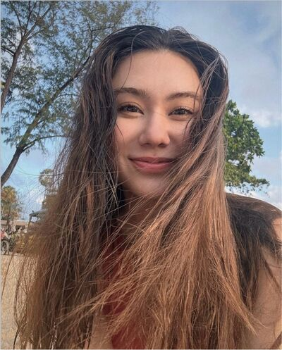
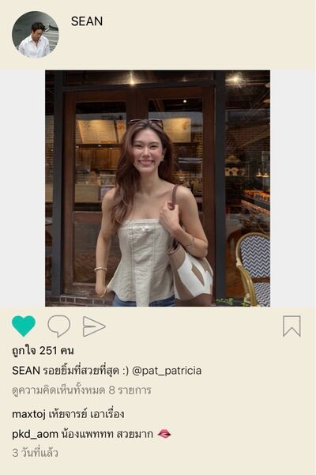
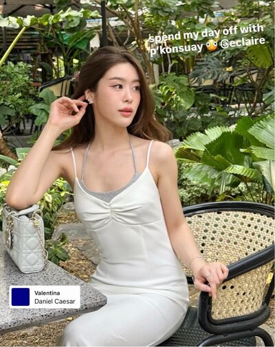
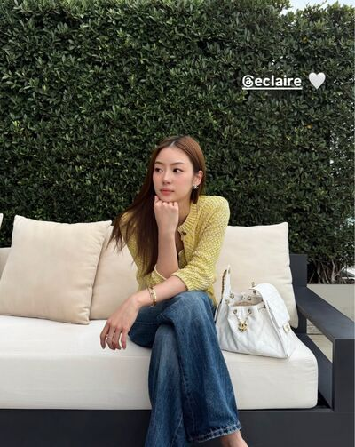
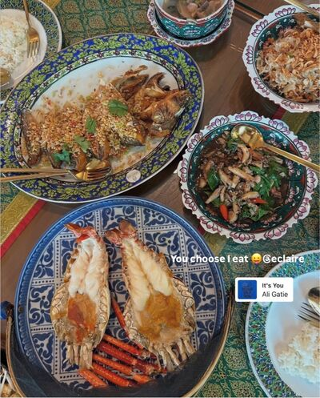
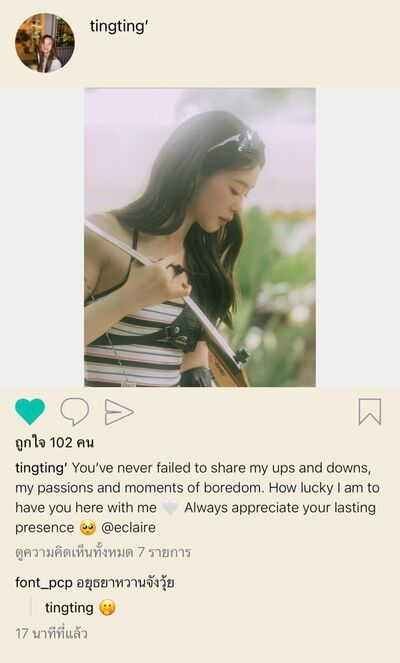
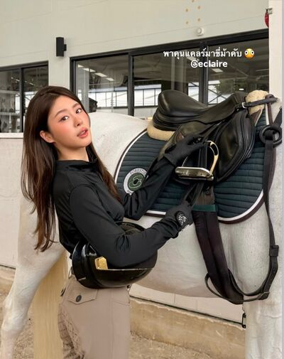

# Never Without You — Chapter 20

## Character and alias key

- **tt’** — TingTing (Ting / Muay), she/her
- **Patricia🌻** — Patricia (Pat / P’Pat), she/her
- **muay🤍** — Muay, Patricia’s new teammate, she/her
- **eclaire** — Claire (P’Claire), she/her
- **khim09** — Khim, she/her
- **lalin** — Lalin (Lin), she/her
- **font_pcp** — Font, she/her
- **JJAPP** — Japp, she/her
- **BEll** — Bell, she/her
- **Namfon** — Namfon (P’Fon), she/her
- **SEAN** — P’Sean, Patricia’s ex-boyfriend, he/him
- **ปะป๊า** — Ting’s father, he/him
- **หม่าม้า** — Ting’s mother, she/her

## Translation notes

- Thai pronouns such as เค้า and เขา are gender-neutral; references to Patricia and Ting use she/her, and references to Sean use he/him.
- Thai internet laughter (55555…) is retained exactly.
- Original English messages, emoji, mentions, and repeated wording are preserved.
- Message alignment follows the exported record className.
- “Muay” is both Ting’s established nickname and the new teammate’s name; the context distinguishes them.

## Full translated chat transcript

---

### December 14th — Monday

### พี่ไม่ทราบ (4)

*8:55 a.m.*

**BEll**
The new girl is here! @All

**BEll**
She seems really friendly. So adorable—she has that fresh-graduate vibe, smiling with her eyes all crinkled.

**BEll**
Sigh, so this is the youthful energy our team needs.

**JJAPP**
Bell, you sound like such an old auntie.

**BEll**
5555555555

**JJAPP**
Is P’Pat here yet?

**BEll**
She’s here, but she went to buy coffee and just missed the new girl.

**Namfon**
Bell, what’s the new girl’s name again?

**BEll**
I already told you, don’t be shocked.

**BEll**
Her name is Muay.

**JJAPP**
Seriously?

**BEll**
Isn’t that wild?

**JJAPP**
I’m going crazy.

**JJAPP**
We haven’t even gotten over the old Muay, and now a new Muay shows up.

**BEll**
5555555555555

*9:08 a.m.*

*muay🤍 added to the group*

### พี่ไม่ทราบ (5)

**BEll**
Feel free to ask any of us anything, okay? Just come over and ask, or tag us. @muay🤍

**muay🤍**
Okay, P’Bell. Thank you!

### JJAPP

*10:33 a.m.*

**JJAPP**
Is something wrong? Are you in a bad mood?

**Patricia🌻**
No, no.

**Patricia🌻**
There’s nothing wrong.

**JJAPP**
No, it’s just that P’Pat seems so quiet.

**JJAPP**
I saw the new girl sitting close to P’Pat. She might think P’Pat is scary.

**Patricia🌻**
55555

### พี่ไม่ทราบ (5)

*12:08 p.m.*

**JJAPP**
What’s up, Muay? Do you want to come down first, in case P’Pat takes a long time? @muay🤍

**JJAPP**
We’re still waiting in front of the elevator.

**muay🤍**
It’s okay! Muay can wait.

**JJAPP**
Suit yourself.

**JJAPP**
Good—then we can pressure P’Pat to hurry up.

**muay🤍**
😂

### JJAPP

*12:20 p.m.*

**Patricia🌻**
Japp, I already told the new girl to go down first.

**Patricia🌻**
Talk to her too, in case you can’t find each other.

**JJAPP**
Huh?

**JJAPP**
P’Pat, you’re still not coming down?

**Patricia🌻**
Yeah, we’re still sorting out some work.

**JJAPP**
Okay, okay.

*12:46 p.m.*

**JJAPP**
What were you doing, new girl? She said she didn’t dare talk to P’Pat.

**Patricia🌻**
I wasn’t doing anything. I just told her to go down first because I hadn’t finished my work.

**Patricia🌻**
I didn’t want her to wait and waste her time.

**JJAPP**
She said P’Pat looked so expressionless that she thought P’Pat was annoyed.

**JJAPP**
We had to hurry and tell her that P’Pat is normally kind—she was probably just busy.

**Patricia🌻**
I think it was because she said she’d wait, and I told her she didn’t have to. Maybe I sounded a little blunt.

**Patricia🌻**
Please tell her I wasn’t annoyed.

**JJAPP**
I already told her.

**JJAPP**
P’Fon was the first one. She rushed to explain herself because she was afraid the new girl would misunderstand. 555555

**JJAPP**
Muay felt a little better after that, because she needs P’Pat’s help with work too.

**JJAPP**
That’s understandable. She was probably scared she wouldn’t get along with P’Pat.

**Patricia🌻**
Mm.

**JJAPP**
It really isn’t anything.

**Patricia🌻**
No, it isn’t.

**Patricia🌻**
What would it even be? 55555

**JJAPP**
Fine, it isn’t anything.

**JJAPP**
Then come eat lunch already!

**Patricia🌻**
If I go down now, I probably won’t catch up with you all.

**Patricia🌻**
I’ll go find something simple and eat by myself.

**JJAPP**
Okay, okay.

### eclaire

*5:48 p.m.*

**eclaire**
Has P’Sita gone to pick her up yet?

**tt’**
She’s here.

**tt’**
But I still haven’t finished my work.

**eclaire**
Do you have that much work?

**tt’**
Mm, but it’s not that much.

**tt’**
I’m probably just slow, that’s why I still can’t finish.

**eclaire**
Why?

**tt’**
I don’t want to do it.

**tt’**
I don’t feel happy about work at all.

**tt’**
I’m so sick of everything.

**eclaire**
Is someone bullying you?

**tt’**
No. Who would dare bully me?

**tt’**
People come in and act nice, but when I actually need help, not a single one reaches out.

**tt’**
I shouldn’t bother getting close to them. I probably can’t become close with people like that anyway.

**tt’**
The other day I even heard them gossiping among themselves. Who knows—if I got close to them, would they talk behind my back too?

**tt’**
When there isn’t a single person on the team who feels like a friend, work isn’t much fun.

**eclaire**
So there’s no one you can trust at all?

**tt’**
Mm.

**tt’**
Not one.

### muay🤍

*6:51 p.m.*

**muay🤍**
P’Pat, are you home yet?

*7:08 p.m.*

**Patricia🌻**
I’m home. What about you?

**muay🤍**
I got home when I texted you.

**muay🤍**
We ran into each other right at the BTS station. Such a coincidence.

**Patricia🌻**
But we were going in opposite directions. 555

**muay🤍**
555555

**muay🤍**
Do you take the BTS home every day?

**Patricia🌻**
Yes.

**Patricia🌻**
If you get stuck on anything work-related, you can talk about it in the group tomorrow.

**Patricia🌻**
I’ll get going then. See you tomorrow.

**muay🤍**
Okay!

### khim09

*7:47 p.m.*

**khim09**
So, are you ready to talk? I gave you a day or two to think, and then you disappeared completely.

**Patricia🌻**
Think about what?

**khim09**
You’re still asking? About Ting, obviously.

**Patricia🌻**
I haven’t been thinking about anything. Only work. I was busy all day; I only just got free once I got home.

**khim09**
Then think about it now. You’re off work.

**khim09**
Going back to the place you used to go with Ting, but going with P’Sean—is it the same?

**Patricia🌻**
Of course it isn’t the same. How could going with a different person feel the same?

**khim09**
Then who makes you happier?

**Patricia🌻**
How can you even compare them? The situations aren’t the same at all.

**Patricia🌻**
When I went with P’Sean, I had just fought with Ting, and Mom had just gotten sick. How happy was I supposed to be?

**khim09**
Oh, I see, I see.

**Patricia🌻**
See what?

**khim09**
I see that all your words mean you were happier when you went with Ting.

**Patricia🌻**
You’re teasing me, Khim.

**khim09**
Well, that is what your words mean. You admitted it yourself, didn’t you? You said it yourself.

**Patricia🌻**
Or is it because I don’t like leaving the house? I’m a homebody.

**khim09**
When you had Ting, were you a homebody?

**khim09**
You went out every week, didn’t you?

*[Read]*

**khim09**
Anyway, try thinking about it, Pat.

**khim09**
This matters a lot to your life. Trust me.

**Patricia🌻**
Yeah… it really doesn’t feel as comfortable as when I was with Ting.

**Patricia🌻**
When I was with Ting, I didn’t have to think about anything, and she was so bright too.

**Patricia🌻**
It felt bright when Ting was around.

**khim09**
So bright, huh? That means it’s dark now that Ting’s gone.

**khim09**
The whole sun is goneee

*[Read]*

**khim09**
And when you’re with P’Sean, what do you think about?

**Patricia🌻**
Mom.

**Patricia🌻**
Mom’s idea of family.

**Patricia🌻**
Whether I have to date P’Sean.

**Patricia🌻**
And if I don’t date him, how will Mom feel? Will she worry a lot? Will it make her health worse?

**Patricia🌻**
If I don’t date him, how should I act around P’Sean so he doesn’t get hurt?

**Patricia🌻**
Or should I just date him so all these questions can finally leave my head?

**khim09**
You think too much.

**khim09**
Have you ever thought that if P’Sean were the right person, you wouldn’t have to think this much?

**Patricia🌻**
I already know he isn’t.

**Patricia🌻**
But right now, if it isn’t P’Sean, who else could it be?

**khim09**
Ting.

**Patricia🌻**
You say that as if Ting is still around.

**khim09**
And if she were still around, would you choose her?

*[Read]*

**khim09**
You’re still so firmly straight. You really won’t switch teams, friend?

**Patricia🌻**
I don’t know.

**Patricia🌻**
I don’t know, Khim.

**khim09**
It’s okay. Take it slowly.

**Patricia🌻**
Khim.

**Patricia🌻**
I miss Ting so much.

**khim09**
How do you miss her?

**khim09**
Do you want to have Ting back like before?

**Patricia🌻**
Mm.

**khim09**
Why?

**khim09**
Why do you want to have Ting back like before?

**Patricia🌻**
Because when I had Ting,

**Patricia🌻**
I was happier than this.

**Patricia🌻**
Leaving the house on days off used to be easier when I went with Ting.

**Patricia🌻**
When P’Sean invites me, I don’t even want to go anywhere. The only reason I went that day was to take Mom to the doctor.

**khim09**
Yeah, I get the picture.

**Patricia🌻**
Does that mean I like Ting like that?

**Patricia🌻**
Like how you like Chan?

**khim09**
If I say yes, will you believe me?

**Patricia🌻**
Is it really true?

**khim09**
See? You don’t believe me either.

**khim09**
Take your time gathering the evidence and arguing with yourself, Pat.

**khim09**
I believe that one day you’ll be able to answer yourself.

---

### December 15th — Tuesday

### Family 🏠 (3)

*10:15 a.m.*

**tt’**
It’s because of Dad that your daughter is suffering like this. Remember that. @ปะป๊า

**ปะป๊า**
What? What suffering? Tell me.

**tt’**
The brand day campaign work that got dumped on me has fallen into my lap.

**tt’**
It’s because of you. Why did you have to insist that I look at a project like this?

**ปะป๊า**
🤣

**ปะป๊า**
That’s good. At least you’ll know how the people behind you feel when you dump work on them.

**tt’**
This isn’t just dumping work—he deleted the files too.

**tt’**
Ugh, never mind. Complaining won’t change anything. Dad’s enjoying this, isn’t he?

**tt’**
I’ll deal with it and show you—both the work and the person who abandoned it.

### prettybabies (3)

*11:22 a.m.*

**tt’**
You bastard. Don’t let me run into you, or I’ll really shoot you.

**font_pcp**
Who is it this time?

**tt’**
I don’t even know. By the time I joined, he was already gone. All I know is his name is Pek.

**font_pcp**
Pek, you’d better start preparing a dress.

**tt’**
I don’t know what his deal is. The team only says he’s a bit unhinged, but I think there’s probably something deeper going on.

**tt’**
But leaving like that—dumping the work and deleting the files—is so pathetic.

**tt’**
And the work had been floating around for a while before I transferred to this team. In the end, the lottery landed on me.

**tt’**
There’s no one to train me either. At least they gave me the contact person’s details, but I don’t even know where the process is now or what I’m supposed to do next.

**tt’**
Ugh, I want to kill someone.

**lalin**
Oh really? That story sounds familiar.

**lalin**
Like a friend of mine once did the same thing.

**font_pcp**
Ai Lin, nooo.

**tt’**
Is this really the time to stab me in the back, Lin?

**tt’**
🤬🤬🤬🤬

**lalin**
55555

**lalin**
So how is it? Sounds like you’re in a real mess.

**tt’**
Yeah. Once I follow up and understand the work, I’m going straight to HR to get him banned.

**tt’**
Don’t even dream of setting foot in my company again—or any company in the group, you idiot. You’re dead for sure. 😡

**font_pcp**
Now I feel sorry for Pek. Of all people to mess with, he messed with Ai Ting the mad dog.

**lalin**
555555

**lalin**
But he deserved it. Deleting files like that—he really should be taught a lesson.

**lalin**
Though I don’t know whether anyone has taught this mad dog yet not to dump work on her teammates.

**font_pcp**
There. Done.

**tt’**
What do you all think?

**tt’**
Will she scold me?

**lalin**
You mean P’Pat?

**lalin**
She even scolded Pek. What reason would P’Pat have not to scold you?

**tt’**
But she’s kind.

**tt’**
She’s always kind to her coworkers.

### BEll

*11:42 a.m.*

**BEll**
Japp, did you notice during the meeting just now?

**JJAPP**
You mean P’Pat?

**BEll**
Yeah.

**BEll**
Since Muay started work yesterday, have you heard Pat call Muay by name even once?

**JJAPP**
No, not once.

**JJAPP**
I was thinking the same thing. She only calls her “the new girl.” Even on LINE, whenever she talks to her, she calls her that every time.

**BEll**
Right, right, right? I thought I was the only one noticing.

**BEll**
During the meeting, when Muay was supposed to continue speaking, Pat didn’t even call her name. She just turned toward her and gestured for her to speak.

**JJAPP**
I saw it too.

**JJAPP**
But is it really that serious, Bell?

**JJAPP**
Are we really that interested in P’Pat’s business?

**BEll**
5555555555

**BEll**
Why not? It’s worth thinking about, you know.

**BEll**
Pat also seems really hung up on the Ting thing. Ever since Ting brought that Care Bear back that day, she hasn’t hung up her own again.

**BEll**
Wait and see whether Pat ever calls Muay by name even once.

### พี่ไม่ทราบ (5)

*12:57 p.m.*

**JJAPP**
P’Pat, who are you with right now? @Patricia🌻

**JJAPP**
I just got back. It’s only P’Fon and P’Bell left.

**Patricia🌻**
Oh, I’m with the new girl. I came to buy milk tea and she asked to come along.

**JJAPP**
Muay, you mean?

**Patricia🌻**
Mm.

**Patricia🌻**
We’ll be back soon, but if you all want to go back to the office first, that’s fine.

**JJAPP**
It’s okay, we can wait.

**muay🤍**
P’Japp, do you want me to get you anything?

**JJAPP**
No, it’s fine!

**JJAPP**
Or is P’Pat treating? If she’s treating, I’ll have one.

**Patricia🌻**
I’m not treating, but if you want one, Japp, I’ll buy it for you. Do you want it?

**JJAPP**
No, no! I was joking. I didn’t mean it.

### BEll

*6:14 p.m.*

**BEll**
What were you two talking about just now?

**JJAPP**
There you go again, Bell.

**BEll**
55555555

**JJAPP**
I overheard that the new girl was going to wait so they could leave together, since they both walk to the BTS station. But P’Pat told her to go back first.

**BEll**
Does Pat hate the new girl or something?

**JJAPP**
Don’t be ridiculous. Of course not.

**JJAPP**
Her work isn’t finished either. She probably just didn’t want Muay to wait too long.

**BEll**
But the milk tea thing—normally she’d treat the new girl, right? They went together, and she’s new too.

**BEll**
And she was still willing to treat you when you texted to ask. Why wouldn’t she treat Muay? It’s strange.

**JJAPP**
Yeah, that’s true.

**JJAPP**
She probably has her reasons. But it probably isn’t because she hates her. They seem to talk normally, just not constantly.

**BEll**
But she hasn’t called Muay by name even once.

**JJAPP**
P’Pat doesn’t hate Muay. How could someone like P’Pat hate anyone?

**JJAPP**
Maybe she just can’t get over the other Muay yet.

### prettybabies (3)

*6:22 p.m.*

**tt’**
You guys, I still haven’t finished my work. I hate Pek so much.

**tt’**
Someone let me yell at him.

**font_pcp**
Go ahead. This unemployed friend will listen to you herself.

**tt’**
I’m so exhausted.

**tt’**
Everyone on the team has already gone home.

**font_pcp**
Are you going to yell or not?

**tt’**
I’m not yelling anymore. I’m tired.

**tt’**
I don’t want to work anymore, Fon.

**font_pcp**
Aww.

**font_pcp**
What’s wrong with the gay kid? Why are you so deflated?

**tt’**
I miss P’Pat so much.

**font_pcp**
Oh my god.

**font_pcp**
@lalin

**tt’**
I used to want to come to work every day because of her.

**tt’**
Now everything has changed.

**tt’**
It’s so awful without her.

**font_pcp**
Ai Lin, hurry, hurry! @lalin

**lalin**
What exactly do you want to do with your life, gay kid?

**lalin**
Didn’t you just yell at her yesterday and tell her not to bother you?

**tt’**
Mm.

**tt’**
I even told her we were just strangers.

**tt’**
Just people sharing the same world.

**font_pcp**
Whoa, excuse me. Your mouth, seriously.

**lalin**
Ting, when someone is sad, you don’t have to say hurtful things.

**tt’**
I just didn’t want her to know

**tt’**
that I was sad.

**tt’**
I didn’t want her to know how much she affected my life.

**lalin**
And how much did she affect it?

**tt’**
I miss her so much I’m about to go crazy, that’s how much.

**lalin**
Yeah, if you miss her, tell her you miss her.

**lalin**
Not “don’t bother me,” you foul-mouthed kid.

**tt’**
I wonder how she is now.

**tt’**
I don’t know how her mom is doing either, but I really hope she’s doing very well.

**tt’**
Her mom was always kind to me. I don’t want P’Pat to worry about her mom either.

**tt’**
Back when we took her mom to get checked up together, she was still sitting there with cold hands.

**font_pcp**
Nostalgia hour, huh?

**font_pcp**
Do you want to know how P’Pat is? I just talked to P’Japp.

**tt’**
How is she?

**font_pcp**
Not working anymore, gay kid?

**tt’**
Tell me, come on. Don’t give me a long speech, it’s annoying.

**font_pcp**
55555555

**font_pcp**
Ever since you left the team, she seems to talk less. She doesn’t take much care of the new girl either—only talks about work.

**font_pcp**
P’Japp said she still won’t even treat that girl to milk tea.

**tt’**
There’s already someone new?

**font_pcp**
Yeah.

**font_pcp**
And her name is Muay too.

**lalin**
Ooh, another Muay.

**lalin**
Can she replace this kid around here?

**tt’**
Replace what? P’Pat used to buy me milk tea. On my second day, she even called to wake me up.

**font_pcp**
That’s a total upgrade. 555555

**lalin**
You’ve already lost, obviously.

*[Read by 2]*

**font_pcp**
I think the gay kid went back to work. She just came to threaten Fon so she’d know she isn’t losing, that’s all.

**font_pcp**
P’Pattttt!

**font_pcp**
So we can talk about P’Pat freely now, right?

**tt’**
She took my phone and took this picture herself.

**tt’**
She even told me to keep it and not delete it.

**lalin**
And you really didn’t delete it?

**tt’**
Mm.

**tt’**
I deleted every other picture except this one.

**tt’**
I’ve tried deleting it so many times, but I just can’t.

**tt’**
It keeps making me think of when we went to the sea together.

**tt’**
Back then, she looked so happy to be going on a trip.

**tt’**
And she’s such a homebody, too.

**lalin**
You really do miss her a lot, don’t you?

**font_pcp**
Then why did you say those awful things to her, Ai Ting? 😭

**lalin**
Acting all tough, that’s why.

**tt’**
I thought I could live without her.

**tt’**
But it feels like I can’t live without her at all.

**lalin**
The truth is probably starting to sink in, gay kid.

**font_pcp**
Our friend has died and come back to life a hundred times already. I don’t know if she can come back this time.

**tt’**
I’m so pathetic.

**tt’**
I unfollowed her on Instagram, then went right back to stalk her like this.

**font_pcp**
Has she posted anything?

**tt’**
No.

**tt’**
I haven’t seen her post any stories yet.

**tt’**
Oh.

**tt’**
She didn’t post, but someone posted for her.

**tt’**
I don’t know why that attention-seeker tagged her.

**tt’**
And why the hell did she make her account public?

**tt’**
She should lock her account. Who would even want to see it?

**font_pcp**
You went stalking her yourself, though. 😭

**tt’**
She really does look happy, though.

**tt’**
Her life without me.

**tt’**
Am I the only one who still thinks about what we had?

**tt’**
I should have realized by now that she has someone she loves.

**tt’**
Her family…

**tt’**
I hate it.

**tt’**
Enough, okay?

**tt’**
Let this be the last time.

**tt’**
I don’t want to love P’Pat anymore.

**tt’**
I really don’t want to love P’Pat anymore.

### Patricia🌻

*6:54 p.m.*

**Patricia🌻**
Ting.

**Patricia🌻**
Are you okay?

**Patricia🌻**
It’s about work, right? Japp just told me.

**Patricia🌻**
If there’s anything I can help with, just tell me.

**tt’**
Can you stop patting my head?

**tt’**
Don’t pat me anymore.

**Patricia🌻**
I’m sorry.

**Patricia🌻**
I just saw you crying.

**tt’**
We’re nothing to each other. Why would you pat me?

**tt’**
Can you stop bothering me?

**tt’**
I already told you not to act like we know each other.

**Patricia🌻**
I just didn’t want you to cry.

**Patricia🌻**
When you were standing there crying, I didn’t know what to do. I just wanted to comfort you.

*[Read]*

**Patricia🌻**
Are you still really angry with me?

**tt’**
I’m not angry.

**tt’**
I’m hurt. I’m sad.

**tt’**
So sad that my heart is completely broken.

**Patricia🌻**
I’m sorry.

**tt’**
If we don’t love each other, can we please stop bothering each other?

**tt’**
Stop bothering Ting.

**tt’**
I’m begging you.

### Baby’s Daddy&Mommy (3)

*7:24 p.m.*

**หม่าม้า**
Claire, sweetheart, P’Sita just called me. She said she picked our girl up, but she was crying really hard.

**หม่าม้า**
I don’t know what happened. Do you know, Claire?

**eclaire**
I don’t know, Mama. She hasn’t replied to my LINE yet.

**หม่าม้า**
Maybe it’s work, I don’t know. She has work she has to take over. I saw her talking to Dad today, and she looked really angry.

**หม่าม้า**
This kid likes to cry when she’s angry too.

**eclaire**
I’ll try talking to her.

**หม่าม้า**
Thank you, sweetheart. Mama’s worried about her.

**หม่าม้า**
She isn’t smiling brightly like before. She isn’t like the old TingTing at all.

**หม่าม้า**
If she tells you she wants to go anywhere or do anything, you can take her anywhere, sweetheart.

**หม่าม้า**
Even abroad is fine. Just tell Mama. I’ll talk to Dad about her work myself.

**eclaire**
Okay, Mama.

### eclaire

*7:36 p.m.*

**eclaire**
Why were you crying? Did someone do something to you?

**tt’**
I shouldn’t have let her see me being weak.

**tt’**
I hate myself so much.

**eclaire**
Please don’t hate yourself.

**eclaire**
I love you this much. Don’t hate yourself, TingTing.

*[Read]*

**tt’**
Claire.

**tt’**
Can you come see me?

**tt’**
Can you stay with me tonight?

**eclaire**
Of course. I’ll come over soon.

**tt’**
Mm.

### khim09

*8:34 p.m.*

**Patricia🌻**
Khim, I ran into Ting on my way home.

**Patricia🌻**
When I got home, Mom could tell I wasn’t okay. She asked if it was about Ting.

**Patricia🌻**
I nodded but didn’t say anything, so Mom came over and hugged me. I really wanted to cry with her, but I held it in.

**Patricia🌻**
I’m so tired.

**khim09**
Pat.

**khim09**
Have you been happy for even one day since you fought with Ting?

**khim09**
I think your mom has probably noticed by now that this Ting thing never ends. It can’t have been an ordinary fight.

**Patricia🌻**
Mom said I look tired every day, like I’m suffering so much. She said she’s never seen me like this.

**Patricia🌻**
Even when I was sitting eating her food, I looked like it didn’t taste good. Mom almost said she’d stop cooking for me.

**khim09**
Pat!!!

**khim09**
You are absolutely not allowed to make my mom doubt her own cooking, you ungrateful child.

**Patricia🌻**
I did tell her it tasted just as good as always. I was really happy too that Mom is well enough to cook again.

**Patricia🌻**
But Mom also said that if I’m tired because of her, she doesn’t want me to overthink it. But if I’m tired because of Ting, she wants me to sort things out with her.

**Patricia🌻**
She told me to go talk to P’Sean about it.

**khim09**
Talk to P’Sean and we’ll all die, ma’am. The whole household will die.

**khim09**
You might as well stab each other with knives.

**Patricia🌻**
Mom thinks I’m dating P’Sean too, but I told her not yet.

**Patricia🌻**
She looked surprised, but she didn’t say anything.

**khim09**
Well, the way you two act now, even if you aren’t dating, it looks like you are. You come and go and take care of her mom that much.

**khim09**
If you didn’t stop him, he’d probably come pick you up from work every day.

**khim09**
But P’Sean is so devoted, so your mom is probably a little reassured. Her daughter has someone looking after her.

**Patricia🌻**
Mm.

**khim09**
And when you said you ran into Ting, how did it happen?

**Patricia🌻**
On my way home. We ran into each other in the elevator. She was standing there crying by herself.

**khim09**
Ugh, every scene between you two—the universe really went out of its way.

**Patricia🌻**
She was sobbing, Khim. I didn’t know what to do. All I knew was that I didn’t want her to cry anymore.

**Patricia🌻**
I went to pat her head without even thinking. It just happened. And she stood there quietly, letting me pat her.

**Patricia🌻**
It felt like the first time since we fought that I’d met the old Ting again.

**Patricia🌻**
The kid who used to like it when I patted her head.

**khim09**
Ting stood there quietly and let you pat her head?

**Patricia🌻**
Mm. At the time, I thought maybe things were getting better. Maybe we could talk again.

**Patricia🌻**
So I texted to ask if she was okay, but she said the same thing as before.

**Patricia🌻**
If I don’t love her, I should stop bothering her.

**khim09**
She has a point.

**khim09**
If you don’t love her, stop bothering her, because she doesn’t want to be your little sister.

**Patricia🌻**
Ting even used the word “please.”

**Patricia🌻**
She begged me to stop bothering her.

**khim09**
She probably can’t take it anymore, Pat.

**khim09**
If you care about her, then stop bothering her.

**khim09**
I know it’s hard to act like you don’t know each other, since you two were so close before.

**khim09**
But you have to do it. You have to manage it. The more you care about Ting, the more you have to do it.

**Patricia🌻**
Mm, I understand.

**Patricia🌻**
I haven’t told you yet, have I? The new girl on the team is named Muay.

**khim09**
No, you haven’t.

**khim09**
Her name is Muay? Be careful.

**khim09**
Pat, did you do something to anger the spirits? They seem determined to grind your life down.

**khim09**
I suspect the spirits are a gay person who hates straight people like you.

**Patricia🌻**
You buffalo. Is this really the time?

**Patricia🌻**
I’m stressed to death, and you’re still insulting me.

**khim09**
555555555

**khim09**
So? Her name is Muay, and then what?

**Patricia🌻**
I don’t dare call her by name. It makes me think of Ting every time.

**Patricia🌻**
The first time I called Ting “Muay,” she immediately asked me whether I called anyone else Muay.

**Patricia🌻**
So I don’t want to use that name for anyone else.

**Patricia🌻**
Even though she doesn’t want me to call her that anymore, if it isn’t Ting, I don’t want to call anyone Muay.

**khim09**
Pat.

**khim09**
You definitely love Ting more than just as a little sister. Believe me.

**khim09**
This is the behavior of someone whose partner left them, not just sisters who had a fight.

**Patricia🌻**
I don’t know, Khim. How is it different?

**Patricia🌻**
All I know is that I’m so sad—sad that we have to act like we don’t know each other.

**Patricia🌻**
Sad that I care about Ting so much but can’t do anything about it.

**Patricia🌻**
I miss the time when we still had each other, everything we used to do together. I miss all of it.

**Patricia🌻**
I miss Ting, Khim.

**khim09**
It’s different because if you really thought of her only as a little sister, you’d have stopped talking about her by now, Pat.

**khim09**
You’ve known Ting for four months. That isn’t short, but it isn’t that long either.

**khim09**
If you want to say it’s because Ting is a very close little sister, then think about this: one day, if we fought and had a reason to stop being friends,

**khim09**
would you be able to accept it, or would you sit here sobbing like this?

**khim09**
You dated P’Sean for three years and you could still move on. What is this? Going around in circles like a ghost haunting your own memories?

**khim09**
You even said yourself that you miss Ting. What more proof do you need to confirm your own feelings? I’d really like to know.

**khim09**
I don’t understand straight people like you. I’m tired of you, Pat, you bastard.

**Patricia🌻**
I want to know too what I want.

**Patricia🌻**
I want to be able to answer myself for once.

---

### December 18th — Friday

### IG: tingting’

*12:08 p.m.*

*12:43 p.m.*

*pat_patricia viewed the story*

### JJAPP

*1:07 p.m.*

**JJAPP**
Oh? Where did you go? I thought you’d rush back to keep working.

**Patricia🌻**
I wanted to be alone for a bit. I’ll go in soon.

**JJAPP**
Is something wrong, P’Pat?

**Patricia🌻**
No, nothing’s wrong.

**JJAPP**
Okay.

### IG: tingting’

*4:47 p.m.*

*5:32 p.m.*

*pat_patricia viewed the story*

### พี่ไม่ทราบ (5)

*6:08 p.m.*

**BEll**
Pat, you went home without waiting for the new girl? Did you forget? @Patricia🌻

**BEll**
Muay is about to cry.

*6:12 p.m.*

**Patricia🌻**
Oh no, I’m sorry.

**Patricia🌻**
I’m already on the BTS. I’m sorry. @muay🤍

**Namfon**
Pat really forgot. 55555

**BEll**
Amazing.

**muay🤍**
P’Patttt 😭

**JJAPP**
P’Pat abandoned the new girl so badly. I don’t want anything anymore. 555555

**Patricia🌻**
I didn’t do it on purpose. I really forgot.

**muay🤍**
Can I sulk?

**BEll**
Comfort the new girl, quickly.

*[Read by 4]*

**JJAPP**
P’Pat is on her way home, so she’s not free to comfort you yet. I’ll comfort you first, Muay.

**Namfon**
There, there. Muay, don’t sulk at Pat, okayyy.

**muay🤍**
I was just saying, that’s all. 55555

### BEll

*6:20 p.m.*

**BEll**
I feel so sorry for Muay. So close. 5555555

**JJAPP**
P’Pat isn’t really comforting her. She hasn’t even called her by name.

**JJAPP**
It must be hard not being P’Pat’s Muay, huh, Muay.

**BEll**
That’s why we can’t both be Muay.

**BEll**
How is Miss Ting doing these days?

**JJAPP**
I saw her take leave today to go on a trip with her sister.

**JJAPP**
I don’t know whether she’s really over it yet.

**BEll**
What did her girlfriend say about it?

**JJAPP**
She misses P’Pat so much she’s about to go crazy.

**JJAPP**
But there hasn’t been any news for a few days now. Maybe she’s already moved on.

**BEll**
Don’t be ridiculous. How could anyone move on that fast?

**JJAPP**
If you know the trick, it can be fast.

**BEll**
What trick?

**JJAPP**
Get someone new to forget the old one, obviously.

---

### December 19th — Saturday

### IG: tingting’

*12:47 p.m.*

*1:05 p.m.*

*pat_patricia viewed the story*

*5:04 p.m.*

### lalin

*5:46 p.m.*

**lalin**
Ting, what on earth are you doing?

**tt’**
Doing what?

**lalin**
Don’t act like you don’t know.

**lalin**
You’re staying with P’Claire and posting stories and Instagram nonstop. Are you doing it to spite P’Pat?

*[Read]*

**lalin**
You don’t have to answer. I already know, and I know P’Claire knows too. P’Claire isn’t stupid, Ting.

**lalin**
What you’re doing right now is incredibly selfish, you know?

**tt’**
I just want her to know

**tt’**
that even if my life doesn’t have her in it, I can still be happy.

**tt’**
I think Claire understands my feelings very well. And Claire said herself that she understands.

**lalin**
She understands you, and does that mean you can use her for whatever you want?

*[Read]*

**lalin**
P’Claire is my sister, Fon’s sister, and even yours, Ting.

**lalin**
Can’t you take a little better care of her heart?

**lalin**
Just that day when you kissed P’Claire, it was sad enough already.

**tt’**
I kissed Claire?

**tt’**
When did I kiss Claire?

**lalin**
The day you were drunk. You really don’t remember?

**tt’**
No, I don’t remember at all.

**tt’**
I kissed Claire, Lin? Really?

**lalin**
Yes. Because you thought P’Claire was P’Pat.

*[Read]*

**lalin**
Ting, if you don’t love P’Claire, let her go.

**lalin**
Seeing her stay with you every day like this—she’s hurting, you know. She isn’t not hurting.

**lalin**
If you don’t want P’Claire, don’t keep holding on to her.

**tt’**
But Claire wants me.

**lalin**
I know that. Then why can you still be so cruel to P’Claire?

**lalin**
Yes, she wants you, but not just your body. She wants your love too.

**tt’**
I don’t want to be selfish with Claire anymore.

**tt’**
Lin, I don’t want to hurt Claire anymore.

**lalin**
Then decide. Choose one path, Ting.

**lalin**
If you can’t love P’Claire, don’t hurt her.

*[Read]*

**tt’**
I want to stay beside Claire, the way she has always been here for me.

**tt’**
I want to love Claire.

---

### December 20th — Sunday

### IG: tingting’

*8:11 a.m.*

*8:36 a.m.*

*pat_patricia viewed the story*

### khim09

*8:38 a.m.*

**Patricia🌻**
Since when do you wake up early on your day off?

**Patricia🌻**
Well, apparently I can wake up.

**khim09**
Who are you talking about?

**Patricia🌻**
Ting.

**khim09**
Why? What happened?

**khim09**
Nothing. I went to check her Instagram myself.

*[Read]*

**khim09**
Oh, so she took Khun Claire, aka “the beautiful older sister,” horseback riding. “Of course.”

**Patricia🌻**
Mm. Horseback riding and archery. Those are probably activities Ting likes.

**Patricia🌻**
She must appreciate her a lot.

**Patricia🌻**
So much that she’s probably forgotten everything she ever said to me.

**khim09**
What did she say to you?

**Patricia🌻**
She never went around complimenting everyone as beautiful.

**Patricia🌻**
She didn’t have to worry about calling someone else “beautiful older sister.”

**Patricia🌻**
I still don’t want to call anyone Muay. Even though it’s the new girl’s actual name, I still don’t want to call her that.

**Patricia🌻**
Why does everything look so easy for Ting?

**khim09**
Excuse me—are you jealous?

**Patricia🌻**
Go away.

**khim09**
Hey.

**khim09**
What’s happened to your heart now, friend?

*9:17 a.m.*

**khim09**
Are you leaving me on read now?

**khim09**
Pat, you awful straight girl.

*9:44 a.m.*

**khim09**
I’ll tell you what happened.

**khim09**
You’re so jealous of Ting that your heart is all over the place, you idiot.

### SEAN

*10:13 a.m.*

**SEAN**
Pat, do you want to get something to eat?

*11:02 a.m.*

### khim09

*11:26 a.m.*

**Patricia🌻**
Mom thinks I fought with P’Sean.

**khim09**
You want to talk when you want and disappear when you want, huh?

**khim09**
Then what did you do to make your mom think that?

**Patricia🌻**
Just now, P’Sean called and asked me to get something to eat, and I turned him down.

**Patricia🌻**
Mom asked who called. When I told her, she was confused about why I wouldn’t go out with P’Sean.

**khim09**
And what did you tell her?

**Patricia🌻**
I said I didn’t want to go. I wanted to stay home.

**Patricia🌻**
So Mom said I could invite P’Sean to eat at home instead, and she’d make dinner.

**Patricia🌻**
But I didn’t want to invite him, so Mom asked whether I’d fought with P’Sean too.

**khim09**
Yeah. Did you fight with P’Sean? He invites you out and you won’t go; Mom tells you to invite him over and you won’t do that either.

**khim09**
What do you actually want, Pat?

**Patricia🌻**
We didn’t fight. I’m just tired. Work has been busy lately.

**khim09**
I don’t know what kind of “busy work” that is, since I saw you scrolling Instagram all day.

**Patricia🌻**
You’re teasing me, aren’t you?

**khim09**
No, I’m telling the truth.

**khim09**
Is there a single story or post of Ting’s that you haven’t seen? You never used to be this glued to Instagram.

**khim09**
The reason you don’t want to see P’Sean isn’t because you’re tired of anything.

**khim09**
You just have to admit it, Pat: you don’t care about P’Sean enough to make time for him anymore.

*[Read]*

**Patricia🌻**
He said we haven’t seen each other for a week, and we barely talk either.

**khim09**
Because you don’t want to see him. You don’t want to talk to him.

**Patricia🌻**
Don’t just pick on P’Sean.

**Patricia🌻**
I’ve been talking to Mom less too.

**khim09**
With your mom too?

**khim09**
That isn’t good. It doesn’t seem like you at all.

**Patricia🌻**
Mm.

**Patricia🌻**
Mom said I’ve seemed different for a while now.

**Patricia🌻**
Ever since I fought with Ting, I’ve looked miserable.

**khim09**
Your mom actually used the word “miserable”?

**Patricia🌻**
Yes.

**khim09**
And do you think she’s right?

**Patricia🌻**
Probably.

**Patricia🌻**
Even eating Mom’s food, I don’t feel happy.

**Patricia🌻**
I’ve tried. I’ve tried to find happiness in the things I have.

**Patricia🌻**
But I can’t find any, Khim.

**Patricia🌻**
I don’t know how I’m supposed to be happy anymore.

**khim09**
Pat.

**khim09**
It’s gotten to this point and you still can’t answer yourself?

**khim09**
You’ve reached the point where you can’t find happiness for yourself. What else are you waiting for?

**Patricia🌻**
I don’t know.

**Patricia🌻**
I’m so annoyed with myself.

**Patricia🌻**
You must be really annoyed with me too. I’m sorry.

**khim09**
Listen to me, Pat.

**khim09**
I know what you’re thinking. You’re scared, aren’t you? That if you admit you love Ting as more than a little sister, then your past relationship will look fake—not as sincere as you wanted it to be.

**khim09**
I’ll tell you right now: it isn’t like that. I know you were sincere with Ting. But feelings can’t be controlled.

**khim09**
It isn’t something you can force. Look at yourself—you don’t even realize yet what kind of love you have for Ting.

**khim09**
But whatever kind of love it is, it’s still love, Pat. You don’t have to be afraid that it’ll turn into something bad.

**khim09**
I believe that the love you have for Ting, whatever form it takes, will always be sincere and beautiful.

---

### December 21st — Monday

### prettybabies (3)

*11:13 a.m.*

**font_pcp**
Why hasn’t the gay kid come complaining yet today?

**font_pcp**
It’s almost noon, you know.

**lalin**
Maybe she’s become a proper adult and regained consciousness.

**font_pcp**
5555555

**tt’**
There’s nothing to complain about, is there?

**tt’**
There are problems, but they’re work problems. Every job has problems. I’m just dealing with them.

**tt’**
But Pek—you’re definitely getting it.

**font_pcp**
555555555

**font_pcp**
Dad took the case.

**tt’**
I don’t know whether he took it, but HR has it now.

**tt’**
But yesterday I did complain to Dad for a long time. He sat there listening until his ears went numb. Serves him right.

**font_pcp**
The revenge of an only daughter.

**lalin**
But Dad is probably happy. It means at least you’re working.

**tt’**
Yeah.

**tt’**
He sat there smiling and laughing, pleased with himself. Mama too.

**lalin**
And what about P’Claire?

**tt’**
She’s pleased too. I went out to eat with Dad and Mama without even being made to.

**tt’**
Claire is coming to lunch with me too, and she’ll pick me up again in the evening.

**lalin**
She gets you for the whole day. So nice.

**font_pcp**
Yeah, P’Claire really is the most reliable one, start to finish.

**tt’**
Mm. Claire is really good to me.

**tt’**
I’m so lucky to have Claire.

### IG: tingting’

*12:38 p.m.*

*12:57 p.m.*

*pat_patricia viewed the story*

### BEll

*1:18 p.m.*

**BEll**
You—Muay texted me saying it looked like Pat was crying.

**BEll**
Don’t look at her. Something’s up.

**JJAPP**
Muay told you?

**BEll**
Yeah. They were sitting next to each other, so she probably saw.

**BEll**
What is Pat crying about?

**BEll**
She went to eat lunch alone today too. Lately she’s been keeping to herself a lot.

**BEll**
At first I thought she’d be closest with the new girl, but it turns out Muay has become close with me instead.

**JJAPP**
I don’t know what she’s crying about either.

**JJAPP**
I don’t really talk to P’Pat about personal things either.

**BEll**
Is it about Ting?

**JJAPP**
Maybe it is, maybe it isn’t.

**BEll**
Go try asking her.

**JJAPP**
Ugh, P’Pat won’t tell me.

**JJAPP**
She normally doesn’t open up that much anyway. Now she’s probably even more closed off than before.

**JJAPP**
Otherwise she’d already be close with Muay.

**BEll**
Yeah, that’s true.

### khim09

*7:11 p.m.*

**Patricia🌻**
Khim.

**Patricia🌻**
I don’t know what’s wrong with me.

**khim09**
Why?

**Patricia🌻**
I don’t like myself. I feel like I’m changing.

**Patricia🌻**
I’m not the person I used to be. I don’t like it.

**Patricia🌻**
Just seeing her living her normal life without me makes me sad.

**Patricia🌻**
I want to be that person—the one who makes Ting happy.

**Patricia🌻**
The one she talks to every day, eats with, gets picked up and dropped off by.

**Patricia🌻**
The one who appreciates the little things with her.

**Patricia🌻**
The person you always want to be there for.

**Patricia🌻**
When I see that I’m not the person she has anymore, it makes me so sad, Khim.

**Patricia🌻**
I’ve been crying since I was at work. I cried on the BTS on the way home, and I cried again when I got home.

**Patricia🌻**
I don’t know what’s wrong with me anymore.

**khim09**
Pat, the reason you’re acting crazy and your life has changed like you’re possessed

**khim09**
is because you love her. You love Ting.

**khim09**
What happened to all that stuff you used to tell me about appreciating life?

**khim09**
You still have a home. You have a job. You have food to eat. Your mom is still waiting for you to come home, just like before. But you—are you still happy?

**khim09**
Do you still appreciate your life right now, Pat?

*[Read]*

**khim09**
I know you can answer, but you won’t.

**khim09**
Seriously, you’re just confused about your sexuality.

**khim09**
This isn’t normal. You don’t really think of Ting as just a little sister.

**khim09**
If you were the old you, you’d be happy and relieved to see someone taking care of Ting—not like this.

**khim09**
Right? Am I right?

**Patricia🌻**
Mm. I should be happy for her, really.

**Patricia🌻**
It reminds me of the first time I met Claire. That day, she came to pick Ting up from the office.

**Patricia🌻**
I waited for her to arrive, then walked Ting to her car. Ting was still sulking and wanted me to go with her. She even said that once Claire took her home, she’d come back with me instead.

**Patricia🌻**
At the time, I didn’t understand why Ting was sulking. It was good that someone came to pick her up.

**khim09**
Because she wanted to go home with you, not with Claire.

**khim09**
Because Ting likes you, so she wanted to be with you.

**Patricia🌻**
I understand that part now.

**Patricia🌻**
But what I don’t understand now is why, back then, I didn’t feel anything at all when I saw Claire come pick Ting up.

**khim09**
You didn’t feel anything then—does that mean you feel something now?

**Patricia🌻**
I do.

**Patricia🌻**
So much that I can’t take it anymore.

**Patricia🌻**
I don’t like Claire. I really don’t. I dislike her so much that I hate myself for disliking her like this.

**Patricia🌻**
She came and told me she’s known Ting since first year, then stood there patting Ting’s head right in front of me.

**Patricia🌻**
What reason was there to pat Ting’s head in front of me?

**Patricia🌻**
That day, Ting fought with Claire too because Claire said something that hurt her. I don’t know what it was about, but it made Ting think our relationship wasn’t special.

**Patricia🌻**
I want to know what she said to Ting too. And what right does she have to interfere with me and Ting?

**khim09**
Pat, Pat, honey. Did you see Ting posting stories with Claire until you got worked up? Worked up enough to save them and get jealous retroactively?

**khim09**
What is this? Is your brain working overtime, flashing back in bursts?

**Patricia🌻**
If she likes Ting too, and she did that on purpose for me to see, Khim—

**khim09**
Oh wow, that’s very possible.

**khim09**
You connect the dots so fast, straight girl. How did you figure it out before me?

**khim09**
Once you catch the gay infection, does your brain just start racing?

**Patricia🌻**
I even told Ting to call me by just my name.

**Patricia🌻**
Because I didn’t want Ting to call only Claire by her name.

**Patricia🌻**
Mm. I’m probably really jealous of Ting.

**khim09**
All of this is you trying to tell me that you like Ting, isn’t it?

**khim09**
You know it, don’t you, Pat?

**Patricia🌻**
Yeah. I like Ting.

**Patricia🌻**
I love Ting—the same way Ting loves me.

**Patricia🌻**
Acting all wise, teaching her that if you have to lose each other, you have to move past it.

**Patricia🌻**
And she really did it. She can live without me.

**Patricia🌻**
I’m the only one who can’t live without her.

**khim09**
Bitter.

**khim09**
You’re so bitter.

**khim09**
So this is the suffering of a straight person—realizing it too late.

**Patricia🌻**
I don’t want to be straight anymore.

**khim09**
Whaaat?

**khim09**
That is not the answer I expected. Oh my gooood.

**khim09**
My friend, once you decide to accept it, you really accept it. You accept everything. You don’t even want to be straight anymore.

**khim09**
So satisfying, you buffalo. Finally, this day has come!!

**Patricia🌻**
I don’t know, Khim. I really don’t.

**Patricia🌻**
I don’t know when my feelings changed.

**Patricia🌻**
From the first day we met, I always saw Ting as a little sister, and she kept coming up to me.

**Patricia🌻**
Until I wanted to open my heart and let her in. I wanted Ting to be a close little sister, to make our relationship special.

**Patricia🌻**
But I don’t know when that specialness turned into love.

**Patricia🌻**
I really don’t know that it’s that kind of love.

**khim09**
You don’t need to know when it changed, because it doesn’t matter.

**khim09**
What matters is that you know now, don’t you, what kind of love it is?

**Patricia🌻**
Mm.

**Patricia🌻**
Thinking about P’Sean makes me understand even more.

**khim09**
Really? What are you thinking about P’Sean?

**Patricia🌻**
When P’Sean came to pick me and Mom up for dinner, took Mom to the doctor, invited me out for a walk, and spent a day off with us at home—

**Patricia🌻**
I thought that if the person beside me were Ting, it would be better than this.

**Patricia🌻**
I don’t want it to be P’Sean. I want it to be Ting.

**khim09**
Yes, this is how it should be. My sweat wasn’t wasted, straight-girl friend.

**khim09**
I mean, gay friend. Aaaaaa.

**Patricia🌻**
Can you stop making it a joke? Do you know I’m crying?

**khim09**
That’s your business. I’m enjoying this. 55555555555

**Patricia🌻**
I’ve liked men my whole life, Khim. How was I supposed to know?

**Patricia🌻**
I never thought liking a woman could happen to me. I never thought my family could be two women.

**Patricia🌻**
I know it sounds stupid, but you understand me, right?

**khim09**
I don’t understand.

**khim09**
I’m gay. Everything you just said can happen, and it’s happening to me right now.

**khim09**
But looking at it from the perspective of someone who’s been straight their whole life, like you, I can understand.

**Patricia🌻**
But I found her, you know. The person you once told me about.

**Patricia🌻**
The person who, even if I have to give my time to Mom, I still don’t want to lose.

**Patricia🌻**
I don’t want to lose Ting at all.

**Patricia🌻**
I can’t lose her

**Patricia🌻**
She was my family and she can be my family

**Patricia🌻**
I know Ting will love me more than anyone, and I’ll love Ting more than anyone too.

**khim09**
Go tell your mom this right now, Pat. I’m sure she’ll understand you.

**khim09**
Because she probably wants her old daughter back too—not this miserable ghost you are now.

**khim09**
And sort out the P’Sean situation too.

**khim09**
Hurry, okay? Because I don’t know how far Ting and Claire have gotten.

### Patricia🌻

*9:42 p.m.*

**Patricia🌻**
Ting, can I talk to you for a moment?

**Patricia🌻**
There’s something important I really want to talk to you about.

*9:55 p.m.*

**Patricia🌻**
Ting, do you still love me?

*[Read]*

**Patricia🌻**
Ting?

**tt’**
Why are you asking?

**Patricia🌻**
Do you still love me at all?

**Patricia🌻**
Even just a fraction of what you used to feel for me is enough.

**Patricia🌻**
I’m asking for just a fragment, because even that would mean so much to me.

**Patricia🌻**
Can you love me a little?

*[Read]*

**Patricia🌻**
Please don’t give up on us

**Patricia🌻**
Don’t give up on me

**tt’**
Why?

**tt’**
What do you want, P’Pat?

**Patricia🌻**
Without Ting, I’m not happy at all.

**Patricia🌻**
Now I can’t find any small wins to appreciate

**Patricia🌻**
You said I was good at appreciating anything but you

**Patricia🌻**
It was wrong

**Patricia🌻**
When you’re gone, I can’t appreciate anything

**Patricia🌻**
Even if it’s the biggest win or just the smallest thing

**Patricia🌻**
Or the fact that I’m being alive

**Patricia🌻**
Cause I know and I’m sure it’s you

**Patricia🌻**
It can’t be just anyone

**Patricia🌻**
My little Privilege, it has to be you

**Patricia🌻**
Without you I’m dying, and I don’t like myself anymore

**tt’**
Can’t she love you well?

**Patricia🌻**
No. She loves me well—well, the way she always loved me.

**tt’**
Then why are you saying this?

**tt’**
Why are you saying it has to be Ting?

**tt’**
Why are you telling Ting to love you?

**Patricia🌻**
Because even if it’s good, it isn’t love from the person I love.

**Patricia🌻**
I’m sorry I realized it too late. I love you, Ting.

**Patricia🌻**
Your love is the best. I want your love—only your love.

**Patricia🌻**
I know now that my family can be Ting. And I want it to be Ting too.

*[Read]*

**Patricia🌻**
Muay.

**tt’**
Why does P’Pat always do this?

**tt’**
Why does she keep making Muay sad?

**tt’**
Why?

**Patricia🌻**
I won’t do it anymore. I won’t.

**Patricia🌻**
I love you, Muay.

**tt’**
Then why tell me you love me now?

**tt’**
Why tell me on the day Muay already has someone new?

*[Read]*

**Patricia🌻**
Claire?

**Patricia🌻**
Is Muay’s new person Claire?

**tt’**
Mm.

**Patricia🌻**
Why does it have to be her?

**Patricia🌻**
Does Muay love her?

**tt’**
Why?

**tt’**
And what about you?

**tt’**
Is P’Pat the only one allowed to have someone new?

*[Read]*

**tt’**
You got your own person and I got mine

**tt’**
What’s the problem here?

**Patricia🌻**
Are you two really dating?

**tt’**
Mm.

**Patricia🌻**
I realized it too late, didn’t I? I really realized it too late.

**Patricia🌻**
Too late.

**Patricia🌻**
It seems like what we had was never possible after all.

**tt’**
I’m so tired.

**tt’**
I don’t like P’Pat at all.

**Patricia🌻**
I’m sorry.

**tt’**
Can I have it back?

**tt’**
P’Pat’s love.

**tt’**
Muay doesn’t want it anymore.

**tt’**
It’s too late.

**Patricia🌻**
Yes. I understand now.

**Patricia🌻**
I’m sorry for making things difficult for you. I’m really sorry.

**tt’**
You just had to love me sooner.

**tt’**
Why couldn’t you?

**tt’**
Can you stop being cruel to Muay?

**Patricia🌻**
I don’t know.

**Patricia🌻**
I didn’t know Muay would love her.

**tt’**
That’s because P’Pat never knew anything.

**tt’**
She didn’t know a single thing.

**Patricia🌻**
I’m sorry.

**Patricia🌻**
But I’m happy for you, Muay, that you have someone good who loves you now.

**Patricia🌻**
I really am happy for you.

**Patricia🌻**
She’ll probably love you better than I did. She’ll understand you more than I did.

**tt’**
You have a bad personality.

**tt’**
P’Pat has such a bad personality.

**Patricia🌻**
Mm.

**Patricia🌻**
I really do have a bad personality, don’t I?

**Patricia🌻**
I ruined everything.

**tt’**
You’re cruel.

**Patricia🌻**
Yes, I’m cruel.

**Patricia🌻**
I’m the one who has always made Muay sad.

**Patricia🌻**
But about P’Sean—I never dated him, Muay. I cut him off too.

**Patricia🌻**
I cut him out of my life. I don’t have anyone.

**Patricia🌻**
I don’t have anyone anymore.

*[Read]*

**Patricia🌻**
Just so you know, I don’t have my person

**Patricia🌻**
Actually, I haven’t had my own person since the day I no longer had you

**Patricia🌻**
The day when I lost my whole sun

### .

### .

### .

### ขอโทษที่ทำให้ทุกคนรอนานนะคะ เราติดนู่นติดนี่เลยไม่ได้สะดวกแต่งตลอด ที่สำคัญติดพี่ดาราอีกต่างหาก 😣 แต่เราตั้งใจอ่านทุกคอมเมนต์เลยนะ ทุกทวิตที่เห็นด้วย ตั้งใจอ่านหมดเลย ขอบคุณมากจริงๆ ค่ะ 🙏

### ขอให้คนอ่านแพทถิงทุกคนมีความสุขนะคะ กินอิ่มนอนหลับ สุขภาพแข็งแรง เติมพี่ดาราฟินๆ น้า 💪💪💪

### ปล. หนุรักพี่น่าที่สุดในจักรวาล รักกว่าแม่หนุอีก พี่น่ารักหนุได้เลยน้า 🤍🥺

## Author’s note

I’m sorry for keeping everyone waiting for so long. I kept getting caught up with this and that, so I never had a chance to write consistently. Most of all, I got caught up with my favorite celebrity too 😣 But I did read every comment carefully, and every tweet I saw that agreed with the story—I read them all. Thank you so much, really. 🙏
I hope every PatTing reader is happy. Eat well, sleep well, stay healthy, and enjoy plenty of your favorite celebrities, okay? 💪💪💪
P.S. I love P’Na the most in the universe—more than I love my own mom. P’Na can love me, okay? 🤍🥺