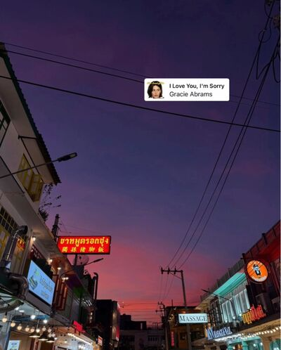
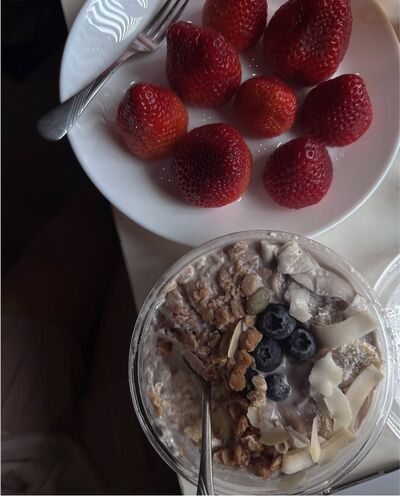
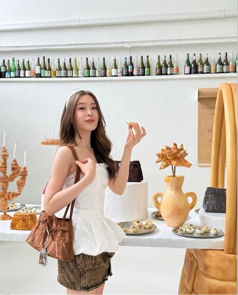
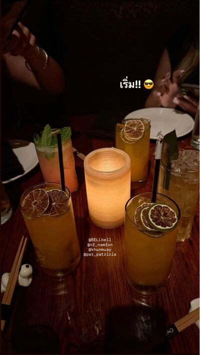
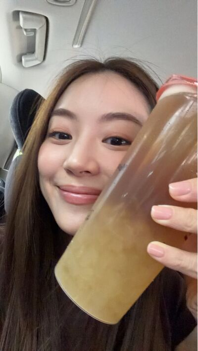
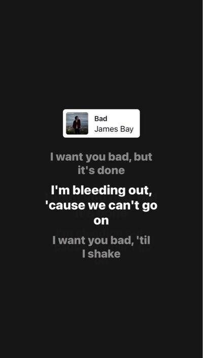

# Never Without You — Chapter 22

## Character and alias key

- **tt’** — TingTing / Ting / Muay; she/her
- **Patricia🌻** — Patricia / Pat / P’Pat; she/her
- **eclaire** — Claire / P’Claire, Ting’s girlfriend; she/her
- **khim09** — Khim, Patricia’s close friend; she/her
- **lalin** — Lalin / Lin, Ting’s friend; she/her
- **font_pcp** — Font, Ting’s friend and Japp’s girlfriend; she/her
- **JJAPP** — Japp, Patricia’s coworker and Font’s girlfriend; she/her
- **BEll** — Bell, Patricia’s coworker; she/her
- **Namfon** — Namfon / P’Fon, Patricia’s coworker (not Font); she/her
- **muay🤍** — Muay, Patricia’s new teammate (not Ting); she/her
- **หม่าม้า** — Mama, Ting’s mother; she/her
- **ปะป๊า** — Dad, Ting’s father; he/him
- **P’Sean** — Patricia’s ex-boyfriend, mentioned in dialogue; he/him
- **Nong Chan** — Chan, Khim’s girlfriend, mentioned in dialogue; she/her
- **Patricia’s mother** — Mentioned in dialogue; she/her
- **P’Art** — Lalin’s partner, mentioned in dialogue; gender/pronouns not established in the supplied chapter
- **neuf96** — The author, including the closing song contribution; gender/pronouns not explicitly established in the supplied chapter
- **Lena and Miu** — Named in the author’s postscript; individual gender/pronoun labels are not established by this export

## Translation notes

- P’ marks an older person; Nong marks someone younger. Age-based “little sister” language does not imply a biological relationship here.
- Ting and Patricia use she/her; Sean uses he/him. Gender-neutral Thai pronouns are resolved by context. Unknown pronouns are labelled rather than guessed.
- Ting’s nickname Muay and the teammate muay🤍 are distinct. Sender/display names remain exactly as exported.
- Original English, emoji sequences, laughter lengths, mentions and repeated messages are preserved. Playful Thai spellings are rendered conversationally.
- At the user’s direction, record 781 is rendered as “unanswered call”, without its exported call graphic. The final story photo (exported as 008.jpg) uses img/chat_image_007.jpg. There are seven unique photos and eight placements because 002.jpg appears twice.
- Pictures were not inspected. The closing video was recovered from record 872’s saved HTML and is a labelled online link requiring internet; no embedded website code is executed.
- Complete relative to the supplied export: 873 ordered records. Every record is indexed in the HTML and in Markdown audit comments.

## Full translated chat transcript

<!-- record 0 -->

---

### December 25th — Friday

<!-- record 1 -->

### IG: tingting’

<!-- record 2 -->

*8:37 p.m.*

<!-- record 3 -->

<!-- record 4 -->

### khim09

<!-- record 5 -->

*9:02 p.m.*

<!-- record 6 -->

**khim09**
Hey, Miss Gloomy.

<!-- record 7 -->

**khim09**
Keep telling her to go, and she really will, you know.

<!-- record 8 -->

**Patricia🌻**
What?

<!-- record 9 -->

**khim09**
Have you seen it yet?

<!-- record 10 -->

**Patricia🌻**
Seen what?

<!-- record 11 -->

**khim09**
Ting’s story.

<!-- record 12 -->

**Patricia🌻**
There’s more?

<!-- record 13 -->

**Patricia🌻**
There’s still more?

<!-- record 14 -->

**khim09**
55555555555

<!-- record 15 -->

*9:06 p.m.*

<!-- record 16 -->

**Patricia🌻**
Well, it’s Christmas. Of course they’d celebrate together.

<!-- record 17 -->

**Patricia🌻**
They’re girlfriends, after all.

<!-- record 18 -->

**khim09**
Pat.

<!-- record 19 -->

**Patricia🌻**
But with me, we didn’t even get to celebrate our birthdays.

<!-- record 20 -->

**Patricia🌻**
We probably won’t get to celebrate anything together anymore.

<!-- record 21 -->

**Patricia🌻**
I’m sad again.

<!-- record 22 -->

**Patricia🌻**
Ting has always been special to me, Khim.

<!-- record 23 -->

**Patricia🌻**
No matter in what way, Ting has always been my special person.

<!-- record 24 -->

**Patricia🌻**
It already hurt enough when I felt like I’d lost Ting as a little sister I loved so much.

<!-- record 25 -->

**Patricia🌻**
And now I have to hurt all over again because I’ve lost Ting a second time.

<!-- record 26 -->

**Patricia🌻**
And this time, it’s as someone I’m in love with.

<!-- record 27 -->

**Patricia🌻**
I’m sad, full of regrets, and I hate it. I want to be so angry with Ting, but I know that, in the end, she hasn’t done anything wrong.

<!-- record 28 -->

**Patricia🌻**
If anyone’s at fault, it’s probably me for hurting her in the first place.

<!-- record 29 -->

**Patricia🌻**
This is awful. I feel like such a bad person.

<!-- record 30 -->

**khim09**
How are you a bad person now?

<!-- record 31 -->

**khim09**
One minute you’re lamenting and heartbroken, then you’re angry at the kid, then you circle back to blaming yourself. I’ll hand it to you, Pat.

<!-- record 32 -->

**Patricia🌻**
I keep saying I love Ting and care about her.

<!-- record 33 -->

**Patricia🌻**
But now that Ting has someone she loves, who loves her too, instead of being happy for her,

<!-- record 34 -->

**Patricia🌻**
instead of being happy to see her happy,

<!-- record 35 -->

**Patricia🌻**
I’m not happy at all. I can’t even be genuinely happy for her.

<!-- record 36 -->

**Patricia🌻**
I can’t. I just can’t do it.

<!-- record 37 -->

**Patricia🌻**
Not right now.

<!-- record 38 -->

**Patricia🌻**
But someday, I want to be able to. I really want to be happy for Ting.

<!-- record 39 -->

**khim09**
And in the end, you still want to be happy for her.

<!-- record 40 -->

**khim09**
You know you don’t have to be happy about everything, right?

<!-- record 41 -->

**khim09**
You don’t have to be that good a person, Pat. If you can’t take it, don’t force yourself.

<!-- record 42 -->

**khim09**
Love, greed, anger, attachment—that’s being human. Stop bottling everything up, you idiot.

<!-- record 43 -->

**Patricia🌻**
I’m not bottling things up.

<!-- record 44 -->

**Patricia🌻**
And I’m not a good person either.

<!-- record 45 -->

**Patricia🌻**
I wasn’t a good person to P’Sean either. I took advantage of him. You think I don’t know that?

<!-- record 46 -->

**Patricia🌻**
But because it’s Ting, Khim, I want to be able to be happy for her.

<!-- record 47 -->

**Patricia🌻**
She's my special kiddo

<!-- record 48 -->

**Patricia🌻**
How can I not want to see her happy?

<!-- record 49 -->

**khim09**
Okayyy. I can understand that.

<!-- record 50 -->

**khim09**
She’s your Whole sun, after all.

<!-- record 51 -->

**Patricia🌻**
I put the picture I painted for Ting up in my room instead.

<!-- record 52 -->

**Patricia🌻**
If I can’t give it to her, then I won’t. I can paint something for myself, damn it.

<!-- record 53 -->

**khim09**
555555555

<!-- record 54 -->

**khim09**
Oh, my friend. Heartbreak at twenty-eight really is entertaining.

<!-- record 55 -->

**Patricia🌻**
I really want to be Miss Sunflower again.

<!-- record 56 -->

**Patricia🌻**
Looking at the painting, I don’t know whether I’ll ever have that kind of relationship with anyone again.

<!-- record 57 -->

**Patricia🌻**
It really is so beautiful—Ting’s sun and my sunflower.

<!-- record 58 -->

**Patricia🌻**
It means having each other, for each other.

<!-- record 59 -->

**khim09**
I really don’t see you getting over this anytime soon, Pat.

<!-- record 60 -->

**khim09**
And even while you’re heartbroken, you’re determined to keep being romantic.

<!-- record 61 -->

**khim09**
Ting, do you know what you’re missing out on?

<!-- record 62 -->

**khim09**
The beautiful gay older girl who would be head over heels for you is right here.

<!-- record 63 -->

**Patricia🌻**
She doesn’t know. What would she know?

<!-- record 64 -->

**Patricia🌻**
She turned me gay and left. Let her never know.

<!-- record 65 -->

**Patricia🌻**
Let her never know how well I could love her, because I know I could love her so well.

<!-- record 66 -->

**Patricia🌻**
It’s better if she doesn’t know. Let me be sad on my own.

<!-- record 67 -->

### eclaire

<!-- record 68 -->

*9:48 p.m.*

<!-- record 69 -->

**lalin**
Are you at Ting’s house?

<!-- record 70 -->

**eclaire**
Yes. I’m sleeping over with Ting tonight.

<!-- record 71 -->

**lalin**
Font told me you ran into P’Pat today too.

<!-- record 72 -->

**lalin**
Really?

<!-- record 73 -->

**eclaire**
I went up to see Ting and ran into her. It was a company event.

<!-- record 74 -->

**lalin**
How did it go?

<!-- record 75 -->

**eclaire**
Ting was quiet. Probably tired from work.

<!-- record 76 -->

**eclaire**
But when we went out to celebrate, just the two of us, she seemed a little happier.

<!-- record 77 -->

**lalin**
She didn’t seem stressed, right?

<!-- record 78 -->

**eclaire**
No, not really.

<!-- record 79 -->

**eclaire**
We’re sitting here choosing a movie right now.

<!-- record 80 -->

**lalin**
Okay, I won’t bother you then.

<!-- record 81 -->

---

### December 26th — Saturday

<!-- record 82 -->

### Family 🏠 (3)

<!-- record 83 -->

*9:46 a.m.*

<!-- record 84 -->

**หม่าม้า**
Take care of yourself and P’Claire, sweetheart.

<!-- record 85 -->

**หม่าม้า**
Have fun horseback riding.

<!-- record 86 -->

**tt’**
Mm.

<!-- record 87 -->

### khim09

<!-- record 88 -->

*10:26 a.m.*

<!-- record 89 -->

**khim09**
Nong Chan invited you to dinner. Want to come? Bring your mom too.

<!-- record 90 -->

**khim09**
The weather’s nice. Let’s go enjoy the breeze and the view, Miss Gloomy.

<!-- record 91 -->

**Patricia🌻**
What have you been telling Nong Chan?

<!-- record 92 -->

**khim09**
Everything.

<!-- record 93 -->

**khim09**
Every last detail.

<!-- record 94 -->

**Patricia🌻**
It’s over.

<!-- record 95 -->

**Patricia🌻**
I’m done for.

<!-- record 96 -->

**khim09**
55555555555

<!-- record 97 -->

**Patricia🌻**
I know you two talk about everything, but you didn’t even consider that I’d be embarrassed, you jerk.

<!-- record 98 -->

**khim09**
What’s there to be embarrassed about? We’re all gay here. Nong Chan feels so bad for you.

<!-- record 99 -->

**khim09**
She keeps pestering me to invite you to dinner. Says she wants to talk to P’Pat and doesn’t want you to be sad alone.

<!-- record 100 -->

**Patricia🌻**
🥺

<!-- record 101 -->

**khim09**
But Chan did ask about Ting—why she got a new girlfriend so fast. She hasn’t even been out of the group chat a month.

<!-- record 102 -->

**khim09**
And I thought, yeah, that’s true. Looking back, as soon as she fought with you, she went straight to Claire.

<!-- record 103 -->

**Patricia🌻**
They were already close.

<!-- record 104 -->

**Patricia🌻**
Ting knew Claire before she knew me.

<!-- record 105 -->

**khim09**
She just chose to spend more time with you than Claire before.

<!-- record 106 -->

**khim09**
But once she didn’t have you, she went over to Claire like that?

<!-- record 107 -->

**Patricia🌻**
I guess so.

<!-- record 108 -->

**khim09**
That kid.

<!-- record 109 -->

**khim09**
Do you think she’s using Claire to spite you, Pat?

<!-- record 110 -->

**khim09**
Obviously all those captions she posts are aimed at you.

<!-- record 111 -->

**khim09**
But do you think she pulled Claire into this to get back at you over P’Sean?

<!-- record 112 -->

**khim09**
Like, if you can have someone, so can she.

<!-- record 113 -->

**Patricia🌻**
When we talked that day, Ting did say that I had my person, so why couldn’t she have hers?

<!-- record 114 -->

**khim09**
See?

<!-- record 115 -->

**Patricia🌻**
But Ting must love her at least a little, right? Why date her if she doesn’t?

<!-- record 116 -->

**khim09**
I don’t know. Ting seems like the kind of person who just does whatever she wants.

<!-- record 117 -->

**khim09**
Don’t you think so? She does seem like a spoiled rich kid.

<!-- record 118 -->

**Patricia🌻**
Yes, Ting is spoiled.

<!-- record 119 -->

**Patricia🌻**
But she isn’t a bad kid, Khim. I don’t believe Ting would do that to someone.

<!-- record 120 -->

**Patricia🌻**
Ting would never deliberately hurt someone just to spite me.

<!-- record 121 -->

**khim09**
I’ll give you that. No one loves Ting more than you do.

<!-- record 122 -->

**Patricia🌻**
I’m serious.

<!-- record 123 -->

**Patricia🌻**
Okay, we haven’t known each other that long.

<!-- record 124 -->

**Patricia🌻**
But in all the time I’ve known her, I know Ting has a good heart.

<!-- record 125 -->

**Patricia🌻**
She might act on her emotions, but when I scold or warn her, she listens.

<!-- record 126 -->

**khim09**
But she wouldn’t listen to you at all about P’Sean.

<!-- record 127 -->

**Patricia🌻**
I don’t think that counts. When it comes to love, we probably all fall apart. Even I can get angry at Ting.

<!-- record 128 -->

**khim09**
555555

<!-- record 129 -->

**khim09**
So very understanding, aren’t you?

<!-- record 130 -->

**khim09**
But yeah, I can see she’s a good kid.

<!-- record 131 -->

**khim09**
She even gritted her teeth and let you go see wicked with P’Sean because she wanted you to be happy, even though she was jealous as hell.

<!-- record 132 -->

**Patricia🌻**
Mm. She came to wait and pick me up too.

<!-- record 133 -->

**Patricia🌻**
And then she saw P’Sean patting my head.

<!-- record 134 -->

**khim09**
You two have been through a lot, haven’t you?

<!-- record 135 -->

**khim09**
So many dramatic scenes. I like it.

<!-- record 136 -->

**Patricia🌻**
You dumbass.

<!-- record 137 -->

**khim09**
5555555

<!-- record 138 -->

**Patricia🌻**
Forget about Ting. Talking won’t change anything anyway. In the end, she has a girlfriend now.

<!-- record 139 -->

**Patricia🌻**
Whatever her reason was, she chose someone else.

<!-- record 140 -->

**Patricia🌻**
I just have to accept it.

<!-- record 141 -->

### prettybabies (3)

<!-- record 142 -->

*2:37 p.m.*

<!-- record 143 -->

**font_pcp**
Ting, want to go drinking today?

<!-- record 144 -->

**tt’**
Today? I’m with Claire.

<!-- record 145 -->

**font_pcp**
Then invite P’Claire too. Perfect—a triple date.

<!-- record 146 -->

**tt’**
Why? Is P’Japp coming too?

<!-- record 147 -->

**font_pcp**
Yeah. And Lin will invite P’Art, right?

<!-- record 148 -->

**lalin**
If everyone’s going, I’ll invite P’Art.

<!-- record 149 -->

**lalin**
Are we going?

<!-- record 150 -->

**font_pcp**
Let’s go.

<!-- record 151 -->

**lalin**
Ting, are you coming?

<!-- record 152 -->

**lalin**
P’Claire probably won’t mind, right?

<!-- record 153 -->

**tt’**
We can go. I asked her.

<!-- record 154 -->

**font_pcp**
Okay, okay. I’ll find a table first, then send you the place.

<!-- record 155 -->

**font_pcp**
Let’s gooo. We can all drink as much as we want today because everyone has someone to take them home.

<!-- record 156 -->

**lalin**
55555555

<!-- record 157 -->

**lalin**
Ask P’Japp first, Fon. She might want a drink too.

<!-- record 158 -->

**font_pcp**
Oh, please. She just drank yesterday.

<!-- record 159 -->

**font_pcp**
Today it’s her turn to pick me up. We take turns.

<!-- record 160 -->

**font_pcp**
But Ting, you didn’t drink at all yesterday. Drink today.

<!-- record 161 -->

**tt’**
I did. I drank with Claire afterward.

<!-- record 162 -->

**font_pcp**
Oh, I forgot.

<!-- record 163 -->

**font_pcp**
She was saving it to drink with her girlfriend, huh 😎

<!-- record 164 -->

**lalin**
They watched a movie last night too.

<!-- record 165 -->

**tt’**
How do you know?

<!-- record 166 -->

**lalin**
I asked P’Claire.

<!-- record 167 -->

**font_pcp**
Ooh, was it netflix and chilll?

<!-- record 168 -->

**font_pcp**
This gay kid is dangerous.

<!-- record 169 -->

**tt’**
What the hell do you mean, chill?

<!-- record 170 -->

**lalin**
Why? Didn’t you want to chill?

<!-- record 171 -->

**font_pcp**
555555555555

<!-- record 172 -->

**font_pcp**
Ting’s gone quiet.

<!-- record 173 -->

**font_pcp**
Hey, we’re all adults. We can talk about it.

<!-- record 174 -->

**font_pcp**
You’re 22. it’s okay

<!-- record 175 -->

**tt’**
Nothing happened.

<!-- record 176 -->

**lalin**
Reallly?

<!-- record 177 -->

**lalin**
With a beautiful older sister there all night, could you really hold back, gay kid?

<!-- record 178 -->

**font_pcp**
Ooooh.

<!-- record 179 -->

**tt’**
Stop it. I told you nothing happened.

<!-- record 180 -->

**tt’**
And stop asking. Even if something did happen, I wouldn’t tell you idiots.

<!-- record 181 -->

**font_pcp**
Oh, but you sure told us plenty about P’Pat.

<!-- record 182 -->

**font_pcp**
She only had to stay the night and you were already dying. All those 🫪🫪🫪🫪 emoji flooding in, like you were about to have a heart attack.

<!-- record 183 -->

**font_pcp**
With P’Claire, you keep quiet, huh, Ting?

<!-- record 184 -->

**tt’**
Stop talking about P’Pat already.

<!-- record 185 -->

**font_pcp**
😭

<!-- record 186 -->

**font_pcp**
Fine, fine, fine. I won’t. Just invite P’Claire too.

<!-- record 187 -->

**tt’**
Mm.

<!-- record 188 -->

### lalin

<!-- record 189 -->

*2:51 p.m.*

<!-- record 190 -->

**font_pcp**
Lin.

<!-- record 191 -->

**font_pcp**
I’m stressed. Has she really gotten over P’Pat?

<!-- record 192 -->

**lalin**
From how she’s acting, probably not.

<!-- record 193 -->

**lalin**
But she’s the one who decided to date P’Claire.

<!-- record 194 -->

**lalin**
Nobody forced her.

<!-- record 195 -->

**lalin**
I told her already: if she doesn’t intend to love her, just let her go. Don’t keep her on the hook and use her day after day.

<!-- record 196 -->

**font_pcp**
Is it because she found out she kissed P’Claire?

<!-- record 197 -->

**lalin**
Maybe.

<!-- record 198 -->

**font_pcp**
She’s probably worried about P’Claire’s feelings.

<!-- record 199 -->

**lalin**
She should be. She’s the one who dragged P’Claire into this in the first place.

<!-- record 200 -->

**lalin**
And P’Claire too—she lets Ting lead her wherever she wants. Left, right, whatever she says.

<!-- record 201 -->

**font_pcp**
But Ting and P’Claire are complicated, Lin.

<!-- record 202 -->

**font_pcp**
I mean, they were really close even before she met P’Pat. Whenever anything happens, Ting always turns to P’Claire.

<!-- record 203 -->

**font_pcp**
Ting always says P’Claire is there whenever she’s sad.

<!-- record 204 -->

**font_pcp**
And we all know how much P’Claire loves her.

<!-- record 205 -->

**font_pcp**
Seeing her so heartbroken she’s losing her mind, of course she’d step in to take care of her.

<!-- record 206 -->

**lalin**
Yeah, I know. But what are we supposed to do?

<!-- record 207 -->

**lalin**
One pulls her in, and the other is more than willing to stay.

<!-- record 208 -->

**lalin**
And now they’re dating. It should be up to Ting and P’Claire to make it work.

<!-- record 209 -->

**font_pcp**
And what if it doesn’t work?

<!-- record 210 -->

**lalin**
Then they’ll have to accept it.

<!-- record 211 -->

**lalin**
If they try and really can’t go on, can’t love each other, at least they’ll know.

<!-- record 212 -->

**lalin**
That might be good too. P’Claire will finally understand.

<!-- record 213 -->

**lalin**
Besides, I want to see Ting try her hardest, like she said she would.

<!-- record 214 -->

**lalin**
She should take some responsibility for her actions.

<!-- record 215 -->

**lalin**
She’s done whatever she wanted her whole life, Font. Let her learn something.

<!-- record 216 -->

**font_pcp**
😭

<!-- record 217 -->

### IG: pat_patricia

<!-- record 218 -->

*8:06 p.m.*

<!-- record 219 -->

<!-- record 220 -->

*IG: khim09: Damn, you’re seriously heartbroken, Pat.*

<!-- record 221 -->

*IG: pat_patricia: Shut up.*

<!-- record 222 -->

*IG: khim09: 5555555555*

<!-- record 223 -->

### JJAPP

<!-- record 224 -->

*8:38 p.m.*

<!-- record 225 -->

**JJAPP**
Hey, you’re not enjoying yourself at all. You’re just drinking.

<!-- record 226 -->

*9:11 p.m.*

<!-- record 227 -->

**tt’**
If you text me, Font might see.

<!-- record 228 -->

**JJAPP**
Why? You don’t want Font to know?

<!-- record 229 -->

**tt’**
Mm.

<!-- record 230 -->

**JJAPP**
Font won’t mind.

<!-- record 231 -->

**tt’**
Won’t mind what?

<!-- record 232 -->

**JJAPP**
What do you want to talk to me about that you don’t want Font to know?

<!-- record 233 -->

**JJAPP**
It’s about P’Pat, isn’t it?

<!-- record 234 -->

*[Read]*

<!-- record 235 -->

**JJAPP**
Font really won’t mind. She’s worried about you too, Ting.

<!-- record 236 -->

**JJAPP**
Or if you’re worried, I won’t tell Font.

<!-- record 237 -->

**JJAPP**
Think of it as us being former coworkers. At least I know you and P’Pat together better than Lin and Font do.

<!-- record 238 -->

**tt’**
I want to apologize to her.

<!-- record 239 -->

**tt’**
But I can’t.

<!-- record 240 -->

**JJAPP**
Let’s talk later.

<!-- record 241 -->

**JJAPP**
You look like you’re about to cry. Enough for now.

<!-- record 242 -->

**tt’**
Mm.

<!-- record 243 -->

### eclaire

<!-- record 244 -->

*10:06 p.m.*

<!-- record 245 -->

**tt’**
Tell me when you get home.

<!-- record 246 -->

**tt’**
Thank you for taking me home.

<!-- record 247 -->

*10:48 p.m.*

<!-- record 248 -->

**eclaire**
I’m home.

<!-- record 249 -->

**eclaire**
Of course I’d take you home.

<!-- record 250 -->

**eclaire**
What about you? Are you less tipsy now?

<!-- record 251 -->

**tt’**
I’m better.

<!-- record 252 -->

**tt’**
I didn’t drink that much anyway.

<!-- record 253 -->

**eclaire**
But you were so quiet today.

<!-- record 254 -->

**eclaire**
I thought you’d talk more with your friends around.

<!-- record 255 -->

**tt’**
Maybe there just wasn’t much to talk about.

<!-- record 256 -->

**tt’**
Were you bored? You didn’t talk much either.

<!-- record 257 -->

**eclaire**
I wasn’t bored. How could I be bored with you?

<!-- record 258 -->

**eclaire**
I just don’t want to see you looking so down.

<!-- record 259 -->

**eclaire**
You were more talkative this morning.

<!-- record 260 -->

**tt’**
Maybe I ran out of energy. 5555

<!-- record 261 -->

**tt’**
Horseback riding is tiring, you know. We left the house so early today too. 🫠

<!-- record 262 -->

**eclaire**
555555

<!-- record 263 -->

**eclaire**
I haven’t even said anything yet. What are you getting all pouty about?

<!-- record 264 -->

**eclaire**
Thank you for coming with me.

<!-- record 265 -->

**eclaire**
I’m happy when you’re with me.

<!-- record 266 -->

**eclaire**
So happy.

<!-- record 267 -->

**tt’**
Mm. I’m happy too.

<!-- record 268 -->

**tt’**
Claire.

<!-- record 269 -->

**tt’**
I want you to be really, really happy.

<!-- record 270 -->

**eclaire**
:)

<!-- record 271 -->

### JJAPP

<!-- record 272 -->

*11:26 p.m.*

<!-- record 273 -->

**JJAPP**
Can you talk?

<!-- record 274 -->

**tt’**
Yes.

<!-- record 275 -->

**JJAPP**
I’ve left Font now.

<!-- record 276 -->

**tt’**
Font really doesn’t mind?

<!-- record 277 -->

**JJAPP**
She feels bad for you, actually.

<!-- record 278 -->

**tt’**
Why feel bad for me?

<!-- record 279 -->

**JJAPP**
Because you’re a sorry sight. You’re out with your friends and girlfriend, and you still don’t look like you’re having fun.

<!-- record 280 -->

**tt’**
I am having fun.

<!-- record 281 -->

**JJAPP**
So, which is it? Is your name Ting or Muay?

<!-- record 282 -->

**tt’**
Ting, obviously.

<!-- record 283 -->

**JJAPP**
Then why did you turn around yesterday when she called Muay’s name?

<!-- record 284 -->

*[Read]*

<!-- record 285 -->

**tt’**
I’m used to it.

<!-- record 286 -->

**tt’**
When it’s her voice,

<!-- record 287 -->

**tt’**
and that name,

<!-- record 288 -->

**tt’**
I automatically think she’s calling me.

<!-- record 289 -->

**JJAPP**
Do you know, Ting?

<!-- record 290 -->

**JJAPP**
The new girl’s been on the team a little while now.

<!-- record 291 -->

**JJAPP**
But that was the very first time P’Pat had said Muay’s name.

<!-- record 292 -->

*[Read]*

<!-- record 293 -->

**JJAPP**
I think P’Pat is probably used to it too.

<!-- record 294 -->

**JJAPP**
That this name is the name she uses for you.

<!-- record 295 -->

**JJAPP**
But she couldn’t avoid it, could she? She drew the girl’s name, so she had to say it.

<!-- record 296 -->

**tt’**
Why are you telling me?

<!-- record 297 -->

**JJAPP**
I don’t know. I just thought you might want to know.

<!-- record 298 -->

**JJAPP**
You said you wanted to apologize to P’Pat.

<!-- record 299 -->

**JJAPP**
In case you think she’s angry with you or hates you, I wanted you to know P’Pat isn’t angry.

<!-- record 300 -->

**JJAPP**
She’s never bad-mouthed you about work either.

<!-- record 301 -->

**tt’**
Really?

<!-- record 302 -->

**JJAPP**
Mm.

<!-- record 303 -->

**tt’**
P’Japp, thank you for telling me.

<!-- record 304 -->

**JJAPP**
Hey, it’s okay.

<!-- record 305 -->

**tt’**
I really don’t want her to hate me.

<!-- record 306 -->

**tt’**
I don’t want her to be angry with me either.

<!-- record 307 -->

**JJAPP**
How could someone as kind as P’Pat hate you or be angry with you?

<!-- record 308 -->

**tt’**
Mm. She really is kind.

<!-- record 309 -->

**JJAPP**
But you two are strange. Why are you both scared the other hates you?

<!-- record 310 -->

**tt’**
What do you mean?

<!-- record 311 -->

**JJAPP**
P’Pat talked to me once. She was scared you hated her.

<!-- record 312 -->

**tt’**
I don’t hate her.

<!-- record 313 -->

**tt’**
I’ve never hated her.

<!-- record 314 -->

**JJAPP**
Yeah, that’s what I told her.

<!-- record 315 -->

**JJAPP**
She was overthinking it after you transferred teams and even returned the Care Bear.

<!-- record 316 -->

**tt’**
P’Japp, I’m so upset.

<!-- record 317 -->

**tt’**
I’ve treated her so badly.

<!-- record 318 -->

**tt’**
I was always awful to her, kept saying terrible things to her. I’m really sorry.

<!-- record 319 -->

**tt’**
I want to apologize to her.

<!-- record 320 -->

**JJAPP**
I told you, let me pass it on if you’re worried about upsetting your girlfriend.

<!-- record 321 -->

*[Read]*

<!-- record 322 -->

**tt’**
I can’t.

<!-- record 323 -->

**tt’**
It’s okay. Never mind.

<!-- record 324 -->

**JJAPP**
How much are you keeping bottled up, Ting?

<!-- record 325 -->

**JJAPP**
Want to tell me?

<!-- record 326 -->

*[Read]*

<!-- record 327 -->

**JJAPP**
Font says you won’t even talk to your friends.

<!-- record 328 -->

**tt’**
I don’t dare talk to Font and Lin.

<!-- record 329 -->

**tt’**
Because I know I’ve done something wrong.

<!-- record 330 -->

**tt’**
Just wanting to apologize to P’Pat already makes me feel guilty toward Claire.

<!-- record 331 -->

**tt’**
But I’m trying. I’m trying to fix everything, P’Japp.

<!-- record 332 -->

**JJAPP**
Okay. I’m rooting for you. If there’s anything you want to say or tell me, you can talk to me, Ting.

<!-- record 333 -->

**JJAPP**
Everyone makes mistakes. It’s good that you want to make things right.

<!-- record 334 -->

**tt’**
Mm.

<!-- record 335 -->

**tt’**
Can I ask one thing? But don’t tell Font.

<!-- record 336 -->

**JJAPP**
Yeah, I won’t. I promise.

<!-- record 337 -->

**tt’**
Please don’t tell her. I’m begging you.

<!-- record 338 -->

**JJAPP**
I won’t. You can trust me.

<!-- record 339 -->

*[Read]*

<!-- record 340 -->

**tt’**
I want to know

<!-- record 341 -->

**tt’**
whether P’Pat is doing okay.

<!-- record 342 -->

**JJAPP**
What kind of answer do you want?

<!-- record 343 -->

**JJAPP**
The truth, or something to make you feel better?

<!-- record 344 -->

**tt’**
The truth.

<!-- record 345 -->

**JJAPP**
Ever since she fought with you,

<!-- record 346 -->

**JJAPP**
I haven’t seen her doing okay for a single day.

<!-- record 347 -->

*[Read]*

<!-- record 348 -->

---

### December 27th — Sunday

<!-- record 349 -->

### IG: pat_patricia

<!-- record 350 -->

*12:37 a.m.*

<!-- record 351 -->

<!-- record 352 -->

*tingting’ viewed the story*

<!-- record 353 -->

### khim09

<!-- record 354 -->

*8:09 a.m.*

<!-- record 355 -->

**Patricia🌻**

<!-- record 356 -->

**Patricia🌻**
Doesn’t it look good?

<!-- record 357 -->

**khim09**
“Heartbroken,” but still looking after your health. Fabulous.

<!-- record 358 -->

**Patricia🌻**
Heartbroken doesn’t mean dead, okay?

<!-- record 359 -->

**khim09**
555555555555

<!-- record 360 -->

**khim09**
Well, Pat, you’ve been looking so miserable lately that even your mom was reaching her limit.

<!-- record 361 -->

**Patricia🌻**
I don’t want to be miserable anymore.

<!-- record 362 -->

**Patricia🌻**
Seeing you yesterday helped. It was like I got to use my brain to think about something other than Ting.

<!-- record 363 -->

**khim09**
Oh, are you getting over her now?

<!-- record 364 -->

**Patricia🌻**
No.

<!-- record 365 -->

**khim09**
You dumbass. And here you were talking so well.

<!-- record 366 -->

**Patricia🌻**
55555

<!-- record 367 -->

**Patricia🌻**
I was still lying in bed thinking about Ting last night.

<!-- record 368 -->

**khim09**
After posting that “heartbroken” story?

<!-- record 369 -->

**Patricia🌻**
Yes, I’m heartbroken. Happy now? You keep rubbing it in.

<!-- record 370 -->

**khim09**
5555555555

<!-- record 371 -->

**khim09**
I don’t see you like this often. I can’t help teasing you, friend.

<!-- record 372 -->

**Patricia🌻**
I’m full of regrets. I keep thinking how nice it would’ve been if Ting could’ve come too.

<!-- record 373 -->

**Patricia🌻**
We had so little time together.

<!-- record 374 -->

**Patricia🌻**
She once told me I hope we will spend more and more days together, but now she’s spending them with someone else.

<!-- record 375 -->

**Patricia🌻**
She’s so mean. Cruel kid.

<!-- record 376 -->

**khim09**
Ting told you that?

<!-- record 377 -->

**Patricia🌻**
Yeah. She commented on Instagram the first time I posted a picture of us together.

<!-- record 378 -->

**khim09**
You really do remember everything. 5555555

<!-- record 379 -->

**Patricia🌻**
Because they’re good things I want to remember.

<!-- record 380 -->

**khim09**
Sigh. My gay friend, heartbroken over her little puppy.

<!-- record 381 -->

**khim09**
At least you got to go to the beach together once.

<!-- record 382 -->

**Patricia🌻**
Mm.

<!-- record 383 -->

**Patricia🌻**
Going out with you and Chan made me think about when I had Ting too.

<!-- record 384 -->

**Patricia🌻**
I never used to feel lonely because you had a girlfriend.

<!-- record 385 -->

**Patricia🌻**
Now I sit here wondering why I have to be single.

<!-- record 386 -->

**khim09**
And you even brought your mom along.

<!-- record 387 -->

**khim09**
Before, having Mom was enough. Now you want a wife too.

<!-- record 388 -->

**khim09**
Did turning gay make you lonely? What happened to your heart, friend?

<!-- record 389 -->

**Patricia🌻**
Will you stop already?

<!-- record 390 -->

**khim09**
555555555555

<!-- record 391 -->

**Patricia🌻**
Khim.

<!-- record 392 -->

**Patricia🌻**
Ting viewed my story.

<!-- record 393 -->

**khim09**
Huh? Really?

<!-- record 394 -->

**khim09**
She came to check up on you?

<!-- record 395 -->

**khim09**
Your heartbreak story?

<!-- record 396 -->

**Patricia🌻**
Mm.

<!-- record 397 -->

**Patricia🌻**
Why did she come look?

<!-- record 398 -->

**khim09**
Maybe she misses you?

<!-- record 399 -->

*[Read]*

<!-- record 400 -->

**Patricia🌻**
Why would she miss me?

<!-- record 401 -->

**khim09**
Come on, she loved you so much, Pat.

<!-- record 402 -->

**khim09**
You have no idea how head over heels she was when she talked to me about you.

<!-- record 403 -->

**Patricia🌻**
Then why are you telling me?

<!-- record 404 -->

**Patricia🌻**
What good does knowing that now do, Khim?

<!-- record 405 -->

**khim09**
Oh, so you’re angry with me too now?

<!-- record 406 -->

**Patricia🌻**
Yeah, I’m angry.

<!-- record 407 -->

**khim09**
I’m not apologizing.

<!-- record 408 -->

**Patricia🌻**
I know. Typical you.

<!-- record 409 -->

**khim09**
55555555555

<!-- record 410 -->

**Patricia🌻**
She has a girlfriend. Why is she missing me?

<!-- record 411 -->

**Patricia🌻**
Save it for missing her girlfriend.

<!-- record 412 -->

**khim09**
But she probably really does miss you. She unfollowed you ages ago, didn’t she?

<!-- record 413 -->

**khim09**
To view your story, she’d have to deliberately search for you. There’s no way it was an accidental tap.

<!-- record 414 -->

**Patricia🌻**
Mm.

<!-- record 415 -->

**Patricia🌻**
Whatever. Like I said, there’s nothing I can do in the end.

<!-- record 416 -->

**Patricia🌻**
If she wants to look, let her. At least she’ll know I’m sad.

<!-- record 417 -->

**khim09**
Not just sad.

<!-- record 418 -->

**khim09**
She’ll know you still love her.

<!-- record 419 -->

**Patricia🌻**
She must already know.

<!-- record 420 -->

**Patricia🌻**
I just told Ting I loved her. I even begged her to love me.

<!-- record 421 -->

**Patricia🌻**
I’ve never done anything like that in my life. I hope Ting knows I wouldn’t have done it for anyone else.

<!-- record 422 -->

**Patricia🌻**
But she doesn’t want my love anyway. Whatever. Let her know whatever she wants.

<!-- record 423 -->

**khim09**
Sulking again.

<!-- record 424 -->

**Patricia🌻**
I’m not sulking. What right do I have to sulk at her?

<!-- record 425 -->

**Patricia🌻**
I don’t want to love someone else’s girlfriend, Khim.

<!-- record 426 -->

**Patricia🌻**
I still love her, but I don’t want to fall any deeper.

<!-- record 427 -->

**khim09**
You’re really done for, Pat. 555555555

<!-- record 428 -->

### Baby’s Daddy&Mommy (3)

<!-- record 429 -->

*11:44 a.m.*

<!-- record 430 -->

**หม่าม้า**
Claire, sweetheart, aren’t you going anywhere with her today?

<!-- record 431 -->

**eclaire**
No, Mama. She said she wanted to rest at home.

<!-- record 432 -->

**หม่าม้า**
My daughter wants to stay home?

<!-- record 433 -->

**eclaire**
Yes. 5555

<!-- record 434 -->

**eclaire**
We were out all day yesterday. She’s probably tired.

<!-- record 435 -->

**หม่าม้า**
She’s just tired, right, sweetheart? Nothing’s wrong? She hasn’t even come down to eat yet.

<!-- record 436 -->

**eclaire**
She hasn’t eaten yet, Mama?

<!-- record 437 -->

**หม่าม้า**
No. Dad’s about to go give her a smack.

<!-- record 438 -->

**หม่าม้า**
At first, having you around made her a little less stubborn. Now I don’t know why she’s being stubborn again.

<!-- record 439 -->

**ปะป๊า**
We can’t even control our own daughter. We raised her ourselves, and now she’s this stubborn.

<!-- record 440 -->

**eclaire**
I’ll try talking to her first.

<!-- record 441 -->

### eclaire

<!-- record 442 -->

*11:58 a.m.*

<!-- record 443 -->

**eclaire**
Didn’t you tell me you’d eaten?

<!-- record 444 -->

**eclaire**
Did you lie to me?

<!-- record 445 -->

**eclaire**
Do I have to be careful now about which things you say are true and which are lies?

<!-- record 446 -->

**tt’**
🫠

<!-- record 447 -->

**eclaire**
TingTing, why won’t you go eat? Mama and Dad are worried.

<!-- record 448 -->

**tt’**
I’m not hungry yet.

<!-- record 449 -->

**eclaire**
Then how could you tell me you’d already eaten?

<!-- record 450 -->

**tt’**
I didn’t want you to worry, Claire.

<!-- record 451 -->

**eclaire**
If you don’t want me to worry, eat.

<!-- record 452 -->

**tt’**
😞

<!-- record 453 -->

**eclaire**
Is something wrong?

<!-- record 454 -->

**tt’**
No. I’m just not hungry.

<!-- record 455 -->

**eclaire**
Do you want me to come over?

<!-- record 456 -->

**tt’**
It’s okay. I’ll go down and eat soon.

<!-- record 457 -->

**tt’**
How did you know, anyway? Did you talk to Mama?

<!-- record 458 -->

**eclaire**
Yes.

<!-- record 459 -->

**eclaire**
Everyone worries about you. Everyone loves you, you know that, right?

<!-- record 460 -->

**tt’**
Mm. I’ll take care of myself.

<!-- record 461 -->

**tt’**
I’m sorry for making you worry.

<!-- record 462 -->

**eclaire**
Or do you want to go shopping? Shall we go to the mall?

<!-- record 463 -->

**tt’**
Today?

<!-- record 464 -->

**eclaire**
Yes. Want to go? It might cheer you up a little.

<!-- record 465 -->

**tt’**
Okay. Then I’ll wait and eat with you.

<!-- record 466 -->

**eclaire**
Okay. I’ll come pick you up.

<!-- record 467 -->

**tt’**
Or should I pick you up for a change?

<!-- record 468 -->

**eclaire**
Why? Do you want to? You don’t like driving.

<!-- record 469 -->

**tt’**
I’m worried you’ll be tired. You’re always coming to see me.

<!-- record 470 -->

**eclaire**
How could I be tired? I want to see you and be with you.

<!-- record 471 -->

**eclaire**
I’m not tired. It makes me happy.

<!-- record 472 -->

**tt’**
Okay. You can pick me up then.

<!-- record 473 -->

**eclaire**
Okay. I love you.

<!-- record 474 -->

**tt’**
I love you too.

<!-- record 475 -->

### prettybabies (3)

<!-- record 476 -->

*1:46 p.m.*

<!-- record 477 -->

**tt’**

<!-- record 478 -->

**tt’**
I’m with Claire.

<!-- record 479 -->

**font_pcp**
P’Claire is so cuuute.

<!-- record 480 -->

**font_pcp**
Where are you two going, Ting?

<!-- record 481 -->

**tt’**
Eating, then shopping.

<!-- record 482 -->

**lalin**
Have fun on your date.

<!-- record 483 -->

**lalin**
I thought you weren’t going out today.

<!-- record 484 -->

**tt’**
I was planning to stay home, but Claire invited me, so I decided to go.

<!-- record 485 -->

**font_pcp**
The world must be ending if Ting wants to stay home.

<!-- record 486 -->

**tt’**
There you go again. People are allowed to be tired, you know.

<!-- record 487 -->

**font_pcp**
555555

<!-- record 488 -->

**tt’**
I still have to work tomorrow. What would unemployed people like you know?

<!-- record 489 -->

**lalin**
Come on. The New Year holiday is almost here.

<!-- record 490 -->

**tt’**
😠

<!-- record 491 -->

---

### December 28th — Monday

<!-- record 492 -->

### Unknown Elders (5)

<!-- record 493 -->

*10:23 a.m.*

<!-- record 494 -->

**BEll**
Japp, hold on to Pat today. Don’t let her get up and leave early. @JJAPP

<!-- record 495 -->

**JJAPP**
555555555

<!-- record 496 -->

**JJAPP**
P’Pat’s like, here we go, starting right off on Monday.

<!-- record 497 -->

**Patricia🌻**
We just had the Christmas party on Friday. Again already?

<!-- record 498 -->

**BEll**
But not everyone will be here tomorrow. Muay and P’Fon are both on leave.

<!-- record 499 -->

**JJAPP**
Come on, P’Pat.

<!-- record 500 -->

**Namfon**
Exactlyyy. End the year with us, Pattt.

<!-- record 501 -->

**BEll**
@muay🤍 Try being sweet. Maybe she’ll go soft for a youngster again.

<!-- record 502 -->

**muay🤍**
P’Pattt, come with us, please. 🥺

<!-- record 503 -->

**JJAPP**
Nicely done, Muay.

<!-- record 504 -->

**BEll**
I trained her myself.

<!-- record 505 -->

**muay🤍**
Please, P’Pat. You have so much work. I want you to let loose a little.

<!-- record 506 -->

**JJAPP**
P’Pat says, then let me go home, sweetheart.

<!-- record 507 -->

**Patricia🌻**
555555

<!-- record 508 -->

**muay🤍**
Oh, P’Japp.

<!-- record 509 -->

**muay🤍**
If you say that, will P’Pat even come? 😭

<!-- record 510 -->

**Patricia🌻**
Fine, I’ll go.

<!-- record 511 -->

**muay🤍**
Really? You said it, okay? 🥺

<!-- record 512 -->

**Patricia🌻**
Yesss.

<!-- record 513 -->

**Patricia🌻**
I’ll go, I’ll go. No need to plead anymore. 5555

<!-- record 514 -->

**JJAPP**
Whoa, P’Pat. What’s gotten into you today?

<!-- record 515 -->

**Patricia🌻**
Why? 5555

<!-- record 516 -->

**JJAPP**
Normally you’d be whining to go home by nowww.

<!-- record 517 -->

**Namfon**
Or has Pat really been working too much? 😥

<!-- record 518 -->

**Patricia🌻**
That’s not ittt.

<!-- record 519 -->

**Patricia🌻**
Like Muay said, it might be nice to let loose a little.

<!-- record 520 -->

### BEll

<!-- record 521 -->

*10:30 a.m.*

<!-- record 522 -->

**BEll**
Muay!!

<!-- record 523 -->

**JJAPP**
Holy shit. Muay.

<!-- record 524 -->

**BEll**
You and me both, Japp.

<!-- record 525 -->

**JJAPP**
55555555555555

<!-- record 526 -->

**BEll**
What’s going on now?

<!-- record 527 -->

**BEll**
Or did she say the name that day and stop overthinking it?

<!-- record 528 -->

**JJAPP**
I don’t know.

<!-- record 529 -->

**JJAPP**
But P’Pat does seem more playful.

<!-- record 530 -->

**BEll**
Or has Pat stopped thinking about Ting now?

<!-- record 531 -->

**JJAPP**
Maybe she’s accepted that they fought and just have to go their separate ways.

<!-- record 532 -->

**BEll**
But Pat really doesn’t feel anything for Ting?

<!-- record 533 -->

**BEll**
Not even a flutter?

<!-- record 534 -->

**JJAPP**
No.

<!-- record 535 -->

**BEll**
Then why is she this upset? It’s been a while, Japp.

<!-- record 536 -->

**BEll**
Long enough for Ting to get a girlfriend already.

<!-- record 537 -->

**JJAPP**
How do I put this? Let’s just say I know P’Pat likes men.

<!-- record 538 -->

**JJAPP**
She definitely doesn’t like Ting that way.

<!-- record 539 -->

**JJAPP**
She’s probably so upset because she loves Ting a lot—as a little sister she’s close to.

<!-- record 540 -->

**BEll**
Why are you only telling me now, Japp? You know everything and keep it all to yourself.

<!-- record 541 -->

**JJAPP**
Well, it isn’t my business. I don’t want to say too muchhh.

<!-- record 542 -->

**JJAPP**
And when we were shipping them, I really was hoping. Maybe P’Pat would slip up.

<!-- record 543 -->

**BEll**
Yeah, I really hoped so too. This sucks.

<!-- record 544 -->

**BEll**
They looked so close. Like, too close.

<!-- record 545 -->

**JJAPP**
Yeah, I get it. That’s why Ting took it seriously.

<!-- record 546 -->

**BEll**
But if Pat doesn’t feel anything, why did she look so sad at the party on Friday?

<!-- record 547 -->

**JJAPP**
Probably because she fought with Ting.

<!-- record 548 -->

**JJAPP**
They used to be close. Now they have to act like strangers when they see each other.

<!-- record 549 -->

**JJAPP**
Let her be saddd.

<!-- record 550 -->

**BEll**
Then we can close the book on the Care Bear legend? (It’s been closed for ages.)

<!-- record 551 -->

**JJAPP**
Yep. Close it. 55555555

<!-- record 552 -->

### IG: JJAPP

<!-- record 553 -->

*8:13 p.m.*

<!-- record 554 -->

<!-- record 555 -->

*8:31 p.m.*

<!-- record 556 -->

*tingting’ viewed the story*

<!-- record 557 -->

### font_pcp

<!-- record 558 -->

*9:37 p.m.*

<!-- record 559 -->

**font_pcp**
Are you home yet?

<!-- record 560 -->

**font_pcp**
Out having so much fun you forgot your wife, huh? 😡

<!-- record 561 -->

*9:44 p.m.*

<!-- record 562 -->

**JJAPP**
Don’t get mad yet. I have something to ask you first.

<!-- record 563 -->

**font_pcp**
What?

<!-- record 564 -->

**font_pcp**
Ask nicely. If you don’t, you’d better watch out.

<!-- record 565 -->

**JJAPP**
Font, do you know P’Pat stopped talking to her ex?

<!-- record 566 -->

**font_pcp**
Huh?

<!-- record 567 -->

**JJAPP**
You definitely didn’t know, then.

<!-- record 568 -->

**font_pcp**
How do you know, babe?

<!-- record 569 -->

**JJAPP**
We went out today, and I asked her how she was getting home. Whether someone was picking her up.

<!-- record 570 -->

**JJAPP**
Last time we talked, she said she was talking to her ex again, so I thought he’d come get her.

<!-- record 571 -->

**font_pcp**
P’Pat isn’t talking to her ex anymore?

<!-- record 572 -->

**font_pcp**
I thought they’d even gotten back together.

<!-- record 573 -->

**font_pcp**
Ting was still sending us Instagram pictures her ex posted of P’Pat the other day.

<!-- record 574 -->

**JJAPP**
No.

<!-- record 575 -->

**JJAPP**
When I asked, she said she’d go home herself. Who would pick her up?

<!-- record 576 -->

**JJAPP**
I was confused, so I asked about her boyfriend. P’Pat said she didn’t have one, they’d stopped talking, and they weren’t anything to each other.

<!-- record 577 -->

**JJAPP**
She said herself that she’s completely single now.

<!-- record 578 -->

**font_pcp**
Huh? Babe, don’t joke.

<!-- record 579 -->

**JJAPP**
Seriously.

<!-- record 580 -->

**JJAPP**
That’s why I texted you right away. I’m shocked too.

<!-- record 581 -->

**font_pcp**
Wait. Does Ting know?

<!-- record 582 -->

**JJAPP**
I have no idea. You need to talk to your friend.

<!-- record 583 -->

**font_pcp**
Ugh, she probably doesn’t. How would she? Even you only just found out.

<!-- record 584 -->

**font_pcp**
If she knew, she would’ve told us.

<!-- record 585 -->

**font_pcp**
But even if she knows, then what? She’s already dating P’Claire, P’Japp.

<!-- record 586 -->

**JJAPP**
While she still loves P’Pat?

<!-- record 587 -->

**JJAPP**
Do you think that’s right, babe?

<!-- record 588 -->

**font_pcp**
I don’t think it’s right, but Ting already made her decision.

<!-- record 589 -->

**font_pcp**
And what if I tell her and she breaks up with P’Claire?

<!-- record 590 -->

**font_pcp**
Lin will definitely scold her, and P’Claire will be hurt too.

<!-- record 591 -->

**font_pcp**
Why did P’Pat stop talking to her ex? Did she say?

<!-- record 592 -->

**JJAPP**
No. I didn’t dare ask.

<!-- record 593 -->

**font_pcp**
What do we do, what do we dooo?

<!-- record 594 -->

**font_pcp**
Should I tell Ting or keep quiet?

<!-- record 595 -->

**font_pcp**
She’s with P’Claire right now too.

<!-- record 596 -->

**font_pcp**
Ugh, babe, I’m stressed!!!!

<!-- record 597 -->

**JJAPP**
Ugh, I’m stressed too!!!!

<!-- record 598 -->

**font_pcp**
Why did you have to tell meeee?

<!-- record 599 -->

**JJAPP**
You want me to keep this to myself? I’d die.

<!-- record 600 -->

**font_pcp**
😭

<!-- record 601 -->

**JJAPP**
What should we do?

<!-- record 602 -->

**JJAPP**
And Ting seems so guilty toward P’Pat too. She definitely still cares about her a lot.

<!-- record 603 -->

**font_pcp**
Yeah.

<!-- record 604 -->

**font_pcp**
But she cares about P’Claire a lot too.

<!-- record 605 -->

**font_pcp**
She seems to be trying really hard to make time for her.

<!-- record 606 -->

**font_pcp**
But can I say it? It looks forced.

<!-- record 607 -->

**font_pcp**
I don’t know what it’s like when she’s alone with P’Claire, but these days, in our group of three, Ting barely jokes around at all.

<!-- record 608 -->

**font_pcp**
Normally she can curse people out all day. The 😡😡🤬🤬🤬😡🤬😡🤬 emoji would be everywhere.

<!-- record 609 -->

**font_pcp**
Now she’s so quiet and lonely.

<!-- record 610 -->

**font_pcp**
I really miss my friend cursing people out. 🥹

<!-- record 611 -->

**JJAPP**
5555555

<!-- record 612 -->

**JJAPP**
Or you could try asking Lin for advice.

<!-- record 613 -->

**font_pcp**
Ugh, I don’t know what Lin will think.

<!-- record 614 -->

**font_pcp**
She’s close to P’Claire too. She might not want Ting to know about P’Pat.

<!-- record 615 -->

**JJAPP**
Babe, I think…

<!-- record 616 -->

**font_pcp**
Think…

<!-- record 617 -->

**font_pcp**
Think what!!!

<!-- record 618 -->

**JJAPP**
Is there a chance P’Pat likes Ting?

<!-- record 619 -->

**JJAPP**
I just talked to P’Bell today. At first I didn’t think anything of it, but now I’m starting to. P’Pat does kind of look heartbroken.

<!-- record 620 -->

**font_pcp**
Whaaaat?

<!-- record 621 -->

**font_pcp**
Don’t be crazy. She told Ting so firmly that she likes men. How could she like Ting?

<!-- record 622 -->

**JJAPP**
But the other day she posted a story with I love you I’m sorry as the song.

<!-- record 623 -->

**font_pcp**
!!!!!

<!-- record 624 -->

**JJAPP**
And it was her first story after being gone for sooooo long. Probably since she fought with Ting.

<!-- record 625 -->

**JJAPP**
She posted it after the day she saw Ting with Claire too.

<!-- record 626 -->

**font_pcp**
Whoa. What the hell is this?

<!-- record 627 -->

**font_pcp**
But you did say P’Pat looked sad all the time, right?

<!-- record 628 -->

**font_pcp**
She wouldn’t even call her teammate Muay by name.

<!-- record 629 -->

**JJAPP**
Yeah.

<!-- record 630 -->

**font_pcp**
She must think Ting is dating P’Claire. That day was basically Ting introducing P’Claire as her girlfriend.

<!-- record 631 -->

**font_pcp**
You’re right, babe. It really is strange.

<!-- record 632 -->

**font_pcp**
Think about it. Normally, wouldn’t P’Pat have gotten back together with her ex by now?

<!-- record 633 -->

**font_pcp**
Why did she suddenly stop talking to him, when she was even willing to fight with Ting over this man? You know?

<!-- record 634 -->

**font_pcp**
There has to be a reason.

<!-- record 635 -->

**JJAPP**
And P’Pat really does seem very upset.

<!-- record 636 -->

**JJAPP**
Especially the day Ting returned the Care Bear. That was bad. She cried.

<!-- record 637 -->

**font_pcp**
And Friday, when she saw P’Claire? How was P’Pat?

<!-- record 638 -->

**font_pcp**
You said she looked deflated, right?

<!-- record 639 -->

**JJAPP**
Yeah.

<!-- record 640 -->

**JJAPP**
But at the time, I just thought it was because they’d fought.

<!-- record 641 -->

**JJAPP**
Oh, there was that day when P’Pat said something strange too.

<!-- record 642 -->

**JJAPP**
Ever since Ting changed teams, P’Pat had never talked about her personally. But that day, she told me I’d made her miss Ting.

<!-- record 643 -->

**JJAPP**
When I asked why she was talking about Ting now, she said something like she understood what it had all been.

<!-- record 644 -->

**font_pcp**
Understood what?

<!-- record 645 -->

**font_pcp**
And what had it all been?

<!-- record 646 -->

**JJAPP**
She wouldn’t say. Ended the conversation.

<!-- record 647 -->

**font_pcp**
Whoa, what is going on? There’s definitely something here.

<!-- record 648 -->

**font_pcp**
Or could it be true? Does P’Pat like Ting?

<!-- record 649 -->

**font_pcp**
Whaaaat? P’Pat really likes Ting? 😭😭😭😭😭

<!-- record 650 -->

**font_pcp**
I can’t take this. I’m going to burst. I want to tell Lin, Lin, Linnnn.

<!-- record 651 -->

**font_pcp**
But I’m scared. I don’t know what’ll happen if I tell her. Ugh.

<!-- record 652 -->

**JJAPP**
Or maybe we shouldn’t get involved, babe. If P’Pat wanted Ting to know, she would’ve told her already.

<!-- record 653 -->

**font_pcp**
Ugh, babe!!!

<!-- record 654 -->

**font_pcp**
I wanna dieee.

<!-- record 655 -->

**font_pcp**
Deaddd, deaddd, deaddd. A million times a day.

<!-- record 656 -->

**font_pcp**
What do we do?

<!-- record 657 -->

**JJAPP**
Let’s keep quiet for now.

<!-- record 658 -->

**JJAPP**
Just between us, okay?

<!-- record 659 -->

**font_pcp**
Hey.

<!-- record 660 -->

**font_pcp**
You’re so mean, babe. If you wanted me to keep quiet, why tell me? 😭

<!-- record 661 -->

**JJAPP**
I’m sorry. 😭

<!-- record 662 -->

---

### December 30th — Wednesday

<!-- record 663 -->

### khim09

<!-- record 664 -->

*8:43 a.m.*

<!-- record 665 -->

**khim09**
Happy Wednesday.

<!-- record 666 -->

**khim09**
Still heartbroken over a gay girl, are we? Aaaaa.

<!-- record 667 -->

**Patricia🌻**
You dumbass.

<!-- record 668 -->

**khim09**
55555555555

<!-- record 669 -->

**Patricia🌻**
Even on the last workday of the year, you can’t let me live in peace.

<!-- record 670 -->

**khim09**
Of course not.

<!-- record 671 -->

**khim09**
When a friend falls down, you’ve got to kick her, right, Pat?

<!-- record 672 -->

**Patricia🌻**
You idiot. I want to bash your head open.

<!-- record 673 -->

**khim09**
5555555

<!-- record 674 -->

**Patricia🌻**
I think I’ll meditate through New Year’s Eve. Maybe I’ll find acceptance and finally stop loving someone else’s girlfriend.

<!-- record 675 -->

**Patricia🌻**
I even told Mom yesterday.

<!-- record 676 -->

**khim09**
You dumbass, look at yourself.

<!-- record 677 -->

**khim09**
How could I not tease you?

<!-- record 678 -->

**Patricia🌻**
5555555

<!-- record 679 -->

**Patricia🌻**
Yeah, I’m heartbroken over a gay girl. What do you want me to do?

<!-- record 680 -->

**Patricia🌻**
I miss Ting every day. I’m sick of myself.

<!-- record 681 -->

**Patricia🌻**
Thinking about it, I feel lucky Ting changed teams.

<!-- record 682 -->

**Patricia🌻**
Otherwise I’d be dead, Khim.

<!-- record 683 -->

**Patricia🌻**
If I had to see her every day, I’d definitely burst into tears in front of her.

<!-- record 684 -->

**khim09**
Wow. My friend.

<!-- record 685 -->

**Patricia🌻**

<!-- record 686 -->

**Patricia🌻**
I miss her.

<!-- record 687 -->

**Patricia🌻**
My life really used to be so bright.

<!-- record 688 -->

**Patricia🌻**
We talked all day back then. Even when she went out with her family, she’d take pictures and send them to me.

<!-- record 689 -->

**Patricia🌻**
She really is a good kid. 🥺🫳

<!-- record 690 -->

**khim09**
Pattttt. Still going?

<!-- record 691 -->

**Patricia🌻**
5555

<!-- record 692 -->

**Patricia🌻**
Can’t believe she isn’t here with me anymore

<!-- record 693 -->

**Patricia🌻**
And now I only got you

<!-- record 694 -->

**Patricia🌻**
The biggest pain in my ass!!

<!-- record 695 -->

**khim09**
Sorry, friend, but I really can’t be “the whole sun” for you.

<!-- record 696 -->

**Patricia🌻**
Will you stop rubbing it in? 😭

<!-- record 697 -->

**khim09**
555555555555555

<!-- record 698 -->

**Patricia🌻**
Why does she have to go brighten someone else’s life?

<!-- record 699 -->

**Patricia🌻**
And leave me here as Miss Gloomy?

<!-- record 700 -->

**Patricia🌻**
Answer me, Khim. Who’s the cruel one?

<!-- record 701 -->

**Patricia🌻**
Me?

<!-- record 702 -->

**khim09**
You just said she was a good kid, you idiot!!!

<!-- record 703 -->

**Patricia🌻**
Just answer the question!!!

<!-- record 704 -->

**khim09**
5555555555

<!-- record 705 -->

**khim09**
Fine, fine. Ting is cruel.

<!-- record 706 -->

**Patricia🌻**
Right?

<!-- record 707 -->

**Patricia🌻**
I’m sad.

<!-- record 708 -->

**khim09**
Sad allll day and allll night.

<!-- record 709 -->

**khim09**
My friend’s definitely carrying this heartbreak into next year.

<!-- record 710 -->

### eclaire

<!-- record 711 -->

*5:48 p.m.*

<!-- record 712 -->

**eclaire**
I’m here. You want me to wait in the car, right?

<!-- record 713 -->

**tt’**
Mm. No need to get out. I’ll walk over to you.

<!-- record 714 -->

**eclaire**
What if I want to walk over and get you?

<!-- record 715 -->

**tt’**
Why get out and tire yourself out?

<!-- record 716 -->

**tt’**
Just wait in the car.

<!-- record 717 -->

**eclaire**
Are you worried I’ll be tired, or worried I’ll run into someone?

<!-- record 718 -->

**eclaire**
You never seem to want me to wait at the office.

<!-- record 719 -->

*[Read]*

<!-- record 720 -->

**tt’**
What are you saying, Claire?

<!-- record 721 -->

**eclaire**
Forget it. Pretend I didn’t say anything.

<!-- record 722 -->

**eclaire**
I’ll wait in the car.

<!-- record 723 -->

**tt’**
Do you want to get out?

<!-- record 724 -->

**tt’**
If you want to come wait, you can. I don’t mind at all.

<!-- record 725 -->

**tt’**
I really just don’t want you to get tired.

<!-- record 726 -->

**tt’**
I’m sorry if I made you feel bad. I didn’t mean to.

<!-- record 727 -->

**eclaire**
Okay, okay. It’s fine now.

<!-- record 728 -->

**eclaire**
Then should we leave the car here and walk somewhere for dinner?

<!-- record 729 -->

**tt’**
Okay.

<!-- record 730 -->

**eclaire**
I’ll wait downstairs. Come down when you’re done.

<!-- record 731 -->

**tt’**
Mm.

<!-- record 732 -->

### khim09

<!-- record 733 -->

*6:06 p.m.*

<!-- record 734 -->

**Patricia🌻**
The guardian spirit of this building is gay.

<!-- record 735 -->

*6:14 p.m.*

<!-- record 736 -->

**khim09**
What are you on about, Pat?

<!-- record 737 -->

**Patricia🌻**
Why not just reply tomorrow?

<!-- record 738 -->

**khim09**
You idiot. What’s wrong with you? I only took eight minutes to reply.

<!-- record 739 -->

**Patricia🌻**
If something had happened to me, I’d be dead in those eight minutes of yours.

<!-- record 740 -->

**khim09**
If it’s that urgent, fucking call me.

<!-- record 741 -->

**Patricia🌻**
It isn’t urgent. It just hurts. It hurts so much.

<!-- record 742 -->

**Patricia🌻**
I hate every sacred being that’s gay.

<!-- record 743 -->

**khim09**
Whaaat?

<!-- record 744 -->

**Patricia🌻**
I was about to walk home and saw Ting walking with Claire.

<!-- record 745 -->

**Patricia🌻**
The spirits must really want to mess with me.

<!-- record 746 -->

**Patricia🌻**
Is having been straight really that wrong? I don’t understand.

<!-- record 747 -->

**khim09**
5555555555555

<!-- record 748 -->

**khim09**
Oh, Pat. You find something to make me laugh every day.

<!-- record 749 -->

**Patricia🌻**
Who’s laughing with you?

<!-- record 750 -->

**Patricia🌻**
I’m pissed.

<!-- record 751 -->

**Patricia🌻**
I was just trying to go home. I was happy the long holiday was finally here, and there was barely any work today. What the hell.

<!-- record 752 -->

**Patricia🌻**
And I was going to walk past quietly, but Ting’s girlfriend had to turn and see me at that exact moment. So we froze and looked at each other for a second.

<!-- record 753 -->

**khim09**
Oh? You saw each other too?

<!-- record 754 -->

**Patricia🌻**
Yeah.

<!-- record 755 -->

**khim09**
So what did you do when she turned and saw you?

<!-- record 756 -->

**Patricia🌻**
What else could I do? I hurried away.

<!-- record 757 -->

**Patricia🌻**
Who’d want to stand there for long? Another second and I’d have cried.

<!-- record 758 -->

**khim09**
Aww, my sensitive girl.

<!-- record 759 -->

**Patricia🌻**
Yeah. Whoever’s happy, be happy. I’m not.

<!-- record 760 -->

**Patricia🌻**
And they were holding hands too.

<!-- record 761 -->

**Patricia🌻**
I get it. lovebirds so in love. Ugh.

<!-- record 762 -->

**khim09**
Even an “ugh.” 5555555555

<!-- record 763 -->

**khim09**
I can’t, Pat. Can you stay heartbroken? I really like this version of you.

<!-- record 764 -->

**Patricia🌻**
You jerk. Well, I don’t. I don’t like myself right now at all.

<!-- record 765 -->

**Patricia🌻**
When Ting saw me with P’Sean, I even stepped away. But here they are, holding hands and not letting go.

<!-- record 766 -->

**Patricia🌻**
Yeah, they’re girlfriends, aren’t they? Go on, hold hands. Don’t let go.

<!-- record 767 -->

**Patricia🌻**
I’m sad. I’d better go home.

<!-- record 768 -->

**khim09**
Pat.

<!-- record 769 -->

**khim09**
You. Are. Jealous!!!

<!-- record 770 -->

**Patricia🌻**
Yes. I’m. Jealous!!

<!-- record 771 -->

**khim09**
555555555555555

<!-- record 772 -->

**khim09**
Go home and meditate, then.

<!-- record 773 -->

**Patricia🌻**
🧘🏻‍♀️

<!-- record 774 -->

### eclaire

<!-- record 775 -->

*8:49 p.m.*

<!-- record 776 -->

**tt’**
Claire.

<!-- record 777 -->

*8:55 p.m.*

<!-- record 778 -->

**tt’**
You’re still not home?

<!-- record 779 -->

*9:32 p.m.*

<!-- record 780 -->

**tt’**
I’m sorry.

<!-- record 781 -->

*unanswered call*

<!-- record 782 -->

*9:36 p.m.*

<!-- record 783 -->

**eclaire**
You don’t need to apologize. I told you I’m not angry.

<!-- record 784 -->

**tt’**
But you’re hurt.

<!-- record 785 -->

**eclaire**
Yes. I’m hurt.

<!-- record 786 -->

**tt’**
I’m sorry.

<!-- record 787 -->

**tt’**
It’s not that I didn’t want to kiss you. Maybe I was just in a bad mood.

<!-- record 788 -->

**eclaire**
I haven’t seen you in a good mood for a single day.

<!-- record 789 -->

*[Read]*

<!-- record 790 -->

**eclaire**
It’s okay. We’ve talked about it. I’m not angry.

<!-- record 791 -->

**tt’**
😞

<!-- record 792 -->

**eclaire**
Is it because we saw her today?

<!-- record 793 -->

**tt’**
No.

<!-- record 794 -->

*[Read]*

<!-- record 795 -->

**eclaire**
Get some rest. We can talk tomorrow.

<!-- record 796 -->

**tt’**
Claire, please don’t be hurt. I’m sorry.

<!-- record 797 -->

**tt’**
I’m really sorry. I won’t do that again.

<!-- record 798 -->

**eclaire**
Do what again?

<!-- record 799 -->

**eclaire**
Not want to kiss me?

<!-- record 800 -->

**tt’**
It isn’t that I didn’t want to kiss you.

<!-- record 801 -->

**tt’**
Please don’t be sad. I’m sorry.

<!-- record 802 -->

**eclaire**
How could I not be sad?

<!-- record 803 -->

**eclaire**
I kissed you.

<!-- record 804 -->

**eclaire**
But you went still and looked like you were about to cry.

<!-- record 805 -->

**eclaire**
How could you expect me not to be hurt?

<!-- record 806 -->

**tt’**
I’m sorry.

<!-- record 807 -->

**eclaire**
Have you ever wanted to kiss me?

<!-- record 808 -->

*[Read]*

<!-- record 809 -->

**eclaire**
Kiss me as me

<!-- record 810 -->

**eclaire**
Not someone else?

<!-- record 811 -->

*[Read]*

<!-- record 812 -->

**eclaire**
Never mind

<!-- record 813 -->

**eclaire**
Good night baby :)

<!-- record 814 -->

**tt’**
I never meant to kiss you as someone else

<!-- record 815 -->

**tt’**
Never

<!-- record 816 -->

**tt’**
And I wanted to kiss you

<!-- record 817 -->

**tt’**
Please Claire please don’t be like this

<!-- record 818 -->

**tt’**
I’m sorry

<!-- record 819 -->

**eclaire**
Stop apologizing. I really am not angry with you at all.

<!-- record 820 -->

**tt’**
I didn’t mean to.

<!-- record 821 -->

**eclaire**
I know. It’s okay.

<!-- record 822 -->

**eclaire**
It’s okay.

<!-- record 823 -->

**tt’**
I never wanted to hurt you, Claire.

<!-- record 824 -->

**tt’**
Can you believe me?

<!-- record 825 -->

**eclaire**
Yes. I believe you.

<!-- record 826 -->

**eclaire**
Enough. We don’t have to talk about this anymore.

<!-- record 827 -->

**eclaire**
I’m not hurt anymore. You don’t need to worry.

<!-- record 828 -->

**tt’**
I won’t do it again. I really won’t.

<!-- record 829 -->

**eclaire**
Yes. I believe you. It’s okay now.

<!-- record 830 -->

**eclaire**
We’re okay now. It’s okay.

<!-- record 831 -->

*[Read]*

<!-- record 832 -->

**eclaire**
Are you crying?

<!-- record 833 -->

**tt’**
Mm.

<!-- record 834 -->

**eclaire**
Don’t cry. I’m not angry, remember?

<!-- record 835 -->

**tt’**
But I hurt you.

<!-- record 836 -->

**eclaire**
No. I’m not hurt anymore.

<!-- record 837 -->

**eclaire**
I’m not hurt anymore. You don’t have to cry now.

<!-- record 838 -->

**tt’**
Really?

<!-- record 839 -->

**tt’**
You really aren’t hurt anymore, Claire?

<!-- record 840 -->

**eclaire**
Mm. Really.

<!-- record 841 -->

**eclaire**
Don’t cry.

<!-- record 842 -->

**tt’**
Mm.

<!-- record 843 -->

*[Read]*

<!-- record 844 -->

**eclaire**
TingTing.

<!-- record 845 -->

**eclaire**
Can you tell me you love me?

<!-- record 846 -->

**eclaire**
Please tell me you love me.

<!-- record 847 -->

**tt’**
I love you, Claire.

<!-- record 848 -->

**tt’**
I love you, Claire.

<!-- record 849 -->

**eclaire**
:)

<!-- record 850 -->

### font_pcp

<!-- record 851 -->

*11:24 p.m.*

<!-- record 852 -->

**tt’**
Font.

<!-- record 853 -->

*tt’ unsent a message*

<!-- record 854 -->

### JJAPP

<!-- record 855 -->

*11:27 p.m.*

<!-- record 856 -->

**tt’**
P’Japp.

<!-- record 857 -->

*tt’ unsent a message*

<!-- record 858 -->

---

### December 31st — Thursday

<!-- record 859 -->

### IG: pat_patricia

<!-- record 860 -->

*12:04 a.m.*

<!-- record 861 -->

<!-- record 862 -->

*1:12 a.m.*

<!-- record 863 -->

*tingting' viewed the story*

<!-- record 864 -->

*.*

<!-- record 865 -->

*.*

<!-- record 866 -->

*.*

<!-- record 867 -->

## Author’s note

Well, let’s post sad songs for the kid to come see. P’Pat, be as heartbroken as you want. Don’t hold back. Whoever dies, so be it. All three of you are tangled up in this mess, so why does my daughter have to be sad alone? 😡🤷🏻‍♀️

<!-- record 868 -->

How does it feel, Ting? Seeing your beautiful older sister hurt because of you—how does that feel!!! 😡🫵😭 But I still feel sorry for Ting. Everyone, don’t scold her. No scolding. She’s probably so stressed all by herself she’s about to throw up. Send 1669 to Nong Ting right now. 😭😭😭😭😭

<!-- record 869 -->

Thank you to everyone reading PatTing. You’re such a huge encouragement. Stay and read with me right through to the end, okay? 🥺🤍

<!-- record 870 -->

P.S. I love Lena and Miu with all my heart. May you two be happy every single dayyyy. Throw anything bad my way instead. 😭😭🤍🤍🫳🫳

<!-- record 871 -->

**neuf96**
Let me share the song P’Pat chose to crank up her sadness and heartbreak. 🥺😭

<!-- record 872 -->

**neuf96**
[James Bay - Bad (YouTube; internet required)](https://www.youtube.com/watch?v=fyrsExw_LUg)

