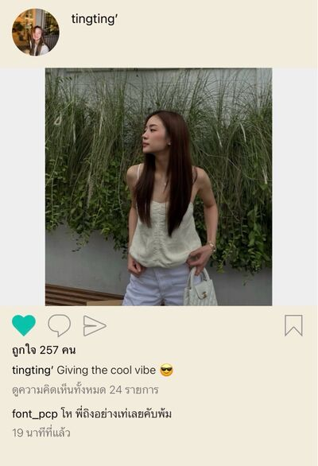
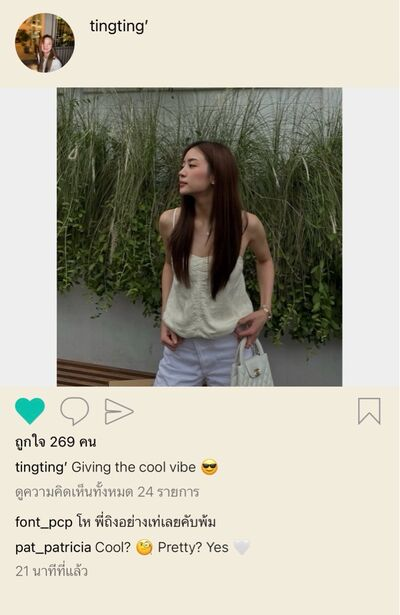

# Never Without You — Chapter 5

English translation · August 9 and 18

## Character and alias key

- tt’ — TingTing / Ting / Muay.
- Patricia🌻 — Patricia / Pat / P’Pat.
- font_pcp — Font, distinct from the coworker Namfon.
- lalin — Lalin.
- eclaire — Claire / P’Claire.
- JJAPP — Japp.
- BEll — Bell.
- Namfon — Namfon / P’Fon.
- Duen — P’Duen.
- ปะป๊า — Dad, TingTing’s father (display name retained).
- หม่าม้า — Mom, TingTing’s mother (display name retained).

Mentioned: P’Sita, Aunt Ying, and Patricia’s parents.

## Translation notes

P’ is an affectionate or respectful honorific for someone older. Muay is Patricia’s nickname for TingTing. “55555” and its variations are Thai internet laughter. “P’Ting-kub” is TingTing’s playful handsome, masculine persona; kub is a polite particle. The Thai hup self-composure cue becomes “hold it in / pull yourself together.” Buddho, Dhammo and Sangho are retained in TingTing’s mock-chant for keeping calm. A “half-full glass” means being open to learning in their conversation. The monkey reaction expresses overwhelmed shy excitement. AW is artwork and KV is key visual in the marketing discussion. “Unknown Elders” follows the project’s established group-name rendering.

Existing English messages are retained, including grammar, playful spellings and the original “didnt’t.” Their discussion of family, loss, privilege and health is translated as the characters’ experience, not general advice; the author’s own qualification is included at the end. Original record order is preserved even where source timestamps move backward. Embedded JJAPP messages in unnamed containers remain in their supplied positions. Two pictures reference img/chat_image_001.jpg and img/chat_image_002.jpg. Image contents have not been inspected, downloaded, or translated. This complete corrected export replaces the earlier incomplete Chapter 5 translation.

## Full translated chat transcript

---

August 9th  
Sunday

---

### Patricia🌻

*8:44 a.m.*

**tt’**  
Morninggg

**Patricia🌻**  
Up early, aren’t you?

**tt’**  
You’re up earlier than me.

**Patricia🌻**  
That goes without saying, Muay.

**tt’**  
55555555

**tt’**  
Going anywhere today?

**Patricia🌻**  
No. Staying home.

**Patricia🌻**  
What about you?

**tt’**  
Shopping with my friends.

**Patricia🌻**  
So cheerful.

**tt’**  
555555

**tt’**  
Buying makeup.

**Patricia🌻**  
Japp said you have twenty lipsticks in your bag.

**tt’**  
P’Japp’s such a gossip.

**Patricia🌻**  
True?

**tt’**  
Exaggerating.

**tt’**  
Maybe a little over ten 🫪

**Patricia🌻**  
How many mouths do you have?

**tt’**  
55555555555555

**tt’**  
I like buying them and keeping them in my bag.

**tt’**  
I like doing makeup.

**Patricia🌻**  
No wonder your makeup’s pretty every day.

**tt’**  
🫪

**Patricia🌻**  
What? 5555

**tt’**  
You called me pretty 🫪

**Patricia🌻**  
Never miss a thing, Muay. Catch every word.

**tt’**  
555555

**tt’**  
Do you have lots of work?

**Patricia🌻**  
The usual amount.

**Patricia🌻**  
Still okay. Why?

**tt’**  
Thought about it all night.

**Patricia🌻**  
Thought what?

**tt’**  
Want you to come to the briefing with me instead 🫠

**Patricia🌻**  
Weren’t you asking Japp to help?

**tt’**  
You said tell you if I changed my mind.

**Patricia🌻**  
At first you wouldn’t let me help.

**tt’**  
Didn’t want to bother you.

**Patricia🌻**  
Now you do, huh?

**tt’**  
I want to go with you.

**tt’**  
Can I?

**tt’**  
Please

**Patricia🌻**  
555555

**Patricia🌻**  
Of course. Khun Kasem’s daughter asks me herself like this. How could I not?

**tt’**  
No.

**tt’**  
Not asking because I’m Dad’s daughter.

**Patricia🌻**  
Then why do you want me there?

*[Read]*

**Patricia🌻**  
Lost for words.

**tt’**  
Because I’m your little Muay.

**tt’**  
Can we go together?

**Patricia🌻**  
My little Muay, huh?

**tt’**  
🙂‍↕️

**Patricia🌻**  
Fine. I’ll come.

**Patricia🌻**  
Could’ve come from the start. You were too considerate to ask.

**tt’**  
Scared you’d be tired.

**tt’**  
But I want to work with you more.

**Patricia🌻**  
P’Duen probably thinks like you.

**tt’**  
Who allowed her? Go put someone else to work 😡

**Patricia🌻**  
55555

**Patricia🌻**  
I have an event at the end of the month too.

**tt’**  
What does that involve?

**Patricia🌻**  
Explain when we meet.

**Patricia🌻**  
Why talk work on a day off, Muay?

**tt’**  
Oh, please.

**tt’**  
You were answering emails this morning.

**Patricia🌻**  
55555555

**Patricia🌻**  
So you checked yours too.

**tt’**  
Notification popped up!!!

**Patricia🌻**  
Why are you shouting!!!

**tt’**  
Yelling at me, P’Pat? 🫠

**Patricia🌻**  
What? You raised your voice first.

**tt’**  
I’m sulking 😠

**Patricia🌻**  
Hey.

**tt’**  
Make it up to me.

**Patricia🌻**  
It’s a day off. No day off from sulking?

**tt’**  
I sulk 24/7. No weekends, official holidays or public holidays off 🙂‍↔️

**Patricia🌻**  
5555555

**Patricia🌻**  
But I can’t coax you 24/7.

**Patricia🌻**  
Only did it last night.

**Patricia🌻**  
Wake up and have to do it again.

**tt’**  
😞

**Patricia🌻**  
How? Tell me how to make it up to you.

**tt’**  
Shopping together.

**Patricia🌻**  
Not going out today. Want to stay with Mom. You understand?

**tt’**  
Fine, fine.

**Patricia🌻**  
Another way instead?

**tt’**  
It’s fiiine. Just pretending to sulk.

**Patricia🌻**  
🤔

**tt’**  
555555

**tt’**  
Stay with your mom. See you Monday.

**tt’**  
Don’t forget breakfast with me when you eat at the office.

**Patricia🌻**  
Still haven’t forgotten that?

**tt’**  
Of course not. Hoping I’d forget? 😠

**Patricia🌻**  
5555555

**Patricia🌻**  
Okay. I’ll tell you.

**Patricia🌻**  
Have fun with your friends.

**tt’**  
🫡

### prettybabies (3)

*9:23 a.m.*

**tt’**  
Noon. Whoever’s late buys lunch.

**font_pcp**  
How are you getting there? P’Sita driving?

**tt’**  
Yes. Too lazy to drive. Tired.

**font_pcp**  
Tired from what?

**tt’**  
Work. Five whole days.

**font_pcp**  
Thought it was drinking.

**tt’**  
What drinking yesterday?

**tt’**  
Barely drank. Not even tipsy.

**font_pcp**  
Right. Sat talking to P’Pat. Only Lalin and me drinking like mad.

**lalin**  
Speaking of P’Pat.

**lalin**  
How’s P’Claire? Talked after you got home?

**tt’**  
Yes.

**lalin**  
What did she say?

**tt’**  
Told Claire I don’t love her.

**tt’**  
Told her I’m tired.

**font_pcp**  
Tiiing.

**lalin**  
Really should’ve collected P’Claire’s body yesterday.

**tt’**  
Seemed to understand. Agreed to let go.

**tt’**  
But I don’t feel good. Not at all. Still awful.

**tt’**  
Lighter, though. Glad she understands.

**font_pcp**  
Did she say anything mean?

**lalin**  
Hardly. P’Claire saying anything mean to Ting?

**lalin**  
Except hurt little digs, can’t imagine her daring tell Ting off.

**tt’**  
Mm. Nothing mean.

**tt’**  
Only nice things, actually.

**font_pcp**  
Why does she love you so much?

**tt’**  
Don’t know.

**tt’**  
But when we were close, such a good relationship. Nothing but goodwill.

**tt’**  
She made me feel so safe and loved

**tt’**  
An amazing sister

**tt’**  
I loved our relationship

**font_pcp**  
With P’Claire since first year, right?

**tt’**  
Yes. First year through graduation.

**tt’**  
Always had her. University would’ve been so hard without her.

**font_pcp**  
Your parents would never have let you stay in a dorm without her.

**lalin**  
Yeah.

**tt’**  
Right. Mom always said I could because Claire was there.

**font_pcp**  
Why did she confess? If she hadn’t, it could still be the same.

**font_pcp**  
Ting’s oblivious. Wouldn’t think she felt more than sisterly love.

**lalin**  
Oh, Font. Who wants sisterhood forever?

**lalin**  
Looked after her so well because she wanted more.

**lalin**  
Who drives you everywhere and stays attached at the hip without feelings?

**font_pcp**  
True. Good deeds with hopes of a reward. I understand.

**font_pcp**  
But confessing wasn’t worth what she lost.

**lalin**  
Probably didn’t expect this ending. Ting used to cling to her. She probably thought she had hope.

**tt’**  
So sad.

**tt’**  
It was really great back then

**tt’**  
We were so happy

**lalin**  
Question, Ting.

**lalin**  
Never even a moment of feeling more than sisterly love for her?

**lalin**  
Through so much together.

**lalin**  
Back to freshman orientation. You cried, she saved you. Everyone knew you were hers and stopped scolding.

**font_pcp**  
So privileged. Knew they were pretending to be strict. Still. My friend belonged to the angel of the class.

**lalin**  
Cheerleading practice, she waited daily. Such good care your parents didn’t worry.

**font_pcp**  
And wanting London. She booked tickets and took you for summer.

**font_pcp**  
Always “Anything for you my baby.”

**tt’**  
Why say so much? Enough 😡

**font_pcp**  
Definitely sitting crying. @lalin

**lalin**  
55555

**lalin**  
That’s why I ask. Not even a moment?

**lalin**  
Because I know you love her

**lalin**  
Even if it's as a sister, you still love her

**lalin**  
And who knows how far your love for her can go?

**tt’**  
I don't know how far it can go

**tt’**  
But for now it's a dead end

**tt’**  
It was a dead end and it still is

**font_pcp**  
Only P’Pat now.

**lalin**  
P’Claire’s dead.

**font_pcp**  
And why does the beautiful older sister indulge Ting so much?

**font_pcp**  
Nearly crying yesterday. Talked a bit, she coaxed her till she beamed.

**font_pcp**  
Every older sister falls to her.

**font_pcp**  
Why?

**lalin**  
Some quality older sisters like, probably. 5555555

**tt’**  
Really like me? 🫪

**lalin**  
P’Claire definitely does.

**font_pcp**  
P’Pat?

**lalin**  
Maybe playing with her heart.

**tt’**  
🤬

**font_pcp**  
Teasing Ting is fun.

**lalin**  
5555555555555

### eclaire

*9:47 a.m.*

**lalin**  
Why give up so easily?

**lalin**  
Thought you’d fight.

**eclaire**  
Didn’t see her face talking to her?

**lalin**  
Saw it. Why? Nearly crying?

**eclaire**  
Yes. She’s a kind girl.

**eclaire**  
She’s so sensitive and caring and when you see her being like this for someone

**eclaire**  
It means she cares that person wholeheartedly

**lalin**  
But she was like this with you too

**lalin**  
Shedding a tear or even crying, she'd done all these because she cared for you

**eclaire**  
Yes, she cared

**eclaire**  
But she didn't love me, not in a romantic way

**eclaire**  
And I knew she loves that woman

**eclaire**  
Sorry but what's her name?

**lalin**  
Pat

**eclaire**  
Yes Pat, the moment I saw her scrolling through Pat's IG

**eclaire**  
I didn't need to hear a single word from her because her eyes were shouting

**eclaire**  
She’s fallen for Pat and that’s when I knew I didn’t really have a chance

**lalin**  
Want to die with you, P’Claire.

### IG: tingting’

*1:43 p.m.*

pat_patricia liked your photo

*1:45 p.m.*

### Patricia🌻

*1:46 p.m.*

**tt’**  
Am I pretty, really? 🫪

**Patricia🌻**  
Muay. Only just commented.

**tt’**  
55555555

**tt’**  
Tried so hard to be handsome P’Ting-kub.

**tt’**  
Even had friends hype me up.

**tt’**  
Then your “pretty” comment. Fine, pretty it is 🫪

**Patricia🌻**  
Want to be P’Ting-kub? 55555

**tt’**  
Can’t I?

**Patricia🌻**  
You look cool.

**Patricia🌻**  
But more cute.

**Patricia🌻**  
Maybe because I see you as a kid. 55555

**tt’**  
Not a kid anymore 😠

**Patricia🌻**  
See? This is why you’re a kid.

**tt’**  
😡

**Patricia🌻**  
🫳

**tt’**  
🫠

**tt’**  
I bought you lipsticks

**tt’**  
I think they will suit you

**Patricia🌻**  
Lipsticks?

**Patricia🌻**  
Whyyy

**Patricia🌻**  
You don’t have to

**tt’**  
Just a few

**tt’**  
No worriesss

**tt’**  
Pretty colours. Definitely suit you.

**Patricia🌻**  
Bought me so much food Friday too.

**Patricia🌻**  
A big spender, Muay?

**tt’**  
Don’t know. Just wanted to buy them.

**tt’**  
Saw them and thought of you.

**Patricia🌻**  
I look like an awful older sister. Haven’t bought you anything.

**tt’**  
Not thinking about that.

**tt’**  
Don’t buy things back just because I gave you something.

**tt’**  
Just wanted to give them.

**tt’**  
And nothing? You bought me milk tea.

**Patricia🌻**  
Only a little.

**tt’**  
Wake-up calls too.

**Patricia🌻**  
Not so little, then.

**tt’**  
🤔

**Patricia🌻**  
555555

**Patricia🌻**  
Not talking. Better run before you sulk again.

**tt’**  
Where are you going?

**Patricia🌻**  
5555555

**Patricia🌻**  
Watching a movie in bed with Mom.

**Patricia🌻**  
My favorite hobby 🙂

**tt’**  
Such a family girl.

**Patricia🌻**  
Of course.

**tt’**  
Want to know so much more about you.

**Patricia🌻**  
Why?

**tt’**  
You seem like a very nice person

**tt’**  
And I really love the energy around you

**Patricia🌻**  
Glad to know na

**Patricia🌻**  
We'll get to know each other better kiddo 🫳

**Patricia🌻**  
Actually, it's your energy that pulls me to you

**Patricia🌻**  
I'm glad we met 🤍

**tt’**  
🤍

---

August 18th  
Tuesday

---

### Patricia🌻

*11:51 a.m.*

**tt’**  
P’Paaaat.

**tt’**  
I’m so annoyed.

**Patricia🌻**  
55555555

**Patricia🌻**  
Pull yourself together first.

**Patricia🌻**  
Can you?

**tt’**  
No. Want to scream.

**Patricia🌻**  
No. No screaming.

**Patricia🌻**  
Hold it in, Muay.

**Patricia🌻**  
Could you stop breathing so hard? It’s funny. 5555555

**tt’**  
😤

**tt’**  
Holding it in!!

**Patricia🌻**  
You have, right?

**Patricia🌻**  
Okay?

**tt’**  
Mm 😠

**Patricia🌻**  
Tell me. What happened?

**tt’**  
Sales asked again when the promotional ads can run. Chasing me.

**tt’**  
But haven’t approved the KV or landing-page details I sent.

**tt’**  
How can I send it to the agengy to run media?

**tt’**  
Dying for promotion, approving nothing. Annoying 😡

**Patricia🌻**  
About two weeks now, this project?

**tt’**  
Yes.

**Patricia🌻**  
Follow up again. Not outrageously late yet.

**Patricia🌻**  
I’ll take you for an acai bowl today so you be happy okayy?

**tt’**  
Really? 🫪

**Patricia🌻**  
Want one?

**tt’**  
So much.

**Patricia🌻**  
Reward for keeping your cool.

**Patricia🌻**  
Your EQ reaches the clouds now.

**tt’**  
555555555555

### Unknown Elders (5)

*1:25 p.m.*

**JJAPP**  
Muaaay. Why scowling? @tt’

**tt’**  
P’Japp, stop.

**JJAPP**  
55555555

**Namfon**  
Teasing without fear, Japp?

**JJAPP**  
Why fear? Won’t hurt me. P’Pat’s here.

**JJAPP**  
If she tries biting my head off, P’Pat stops her.

**tt’**  
🤬

**Patricia🌻**  
Stop teasing, Japp.

**Patricia🌻**  
I’ll get caught in it too.

**JJAPP**  
5555555

### Patricia🌻

*1:32 p.m.*

**Patricia🌻**  
I’m sorry.

**Patricia🌻**  
Didn’t mean to.

**tt’**  
😡

**Patricia🌻**  
Actually angry?

**Patricia🌻**  
Muaaay.

**tt’**  
Not angry. Don’t like other people calling me Muay.

**Patricia🌻**  
I always call you that now. Slipped out.

**Patricia🌻**  
Really sorry. My mistake.

**tt’**  
Said I’m not angry 🫠

**tt’**  
Not with you. With P’Japp 😡

**Patricia🌻**  
Still. Sorry I gave her a chance to tease you.

**Patricia🌻**  
Should I stop calling you Muay? So others won’t copy?

**tt’**  
No.

**tt’**  
You keep calling me Muay.

**Patricia🌻**  
Oh.

**Patricia🌻**  
But if I slip again, others will copy again.

**tt’**  
Mm. It’s fine. Whatever.

**tt’**  
Better than you stopping.

**Patricia🌻**  
Like it that much?

**tt’**  
That much.

**Patricia🌻**  
Haven’t said what yet. Answered so fast.

**tt’**  
🫪

**Patricia🌻**  
I mean liking the name Muay that much. 5555

**tt’**  
I like it 😠

**Patricia🌻**  
Okay.

**Patricia🌻**  
Good Bell’s on leave. Doesn’t know. Another tease.

**tt’**  
Whatever. Anyone can say it. Knowing you called me Muay first is enough 🙂‍↕️

**Patricia🌻**  
Annoyance gone so fast.

**tt’**  
You taught me well.

**tt’**  
Buddho. Hold it in. Dhammo. Hold it in. Sangho. Hold it in.

**Patricia🌻**  
Muaaay.

**tt’**  
5555555555

### B2B marketing (6)

*1:19 p.m.*

**Duen**  
@BEll When can I review the first artwork draft? And have you prepared the other brief for the agency? Send it to me too.

*[Read by 5]*

### Unknown Elders (5)

*1:22 p.m.*

**BEll**  
Am I not on leave?

**BEll**  
Tagging your daddy, are you?

**Patricia🌻**  
Really too far this time.

**JJAPP**  
Not urgent either. Could ask tomorrow.

**BEll**  
Even free, I don’t want to reply.

**tt’**  
Why does she do this?

**JJAPP**  
Oh. P’Pat’s holding Ting’s hand. 5555555

**BEll**  
Why? What happened?

**JJAPP**  
Stopping her typing insults at P’Duen. 555555

**JJAPP**  
Looking at each other now. Attitude adjustment by eye contact.

**Namfon**  
555555555

**JJAPP**  
Muay. Calm down, sweetheart.

**tt’**  
Won’t be calm if you call me Muay.

**tt’**  
You’ll die without warning.

**Namfon**  
Nong Tiiing. 5555

**Patricia🌻**  
Sigh.

**JJAPP**  
555555555

**tt’**  
😡

**BEll**  
Funny. Angry with P’Duen, but Ting still makes me laugh. 55555

**BEll**  
She always does this. Talks work when someone’s on leave. Doesn’t care about anything.

**tt’**  
Awful.

### B2B marketing (6)

*1:39 p.m.*

**Duen**  
Answer by today, please. @BEll

**BEll**  
I’m unavailable. On leave.

**Duen**  
Spare a little time. Sent it yesterday and I wouldn’t need to chase today.

**BEll**  
Thought we still had time. Tomorrow should be fine.

**Duen**  
Lots of other work tomorrow. Won’t have time to review.

**Duen**  
That’s settled.

*[Read by 5]*

### Patricia🌻

*1:55 p.m.*

**tt’**  
Does she have manners?

**Patricia🌻**  
I understand. Everything you feel.

**Patricia🌻**  
Talk tonight, okay?

**tt’**  
So annoying, P’Pat. Working with her makes me unhappy.

**tt’**  
Team doesn’t like it either. Look what she does. How stay under her so long?

**tt’**  
No people skills. Sits breathing loudly all day.

**tt’**  
Only good thing: stamina to work all day with no finishing time, maybe.

**Patricia🌻**  
But everyone’s purpose here is work. If she does it, and more than others,

**Patricia🌻**  
wouldn’t you keep her if you were her boss?

**tt’**  
Of course. Doesn’t have to endure what we do.

**tt’**  
No careless handoffs. No nitpicking and endless revisions.

**tt’**  
No chasing on leave or holidays. No evening assignments due tomorrow morning.

**tt’**  
Only two weeks here and this much already. Two years like you? I’d be insane.

**Patricia🌻**  
Everyone has responsibilities, Muay. Can’t bear it, leave. They find someone new.

**tt’**  
Can’t keep calm. Don’t want to talk.

**Patricia🌻**  
Okay. Continue at home later.

**tt’**  
😡

**Patricia🌻**  
But could you hold it in first? Meeting soon.

**Patricia🌻**  
I know it’s frustrating. Not easy to calm down now.

**Patricia🌻**  
Promise you can vent all you want once home.

**Patricia🌻**  
Okay?

**tt’**  
Fine 🫠

### B2B marketing (6)

*2:49 p.m.*

**Duen**  
Following the meeting, Ting, summarise the process for me. @tt’

JJAPP: Ting’s turn this time.

**tt’**  
You want me to summarise?

**tt’**  
But you haven’t sent a brief.

**Duen**  
Try starting yourself. Summarise it and I’ll review.

**tt’**  
Isn’t it your job to give me a brief? Not have me do everything for you?

JJAPP: P’Pat, look at Ting in P’Duen’s group. Quick. @Patricia🌻

**tt’**  
You care so much about tiny details. Send something and I’ll have a thousand revisions. Could you give instructions first? At least the scope.

*[Read by 5]*

**Duen**  
Any problems, come talk to me, Ting.

**Patricia🌻**  
I’ll help her check it, P’Duen.

### Unknown Elders (5)

*2:50 p.m.*

**JJAPP**  
Ting’s turn this time.

**JJAPP**  
P’Pat, look at Ting in P’Duen’s group. Quick. @Patricia🌻

*2:54 p.m.*

**Namfon**  
Confused. Thought today would be peaceful.

**BEll**  
Little firecracker. Love you. Not even a month and fighting P’Duen. @tt’

**JJAPP**  
Ting’s snapped her cable. Can’t hold it in.

**JJAPP**  
P’Pat’s turned and grabbed her hand again. 55555

**Namfon**  
Pity Pat. So much work. Oversees the team for P’Duen. Now therapist too.

**JJAPP**  
Love P’Pat so much. Without her, couldn’t stay in this team.

**BEll**  
True.

**Patricia🌻**  
Bell, don’t encourage her. Even we don’t dare speak to P’Duen like that.

**JJAPP**  
There.

### Patricia🌻

*2:59 p.m.*

**Patricia🌻**  
Muay, where are you going?

### Family 🏠 (3)

*3:25 p.m.*

**ปะป๊า**  
Your daughter cried down the phone reporting to me for nearly half an hour. @หม่าม้า

**ปะป๊า**  
Crybaby from childhood to adulthood 🤣

**tt’**  
Dad. Not funny.

**tt’**  
I’m frustrated to death. Understand?

**tt’**  
Don’t want to work here. Can’t remove her, I quit.

**ปะป๊า**  
Said you wanted work because of Pat. Quitting now?

**tt’**  
True. I’ll keep working 😡

**หม่าม้า**  
What happened?

**ปะป๊า**  
Daughter reported her supervisor. Dozens of reasons to fire Khun Duen. Crying while talking. So upset 🤣

**tt’**  
Why treat it like a joke?

**ปะป๊า**  
Because you’re acting like a child.

**tt’**  
Try taking my side, Dad.

**ปะป๊า**  
Been on your side your whole life, little one.

**tt’**  
Mooom.

**ปะป๊า**  
No Mom. Talking to Dad is right.

**ปะป๊า**  
Why call me demanding someone’s firing? Because you’re my daughter, you dare?

**ปะป๊า**  
Are you and I the only owners of this organisation?

**tt’**  
No.

**tt’**  
But everything I said is true. Affects the whole team’s work and mental state.

**tt’**  
Even good performance—I don’t know how good—comes from overworking her subordinates.

**tt’**  
From releasing negative energy whenever she likes. No regard for anyone.

**tt’**  
Not her specialism? Dumps it. Won’t look. Her strength? Nitpicks nonstop. No middle ground.

**tt’**  
No tact whatsoever. Awful atmosphere. Who wants to endure that boss?

**ปะป๊า**  
Who’s Khun Duen’s boss?

**tt’**  
Aunt Ying.

**ปะป๊า**  
And Aunt Ying’s boss?

**tt’**  
Dad.

**ปะป๊า**  
And Dad’s boss?

**tt’**  
Who?

**หม่าม้า**  
You, sweetheart. Who else would he yield to?

**ปะป๊า**  
🤣

**tt’**  
What is this? 😡

**ปะป๊า**  
We all answer to someone. Right now you answer to Khun Duen.

**tt’**  
Telling me to endure it?

**ปะป๊า**  
Not saying that. But our company has structure, hierarchy. Follow the rules.

**ปะป๊า**  
If I wanted you above everyone, wouldn’t send you as someone’s subordinate. Understand, TingTing?

**ปะป๊า**  
Want to fix things? Try from your own position. Don’t report to me. Learn the outside road isn’t strewn with roses like we’ve laid your whole life.

**tt’**  
What can I do from my position now?

**ปะป๊า**  
Exactly.

**ปะป๊า**  
Lowest in the team.

**tt’**  
You’re bullying me.

**หม่าม้า**  
I believe you can do it.

**tt’**  
Mom, I might kill someone instead.

**ปะป๊า**  
🤣

**หม่าม้า**  
You’re enjoying this so much.

**ปะป๊า**  
My daughter.

**หม่าม้า**  
Was “your daughter” a moment ago.

**tt’**  
Both your daughter. Stop arguing!! 😡

### Patricia🌻

*3:24 p.m.*

**Patricia🌻**  
Muay, okay?

**tt’**  
Not at all.

**tt’**  
Frustrated. Can’t do anything.

**Patricia🌻**  
P’Duen?

**tt’**  
Yes.

**tt’**  
Dad scolded me too. Scolded and teased.

**tt’**  
Reported her to him.

**Patricia🌻**  
Told Khun Kasem about P’Duen?

**tt’**  
Yes. Everything. Want him to fire someone like her.

**tt’**  
No judgment about what’s appropriate. Completely unfit to lead.

**Patricia🌻**  
Even after Buddho, hold it in. Dhammo, hold it in. Sangho, hold it in.

**tt’**  
🫠

**tt’**  
I don’t like it.

**tt’**  
What she does is awful.

**Patricia🌻**  
Yes. You’re right.

**tt’**  
Angry even being Dad’s daughter changes nothing if he won’t help. Can’t do a thing.

**tt’**  
What rules? Who listens to a tiny ant? She’s worth much more to the company.

**tt’**  
Even if they listened, who’d pay severance to get her out?

**tt’**  
So frustrating. Feel powerless.

**Patricia🌻**  
Have you been crying?

**Patricia🌻**  
You cried, didn’t you?

**tt’**  
Don’t look, P’Pat.

**tt’**  
Others will know.

**Patricia🌻**  
Really can’t hold it together now, huh?

**tt’**  
Mm.

**Patricia🌻**  
It’s okay. I’ll help with what she assigned.

**tt’**  
It’s fine. I’ll do it.

**tt’**  
Not unwilling to work. Just don’t want unfair treatment. Frustrating.

**tt’**  
Too frustrated, tears come themselves. I’m fine.

**Patricia🌻**  
What can I do? Don’t want you upset.

**Patricia🌻**  
Want to help. Can’t do more, Muay. Sorry.

**tt’**  
Nooo it's not your fault

**Patricia🌻**  
Will a head pat help?

**tt’**  
🫪

*[Read]*

**tt’**  
Feel nothing now. No frustration. All gone 🫪

**Patricia🌻**  
555555

**Patricia🌻**  
Silly, Muay.

**Patricia🌻**  
Really gone?

**tt’**  
Not really.

**tt’**  
But so much better.

**tt’**  
Thank you, P’Pat 🫠

**Patricia🌻**  
🙂

### prettybabies (3)

*7:47 p.m.*

**tt’**  
Work for old lady Duen, get scolded by Dad, P’Pat has to control my behaviour.

**tt’**  
Hate this world 🤬

**font_pcp**  
P’Japp told me.

**font_pcp**  
Shook the industry, apparently.

**font_pcp**  
Argued with her boss in LINE. @lalin

**lalin**  
555555

**lalin**  
Very her.

**tt’**  
But P’Pat patted my head for the first time. Everything disappeared.

**tt’**  
My sanity too 🫠

**font_pcp**  
Tiiing. 5555555

**lalin**  
Why pat your head? Comfort?

**tt’**  
Yes 🫪

**tt’**  
Didn’t want me upset. Never patted mine or anyone’s head before.

**tt’**  
And this was the first time 🫪

**font_pcp**  
Gay kid’s getting encouraged.

**lalin**  
What’s with P’Pat?

**lalin**  
Actually has feelings?

**tt’**  
Aaaaaah.

**tt’**  
Lalin. Be serious.

**lalin**  
Don’t know. Never met her. Need to see you together.

**tt’**  
I’ll bring her.

**font_pcp**  
What are you to her, bringing her to friends? What relationship, P’?

**tt’**  
Little Muay 😡

**font_pcp**  
Oh, yeah. P’Japp said P’Pat calls her Muay.

**font_pcp**  
But she snapped when P’Japp did. 55555555555

**font_pcp**  
Why, sweetie Muay? Can’t call you that?

**tt’**  
Not Muay. Ting.

**tt’**  
It’s Ting, baby.

**font_pcp**  
Your baby, my arse.

**lalin**  
5555555555

**tt’**  
Why? Not P’Japp, can’t call you baby?

**font_pcp**  
Not P’Pat, can’t call you Muay?

**tt’**  
🫪

**tt’**  
So shy. Don’t know why. I love being little Muay 🫪

**font_pcp**  
Oh, Ting. Seriously bad.

**lalin**  
Came to complain about work. Ends up blushing over the beautiful older sister.

**lalin**  
Gay kid really is a gay kid.

**tt’**  
5555555

**tt’**  
But didn’t like myself today. Still feel that. Hate it.

**tt’**  
Seeing her calm me down felt awful. Like she’s always the one caring for me.

**tt’**  
I just feel like I was a burden to her and I don't like it

**tt’**  
I want to be better so she can rely on me, not the other way around

**font_pcp**  
Ting wants to be a better person!!!???

**font_pcp**  
That can happen?

**lalin**  
Oh Claire was right

**lalin**  
You've fallen for her

**tt’**  
Yes

**tt’**  
Head over heels

### Patricia🌻

*8:12 p.m.*

**Patricia🌻**  
Muay, home yet?

**tt’**  
Home 🫠

**Patricia🌻**  
Didn’t tell me.

*[Read]*

**Patricia🌻**  
What’s wrong?

**tt’**  
Scared you’ll scold me.

**Patricia🌻**  
Scared of what?

**Patricia🌻**  
Why would I scold you?

**tt’**  
Every “talk at home later,” I get scolded.

**Patricia🌻**  
5555555

**tt’**  
Comforting head pats don’t mean I won’t be held to account later.

**tt’**  
P’Japp says attitude adjustment incoming.

**Patricia🌻**  
I worry about you.

**Patricia🌻**  
Want us to understand. Your dad had reasons for what he said too.

**tt’**  
🫠

**Patricia🌻**  
Want to talk?

**tt’**  
I do.

**tt’**  
But nicely.

**Patricia🌻**  
55555

**Patricia🌻**  
I always speak nicely to you.

**Patricia🌻**  
Go on. You first. Vent everything.

**tt’**  
So many times today. Started with P’Bell.

**tt’**  
Then dumped work after the meeting. No brief. Figure it out myself. Couldn’t stand it. Had to talk back.

**tt’**  
You said you’d help. Made me feel I could do nothing but obey.

**tt’**  
So frustrated I called Dad. But he wouldn’t help. Left me stranded too.

**tt’**  
Even angrier. Hated everything. Nothing good today. Felt awful. Don’t want work anymore.

**tt’**  
Thought my EQ improved. Nothing better 🫠

**Patricia🌻**  
I understand you disliking it. Everything feels frustrating.

**Patricia🌻**  
Honestly, P’Duen was wrong.

**tt’**  
Exactly. Spoke directly because I want her to know it’s wrong.

**tt’**  
Bad boss, just endure? That’s not right.

**Patricia🌻**  
I understand, Ting. But the outside world doesn’t work that way.

**Patricia🌻**  
You know they won’t pay compensation to get her to leave.

**Patricia🌻**  
However much you want what’s right, you can only do what the system allows.

**tt’**  
Mm.

**Patricia🌻**  
Wait. Before continuing, still want to be a half-full glass?

**tt’**  
Teaching me a lot?

**tt’**  
I was wrong. Don’t scold too much.

**Patricia🌻**  
Not scolding. Teaching, maybe.

**Patricia🌻**  
But won’t continue if you don’t want to hear it. Up to you.

**Patricia🌻**  
And it's gonna be a serious topic so I just want to know if you will let me continue

**tt’**  
It's okay if it’s you, go ahead

**Patricia🌻**  
Remember arriving late your first two days? No one said anything.

**tt’**  
Yes. Only two days, though.

**Patricia🌻**  
Because I called to wake you after that, right?

**tt’**  
True again 🫠

**Patricia🌻**  
Anyone else, P’Duen would report to HR.

**Patricia🌻**  
Know why not you?

**tt’**  
Dad’s daughter 😞

**Patricia🌻**  
Yes. Khun Kasem’s daughter.

**tt’**  
Without you, I’d probably keep coming late.

**Patricia🌻**  
Didn’t want that. Offered wake-up calls.

**Patricia🌻**  
Know you’re a good girl. Just wanted you to enjoy working with others.

**Patricia🌻**  
Like your dad said. Rules. You work with others, with me. Same rules for us. Right?

**tt’**  
My family’s company too.

**tt’**  
Even more reason to follow them. Otherwise people talk behind my back.

**tt’**  
Already gossiping about me born on a pile of privileges but who cares 🤷🏻‍♀️

**Patricia🌻**  
I care

**Patricia🌻**  
I don't want anyone to talk behind your back cause I know you're a good girl

**Patricia🌻**  
And you've been working hard

**tt’**  
🫠

**Patricia🌻**  
But yes. You really were born with privileges.

**Patricia🌻**  
Late to work, no one dares say anything.

**Patricia🌻**  
You see how distorted the world is?

**Patricia🌻**  
That's why you can’t expect anything to be right and fair

**Patricia🌻**  
Because that’s not how things work

**tt’**  
It's my fault that I was born to be my Daddy's girl?

**tt’**  
Just asking, I got your point though

**Patricia🌻**  
It's not your fault

**Patricia🌻**  
It's your fortune kid

**Patricia🌻**  
Want you to try another perspective. Your world might be nicer than you think.

**Patricia🌻**  
Maybe not that frustrating. Not that irritating.

**Patricia🌻**  
Someone might be looking at your life thinking the world’s unfair right now. Know that?

**Patricia🌻**  
Tell my best friend this, she’d say I’m bitter.

**tt’**  
Don’t like me, P’Pat?

**tt’**  
Hate me?

**Patricia🌻**  
How could I hate you?

**Patricia🌻**  
Don’t dislike you either. I’m happy for you.

**Patricia🌻**  
Just saying, when everything feels wrong and doesn’t go your way,

**Patricia🌻**  
try appreciating little things in life.

**tt’**  
Can’t think of anything besides you.

**tt’**  
Anything I want to appreciate.

**Patricia🌻**  
Let’s think this way

**Patricia🌻**  
At least we’re breathing now

**Patricia🌻**  
At least we’re living now

**Patricia🌻**  
We can eat anything we like. We can drink anything we want.

**Patricia🌻**  
We can walk. We can talk.

**Patricia🌻**  
We can hear. We can see.

**Patricia🌻**  
Most importantly, we’re having a home to come back to after a long tough day

**Patricia🌻**  
Better yet, you’re having your parents at home waiting for you

**Patricia🌻**  
It’s not that everyone can get what we have

**Patricia🌻**  
Not to mention what you have

**Patricia🌻**  
Trust me

**tt’**  
And I have you to talk to

**Patricia🌻**  
See?

**tt’**  
🫠

**tt’**  
Wait

**tt’**  
When mentioning parents, why did you swap we with you?

**tt’**  
I mean from both of us to only just me

**Patricia🌻**  
I have one parent

**Patricia🌻**  
Only my mom

**tt’**  
What happened?

**tt’**  
Sorry, I shouldn't have asked

**Patricia🌻**  
Why?

**tt’**  
I didnt’t want to cross the line

**Patricia🌻**  
No

**Patricia🌻**  
There’s no line between us anymore

**Patricia🌻**  
My dad passed away when I was 22

**Patricia🌻**  
That's what happened

*[Read]*

**Patricia🌻**  
Not that big a deal, Muay.

**Patricia🌻**  
Don’t go quiet. 5555

**tt’**  
It is.

**tt’**  
Huge.

**tt’**  
Noticed you never mentioned your dad. Didn’t think much.

**tt’**  
Awful. So awful.

**Patricia🌻**  
Not awful. Nothing’s awful.

**tt’**  
What have I been complaining to you about every day?

**tt’**  
Everything. Never happy with anything. Nothing even wrong.

**tt’**  
I'm now the same age when you suffered the loss

**tt’**  
And all these stupid little things I dumped on you

**tt’**  
All this time I had no idea what you'd been through

**tt’**  
I was so stupid and I'm so so sorry

**Patricia🌻**  
Muaaay. Don’t.

**Patricia🌻**  
Not telling you to make you feel bad. Just want you happy with your life.

**tt’**  
Without Dad now, wouldn’t know how to live.

**tt’**  
Just thinking hurts, but you were the one who experienced it ☹️

**Patricia🌻**  
I felt awful then too. But it’s been ages.

**Patricia🌻**  
I got through it and I can handle it now

**Patricia🌻**  
Don't you worry kiddo 🫳

**tt’**  
P’Duen seems such a little thing now.

**Patricia🌻**  
It isn’t little.

**Patricia🌻**  
Still frustrating. Still irritating.

**Patricia🌻**  
Just be annoyed briefly. Spend the rest being happy. Better, isn’t it?

**Patricia🌻**  
Not saying never get upset. Just give it a little time. That’s enough.

**Patricia🌻**  
Don't let negativity own you

**Patricia🌻**  
Your life is much more than that

**tt’**  
Throwing all these emojis away 😠😡🤬

**Patricia🌻**  
555555

**Patricia🌻**  
No need.

**Patricia🌻**  
Use them. Cute when you do. So funny when you sulk.

**Patricia🌻**  
But no crying like today, okay? Don’t want frustration bringing you to tears.

**Patricia🌻**  
Tears don’t suit you at all.

**tt’**  
I’ll try.

**tt’**  
But if I cry again, pat my head.

**tt’**  
Pat once, crying stops instantly 🫪

**Patricia🌻**  
Crafty thing. Good mood already, huh?

**tt’**  
5555555

**tt’**  
Don’t want to spoil the mood. Everyone would be sad.

**Patricia🌻**  
Know what? Finding out you were twenty-two made me think of myself.

**Patricia🌻**  
Wasn’t a fraction as bright as you then.

**Patricia🌻**  
Seeing you cheerful, talkative, such a baby, I couldn’t help adoring you.

**Patricia🌻**  
Even if you complain brilliantly, get annoyed easily and never like anything.

**tt’**  
P’Paaat.

**Patricia🌻**  
5555555

**tt’**  
What’s with all this baby talk?

**Patricia🌻**  
Driven everywhere. Housekeeper cooking. How aren’t you a baby?

**tt’**  
🫠

**tt’**  
True, huh.

**tt’**  
Wake up to breakfast made for me. Driver. Family job waiting. Parents who love and indulge me.

**tt’**  
All good things. Get them daily. Never saw them.

**Patricia🌻**  
You see now.

**tt’**  
Because of you.

**tt’**  
How did you learn to think like this?

**Patricia🌻**  
I was so unhappy once. Didn’t know why I was born. Why keep living.

**Patricia🌻**  
After Dad died, drifted day to day for nearly two years.

**Patricia🌻**  
Wake, eat, work, home, sleep. Repeat. Like a robot, Muay.

**Patricia🌻**  
Mom getting ill woke me up. Not the life I wanted. Not what I wanted for her.

**Patricia🌻**  
We should enjoy every second we have left together.

**Patricia🌻**  
Several heart arteries narrowed and blocked then. Doctor ordered bypass surgery.

**Patricia🌻**  
Lucky Dad’s money remained. Lucky treatment went well. That’s why Mom’s still with me.

**Patricia🌻**  
After that, opening my eyes to life with her, seeing her healthy, makes me happy.

**Patricia🌻**  
Life is that simple, you know?

**tt’**  
You were so strong

**tt’**  
I can't picture myself doing it like you

**Patricia🌻**  
It's nothing

**Patricia🌻**  
Universe just gave me a lesson and I've learned

**tt’**  
Really want to know so much more about you.

**Patricia🌻**  
You know so much more already.

**Patricia🌻**  
So fast too.

**Patricia🌻**  
Just over two weeks, Muay. Nearly know me as well as my best friend.

**tt’**  
I like you so much.

*[Read]*

**tt’**  
I mean liking knowing you.

**tt’**  
Like I always get good energy from you.

**Patricia🌻**  
You’re good energy in my life too.

**tt’**  
🫠

**Patricia🌻**  
Anything else you appreciate today?

**tt’**  
Something else today?

**tt’**  
You wore lipstick I bought you

**Patricia🌻**  
You noticed it?

**tt’**  
Of course

**Patricia🌻**  
Such sharp eyes.

**tt’**  
Of course. I’d know.

**tt’**  
Picked it specially for you 🙂‍↕️

**Patricia🌻**  
Clever girl.

**Patricia🌻**  
Okay today? Feeling better?

**tt’**  
My part’s good.

**tt’**  
Yours isn’t. Don’t want bad things happening to you anymore.

**Patricia🌻**  
Can’t stop that. Happens, get through it.

**Patricia🌻**  
But don’t think ahead now. Stay in the present. Okay?

**Patricia🌻**  
At this moment, I'm happy talking to you and that's enough 🙂

**tt’**  
And I'm happy to have you in my life

**tt’**  
That's enough too

**Patricia🌻**  
🫳

**tt’**  
You turned a monkey into a person.

**Patricia🌻**  
What are you saying, Muay?

**tt’**  
You changed my perspectives

**tt’**  
You evolved me!!

**Patricia🌻**  
LOL

**Patricia🌻**  
It's just how I live my life!!

**tt’**  
It's how we live our lives, beautiful 🙂

.

.

.

## Author’s note

Only five chapters written, but I love PatTing like I’ve been writing them five months 😭
P’Pat loves her little one so much. Muay loves her beyond words. Waiting for someone to fall. Fall in love or fall flat? Who knows 🙇🏻‍♀️

Don’t know if any long-time readers are here. If you are, you’ve probably seen me grow with every fic. Read them all and you’ll know plenty about me. 555555555

Thank you to everyone reading. Wishing you only good things, and let’s be happy in the moment 🙂

P.S. Patricia and Ting’s universe-lesson conversation applies only to them. 555 Not everyone can appreciate everything Patricia mentions. It’s quite sensitive 🫠
