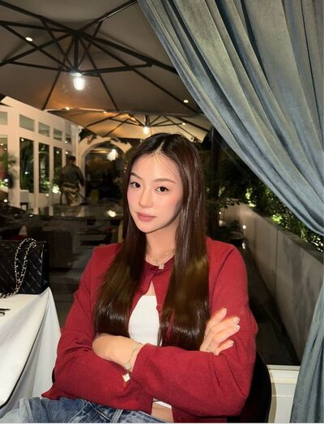

# Never Without You — Chapter 6

English translation · August 19, Wednesday

## Character and alias key

- tt’ — TingTing / Ting / Muay.
- Patricia🌻 — Patricia / Pat / P’Pat.
- eclaire — Claire / P’Claire.
- font_pcp — Font, distinct from the coworker Namfon.
- lalin — Lalin.
- JJAPP — Japp.
- BEll — Bell.
- Namfon — Namfon / P’Fon.
- khim09 — Khim.
- หม่าม้า — Mom, TingTing’s mother (display name retained).
- ปะป๊า — Dad, TingTing’s father (display name retained).

Mentioned: P’Duen, Nong Chan, and Patricia’s mother.

## Translation notes

P’ is an affectionate or respectful honorific for someone older. Muay is Patricia’s nickname for TingTing. “55555” and its variations are Thai internet laughter. Kub-pom and ka are polite particles used playfully in their chats. “Pull yourself together / hold it in” conveys the recurring Thai hup self-composure cue, used both for temper and for shy excitement. “Turning into a monkey” is TingTing’s dramatic image of being overwhelmed with delight. Claire’s “little whiner” is an affectionate nickname TingTing resists. AW is artwork in the marketing conversation. The Pat-ch joke plays on Pat’s name and a software update, while bitter/better wordplay is kept intact. “Unknown Elders” follows the established coworker group-name convention.

Original English messages are retained, including capitalization and the original lowercase “little privilege.” The source’s Thai ship hashtag is preserved. One photograph references img/chat_image_001.jpg at its original position. Image contents have not been inspected, downloaded, or translated. This version uses the complete corrected Chapter 6 export, replacing the earlier incomplete translation.

## Full translated chat transcript

---

August 19th  
Wednesday

---

### Baby’s Daddy&Mommy (3)

*7:42 a.m.*

**หม่าม้า**  
She’s left for work.

**eclaire**  
Okay, Mom.

**หม่าม้า**  
Claire, do you know someone called Pat?

**eclaire**  
I’ve heard the name.

**หม่าม้า**  
Are they very close?

**eclaire**  
Not sure how close. But Ting admires her so much.

**eclaire**  
Why, Mom?

**หม่าม้า**  
Last night, she suddenly asked to sleep with us. In the middle too. And she’s hardly tiny.

**หม่าม้า**  
Cuddled up, telling us she loved us. Her dad couldn’t stop smiling.

**ปะป๊า**  
Not just cuddling. Apologised too.

**ปะป๊า**  
“Sorry I’m difficult and complain so much. I love you, Dad and Mom. Thank you for giving me such a good life, such happiness. I love you most of all” 🤣

**eclaire**  
55555

**eclaire**  
Really that much?

**หม่าม้า**  
Yes. Even I was surprised, sweetheart.

**หม่าม้า**  
Asked why. Said she’d talked to P’Pat, who made her realise how precious we are.

**eclaire**  
She said that?

**หม่าม้า**  
Yes.

**ปะป๊า**  
Ever met her, Claire?

**eclaire**  
Never.

**ปะป๊า**  
I’ve been interested since she made my daughter want to work.

**eclaire**  
I don’t know her, Dad.

**eclaire**  
But she must make Ting so happy.

**หม่าม้า**  
Come eat with us when you’re free. Haven’t seen you for ages.

**eclaire**  
I’m free today, Mom. Shall I pick you up? Lunch and a walk?

**หม่าม้า**  
Let’s go. I’m a little lonely.

**eclaire**  
55555

**eclaire**  
I’ll come get you.

### eclaire

*8:44 a.m.*

**eclaire**  
Tell me when you reach the office.

**eclaire**  
Your parents told me you slept with them.

*8:53 a.m.*

**tt’**  
Why tell you? 😠

**eclaire**  
555555

**eclaire**  
Why did you do that? Never seen you sleep with them.

**tt’**  
You don’t want to know.

**eclaire**  
I do. Want to know everything about you.

**eclaire**  
Even if it’s about her.

**eclaire**  
You can talk to me about her, TingTing.

**tt’**  
Can I?

**tt’**  
Are you okay with it, Claire?

**eclaire**  
Yes. I’m okay.

**tt’**  
Yesterday P’Pat taught me another way to see the world.

**tt’**  
The way I know grown-ups do.

**tt’**  
Life’s about our perspective. See something as small, and it becomes small.

**tt’**  
And which things should matter, because they really do matter to us.

**eclaire**  
What did she say to make you think like this?

**tt’**  
Personal business.

**eclaire**  
Ouch you little rascal

**tt’**  
No I mean it's her personal matter

**tt’**  
I can't tell you 🫠

**tt’**  
But I don’t think it’s about what she said.

**tt’**  
Well, it is. But that isn’t where the weight lies.

**eclaire**  
Where does it lie?

**tt’**  
More with who said it.

**tt’**  
Because it’s P’Pat, I want to listen and adopt it.

**eclaire**  
If it were me, you probably wouldn’t listen.

**tt’**  
Claire. You matter to me.

**tt’**  
Not that kind of love, but you really matter.

**eclaire**  
Yes, little whiner. I matter, then.

**tt’**  
My name’s Ting!!! 😡

**eclaire**  
555555

**eclaire**  
Having lunch with your mom today. Picking her up soon.

**tt’**  
Really? Not waiting for me 😠

**eclaire**  
You’re busy.

**tt’**  
Weekday. How could I be free?

**eclaire**  
Then I’ll pick you up Saturday too.

**tt’**  
Make plans with my parents too.

**eclaire**  
Of course.

**tt’**  
Thank you.

### prettybabies (3)

*10:06 a.m.*

**tt’**  
Told your parents you love them today?

**font_pcp**  
What?

**tt’**  
Tell them soon. Never know when you won’t have them with you.

**font_pcp**  
What’s with her? @lalin

**tt’**  
Talked to P’Pat. Beautiful older sister taught me to appreciate everything we have now 🫠

**font_pcp**  
Knew it.

**lalin**  
Won’t listen to anyone else. Beautiful older sister teaches? Listens and applies.

**tt’**  
How did you know? 🫪

**font_pcp**  
Look at you.

**tt’**  
But really. Things we overlook matter so much.

**tt’**  
Just waking up to my parents, coming to work and seeing P’Pat, I’m happy.

**tt’**  
Nothing can ruin my mood.

**lalin**  
Say that again at the end of the day.

**font_pcp**  
Old lady Duen arrived yet?

**lalin**  
555555555

**tt’**  
🤬

**tt’**  
Anyway. I like P’Pat so much.

**font_pcp**  
Not working anymore, huh?

**font_pcp**  
Normally never chats during work.

**tt’**  
Just want to tell you. Want to gossip.

**tt’**  
Listen first.

**lalin**  
Talked a lot yesterday?

**tt’**  
Yes. Deep too.

**font_pcp**  
Talk every day?

**tt’**  
Of course.

**font_pcp**  
Wow. Is there hope? Our straight older sister, answer me. @lalin

**lalin**  
Coworkers can talk every day.

**font_pcp**  
Oh.

**lalin**  
Even P’Claire being with her daily didn’t give her a chance.

**lalin**  
What do you expect from just talking?

**font_pcp**  
Ooooh.

**tt’**  
Oh my god.

**tt’**  
Just want to tell you how lovely she is. Could you stop and listen? 🤬🤬🤬

**font_pcp**  
“Nothing can ruin my mood.”

**font_pcp**  
Since when?

**font_pcp**  
So confused.

**lalin**  
55555555555

**font_pcp**  
Okay. Tell us.

**font_pcp**  
Before she bursts and dies.

**tt’**  
P’Pat’s so lovely.

**tt’**  
Positive energy in my life.

**tt’**  
Unlike you two!!! 😡

**lalin**  
Circling back to insult us? Won’t listen, then.

**tt’**  
No, no. Listen.

**lalin**  
Don’t get brave with me when you’ve no friends left, little one.

**font_pcp**  
55555555

**font_pcp**  
Laliiin. Too close to the bone.

**font_pcp**  
Enough. Let her tell it.

**tt’**  
😠

**tt’**  
With her, I feel the good energy she gives off.

**tt’**  
She makes me grow up. Her energy calms me.

**tt’**  
So patient and kind. When I’m heated, seeing her makes me cool down too.

**tt’**  
Doesn’t teach optimism or pessimism. Teaches me to see the world as it is.

**tt’**  
Our perspective matters most. Good or bad depends on how we see it.

**tt’**  
Want to know her more and more. Someone I want to keep in my life.

**tt’**  
Glad I met her.

**lalin**  
Beautiful older sister, what did you do to our friend?

**lalin**  
Not used to it. Go back to being unhinged, Ting.

**font_pcp**  
I’m confused.

**font_pcp**  
Reached enlightenment?

**tt’**  
Don’t know. Meet her and maybe you’ll understand.

**lalin**  
Bring her.

**lalin**  
Want to meet someone who makes you like her this much.

**tt’**  
Want to bring her too.

**tt’**  
But she doesn’t like going out on days off. Likes being with Mom.

**tt’**  
Even work nights, watches movies in bed with her mom.

**tt’**  
Loves her so much. Total family girl 🫳

**tt’**  
Green flag, right? 🫪

**lalin**  
With Mom or with her husband?

**font_pcp**  
Laliiiin.

**tt’**  
Don’t say that.

**tt’**  
She really loves her mom. Even if she has a husband, don’t joke about this with her.

**lalin**  
Teasing, teasing.

**font_pcp**  
Gay kid’s angry now.

**lalin**  
Sorry, P’.

*[Read by 2]*

**lalin**  
Ting, angry? @tt’

**tt’**  
Nearly fainted from anger just now.

**tt’**  
I really like her so much 🫪

**lalin**  
Oh, dead.

**lalin**  
I nearly died.

**font_pcp**  
55555555555555

### Patricia🌻

*11:18 a.m.*

**Patricia🌻**  
Muay, SmartBuddy going okay?

**tt’**  
They want more ads.

**tt’**  
Requested more artwork already.

**Patricia🌻**  
Need to talk to Japp, then.

**tt’**  
Yes.

**tt’**  
I’ll discuss budget allocation with P’Japp.

**tt’**  
Summarise at next Monday’s meeting.

**Patricia🌻**  
Clever. Running it without any problems.

**tt’**  
🫪

**Patricia🌻**  
Time you helped with my work.

**tt’**  
Bring it on.

**tt’**  
Been waiting. Tell me what I can help with.

**Patricia🌻**  
5555555

**Patricia🌻**  
Kidding.

**Patricia🌻**  
Better wait for P’Duen’s work. Little tasks coming soon.

**tt’**  
Tell yourself about little tasks.

**tt’**  
You’re the only one I see getting hit 😠

**tt’**  
Learn to push some work away.

**Patricia🌻**  
I do.

**tt’**  
Not true.

**Patricia🌻**  
I did before. Before you joined.

**tt’**  
Don’t know about then.

**tt’**  
But never seen you push work back now.

**tt’**  
And I really don’t like it.

**Patricia🌻**  
Working hard for your company, you know.

**Patricia🌻**  
Still don’t like it?

**tt’**  
Could you not say that?

**tt’**  
I really don’t like it 😞

**Patricia🌻**  
Oh.

**Patricia🌻**  
Muay, what’s wrong?

**tt’**  
Don’t like it. Don’t say it again.

**Patricia🌻**  
Okay. Won’t.

**Patricia🌻**  
Won’t say it again.

**Patricia🌻**  
But why? Could you tell me?

**tt’**  
It feels awful.

**tt’**  
I know my family’s taking advantage of ordinary people now.

**tt’**  
I know you’re being exploited. I don’t like it.

**Patricia🌻**  
Kiddooo you don’t have to take it seriously

**Patricia🌻**  
That’s how things work, remember?

**tt’**  
I don’t care how things work

**tt’**  
I only care if you get what is best for you

*[Read]*

**tt’**  
Could you work only as much as they pay you?

**tt’**  
Otherwise I’ll steal all the work and do it myself.

**Patricia🌻**  
How could you?

**tt’**  
I can 😡

**tt’**  
Just watch. I’ll come to that end-of-month event no matter what.

**Patricia🌻**  
Clear your own workload first. You’re hardly carrying little yourself now.

**tt’**  
🫠

**Patricia🌻**  
555555

**tt’**  
Back to work.

**tt’**  
But promise first. Turn things down if you can’t manage.

**Patricia🌻**  
What do I do…

**tt’**  
P’Pat, I’m serious.

**Patricia🌻**  
Serious about?

**tt’**  
Really wanting only good things for you.

**tt’**  
Don’t make me worry.

**tt’**  
Don’t want to worry more than this.

**tt’**  
So frustrating I feel like I’ll go crazy.

**Patricia🌻**  
Crazy? 🧐

**tt’**  
I mean it.

**tt’**  
Promise?

**Patricia🌻**  
Yes. I promise.

**Patricia🌻**  
Thank you, Muay.

**tt’**  
🤍

### Unknown Elders (5)

*12:15 p.m.*

**JJAPP**  
A kid’s scowling now. @Patricia🌻

**Patricia🌻**  
Nearly done.

**JJAPP**  
Muay’s complaining. Says you lied. Didn’t you say five minutes?

**JJAPP**  
Won’t answer LINE either.

**Patricia🌻**  
I’m hurrying.

**tt’**  
Next time I’ll wait upstairs till you come down.

**tt’**  
Not getting tricked again 😡

**Namfon**  
She’s really angry. Careful, Pat. 555555

**Patricia🌻**  
Muaaay.

**tt’**  
Come down already.

**tt’**  
Or I’m going back up.

**Patricia🌻**  
Okay. Done. Coming down.

**JJAPP**  
Muay’s fierce.

**BEll**  
And Pat’s scared. That’s the thing.

### Patricia🌻

*12:19 p.m.*

**tt’**  
No milk tea for you 😡

**Patricia🌻**  
Hey.

**Patricia🌻**  
Unrelated. I’m getting 25% like you said.

**Patricia🌻**  
On my way. Waiting for the lift.

**tt’**  
You promised.

**Patricia🌻**  
Only a moment. Have to send this before the afternoon, Muay.

**tt’**  
Don’t sweet-talk me 😠

**Patricia🌻**  
Why? Softening already?

**tt’**  
🫪

**Patricia🌻**  
55555

**Patricia🌻**  
Silly.

**tt’**  
I’m worried.

**Patricia🌻**  
I know. Trying to adjust.

**Patricia🌻**  
Only the first day of my promise. Give me time.

**tt’**  
Fine 🫠

### JJAPP

*1:05 p.m.*

**JJAPP**  
Should we head back first?

**tt’**  
Okay. Crowded. Long wait.

**JJAPP**  
Wouldn’t let P’Pat buy it alone, huh?

**tt’**  
Why? Want to go with her.

**JJAPP**  
P’Bell and P’Fon are starting to take this seriously.

**tt’**  
They should. I’m serious.

**JJAPP**  
55555555

**JJAPP**  
And you accepted Muay as your name without protest.

**tt’**  
P’Pat gave it to me. Cutest name ever 🙂‍↕️

**JJAPP**  
Yes, yes.

**JJAPP**  
Look after P’Pat. We’re heading back.

**tt’**  
Okay.

**JJAPP**  
Oh, Muay.

**tt’**  
What?

**JJAPP**  
Don’t want to give you false hope.

**tt’**  
Say it now.

**tt’**  
I need hope.

**tt’**  
Quick, P’Japp.

**JJAPP**  
5555555555

**tt’**  
Hurryyy 🤬

**JJAPP**  
P’Pat’s nice to everyone. But never lets anyone as close as you.

**JJAPP**  
Known her months. Never chatted as much as you. Work ends, conversation ends.

**JJAPP**  
Font told me. You drive her home, talk daily, even holidays. Wake-up calls too.

**JJAPP**  
Surprised me. Easy to talk to, relaxed with everyone. But never felt I could get close.

**JJAPP**  
You seem to have done it. Well done.

**tt’**  
🫪🫪🫪🫪

**JJAPP**  
Usually has a distance. I feel it. Coworkers are coworkers.

**JJAPP**  
And I’ve noticed her taking good care of you from the start. Tissues, fan, buying milk tea to make up.

**JJAPP**  
Didn’t think much at first. All together, looks special.

**tt’**  
You’re observant, P’Japp.

**JJAPP**  
55555555

**JJAPP**  
Know what else I noticed?

**tt’**  
What? Everything. Tell me.

**tt’**  
So I can turn into a monkey all at once.

**JJAPP**  
555555

**JJAPP**  
She smiles more since you joined.

**JJAPP**  
Not scowling like you usually. But polite smiles. “Okay, fine. I’ll do it. Me again.”

**JJAPP**  
With you, she really smiles.

**JJAPP**  
You sulk, she smiles. Nag, smiles. Teaches you, smiles. You present at meetings, smiles. Always. Except when you fight P’Duen.

**tt’**  
P’Japp.

**tt’**  
Tell Font. Body collection immediately. Can’t survive 🫠

**JJAPP**  
What do you two talk about all day? I’d love to know.

**JJAPP**  
Don’t make my girlfriend unhinged like you, Ting.

**tt’**  
5555555555

### prettybabies (3)

*1:18 p.m.*

**tt’**  
Fooont. Marry P’Japp. I approve 🫪🫪🫪🫪@font_pcp

**font_pcp**  
You lunatic.

**lalin**  
What’s she unhinged about now?

**font_pcp**  
P’Japp gave her hope about P’Pat.

**font_pcp**  
But sounds like actual hope, from her story.

**tt’**  
P’Japp used the word “special” 🫪

**tt’**  
Says she smiles more since I came along.

**lalin**  
Really?

**tt’**  
And she doesn’t get close to people at work.

**font_pcp**  
True. P’Japp’s said it before.

**tt’**  
When we talked about her mom, she said not to tell anyone at work. Doesn’t want them knowing.

**lalin**  
What about her mom?

**tt’**  
Can’t tell. Private.

**lalin**  
Wow. Protecting the beautiful older sister’s privacy so hard.

**tt’**  
Of course. Doesn’t want anyone knowing, I won’t tell anyone.

**tt’**  
Even Claire asked. Didn’t tell her.

**font_pcp**  
Doesn’t want coworkers knowing. Why tell you?

**tt’**  
Because I’m “special” 🫪

**lalin**  
Shipping like that. Gay kid’s heart is gone.

**font_pcp**  
555555555

### Patricia🌻

*1:37 p.m.*

**Patricia🌻**  
What are you smiling at, Muay?

**tt’**  
What are you smiling at, P’Pat? 🫪

**Patricia🌻**  
What am I smiling at?

**Patricia🌻**  
Not smiling. You won’t stop.

**tt’**  
Really? Not smiling? 🫪🫪

**Patricia🌻**  
What is with you? 55555

**Patricia🌻**  
Smiling all by yourself.

**tt’**  
See? You’re smiling now.

**Patricia🌻**  
Because you’re smiling about something.

**tt’**  
Why smile along?

**Patricia🌻**  
Because you’re smiling.

**tt’**  
I smile, so you have to? 🧐

**Patricia🌻**  
It’s funny.

**Patricia🌻**  
Not smiling anymore.

**tt’**  
Good. Hold it in. Why copy my smile?

**tt’**  
Oh. Smiling again.

**Patricia🌻**  
Oh, Muay. Not talking anymore.

**tt’**  
5555555555

### JJAPP

*1:43 p.m.*

**JJAPP**  
What are you smiling at?

**tt’**  
You saw?

**JJAPP**  
Watching you.

**tt’**  
Just smiling because she’s endearing. She smiled along herself 🫪

**JJAPP**  
Are you a real couple?

**tt’**  
P’Jaaaaap.

**JJAPP**  
Don’t scream, Muay. 55555555

**JJAPP**  
Hey. Red face already.

**tt’**  
😳

**tt’**  
What do I do? Can’t hold it in. So shy.

**JJAPP**  
Fun. 555555

**JJAPP**  
Keep going, kid. Waiting to tease P’Pat too.

**tt’**  
🙂‍↕️🫪

### Unknown Elders (5)

*3:47 p.m.*

**Namfon**  
P’Duen called Pat over.

**BEll**  
More work?

**Namfon**  
Don’t know.

**BEll**  
Or the town hall?

**JJAPP**  
Ting, craning your neck that much, just stand up. Scared you’ll break it, sweetheart.

**BEll**  
555555555

**BEll**  
She’s funny.

**JJAPP**  
Worried about P’Pat.

**BEll**  
Ready to fight P’Duen again?

**JJAPP**  
Probably doesn’t dare. Got her attitude adjusted by P’Pat that day.

**BEll**  
Brave with P’Duen, not Pat.

**BEll**  
Is she that strict?

**tt’**  
Yes 🫠

**BEll**  
Hard to believe.

**JJAPP**  
But Muay scolds her well too. Taking turns.

*4:09 p.m.*

**Patricia🌻**  
What, Muay? When did I scold you?

**tt’**  
Don’t know. You can scare me, anyway.

**JJAPP**  
What work, P’Pat?

**Patricia🌻**  
Help with town hall slides. Nothing much.

**tt’**  
Again.

**Patricia🌻**  
Again. You’re doing it again, Muay.

**tt’**  
Can’t complain about anything 😡

**Namfon**  
555555

**Namfon**  
But town hall’s tomorrow morning. Last-minute assignment again.

**Patricia🌻**  
P’Fon, don’t give her an opening to pile on.

**BEll**  
She’s winding up already.

**tt’**  
Exactly.

**tt’**  
Forgot what you promised.

**Patricia🌻**  
Haven’t forgotten.

**JJAPP**  
What promise?

**BEll**  
What promise? #แพทถิง

**Namfon**  
Let me know too. #แพทถิง

**JJAPP**  
5555555555

**JJAPP**  
Don’t know the promise. Just know Muay’s scowling again. Thousand moods a day.

**BEll**  
Hashtag appears, Pat disappears.

**Patricia🌻**  
What thousand moods? One mood. Sour.

**JJAPP**  
555555555

**tt’**  
😡

**JJAPP**  
She hasn’t disappeared. Just won’t acknowledge it.

**BEll**  
Now I know.

### Patricia🌻

*5:24 p.m.*

**tt’**  
Send the slides. I’ll help.

**Patricia🌻**  
It’s fine. I’ll do it.

**tt’**  
Haven’t even started, have you?

**tt’**  
Still chasing P’Fon’s work.

**Patricia🌻**  
About to start.

**tt’**  
Your “about to” means starting right at closing time.

**tt’**  
When will you get home?

**tt’**  
Send P’Duen’s brief. Let me try. You can adjust it afterward.

**Patricia🌻**  
No. Not your work.

**tt’**  
Not my work doesn’t mean I can’t do it.

**tt’**  
Nothing wrong with me doing it.

**tt’**  
You review it in the end. Just needs to match her brief.

**tt’**  
Talked all day about pushing work back. Haven’t pushed anything away.

**Patricia🌻**  
You’re getting upset. Calm down first.

**tt’**  
No 😡

**Patricia🌻**  
Muaaay.

**tt’**  
Hate it. A promise isn’t a promise.

**Patricia🌻**  
Can’t turn this one down.

**tt’**  
Let me help, then.

**tt’**  
Please. I can do it. Want to too.

**tt’**  
Let me help, please.

**Patricia🌻**  
All right.

**Patricia🌻**  
Just this once.

**tt’**  
No.

**tt’**  
Every time I can help, I will.

**Patricia🌻**  
Muay, don’t.

**tt’**  
P’Pat.

**tt’**  
You tell me to calm down, I do. Teach me something, I listen.

**tt’**  
Why are you so stubborn?

**tt’**  
World’s unfair, so you’ll just leave it unfair?

**tt’**  
Can’t you accept my goodwill for once?

**Patricia🌻**  
Not like that. I’ve managed before. Don’t want to trouble you.

**tt’**  
Before is before.

**tt’**  
Before, you didn’t have me. Now you do. Why do it the old way?

**tt’**  
You wake me every day. Not even your duty. Why?

**Patricia🌻**  
Don’t want you late.

**tt’**  
I don’t want you working too hard either.

*[Read]*

**tt’**  
Only you get to worry about me?

**tt’**  
Ugh. Frustrating 😡

**Patricia🌻**  
How many times have I upset you today? 5555

**tt’**  
Don’t laugh. I’m serious.

**tt’**  
Could you not make me worry? 🫠

**Patricia🌻**  
I have to let you help?

**tt’**  
Yes. Anything I can help with, just let me.

**tt’**  
So easy.

**tt’**  
Life is that simple you said

**tt’**  
So let’s not complicate things

**Patricia🌻**  
I understand.

**Patricia🌻**  
My life isn’t the same anymore, is it?

**Patricia🌻**  
You’re in it now.

**tt’**  
Yes. Not the same.

**tt’**  
You've got me now ok?

**Patricia🌻**  
Ok

**Patricia🌻**  
I’m letting you be my little privilege now 🫳

**tt’**  
🫪

### Family 🏠 (3)

*6:46 p.m.*

**หม่าม้า**  
Heading home yet, sweetheart? @tt’

**tt’**  
Not yet, Mom.

**tt’**  
Working with P’Pat.

**tt’**  
Raining too. Traffic must be awful.

**หม่าม้า**  
What time are you eating at home, little girl?

**tt’**  
Thought I’d eat with P’Pat. Okay, Mom?

**tt’**  
Driving her home too. Don’t want her travelling alone in the rain. She’ll get wet.

**หม่าม้า**  
Okay.

**หม่าม้า**  
Take care of yourself.

**หม่าม้า**  
I’ll call you.

**tt’**  
Yes, ma’am 🫡

### khim09

*8:08 p.m.*

**Patricia🌻**  
Khim.

**Patricia🌻**  
Today I feel so good.

**Patricia🌻**  
Without having to hunt for small wins.

**Patricia🌻**  
Without appreciating tiny things I already have.

**Patricia🌻**  
Cause I just got the whole sun for myself

**Patricia🌻**  
And it just felt really really good

**khim09**  
Reading too much, Pat?

**khim09**  
What sun? So melodramatic.

**Patricia🌻**  
You idiot.

**Patricia🌻**  
Try reading. Get some art in your heart.

**khim09**  
55555555555

**khim09**  
Yeees.

**khim09**  
P’Pat. so poeticccc sooooo romantic.

**Patricia🌻**  
Seriously. Tell you when I’m home.

**khim09**  
What do you mean?

**khim09**  
Your whole sun.

**Patricia🌻**  
Who, not what.

**khim09**  
Huh?

**khim09**  
A person?

**Patricia🌻**  

**khim09**  
Who’s this?

**Patricia🌻**  
Ting.

**Patricia🌻**  
Took me out to dinner.

**khim09**  
Nong Ting?

**Patricia🌻**  
Mm.

**khim09**  
Cute.

**khim09**  
So fucking cute.

**khim09**  
Looks so riiich.

**khim09**  
Has a girlfriend yet, sweeeetie?

**Patricia🌻**  
She doesn’t. You do.

**Patricia🌻**  
Don’t be gross.

**khim09**  
55555555555

**khim09**  
Just joking.

**Patricia🌻**  
Go die, Khim.

**khim09**  
Why?

**khim09**  
Possessive over your suuun, sweetie?

**Patricia🌻**  
Not possessive.

**Patricia🌻**  
Want to smack your mouth. Respect Nong Chan.

**khim09**  
Just teasing. Who’s serious?

**Patricia🌻**  
Eating first. Talk when I’m home.

**khim09**  
Wait.

**Patricia🌻**  
What?

**khim09**  
Told her about your mom yet?

**Patricia🌻**  
You remember?

**khim09**  
Of course. How many things happen in your life?

**Patricia🌻**  
Told her.

**khim09**  
Ooooh

**khim09**  
So she's your person now?

**Patricia🌻**  
What do you think?

**Patricia🌻**  
She can’t be the whole sun if she’s not my person you stupid

**khim09**  
Aaaaaah.

**khim09**  
Finally my friend has her own brightness in this world.

**khim09**  
My sunflower finally gets some sunlight too.

**Patricia🌻**  
You’re so annoying. Be normal for once.

**khim09**  
You’re just as abnormal with your sun melodrama, Pat.

**Patricia🌻**  
You idiot, Khim. Stop teasing.

**khim09**  
555555555555

### Patricia🌻

*9:17 p.m.*

**Patricia🌻**  
Muay, tell me as soon as you’re home. Waiting.

**Patricia🌻**  
It’s late. Your parents must be so worried.

*9:58 p.m.*

**tt’**  
Home, home.

**tt’**  
Mom called and talked the whole way. Don’t worry. 555555

**Patricia🌻**  
Means she’s very worried.

**tt’**  
Waited till I got home.

**Patricia🌻**  
See? And you still dropped me off first.

**tt’**  
I told her. She didn’t mind.

**Patricia🌻**  
You don’t have to drive me home next time.

**Patricia🌻**  
Your family waits and worries till you get back.

**tt’**  
If you go alone, your mom waits and worries too.

**tt’**  
And you travelling alone is much more worrying.

**tt’**  
At least I drive. Don’t have to take a ride to my house like you. So dangerous.

**tt’**  
See? She was happy I drove you today 🙂‍↕️

**Patricia🌻**  
Some kid rushed to introduce herself so eagerly.

**Patricia🌻**  
Won my mom over fast, Muay.

**tt’**  
555555555555

**tt’**  
Making an impression first. So she remembers me.

**tt’**  
Someone drives you home, she’s at ease.

**tt’**  
Rain or another late night, I’ll drive you again.

**tt’**  
Excuse: reassuring your mom.

**Patricia🌻**  
Excuse ready already.

**tt’**  
Aren’t I thorough? 🙂‍↕️

**Patricia🌻**  
Real reason, not excuse?

**tt’**  
I worry about you.

**tt’**  
But you won’t give in much when I say that. Mom works best.

**tt’**  
You love your mom. Don’t worry her too much. Not good, you know 🙂‍↔️

**Patricia🌻**  
You deserve a smack.

**tt’**  
Can’t win the argument, huh? 🙂‍↔️

**Patricia🌻**  
Stop shaking your head. You’re so adorably infuriating.

**tt’**  
5555555555

**Patricia🌻**  
You can drive me. But don’t have to so often.

**tt’**  
No. As often as I want.

**Patricia🌻**  
Not listening to me at all now.

**tt’**  
Only need to listen to some things.

**tt’**  
Sometimes you have to listen to me too.

**tt’**  
I just want us to have a give and take relationship

**tt’**  
We will look after each other not just you looking after me

**Patricia🌻**  
So you treated me to dinner.

**Patricia🌻**  
Couldn’t argue a word.

**Patricia🌻**  
Don’t know what I can say now. You won’t listen to anything.

**tt’**  
Dad pays this card.

**tt’**  
Company benefit for outstanding employees.

**tt’**  
Time to get back at the capitalists.

**Patricia🌻**  
Muaaay. 555555

**tt’**  
🙂‍↕️

**Patricia🌻**  
Sigh.

**Patricia🌻**  
Give in once, have to give in on everything else.

**tt’**  
Don’t you like it?

**tt’**  
Me worrying?

**Patricia🌻**  
Not that I don’t like it.

**tt’**  
Do you like it, then?

*[Read]*

**Patricia🌻**  
I let you worry now because I like it.

**tt’**  
🫪

**Patricia🌻**  
See? Say that and you get encouraged. Do more and more.

**Patricia🌻**  
I understand give and take. But you’re so much younger, I don’t want to accept too much.

**tt’**  
But I want to give.

**tt’**  
We talked about this.

**tt’**  
You let me be your little privilege

**tt’**  
That’s why you let me drive you home.

**Patricia🌻**  
Just driving me home turned into treating me to dinner too.

**Patricia🌻**  
What I’m saying. Keeps growing beyond what I expected.

**Patricia🌻**  
Because you’re so kind. Don’t want to feel I’m taking advantage.

**tt’**  
Do you like it?

*[Read]*

**tt’**  
Do you, P’Pat?

**Patricia🌻**  
I do.

**tt’**  
Me too.

**tt’**  
Don’t see it as exploitation or needing something in return.

**tt’**  
Just me wanting to do things for you. You for me. That’s all.

**tt’**  
Can’t we just do what we want for each other?

**tt’**  
It’s just this is how I appreciate my life today

**tt’**  
To look after you and to be looked after by you

**Patricia🌻**  
Okay. I give in.

**Patricia🌻**  
Whatever happens next, I don’t know anymore.

**Patricia🌻**  
I will just enjoy my privilege to the max

**tt’**  
My pleasure, beautiful 🫠

**Patricia🌻**  
555555

**Patricia🌻**  
Kidding.

**Patricia🌻**  
We can just give and take

**Patricia🌻**  
We're gonna look after each other like you said

**Patricia🌻**  
This will be how I appreciate my life with you in it too, pretty 🤍

**tt’**  
🫪🫠

### khim09

*10:46 p.m.*

**Patricia🌻**  
Ting stayed working late with me. Took her to dinner just now.

**Patricia🌻**  
She drove me home. Met Mom too.

**khim09**  
Met Mom already.

**khim09**  
Nong Ting’s so precious. Really is mothering you. How many days have you known each other?

**Patricia🌻**  
Nearly a month.

**Patricia🌻**  
Three weeks, maybe.

**khim09**  
Already your person? Why?

**khim09**  
More than just finding her endearing, Pat?

**Patricia🌻**  
You might like the answer.

**khim09**  
Why? /narrows eyes

**Patricia🌻**  
I really hate you, Khim.

**Patricia🌻**  
Every time I say it, I mean it.

**khim09**  
5555555555

**khim09**  
Why, sweetie? Dying to like it. Tell P’Khim.

**Patricia🌻**  
She makes me feel I have privilege.

**khim09**  
Pat, hear something?

**Patricia🌻**  
No.

**khim09**  
Listen. So fucking loud.

**Patricia🌻**  
What?

**khim09**  
Listen. Properly.

**Patricia🌻**  
What are you doing, Khim?

**khim09**  
Those are the echoes of your bitterness!!!

**khim09**  
You've just admitted that you yearned for privileges

**khim09**  
First time you’ve screamed your suffering loud enough for me to hear.

**khim09**  
Shook the universe so hard my ear bones might shatter, friend.

**Patricia🌻**  
Not that bad, is it?

**Patricia🌻**  
Not suffering and writhing like I’m dying.

**khim09**  
If not, why so thrilled to receive something nice and special?

**khim09**  
Messaged me first to brag how good today felt. Your very own whole sun.

**khim09**  
Now bragging your life has privilege.

**khim09**  
First time, right? First in years you got something easily.

**khim09**  
Because life’s always been hard for you.

*[Read]*

**khim09**  
Hit a nerve. Can’t argue, huh? Haha.

**Patricia🌻**  
Why does Nong Chan like you? Loudmouth, foul-mouthed, annoying.

**khim09**  
With my wife, I’m a warm family man.

**Patricia🌻**  
Khim, serious today. Please.

**khim09**  
55555555

**khim09**  
But your answer really got me.

**khim09**  
Remember when you said a new girl joined? Bitter straight away. Twenty-two, so bright and cheerful.

**khim09**  
How did that bitterness become this privilege?

**khim09**  
Did she do that much? Your precious small wins can’t compare?

**Patricia🌻**  
Because she shares everything with me, maybe. Shares things in, shares things out.

**Patricia🌻**  
Her brightness, cheer, good luck. All her good things. Shares them with me.

**Patricia🌻**  
My exhaustion, hardship, struggle to live. Shares the load away from me.

**khim09**  
Doesn’t seem her character, huh?

**khim09**  
Rich kid. Wouldn’t expect her to share your difficulties.

**khim09**  
But okay. Good to you from the start. Good you met someone good.

**Patricia🌻**  
Mm.

**Patricia🌻**  
She really is someone good in my life.

**khim09**  
Called her the whole sun, after all.

**Patricia🌻**  
I know the world’s unfair. Can never be fair.

**Patricia🌻**  
How could I beat reality? Just one ordinary person.

**Patricia🌻**  
Heavy things happen. Find a way to cope and get through. All I can do.

**Patricia🌻**  
Always knew. Accepted it too. Even taught her that.

**Patricia🌻**  
Until she said today that even if it’s unfair, she wants the best for me.

**Patricia🌻**  
Then I understood. Unfair world doesn’t mean we always have to be unlucky.

**Patricia🌻**  
One day maybe we’re among the lucky ones.

**Patricia🌻**  
Maybe something good comes without effort.

**Patricia🌻**  
Just a moment when the universe throws someone good my way.

**Patricia🌻**  
Suddenly I met Ting. Another source of comfort. Another good person in my life.

**Patricia🌻**  
Knows when I worry, need energy, feel tired, without a word from me.

**Patricia🌻**  
Just comes and shares those burdens.

**Patricia🌻**  
Realised how much better life is with more happiness than just getting through a day.

**Patricia🌻**  
It’s really good, Khim. Not bitter now. Embracing this privilege tight.

**khim09**  
Pat.

**khim09**  
She literally means the whole sun to you

**khim09**  
You opened your heart so much. Like, OMG.

**Patricia🌻**  
Yes. Telling you everything.

**khim09**  
Updated my Pat-ch.

**Patricia🌻**  
555555

**Patricia🌻**  
Like a bright orange bundle of energy. So warm. Sometimes a little too hot.

**Patricia🌻**  
But good. So good. Uniquely Ting’s energy.

**Patricia🌻**  
Made me picture the sun. That’s why I said it.

**khim09**  
Your mom must be glad.

**khim09**  
Finally someone in your life besides Mom and me.

**Patricia🌻**  
55555

**Patricia🌻**  
True.

**Patricia🌻**  
Since Mom got ill, no heart to let anyone in.

**khim09**  
Zero emotional availability.

**khim09**  
Let someone slip out of your life too.

*[Read]*

**khim09**  
I know you can live independently.

**khim09**  
Capable. Strong. Looked after Mom alone all this time.

**khim09**  
But if there’s a way to be happier, take it, Pat.

**khim09**  
Hope you appreciate the beauty of life, not just still being alive.

**Patricia🌻**  
Mm.

**khim09**  
Not only Nong Ting, either.

**khim09**  
Anything. Anyone. Any way. Be really happy, please.

**khim09**  
Know little things can make you happy.

**khim09**  
But want you happy with special things too.

**khim09**  
I tease your bitterness because deep down no one wants what you went through.

**khim09**  
Dad dies, Mom ill before you’ve established yourself. Who’d choose your life?

**khim09**  
Wanted you to let some suffering out.

**khim09**  
Life goes on, yes. You’re amazing for getting through. For not going mad first.

**khim09**  
But given a choice, wouldn’t you want a better life?

**khim09**  
Everyone fucking wants privilege. Anyone says no, I’ll smack their mouth.

**Patricia🌻**  
Enough. I’ll cry.

**Patricia🌻**  
Don’t want to cry today. Really happy today.

**khim09**  
Just getting going. Interrupted.

**Patricia🌻**  
Asked you for serious. Really gave it to me.

**khim09**  
You asked. I delivered.

**Patricia🌻**  
You idiot.

**Patricia🌻**  
Not this serious.

**khim09**  
Too close to the heart?

**Patricia🌻**  
You’re a bastard.

**khim09**  
5555555

**khim09**  
Not bitter anymore now, probably.

**Patricia🌻**  
Yes.

**Patricia🌻**  
It’s better now

**khim09**  
A true poet. Can’t resist wordplay.

**khim09**  
P’Pat the poet.

**Patricia🌻**  
55555555

**khim09**  
Joked about befriending the owner’s daughter.

**khim09**  
My friend did it for real. Got her own sun.

**Patricia🌻**  
Never planned that. We got close naturally.

**Patricia🌻**  
Thank my ability to appreciate everything.

**Patricia🌻**  
Even if it’s survival, the positive energy really comes from inside.

**Patricia🌻**  
Ting probably likes that energy.

**Patricia🌻**  
Says she gets good energy from me.

**khim09**  
Good. Well matched.

**khim09**  
One needs to appreciate ordinary things.

**khim09**  
The other should enjoy privilege sometimes.

**khim09**  
Sounds fun. Universe must’ve chosen well.

**Patricia🌻**  
Mm.

**Patricia🌻**  
Probably a reason we met.

.

.

.

## Author’s note

P’Pat’s so precious, especially with Khim 😭 Muay’s already devoted her whole life to her. 555555555

Thank you to everyone who came to read. Hope you take some good energy from PatTing with you 🙏🙇🏻‍♀️
