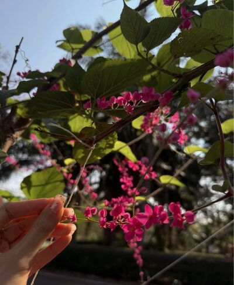
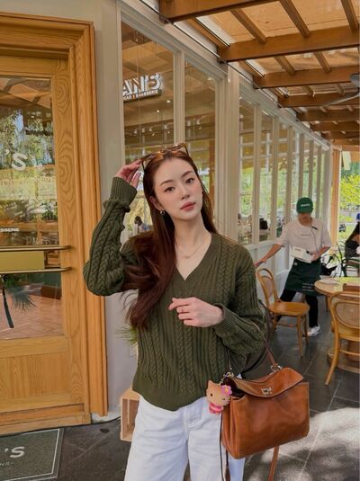
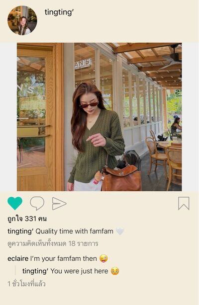
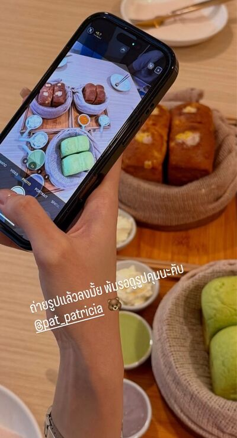
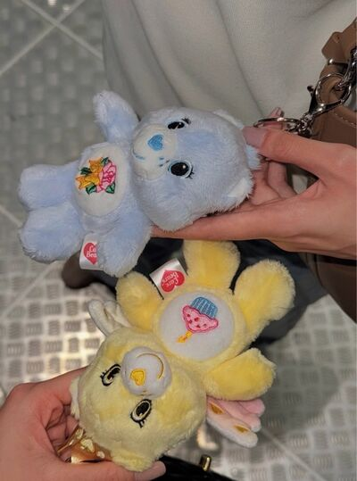
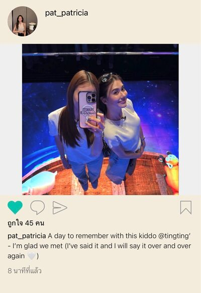
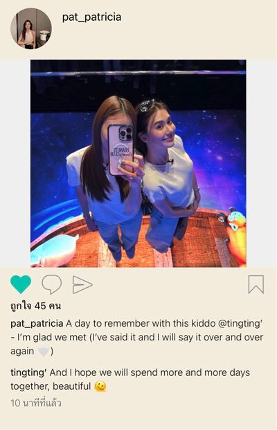

# Never Without You — Chapter 7

English translation · August 22–24

## Character and alias key

- tt’ — TingTing / Ting / Muay.
- Patricia🌻 — Patricia / Pat / P’Pat.
- lalin — Lalin.
- font_pcp — Font.
- khim09 — Khim.
- eclaire — Claire / P’Claire.
- JJAPP — Japp.
- BEll — Bell.
- Namfon — Namfon / P’Fon.
- Duen — P’Duen.
- neuf96 — closing contributor display name.

## Translation notes

P’ marks an older person addressed affectionately or respectfully. Muay is Patricia’s nickname for TingTing, referring to her Chinese-looking features. “55555” and its variations are Thai internet laughter. “P’Ting-kub” is TingTing’s playful handsome, masculine persona; kub/ka are Thai polite particles. “Special, with eggs” plays on ordering an extra-special portion of food. “Unknown Elders” follows the project’s established rendering of the coworker group name. The original English messages are retained. Images use your existing local img folder. No image contents have been translated or inferred. The closing video is provided as an online link.

## Full translated chat transcript

---

August 22nd  
Saturday

---

### Patricia🌻

*7:11 a.m.*

**Patricia🌻**  
Morningg

*7:49 a.m.*

**Patricia🌻**  

**Patricia🌻**  
You really won’t wake up unless I call you, will you, Muay?

*8:47 a.m.*

**tt’**  
At first glance I thought you’d sent me one of those “Happy Saturday” pictures.

**Patricia🌻**  
Muaaay.

**tt’**  
5555555555555

**Patricia🌻**  
I’m not sending you any more.

**tt’**  
Noooo.

**tt’**  
Send them, send them. It’s cute.

**tt’**  
You’re taking a walk with your mom, right?

**Patricia🌻**  
Yes. It was pretty, so I took a picture for you.

**Patricia🌻**  
And somehow it turned into a “Happy Saturday” picture.

**tt’**  
5555555

**tt’**  
Are you going anywhere today, P’Pat?

**Patricia🌻**  
Nooo. Staying home.

**tt’**  
You stay home every weekend.

**Patricia🌻**  
It’s where an introvert is happiest.

**tt’**  
Would you come out if I invited you somewhere?

**Patricia🌻**  
We’ll see.

**tt’**  
😡

**Patricia🌻**  
555555

**Patricia🌻**  
Where? Where do you want to go?

**tt’**  
Anywhere, really.

**tt’**  
Just hang out.

**Patricia🌻**  
But you like drinking.

**Patricia🌻**  
I don’t like drinking, you know.

**tt’**  
🫠

**Patricia🌻**  
I’ll look after you instead, then.

**tt’**  
🫪

**tt’**  
Let’s make it tonight.

**Patricia🌻**  
Don’t even try.

**tt’**  
555555

**Patricia🌻**  
You have to make plans in advance. If you ask me today to go out today, I’m not going.

**Patricia🌻**  
I have limited energy.

**tt’**  
Yeees. You’re so hard to book, Miss Patricia.

**Patricia🌻**  
What, Muay? Why are you calling me by my full name?

**tt’**  
It’s your name. Why can’t I use it?

**Patricia🌻**  
It feels weird. 5555

**tt’**  
It’s your own name, you know. 55555

**tt’**  
Then I’ll give you a new nickname. Patty.

**Patricia🌻**  
Noooo.

**Patricia🌻**  
Enough. Don’t go changing my name.

**tt’**  
But you call Ting “Muay.”

**Patricia🌻**  
Because you look Chinese.

**tt’**  
And you look Western.

**tt’**  
Then I’ll call you P’Westerner.

**Patricia🌻**  
Can’t you just keep calling me Pat?

**tt’**  
555555

**tt’**  
I want a nickname to call you too.

**Patricia🌻**  
Pat is fine.

**tt’**  
Okay.

**tt’**  
Pat.

**Patricia🌻**  
You’re really doing this, Muay?

**tt’**  
55555555555

**Patricia🌻**  
I’m six years older than you, you know.

**tt’**  
Pat, ka.

**tt’**  
Does that sound nicer?

**Patricia🌻**  
What do you think?

**tt’**  
Probably doesn’t help.

**Patricia🌻**  
555555

**Patricia🌻**  
Just call me P’Pat like before.

**Patricia🌻**  
There’s such an age gap. You can’t address me like we’re the same age.

**tt’**  
P’Pat it is, P’Pat, P’Pat.

**Patricia🌻**  
Anyway, you’re going out today, aren’t you?

**tt’**  
Yes. Going for a meal with my family.

**Patricia🌻**  
Okaaay.

**Patricia🌻**  
Enjoy your weekend with your family na 🫳

**tt’**  
Yes, ma’am.

**tt’**  
You too, P’Pat. Enjoy your time with your mom 🤍

### prettybabies (3)

*1:04 p.m.*

**lalin**  

**tt’**  
Hey, where did you get that picture?

**lalin**  
P’Claire.

**tt’**  
😠

**tt’**  
I only asked her to take a picture, and now she’s sending it everywhere.

**lalin**  
She sent it to gush about you to me.

**lalin**  
“So adorable, P’Claire’s little whiner.”

**font_pcp**  
I can feel the annoyance through the text.

**lalin**  
Seriously, what is she so obsessed with?

**font_pcp**  
5555555555

**lalin**  
Does your beautiful older sister know you’re out with your old flame?

**tt’**  
What old flame?

**tt’**  
P’Pat doesn’t know Claire came along.

**lalin**  
Tell her.

**lalin**  
Then you’ll find out whether she gets jealous.

**font_pcp**  
Ooh.

**tt’**  
🫪

**tt’**  
Should I tell her?

**lalin**  
Try it. Casually let it slip, like you didn’t mean to.

**tt’**  
I’m scared she won’t get jealous 🫠

**font_pcp**  
5555555555

**tt’**  
I just tried calling her Pat, and she told me to call her P’.

**tt’**  
“There’s such an age gap. You can’t address me like we’re the same age.” Got scolded again.

**font_pcp**  
The gay kid’s crestfallen.

**font_pcp**  
But she doesn’t want to be your little sister, ma’am.

**lalin**  
Then calling P’Claire just “Claire” means…

**font_pcp**  
Oh, are we shipping a new couple now?

**tt’**  
We’re close. I’m used to it.

**lalin**  
You keep being this close with her.

**lalin**  
No wonder she can’t get over you.

### IG: tingting’

*2:26 p.m.*

pat_patricia liked your photo

### Patricia🌻

*2:30 p.m.*

**tt’**  
Aha. Someone’s checking me out.

**Patricia🌻**  
Checking you out? I actually liked it.

**tt’**  
55555555

**Patricia🌻**  
Every time you post on Instagram, you’re P’Ting. Posing so hard.

**tt’**  
But am I handsome? 😎

**Patricia🌻**  
I told you, you’re cute.

**tt’**  
You never let me be handsome P’Ting-kub with you.

**Patricia🌻**  
5555555

**tt’**  
You hardly ever post pictures, P’Pat.

**tt’**  
Don’t you take many photos?

**Patricia🌻**  
I do. I just don’t post them much.

**Patricia🌻**  
Too lazy.

**tt’**  
You don’t have to post them.

**tt’**  
But you can send them to me when you take them.

**tt’**  
I want to keep up with your life too.

**Patricia🌻**  
I only stay home. There’s nothing to keep up with.

**tt’**  
You won’t come out when I invite you 😠

**Patricia🌻**  
You have to ask in advance.

**tt’**  
Tomorrow.

**Patricia🌻**  
“In advance” means more notice than tomorrow.

**tt’**  
Wow, you’re really hard to make plans with.

**Patricia🌻**  
555555

**tt’**  
Next Saturday, then.

**tt’**  
Even though I want to go with you tomorrow 😞

**Patricia🌻**  
There you go, looking sad at me again.

**tt’**  
Do you care, though? 😞

**Patricia🌻**  
Muaaay.

**tt’**  
I just want to go out with you.

**Patricia🌻**  
You’re out with your family today. Don’t you want to rest on Sunday?

**tt’**  
I do.

**tt’**  
With you.

**tt’**  
Just being with you feels like a rest, P’Pat.

**Patricia🌻**  
You keep saying things that make me want to take care of you.

**tt’**  
🫪

**tt’**  
Go ahead. Take care of me.

**Patricia🌻**  
555555

**Patricia🌻**  
But you already have someone taking care of you, don’t you?

**tt’**  
No, I don’t.

**Patricia🌻**  
Yes, you do.

**tt’**  
Who?

**Patricia🌻**  
Your older friend. Claire.

**Patricia🌻**  
You went together, didn’t you?

**tt’**  
Yes, she came along.

**tt’**  
How did you know?

**Patricia🌻**  
I saw her talking to you in the comments.

**tt’**  
Oh.

**tt’**  
Claire and I aren’t anything, you know.

**tt’**  
I mean, she isn’t family. Just an older friend I’m close to.

**Patricia🌻**  
Oh, that’s right. You call her just by her name, like you wanted to call me Pat.

**Patricia🌻**  
Do you like calling people just by their names?

**tt’**  
Once I’m really close to someone, I like using just their name.

**tt’**  
It happens naturally. I don’t know why either.

**tt’**  
I just feel comfortable enough to do that

**Patricia🌻**  
You must be really close with her.

**Patricia🌻**  
That’s good. You already have a beautiful older sister taking care of you. She came along last time you went drinking too.

**Patricia🌻**  
Then I’d better stay home.

**tt’**  
What? That doesn’t count. What does she have to do with this? I want you to take care of me.

**tt’**  
Please? Let’s go out together.

**Patricia🌻**  
555555

**tt’**  
Stop teasing me 😡

**Patricia🌻**  
You want to go tomorrow?

**tt’**  
Yes.

**tt’**  
Can we?

**tt’**  
Please 🫠

**Patricia🌻**  
Where do you want to go, Muay?

**tt’**  
Let’s find an activity to do.

**tt’**  
I’ll find something.

**tt’**  
I’m good at finding things to do.

**Patricia🌻**  
5555555

**tt’**  
All you have to do is wait at home for me to pick you up.

**tt’**  
Tomorrow’s all on me 🙂‍↕️

**Patricia🌻**  
All right, I’ll go.

**tt’**  
You don’t sound like you want to go with me at all.

**tt’**  
Just how introverted are you?

**Patricia🌻**  
No, it’s not that I don’t want to.

**Patricia🌻**  
Don’t go looking for a reason to sulk, Muay.

**tt’**  
😠

**Patricia🌻**  
Muaaay.

**tt’**  
Don’t care. I’m sulking now.

**tt’**  
I’m not inviting you anymore.

**Patricia🌻**  
What is this?

**Patricia🌻**  
I said I’m going.

**Patricia🌻**  
You’re such a sulker.

**tt’**  
I’ve been a sulker since day one, haven’t I? 😡

**Patricia🌻**  
5555555

**Patricia🌻**  
I’ll go. I want to go out with you, Muay.

**Patricia🌻**  
No more sulking. Wherever you want to go, I want to go with you.

**tt’**  
Fine, I’ll stop sulking 🫠

**Patricia🌻**  
A sulker since day one, and easy to coax since day one too. 55555

**tt’**  
But you always agree to coax me 🫪

**Patricia🌻**  
Well.

**Patricia🌻**  
That’s true.

**Patricia🌻**  
Someone’s getting thoroughly spoiled, isn’t she?

**tt’**  
You can coax me all you like. I won’t complain 🙂‍↔️

**Patricia🌻**  
But don’t sulk all the time, or I will complain.

**tt’**  
P’Paaaat.

**Patricia🌻**  
5555555

**tt’**  
I’ll pick you up at noon tomorrow.

**Patricia🌻**  
Where are we going? So I know what to wear.

**tt’**  
It’s a secret.

**tt’**  
But you can wear something comfortable.

**Patricia🌻**  
Okay.

**Patricia🌻**  
No more sulking, all right?

**tt’**  
I’m not sulking anymore 🙂‍↔️

**Patricia🌻**  
See you tomorrow prettyy

**tt’**  
See you kub beautiful 🫪

**Patricia🌻**  
Stop being handsome P’Ting-kub right this instant.

**tt’**  
5555555555555

**Patricia🌻**  
Silly girl.

### prettybabies (3)

*2:58 p.m.*

**tt’**  
I successfully asked P’Pat on a date!!!

**tt’**  
But I don’t think she knows she’s going on a date with me 🫠

**font_pcp**  
Weird.

**lalin**  
Two people going out, only one on a date.

**font_pcp**  
555555555

**tt’**  
It’s fine. Let’s get there first and figure it out later 🙂‍↕️

**font_pcp**  
How did you ask her to get her to agree?

**tt’**  
At first she wasn’t going. Then I sulked, so she coaxed me.

**font_pcp**  
Look, my friend’s no amateur.

**tt’**  
Exactly. The beautiful older sister loves coaxing me too much 🙂‍↕️

**font_pcp**  
She indulges you so much. Does she feel something?

**tt’**  
🫪

**tt’**  
But she knows Claire came with me today.

**tt’**  
Because she saw us talking in the comments.

**lalin**  
So she read through your comments.

**tt’**  
I guess so.

**lalin**  
And how did she react?

**tt’**  
Nothing. Said P’Claire could take care of me so she could stay home.

**tt’**  
That destroyed me. I nearly screamed.

**font_pcp**  
555555555555

**lalin**  
Wow, the beautiful older sister has no intention of getting jealous.

**font_pcp**  
I’m devastated on Ting’s behalf.

**tt’**  
Maybe she just doesn’t understand her own feelings yet.

**tt’**  
Give her some time.

**lalin**  
The gay kid’s fighting for her life to postpone her death.

**lalin**  
So you still don’t dare ask whether she’s gay?

**tt’**  
Mm.

**tt’**  
I don’t dare. I’m scared. But I like how things feel right now.

**tt’**  
I really feel special. Maybe P’Japp’s words made me read too much into it, but it really does feel good.

**lalin**  
If you find out later, it might be too late to pull back, Ting.

**tt’**  
I’m not pulling back anyway.

**font_pcp**  
She’s ready to charge straight in.

**tt’**  
Please.

**tt’**  
This one.

**tt’**  
Even if I end up dying like a lovesick dog, I’ll take it 🫠

**font_pcp**  
P’Pat, could you be gay for my friend?

### khim09

*8:18 p.m.*

**Patricia🌻**  
I just told Mom I’m going out with Ting tomorrow.

**Patricia🌻**  
She was so confused. Asked whether I had friends other than Khim.

**khim09**  
555555555

**Patricia🌻**  
She already seemed surprised when Ting drove me home that time.

**Patricia🌻**  
It’s funny. I sound like some antisocial person.

**khim09**  
You really don’t befriend anyone else.

**khim09**  
Where are you going with Nong Ting?

**Patricia🌻**  
I don’t know. She won’t tell me.

**khim09**  
Oh.

**khim09**  
A surprise?

**Patricia🌻**  
That’s how she is. Like a kid, right? 5555

**Patricia🌻**  
Her love of going out is so endearing. Out with her family today, then going out again tomorrow.

**Patricia🌻**  
I’d be lying there crying if I had to leave the house every day.

**khim09**  
5555555

**khim09**  
More importantly, how did she get you to agree?

**khim09**  
My friend isn’t easily persuaded to leave the house, sweetheart.

**Patricia🌻**  
At first I wasn’t going. I was dragging my feet, looking for a way out.

**khim09**  
You’re awful, Pat.

**Patricia🌻**  
555555555

**Patricia🌻**  
Then she sulked at me, so I said fine, I’d go.

**khim09**  
P’Pat is always kind.

**khim09**  
But I doubt you’re this kind to everyone.

**Patricia🌻**  
Of course I’m not.

**Patricia🌻**  
If it weren’t Ting, I wouldn’t go.

**khim09**  
Yeah. Go.

**khim09**  
Get out and live a little. Go enjoy your privilege.

**khim09**  
I’m going out with Nong Chan tomorrow too. Let’s leave each other alone, friend.

**Patricia🌻**  
I feel like we already leave each other alone anyway.

**khim09**  
555555555

---

August 23rd  
Sunday

---

### Patricia🌻

*7:13 a.m.*

**Patricia🌻**  
Muay, are you awake yet?

**Patricia🌻**  
Just asking. I know you’re not.

*8:14 a.m.*

**tt’**  
5555555555

**Patricia🌻**  
You liked that, huh?

**tt’**  
Funny. 55555

**tt’**  
It was like your new way of saying good morning

**Patricia🌻**  
Saying morning every day would get boring.

**tt’**  
Then why do you message me every day?

**Patricia🌻**  
Oh, I don’t have to.

**tt’**  
No, no, no.

**tt’**  
Messaging me is good.

**Patricia🌻**  
I won’t message you tomorrow.

**tt’**  
Why? 😠

**Patricia🌻**  
Because I have to call to wake you up.

**tt’**  
55555555555

**Patricia🌻**  
I’m practically raising you as my child.

**tt’**  
Your CHILD????

**tt’**  
Who’s your child, ma’am? 🫨

**Patricia🌻**  
55555555

**Patricia🌻**  
You’re like a baby, Muay.

**tt’**  
I’m confused, P’Pat.

**tt’**  
I’m not being your child 🫨

**Patricia🌻**  
Okay, okay.

**Patricia🌻**  
You’re funny. 55555

**tt’**  
I’m going to shower and get ready to pick you up.

**Patricia🌻**  
See you soon.

**tt’**  
Okay.

### khim09

*12:18 p.m.*

**Patricia🌻**  
Khim.

*12:23 p.m.*

**khim09**  
Thought we were leaving each other alone.

**Patricia🌻**  
Ting brought so many things for my mom.

**Patricia🌻**  
I don’t know how I feel right now. I’m so overwhelmed.

**Patricia🌻**  
But I do know I’m grateful for her

**khim09**  
She’s so precious.

**khim09**  
She really is such a lovely kid.

**Patricia🌻**  
She really, really is.

**Patricia🌻**  
She bought all these health supplements.

**Patricia🌻**  
She never asked me anything more about Mom, you know.

**Patricia🌻**  
I didn’t think she’d care enough to buy her things.

**khim09**  
She’s a caring person.

**khim09**  
She’s always worrying about you too.

**Patricia🌻**  
Mm.

**Patricia🌻**  
It’s so nice.

**Patricia🌻**  
Go be with Nong Chan. That’s all I came to say.

**khim09**  
Yeah. Have fun with her.

### IG: tingting’

*2:05 p.m.*

### eclaire

*2:09 p.m.*

**eclaire**  
You went with her?

### prettybabies (3)

*4:27 p.m.*

**tt’**  
You guys.

**tt’**  
P’Pat is so cute 🫠

**tt’**  

**tt’**  
She bought us matching ones. I can’t survive this 🫠

**font_pcp**  
What is happening here?

**font_pcp**  
Matching plushies on the first date already.

**font_pcp**  
This is getting a little… you know.

**tt’**  
🫠🫠🫠🫠🫠🫠

**lalin**  
The beautiful older sister isn’t letting the gay kid go anywhere, huh?

**tt’**  
I’m not going.

**tt’**  
Not going anywhere.

**tt’**  
This is where I was born, and this is where I’ll die.

**tt’**  
In Miss Patricia’s heart, where I belong.

**font_pcp**  
My friend is completely unhinged.

**lalin**  
55555555555

**lalin**  
But the beautiful older sister is dangerous. I surrender to this move.

**lalin**  
Why did she buy them?

**tt’**  
I went over to look and said they were cute. She asked, “Want one? I’ll buy it for you.”

**tt’**  
I felt bad and said no. She said she wanted to buy it for me, and she’d get one for herself too so we could match.

**tt’**  
The moment I heard “match,” my limbs went weak and my lips started trembling. How was I supposed to refuse?

**font_pcp**  
555555555555

**font_pcp**  
Not feeling shy about accepting anymore, beautiful older sister?

**tt’**  
If she wants to give, I want to receive.

**tt’**  
Then we can be “a matching pair” 🫪

### Patricia🌻

*5:11 p.m.*

**Patricia🌻**  
Mom’s already invited you for dinner. She said it’s a shame she didn’t know what time we’d be back today. Next time she’ll cook for you.

**Patricia🌻**  
Let me know when you get home, Muay. Drive safely.

**Patricia🌻**  
Thank you so much for today. I had so much fun 🫳

*5:58 p.m.*

**tt’**  
Please thank your mom for me 🙏

**Patricia🌻**  
I should be thanking you on Mom’s behalf. You brought her so much.

**tt’**  
Just a little.

**Patricia🌻**  
A little? That’ll last her who knows how many months. And so many different things. It’s too much.

**tt’**  
5555555

**tt’**  
I have a relative who’s a doctor. I asked them to recommend what would be good for your mom.

**Patricia🌻**  
Thank you so much for thinking of my mom.

**tt’**  
It’s nothing at all.

**tt’**  
I didn’t plan it or anything. Yesterday, when I found out we’d be going out and I’d be picking you up at home, I thought I should bring something for your mom.

**tt’**  
That’s all.

**Patricia🌻**  
That alone is already lovely.

**Patricia🌻**  
I’m really touched, you know.

**tt’**  
🫪

**tt’**  
It’s not just your mom.

**tt’**  
My dad and mom want to meet you too.

**Patricia🌻**  
What? Why do your parents want to meet me?

**tt’**  
Because I’ve told them so many nice things about you.

**Patricia🌻**  
Don’t oversell me, Muay.

**tt’**  
I’m not exaggerating at all.

**tt’**  
Mom asked how going out with you went today.

**tt’**  
I said it was wonderful. I was so happy. P’Pat was kind and bought me a bear too.

**Patricia🌻**  
You bought much more than the bear I got you.

**tt’**  
But what you’ve given me is worth more than what I bought you.

**Patricia🌻**  
What have I given you? When?

**tt’**  
You’ve taught me so much.

**tt’**  
You taught me how I should appreciate my life

**tt’**  
And that's the most precious thing I can get from anyone

**tt’**  
You know, after we finished talking that day,

**tt’**  
I went to sleep with my parents. I told them I loved them too 🫠

**Patricia🌻**  
Aww, really?

**tt’**  
Really.

**Patricia🌻**  
That’s so sweet.

**tt’**  
You can pat my head. Pat, pat.

**Patricia🌻**  
5555555

**Patricia🌻**  
🫳

**tt’**  
🫪

**Patricia🌻**  
I’m happy for your parents, having such a lovely daughter.

**tt’**  
You can be happy for them, but don’t become my mom instead, okay?

**Patricia🌻**  
Muaaay.

**tt’**  
55555555

**tt’**  
Thank you for agreeing to come out today. I know you’re a homebody.

**Patricia🌻**  
Yes, I’m a homebody.

**tt’**  
😠

**Patricia🌻**  
Wait for me to finish typing.

**tt’**  
Hurry up, Miss Patricia.

**Patricia🌻**  
You’re determined to use my full name, aren’t you?

**tt’**  
555555

**tt’**  
It’s a pretty name.

**Patricia🌻**  
I was going to say I really am a homebody, but going out with you today made me think getting out once in a while is nice too.

**Patricia🌻**  
It was a good day. I really appreciate the time I spent with you today 🙂

**tt’**  
I’m glad you liked it.

**tt’**  
Really, really glad 🫠

**Patricia🌻**  
You really are good at finding activities. Took me to take pictures on some ridiculously tall building. I was so scared of the height I nearly cried.

**tt’**  
I believe you were scared. You held my hand the whole time 🙂‍↕️

**Patricia🌻**  
I wasn’t refreshed, Muay. I was practically sobbing.

**tt’**  
5555555555555

**tt’**  
That’s why I told you we’d take the pictures quickly and come down. I didn’t know you’d be scared. I just wanted you to see the pretty view.

**Patricia🌻**  
Even after finding out I’m scared of heights, you still took me to play VR.

**tt’**  
We’d come all that way. 555555

**Patricia🌻**  
You were the one having the most fun.

**tt’**  
And you were the one doing the most screaming.

**Patricia🌻**  
555555

**Patricia🌻**  
You seem to like this stuff. I’m starting to see you really can be handsome P’Ting-kub. Just like a boy.

**tt’**  
Right? I’m incredibly handsome and cool 😎

**Patricia🌻**  
Walked right into that one.

**tt’**  
55555

**Patricia🌻**  
But you clearly put a lot of thought into picking the restaurant and dessert place too. Well done. You planned today really well.

**Patricia🌻**  
When shall we go next?

**tt’**  
Whaaaat?

**Patricia🌻**  
Just teasing. 55555

**tt’**  
Hey, let’s really go.

**Patricia🌻**  
Let me rest first. I’m out of energy.

**tt’**  
🫠

**Patricia🌻**  
We have work tomorrow, Muay.

**tt’**  
I hate Mondays 😡

**Patricia🌻**  
But we’ll get to see each other.

**Patricia🌻**  
Do you really hate it?

**tt’**  
Not anymore 🫠

**Patricia🌻**  
55555

**Patricia🌻**  
Get some rest so you’ll have energy for work tomorrow.

**tt’**  
You too. See you tomorrow.

### IG: pat_patricia

*8:03 p.m.*

tingting’ liked your photo

*8:05 p.m.*

### prettybabies (3)

*8:05 p.m.*

**tt’**  
I can’t, I can’t.

**tt’**  
I can’t survive. What is the beautiful older sister doing?

**tt’**  
What’s gotten into her? 🫠

**font_pcp**  
What now? Shall I collect your body?

**tt’**  
Not yet. I can probably enjoy this a little more 🫪

**font_pcp**  
It’s that serious? What did she do to you, Ting? 55555

**tt’**  

**tt’**  
She suddenly posted on Instagram. I thought she only asked for the photos to keep them 🫠

**tt’**  
And she hardly ever posts. Her last post was months and months ago.

**tt’**  
Then suddenly she posts a picture of us together. Does she like me? What do you think?

**lalin**  
Whoa.

**font_pcp**  
What do you say, P’Lalin? What is this move?

**lalin**  
I don’t know who’s playing with whose heart anymore.

**lalin**  
The beautiful older sister’s a lot. Our friend’s a lot too.

**lalin**  
Are they flirting? Get it together.

**font_pcp**  
5555555555

**font_pcp**  
Hey, what’s gotten into you, straight girl?

**font_pcp**  
You never ship them. You’re always hitting the brakes.

**lalin**  
I can’t handle this either. I’m straight and even I’m blushing.

**lalin**  
Posting a picture of them together and saying she’s glad they met? What the hell? I wouldn’t dare do that unless I wanted them as my partner.

**lalin**  
And a picture together without showing their faces. Like she wants to launch the relationship but keep it mysterious. The beautiful older sister is too dangerous.

**tt’**  
🫪🫪🫪🫪🫪🫪

**tt’**  
If P’Lalin says that, I guess I’ll have to turn into a monkey.

**tt’**  
🙈🙈🙈🙈🙈

**font_pcp**  
55555555555

**font_pcp**  
But as for whether they’re flirting,

**font_pcp**  
Ting definitely is.

**font_pcp**  
But what about the beautiful older sister? What’s that white heart supposed to mean?

**tt’**  
But today she told me she was going to raise me as her child.

**tt’**  
That destroyed me. I screamed once already.

**font_pcp**  
Huh? Her child?

**font_pcp**  
You want to be her wife, and she makes you her child? What?

**tt’**  
Exactly. What?

**tt’**  
What does she want from me?

**lalin**  
It’s complicated. But that Instagram post was so sweet.

**lalin**  
If she really doesn’t feel anything, she must be an incredibly romantic person.

**font_pcp**  
Is P’Pat romantic?

**tt’**  
I don’t know. But she really likes reading novels.

**tt’**  
But please, she doesn’t have to be that romantic.

**tt’**  
Just feel something for me. Please feel something 🫨

**font_pcp**  
The gay kid’s practically begging on her knees.

**lalin**  
555555555555

### eclaire

*8:36 p.m.*

**lalin**  

**lalin**  
Here you go.

**eclaire**  
So they really did go on a date.

**lalin**  
Ting was on a date. Whether P’Pat was, I don’t know.

**lalin**  
She’s been squealing to us about how happy she is.

**eclaire**  
She still hasn’t replied to me.

**eclaire**  
I messaged her at two this afternoon.

**lalin**  
She probably put it off so long she forgot.

*[Read]*

**lalin**  
Sorry, sorry. I didn’t mean to make you feel bad.

**eclaire**  
It’s okay. It’s probably just like you said.

**eclaire**  
It’s really hard to accept, you know.

**lalin**  
But you have to, P’Claire.

**lalin**  
Ting likes P’Pat so much. So, so much.

**lalin**  
I don’t want you wasting your time waiting for her.

**eclaire**  
It’s not that I’m waiting. I wasn’t planning on liking anyone else anyway.

**eclaire**  
And I still can’t stop loving Ting.

**lalin**  
Oh, no.

**eclaire**  
Does she like Ting?

**eclaire**  
Does she take good care of her?

**lalin**  
We’re still not sure whether she likes her.

**lalin**  
But she takes good care of Ting.

**lalin**  
She seems lovely. A good person.

**eclaire**  
Good for her then

**lalin**  
Want to message her again? She’s not deliberately ignoring you.

**eclaire**  
It’s okay.

---

August 24th  
Monday

---

### Unknown Elders (5)

*8:44 a.m.*

**JJAPP**  
Anyone who saw PatTing yesterday, raise your hand.

**BEll**  
🙌

**JJAPP**  
Fast. P’Bell’s always fast when it comes to this stuff.

**BEll**  
555555555

**BEll**  
I saw Ting’s story first, but I didn’t expect Pat to post a picture.

**BEll**  
And I’ve never seen anyone on Pat’s Instagram except her mom.

**JJAPP**  
Right?

**Namfon**  
I went to look. So cuuute.

**JJAPP**  
Right?

**JJAPP**  
PatTing, let’s go.

**Namfon**  
PatTing, PatTing.

**Patricia🌻**  
Having fun, Japp?

**JJAPP**  
55555555555

**JJAPP**  
Muay’s not replying. She must be driving.

**Patricia🌻**  
Don’t tag her. She’ll want to join in again.

**BEll**  
Where did you two go?

**Patricia🌻**  
The Mahanakhon building.

**JJAPP**  
So extra. Ting definitely took you there.

**Patricia🌻**  
555555

**tt’**  
There’s something even more extra, P’Japp.

**tt’**  
You’ll find out when you see us.

**Patricia🌻**  
Muay. Focus on driving. Properly.

**tt’**  
Sorry, ma’am 🫠

**JJAPP**  
Is P’Pat the only person you’re scared of in your whole life?

**Namfon**  
555555

**Namfon**  
So cute.

### JJAPP

*9:11 a.m.*

**JJAPP**  
Matching Care Bears, huh.

**tt’**  
Do you understand me, P’Japp?

**tt’**  
Do you get it now? 🫠

**JJAPP**  
I do.

**JJAPP**  
I understand everything.

**JJAPP**  
But I don’t dare hype it up too much. P’Pat will scold me.

**tt’**  
🫠🫠🫠

**JJAPP**  
55555555

**JJAPP**  
Did you sweet-talk her into buying you one?

**tt’**  
No. She bought it for me herself.

**JJAPP**  
So extra.

**JJAPP**  
P’Pat is so extra.

**JJAPP**  
The Instagram post was extra too.

**tt’**  
Right?

**tt’**  
I can’t survive this, P’Japp.

**tt’**  
I’m so flustered.

**JJAPP**  
You really are special, Muay.

**tt’**  
With an egg on top?

**JJAPP**  
Two eggs.

**tt’**  
🫪

### Unknown Elders (5)

*9:28 a.m.*

**Namfon**  
P’Duen hasn’t come in yet, right?

**BEll**  
But I saw her send an email.

**JJAPP**  
I saw her discussing work in another LINE group too.

**BEll**  
Definitely working from home, by the looks of it.

**BEll**  
Without even telling us.

**BEll**  
Who else on our team can work from home like her? Forget working from home. Even taking leave is exhausting.

**BEll**  
Taking leave is such a struggle. I submit it in the system and she won’t approve it. I have to formally explain my reasons first.

**JJAPP**  
But she can work from home without asking anyone.

**BEll**  
I’m pissed.

**tt’**  
Is that how she is?

**BEll**  
Yes. She hasn’t taken leave today.

**BEll**  
And I doubt she’s just running late.

**Namfon**  
I need to discuss work with her.

**JJAPP**  
Message and ask, P’Fon.

**BEll**  
Yeah, tag her.

**BEll**  
Don’t be scared.

**Namfon**  
I’m scared.

**BEll**  
555555555

**tt’**  
Why be scared? We haven’t done anything wrong. She has.

**tt’**  
Want me to tag her and ask for you?

**JJAPP**  
@Patricia🌻

**tt’**  
P’Japp!!!

**Patricia🌻**  
What is it, Muay?

**tt’**  
Nothing. Getting back to work 🫠

**JJAPP**  
And that’s that. 555555555

### B2B marketing (6)

*9:37 a.m.*

**Namfon**  
P’Duen, are you coming in today? @Duen

**Duen**  
Oh, no. I’m working from home.

**Duen**  
Did you need something, Fon?

**Namfon**  
I printed the proof for you to check, but tomorrow is fine too.

**Duen**  
You had all that time and didn’t show me. Now you want me to look on the day I’m working from home.

**Duen**  
Leave it until tomorrow, then.

**Namfon**  
Of course. Thank you.

### Patricia🌻

*9:41 a.m.*

**tt’**  
Look at what she said.

**tt’**  
How was anyone supposed to know she was working from home?

**tt’**  
What did P’Fon do wrong? Why did she get told off?

**Patricia🌻**  
Well done. You messaged me separately to complain 🫳

**tt’**  
🤬

**tt’**  
I really want to talk back on P’Fon’s behalf.

**tt’**  
Why does everyone have to adjust how they work around her? That old hag thinks she’s the centre of the universe.

**Patricia🌻**  
Muay. Watch your language.

**tt’**  
Just watch. I’m remembering everything she does.

**tt’**  
Want me to play by the rules? Fine. I’ll make her cry 🤬

**Patricia🌻**  
I’ll help you remember. I’ll collect all the information for your report.

**tt’**  
Just help me remember. I’ll report it to Aunt Ying myself.

**tt’**  
Just wait until the time comes 🤬

**Patricia🌻**  
You really are angry.

**tt’**  
Of course. I don’t want everyone having to put up with this nonsense anymore.

**tt’**  
Work is exhausting enough without dealing with an unhinged boss too.

**Patricia🌻**  
I’m starting to dislike her too.

**tt’**  
Why?

**tt’**  
Wait. You’re only starting now? You should’ve disliked her ages ago!!!

**Patricia🌻**  
555555

**Patricia🌻**  
Let me rephrase. I dislike her even more now.

**Patricia🌻**  
Because she puts you in a bad mood every day. Turns a sweet kid into a little firecracker every time.

**Patricia🌻**  
I want to see you happy. You’re not cute when you’re scowling.

**tt’**  
Fine, I’ll pull myself together 😤

**tt’**  
There. I’ve calmed down. Am I cute yet?

**Patricia🌻**  
5555555

**Patricia🌻**  
You’re cute now.

**Patricia🌻**  
Very cute.

*[Read]*

**Patricia🌻**  
You keep asking for head pats, then sit perfectly still when I give you one.

**Patricia🌻**  
Do you actually like having your head patted?

**tt’**  
You wouldn’t understand, P’Pat 🫠

**Patricia🌻**  
What am I supposed to understand?

**tt’**  
It makes me shy.

**Patricia🌻**  
Why would you be shy?

**tt’**  
The beautiful older sister is patting my head. Who wouldn’t be shy?

**Patricia🌻**  
I’ll try patting Japp’s head too. I wonder if she’ll blush.

**tt’**  
Stop. Miss Patricia, you need to stop right now.

**Patricia🌻**  
Why? 55555

**tt’**  
You can’t just go around patting other people’s heads.

**Patricia🌻**  
What? I can pat yours. Surely I can pat Japp’s too.

**tt’**  
No. I won’t allow it 😡

**Patricia🌻**  
Are you a possessive little thing?

**tt’**  
Yes.

**tt’**  
Could you not pat anyone else’s head, P’Pat?

**tt’**  
I won’t let you.

**Patricia🌻**  
Oh, you look so serious.

**tt’**  
Because I am serious.

**Patricia🌻**  
Okay, okay. I won’t. I won’t pat anyone else’s head.

**tt’**  
Promise.

**Patricia🌻**  
I promise.

### JJAPP

*10:02 a.m.*

**JJAPP**  
I saw that. P’Pat patting your head. I saw.

**JJAPP**  
She rolled her chair over to pat your head. I saw it.

**tt’**  
Good. Be a witness to my love story.

**JJAPP**  
5555555555555

**JJAPP**  
Love it, love it.

**tt’**  
🫪

**tt’**  
I almost screamed, but managed to shut my mouth. I didn’t even dare reply out loud. We had to type to each other.

**tt’**  
I’m scared I’ll die of embarrassment, P’Japp.

**JJAPP**  
P’Pat dotes on you so much.

**tt’**  
Is it just doting? Does she like me?

**JJAPP**  
Don’t know. You’ll have to find that answer yourself. 55555

**tt’**  
🫠

### eclaire

*10:13 a.m.*

**tt’**  
Oh, I only just saw this.

**tt’**  
Yes, I went with P’Pat yesterday.

**eclaire**  
Okay.

**tt’**  
But I went out with you on Saturday too.

**eclaire**  
I haven’t said anything.

**eclaire**  
Why? Worried I’ll be hurt?

**tt’**  
😠

**eclaire**  
55555

**eclaire**  
I’m fine.

**eclaire**  
Being left on delivered hurt more.

**tt’**  
I’m sorry 🫠

**tt’**  
Your chat got pushed down. I didn’t mean to, I swear.

**eclaire**  
We used to talk so often, didn’t we?

*[Read]*

**eclaire**  
Work hard, okay? Your dad and mom are so proud of you, you know.

**tt’**  
Are you proud of me too?

**eclaire**  
Of course I am.

**eclaire**  
If you’re ever tired or have a problem, message me if there’s anything I can help with.

**eclaire**  
You don’t have to message often. Just when you need me is fine. I’ll always be here.

**tt’**  
Stop saying things like that.

**tt’**  
We can still talk like before.

**eclaire**  
You really don’t understand anything, do you?

**eclaire**  
Such a little kid.

**tt’**  
What? 😠

**eclaire**  
If we keep talking like before, I’ll keep loving you like before too.

**eclaire**  
It’s cute.

**tt’**  
What’s cute?

**eclaire**  
You and her.

**eclaire**  
You two look good together

**tt’**  
What do you mean? The Instagram picture?

**eclaire**  
Yes.

**tt’**  
How did you see it?

**tt’**  
Lalin? Did Lalin send it?

**eclaire**  
Yes. Why are you so surprised? 5555

**tt’**  
Such a busybody 😡

**eclaire**  
But I wanted to see it too. It’s cute.

**eclaire**  
I like seeing you happy.

**tt’**  
Mm. Then I’ll be really, really happy.

### Unknown Elders (5)

*12:43 p.m.*

**BEll**  
Hey, matching plushies? Seriously? @JJAPP

**JJAPP**  
Seriously.

**BEll**  
Am I being a third wheel right now?

**JJAPP**  
5555555

**JJAPP**  
You could’ve asked them to buy it for you and let them go alone.

**BEll**  
I didn’t want to trouble them. They’d have too much to carry.

**BEll**  
Turns out I’m just interrupting their time together.

**JJAPP**  
See? They don’t even get to be sweet together.

**tt’**  
And you said you were scared P’Pat would scold you.

**JJAPP**  
555555555555

**JJAPP**  
What, don’t you like it?

**tt’**  
🫪

**BEll**  
Pat isn’t reading this. 5555

**Namfon**  
Pat doesn’t know.

**JJAPP**  
P’Bell, tease her yourself.

**tt’**  
P’Bellllll.

**BEll**  
I’m teasing Pat, but Ting’s the one blushing. What the hell?

**BEll**  
Her face is red.

**BEll**  
Is your kid going to die, Japp?

**JJAPP**  
Why?

**JJAPP**  
What happened? Tell me.

**BEll**  
5555555555555

**BEll**  
I only teased Pat: “Did you buy her a Care Bear because you care about Ting?”

**BEll**  
Pat rolled her eyes, but Ting went red.

**JJAPP**  
555555555555

**JJAPP**  
Can’t survive this. @tt’

**tt’**  
🫠

**Namfon**  
What’s Pat rolling her eyes for? 555555

**Patricia🌻**  
What are you all teasing us about?

**Patricia🌻**  
It was cute, so I bought it for her. That’s all.

**Patricia🌻**  
You’re making such a big deal out of it.

**Patricia🌻**  
And you get so shy, Muay. You’re giving them something to tease you about.

**tt’**  
Okay. Next time I won’t blush for anyone to tease me about.

**JJAPP**  
Oh, the captain won’t steer the ship.

**BEll**  
The shippers are out of a job.

### JJAPP

*12:48 p.m.*

**BEll**  
Japp.

**BEll**  
Dude, I think there’s tension.

**JJAPP**  
Why?

**BEll**  
I think Ting’s upset.

**JJAPP**  
Thought so.

**BEll**  
She’s gone all tense. Pat looks confused too.

**BEll**  
Meanwhile I’m walking ahead in silence. I want no part of this.

**JJAPP**  
5555555555

**JJAPP**  
You’re awful, P’Bell.

**BEll**  
You made your bed, you lie in it.

**JJAPP**  
She’s probably upset P’Pat called her out for blushing.

**BEll**  
Ting likes Pat, right?

**JJAPP**  
Dunnooo.

**BEll**  
You do know, you liar, Japp.

**JJAPP**  
555555555555

**JJAPP**  
Let’s put it this way. Ting’s gay.

**BEll**  
Okay. Understood.

**JJAPP**  
But as for P’Pat, I don’t know.

**BEll**  
Yeah. I’ve never seen Pat dating anyone.

**BEll**  
Hey, hey. I just heard Pat ask what’s wrong with Muay.

**BEll**  
Ting said, “Nothing. I’m fine.”

**BEll**  
Oh, here we go.

**BEll**  
I think this is going to drag on.

**JJAPP**  
55555555555

### Patricia🌻

*1:08 p.m.*

**Patricia🌻**  
Muaaay, what’s wrong?

**Patricia🌻**  
And don’t tell me it’s nothing. I won’t believe you.

**tt’**  
Please get back to work, P’Pat. Otherwise you won’t finish in time and you’ll end up working late again.

**Patricia🌻**  
Are you upset with me, Muay?

**tt’**  
I said I’m not.

**Patricia🌻**  
Muaaay.

*[Read]*

**Patricia🌻**  
You’re definitely upset with me.

*1:19 p.m.*

**Patricia🌻**  
Okay, I’ll work. But we need to talk when you get home.

### Unknown Elders (5)

*3:19 p.m.*

**tt’**  
I’ve received the final version. If anyone’s free, please come over to my desk to help check and approve the brochure. I need to confirm with the printer by 4:00 p.m. @All

**JJAPP**  
But P’Pat is sitting right next to you.

**tt’**  
Anyone who wants to help is welcome. It doesn’t have to be P’Pat.

*[Read by 4]*

### JJAPP

*3:33 p.m.*

**BEll**  
Oooof.

**BEll**  
That made me hiss through my teeth.

**JJAPP**  
She really is upset.

**BEll**  
Can you check Pat’s face for me? What does she look like right now?

**BEll**  
I can’t see her.

**JJAPP**  
Expressionless.

**JJAPP**  
When I went over to help Ting check it, P’Pat turned around and gave her input too. She seemed completely normal.

**JJAPP**  
Ting was really composed too. No joking around at all. Everyone was being so serious.

**BEll**  
Are they going to make up?

**JJAPP**  
P’Pat will go make it up to her. Trust me.

**JJAPP**  
She probably figures they’re at work right now. Being professional, you know.

**BEll**  
Ting’s kind of scary when she gets serious, huh?

**BEll**  
She really gives off that company owner’s daughter aura.

**JJAPP**  
555555

**JJAPP**  
She might not look it, but Ting did really well in school. She’s really good at work too. My girlfriend told me.

**BEll**  
Let’s leave her to Pat, then. We’d better get back to work.

**JJAPP**  
555555

### Patricia🌻

*7:44 p.m.*

**tt’**  
I’m home now. Are you home yet, P’Pat?

**Patricia🌻**  
I thought you weren’t going to message me.

**tt’**  
I didn’t really want to.

**tt’**  
But I was worried. I wanted to know if you’d made it home.

**Patricia🌻**  
I’m home. I only got back a little while ago.

**tt’**  
Okay.

**Patricia🌻**  
Muay, what’s wrong? Can’t you tell me?

**tt’**  
I don’t want to.

**Patricia🌻**  
What did I do?

**Patricia🌻**  
Is it what I said in the group?

*[Read]*

**Patricia🌻**  
I’m sorry. I won’t say it again.

**Patricia🌻**  
I just didn’t want people teasing us.

**tt’**  
Do you really not want people teasing us that badly?

**tt’**  
You don’t like it?

**Patricia🌻**  
It’s not that I don’t like it. I just didn’t want people acting like it was something they had to tease us about.

**Patricia🌻**  
It’s just something I want to do for you, or something you want to do for me. It’s just what we normally do for each other.

**Patricia🌻**  
So when other people make a big deal out of it, I get a little confused.

**tt’**  
Have you ever bought matching Care Bears with anyone else?

**Patricia🌻**  
No, never.

**tt’**  
Then why did you buy one for me?

**tt’**  
Why didn’t you buy them for anyone else too?

**Patricia🌻**  
Because we’re close.

**Patricia🌻**  
It’s not like I’m going to be this close with everyone.

**Patricia🌻**  
I bought it for you because it’s you, Muay.

*[Read]*

**tt’**  
Then how do you expect people not to tease us?

**tt’**  
Have you actually read what you just typed?

*[Read]*

**Patricia🌻**  
Ok

**Patricia🌻**  
It looks special I know

**Patricia🌻**  
And we’re special

**tt’**  
And do you like it, P’Pat?

**tt’**  
The way we are?

**tt’**  
Or do you want to change it?

**Patricia🌻**  
No. Not at all. I’ve never wanted to change anything about us, Muay.

**Patricia🌻**  
I like us like this. And I’m really, really happy to have you.

**tt’**  
Then let’s just keep doing what we’ve been doing.

**tt’**  
And if people want to tease us, can we just let them?

**Patricia🌻**  
You don’t like that I don’t want people teasing us?

**tt’**  
What I don’t like is you acting like there’s nothing about us worth teasing.

**tt’**  
They tease us because it’s special.

**tt’**  
Yes, doing things for each other is normal for us.

**tt’**  
But that doesn’t mean it isn’t special, right?

**Patricia🌻**  
Yes. It’s special.

**Patricia🌻**  
Okay, I understand now. If people want to tease us, we’ll let them.

**tt’**  
Mm.

**Patricia🌻**  
But I really mean it, Muay.

**Patricia🌻**  
I like us just the way we are.

**Patricia🌻**  
And I’ve never even thought about changing that.

**tt’**  
Me too.

**Patricia🌻**  
You’re not upset anymore, right?

**tt’**  
Mm. I’m not upset anymore.

**Patricia🌻**  
You were really upset today. It scared me a little.

**Patricia🌻**  
You’ve never been this seriously upset with me before.

**tt’**  
Scared of what?

**Patricia🌻**  
That I wouldn’t be able to make it up to you.

**tt’**  
Of course you could.

**tt’**  
Just come and try. If it’s you, P’Pat, I’ll forgive you no matter what I’m upset about.

**Patricia🌻**  
I’m sorry, okay? I won’t do it again.

**tt’**  
Then give me some pats.

**tt’**  
You hurt my feelings, you know 🫠

**Patricia🌻**  
🫳

**Patricia🌻**  
I’ll take you out for treats tomorrow.

**tt’**  
Don’t try to tempt me with treats 😠

**Patricia🌻**  
I’m not trying to tempt you.

**Patricia🌻**  
I’m trying to make it up to you.

**tt’**  
But I’m not upset anymore.

**Patricia🌻**  
But I don’t want to stop making it up to you yet. You seemed so hurt.

**Patricia🌻**  
I feel really, really guilty.

**tt’**  
Then I guess I’ll let you keep making it up to me 🫠

**Patricia🌻**  
555555

**Patricia🌻**  
Tomorrow, then. But if work gets busy, can we go in the evening instead? I’m worried we won’t have enough time at lunch.

**tt’**  
Whenever is fiiine. But if we go in the evening, I’m driving you home.

**tt’**  
I don’t want you going home by yourself late at night.

**Patricia🌻**  
We’ll see.

**tt’**  
No “we’ll see.” If we go in the evening, I’m taking you home.

**Patricia🌻**  
Muaaay.

**tt’**  
It's how we appreciate our lives, remember?

**tt’**  
Don't forget you always have your little privilege here with you

**Patricia🌻**  
Aww

**Patricia🌻**  
Ok

**Patricia🌻**  
As you said, my little Privilege 🫳

**tt’**  
🫪

**tt’**  
Uppercase?

**Patricia🌻**  
Yes, cause you’re my little Privilege

**Patricia🌻**  
I thought it was pretty obvious from the start though

**tt’**  
It just somehow feels different with the uppercase 🫠

**tt’**  
But yes, I am the only Privilege just for you 🤍

**Patricia🌻**  
🙂

### prettybabies (3)

*8:37 p.m.*

**tt’**  
You guys.

**tt’**  
I’m so scared I’m falling in love with a straight girl.

**tt’**  
I’m doomed. I’m definitely doomed 🫠

.

.

.

## Author’s note

So what’s the deal with P’Pat? Straight or gay? Is this real or is she just playing? Is our Muay going to survive? 🫠
Whatever the answer, P’Pat means every word she says. I love PatTing so much 😭

Thank you to everyone who came to read 🙏

P.S. P’Pat really is out here being adorable at every turn, then telling people not to tease her. I completely understand how Muay feels. My baby’s so upset 😭😭😭

**neuf96**  
[Music video — Miew Natcha, My Safe Zone OST](https://www.youtube.com/watch?v=l_BwV0pudj4)

**neuf96**  
Once you’ve finished reading, go listen to Khun Nu Miew’s song. So precious 🥺🫳
