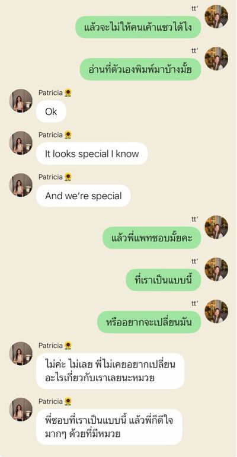
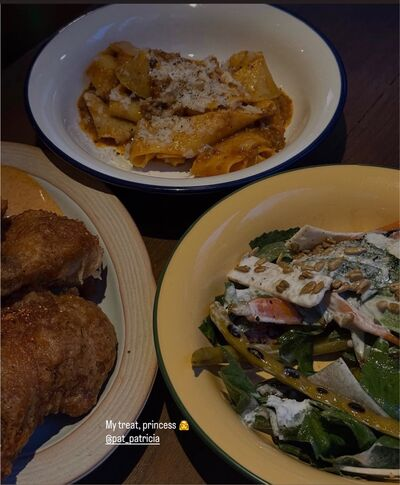
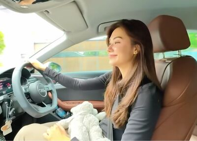
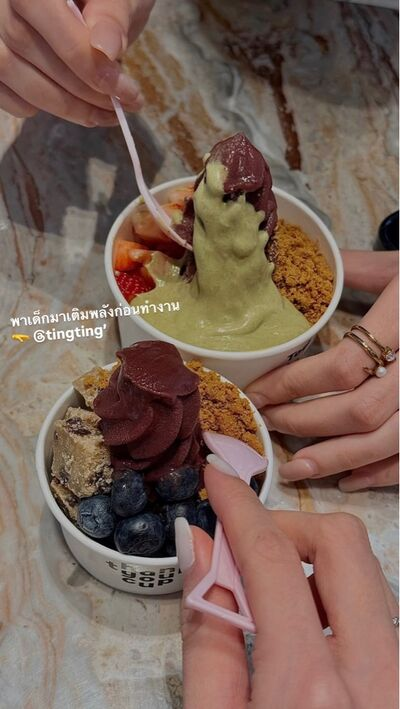

# Never Without You — Chapter 8

English translation · August 24–29

## Character and alias key

- tt’ — TingTing / Ting / Muay.
- Patricia🌻 — Patricia / Pat / P’Pat.
- lalin — Lalin.
- font_pcp — Font (distinct from the coworker Namfon).
- khim09 — Khim.
- JJAPP — Japp.
- BEll — Bell.
- Namfon — Namfon / P’Fon.
- Duen — P’Duen, their supervisor.
- หม่าม้า — Mom, TingTing’s mother; display name retained.
- ปะป๊า — Dad, TingTing’s father; display name retained.

Mentioned: Claire, Nong Chan, Aunt Ying, and Patricia’s mother.

## Translation notes

P’ is an affectionate or respectful honorific for someone older. Muay is Patricia’s nickname for TingTing. “55555” and its variations are Thai internet laughter. The friends’ rescue/CPR jokes dramatise TingTing’s lovesickness; “falling” refers to falling for someone. “Pull yourself together” / “calm down” conveys the recurring Thai “hup” self-composure cue. A wai is a Thai palms-together greeting. CTA means call to action in the marketing discussion. “Unknown Elders” follows the project’s rendering of the coworker group name.

Original English messages are retained. All nine picture appearances reference six unique files in your local img folder; image contents have not been inspected or translated. Five messages literally say “Sent a photo” in the source and have no corresponding image element or URL; these are preserved as text, not assigned invented pictures.

## Full translated chat transcript

---

August 24th  
Monday

---

### prettybabies (3)

*8:38 p.m.*

**lalin**  
Who’s straight?

**lalin**  
P’Pat?

**lalin**  
Why? You sounded so sure she was gay before.

**font_pcp**  
Guess getting cast as her child knocked you out cold.

**lalin**  
5555555555

**tt’**  
The child thing too.

**tt’**  
But the worst part is she doesn’t seem to want people at work teasing us about each other.

**font_pcp**  
P’Japp did say she can’t ship you too hard or P’Pat will scold her.

**tt’**  
Exactly.

**font_pcp**  
But why? How does not wanting to be teased make her straight?

**font_pcp**  
Maybe she’s just shy?

**tt’**  
No. She isn’t shy.

**tt’**  
I’m the shy one.

**tt’**  
All by myself 🫠

**font_pcp**  
Tiiiing. 55555555555

**tt’**  
When she didn’t blush, I could still comfort myself thinking maybe it was her poker face.

**font_pcp**  
Yeah. Didn’t want anyone to know, right?

**tt’**  
But when we got home and talked,

**tt’**  
I realised she really wasn’t shy.

**tt’**  
Not shy as in not shy at all. She didn’t even understand why people were teasing us, because what we do for each other is normal.

**tt’**  
Normal how? I snap at everyone else, but I’m a good girl only for her.

**tt’**  
How the hell is that normal? I want to scream in her face.

**font_pcp**  
555555555

**font_pcp**  
I can’t. If Ting were acting like her usual self, she really would’ve screamed in P’Pat’s face by now.

**lalin**  
This is the first day I’ve felt sorry for her.

**font_pcp**  
The beautiful older sister is starting to give straight vibes.

**tt’**  
I want to die.

**lalin**  
Go ahead. Font’s standing by.

**font_pcp**  
I’m here, P’.

**tt’**  
😞

**lalin**  
Did she actually say what she does is normal?

**tt’**  
At first she said it was normal.

**tt’**  
But when I asked whether she’d bought matching plushies with anyone else, she said never.

**font_pcp**  
Oh? So what’s going on, then?

**tt’**  
Right. So I asked why she didn’t buy them for anyone else too.

**tt’**  
Know what she said? We’re close. She isn’t going to be this close with everyone. She bought it because it’s me.

**font_pcp**  
Wait, she only bought one for you. So is that normal or not? I’m confused.

**font_pcp**  
Lalin, help us figure this out.

**lalin**  
It’s normal.

**lalin**  
In a not-very-normal way.

**lalin**  
But maybe it’s just because you’re close. I’m confused. I’m straight and I’m confused.

**font_pcp**  
I’m gay and I’m confused too.

**tt’**  
It’s not normal!!! Nothing about it is normal!!!

**tt’**  

**tt’**  
Look at this! Is that normal!!!

**tt’**  
I refuse to accept any of this “normal” business. we’re special!!! 😡🤬

**font_pcp**  
Well.

**font_pcp**  
Do we still need the rescue vehicle?

**font_pcp**  
What exactly does the beautiful older sister want?

**lalin**  
No, but the gay kid really won’t back down.

**lalin**  
Getting cast as her child made her stagger. Finding out she wasn’t shy brought her to her knees. But she never fell. She fought until she got “special.”

**lalin**  
And even while claiming to be a good girl, she snapped at the beautiful older sister to go reread what she’d typed.

**font_pcp**  
555555555

**font_pcp**  
Exactly. Opened with “she’s straight, I want to die,” then revealed she said we’re special.

**lalin**  
You’re such a tease with your storytelling, Ting.

**tt’**  
It’s called telling a story with finesse 🫪

**tt’**  
But she really wasn’t shy.

**tt’**  
P’Bell from our team teased her to her face today, and she didn’t seem embarrassed at all. Only I went red.

**font_pcp**  
55555555

**font_pcp**  
The beautiful older sister probably knows just how much you like her by now.

**tt’**  
Don’t know. But if she doesn’t, she really should by now.

**lalin**  
And do you know whether she likes you?

**font_pcp**  
Ooooh.

**tt’**  
Let’s find out whether she’s straight first 😠

**font_pcp**  
555555555

**tt’**  
But every time I sulk, she makes it up to me.

**tt’**  
And she keeps patting my head, even if I’m the one who asks her to.

**tt’**  
Why do it if she doesn’t feel anything? If she doesn’t like me, she doesn’t have to pat my head 😠

**font_pcp**  
Your face: 😠. Your heart: 🫪.

**tt’**  
You know me so well 🫪

**font_pcp**  
Look at the state of you.

**lalin**  
Coaxing you AND patting your head?

**tt’**  
Yeah. Is that really normal? 🫠

**lalin**  
No. Because it’s special. She said so herself.

**tt’**  
Special in what way?

**lalin**  
That’s the problem.

**font_pcp**  
From your straight perspective, what kind of special is it?

**font_pcp**  
Because from a gay perspective, like mine and Ting’s, it’s definitely the kind of special things people who like each other do.

**tt’**  
Exactly.

**tt’**  
I do this because I like her so much.

**tt’**  
Does she like me? Why is she doing this?

**tt’**  
A gay person is going to take it seriously 🫠

**lalin**  
First question: does she know you’re gay?

**tt’**  
I’ve never actually told her outright.

**tt’**  
But I’m this obsessed with beautiful women. Does she really not know?

**lalin**  
Straight people can like beautiful women too.

**font_pcp**  
Why are you stealing gay people’s jobs?

**lalin**  
Idiot. Just liking them, not wanting to make them my wife.

**font_pcp**  
55555555

**lalin**  
If she doesn’t know you’re gay, maybe she hasn’t considered that you could like her that way.

**lalin**  
Sometimes straight people just don’t think of it.

**font_pcp**  
Is she stupid? How can she not see something this obvious?

**tt’**  
Yeah, is she stupid? It’s so obvious.

**tt’**  
Hey, wait.

**tt’**  
She’s not stupid. Don’t call P’Pat stupid. People can just not know, Font. Not everyone has to understand us gays. You’re so narrow-minded!! 😡

**font_pcp**  
55555555555555

**font_pcp**  
What is wrong with my friend?

**tt’**  
I can insult the whole world, but leave the beautiful older sister out of it 🫠

**font_pcp**  
She’s beyond saving, Lalin. Ting is really, truly beyond saving.

**lalin**  
I’m going insane.

**lalin**  
You gays are all unhinged.

**font_pcp**  
5555555555

**tt’**  
So what’s it like from a straight perspective? What kind of special?

**lalin**  
Maybe a younger girl she really likes, really adores, really clicks with. Her absolute favourite little sister. She wants to look after her and indulge her.

**lalin**  
And she sees it as a good, beautiful relationship. One she wants to preserve.

**lalin**  
It's girls love but not love love

**font_pcp**  
Ooh.

**font_pcp**  
So there’s girls love but not love love, huh. I see.

**tt’**  
WTF is girls love but not love love?

**tt’**  
This gay kid doesn’t understand 🤬

**font_pcp**  
The gay kid refuses to understand this concept. 555555

**lalin**  
You understand. You just don’t want to, Ting.

**tt’**  
🫠

**tt’**  
Font

**tt’**  
I think I may need your service one day

**font_pcp**  
There we go. Booking an appointment already.

**tt’**  
But I’m this cute.

**tt’**  
Wouldn’t she fall for me at all?

**font_pcp**  
Ting, you’re changing the storyline too fast.

**font_pcp**  
One moment you’re dying, the next you’re hoping she’ll fall for you.

**lalin**  
Ting, honestly?

**lalin**  
No matter how cute you are,

**lalin**  
straight is straight.

**lalin**  
We like men. We don’t like women. We just don’t.

**tt’**  
Mm.

**tt’**  
Then she doesn’t have to like women.

**tt’**  
P’Pat doesn’t have to like women at all.

**tt’**  
Can she just like me?

**tt’**  
Only me.

**lalin**  
That’s really hard. It could be a one-in-a-thousand chance.

**lalin**  
I already warned you it might be too late to pull out.

**tt’**  
Try being me for a change.

**tt’**  
Having her make me feel good every day.

**tt’**  
So good that even if it’s impossible in the end…

**tt’**  
But having her in my life is one of the greatest things that's ever happened to me

**tt’**  
And I'd die just to love her dearly

**font_pcp**  
Lalin.

**font_pcp**  
Help her. This is too much.

**lalin**  
Not even CPR would bring her back in this state. All we can do is wait for her to die.

**tt’**  
😞

**lalin**  
Then I hope she falls for you.

**lalin**  
I hope that one-in-a-thousand chance is yours.

---

August 25th  
Tuesday

---

### Patricia🌻

*1:28 p.m.*

**tt’**  
Tell your mom I’m driving you home today.

**tt’**  
And that someone refused to eat lunch 😡

**Patricia🌻**  
I did eat.

**Patricia🌻**  
The moment you bought it for me, I had it straight away.

**tt’**  
Since when is bubble tea a meal? 😡

**Patricia🌻**  
The pearls are carbs. Practically the same as eating rice.

**tt’**  
There’s no protein or anything.

**tt’**  
I offered to buy you food, and you refused. Nothing but bubble tea, bubble tea, bubble tea.

**Patricia🌻**  
Nag, nag, nag.

**Patricia🌻**  
But you bought me 100% sugar.

**tt’**  
Because you like it.

**tt’**  
You looked tired, so I wanted you to have lots of energy 🫠

**Patricia🌻**  
I’ve got energy now. Overflowing.

**Patricia🌻**  
Thank you 🫳

**Patricia🌻**  
I’ll give you some energy back this evening. Overflowing too.

**tt’**  
Anything I can help with?

**Patricia🌻**  
No. Work on your own part. You don’t need to help me.

**tt’**  
I’m coming to the event on Saturday too.

**Patricia🌻**  
It’s your day off. Wouldn’t you rather rest?

**tt’**  
I don’t want to rest.

**tt’**  
I want to help you.

**Patricia🌻**  
If I tell you not to, will you listen?

**tt’**  
No.

**tt’**  
So don’t waste energy arguing. Spend the time working instead.

**Patricia🌻**  
Okay. Understood.

**tt’**  
There’s stuff to carry too. You don’t have a car. How will you get there? I’ll help.

**Patricia🌻**  
Now I really want a car of my own.

**tt’**  
Want one?

**Patricia🌻**  
What, Muay? You make it sound like you’ll buy me one. It’s a car, not bubble tea. 5555

**tt’**  
I’m not buying one. But we have lots of cars at home. You can borrow one. Even mine.

**Patricia🌻**  
No, it’s okay.

**tt’**  
I can let you have one.

**Patricia🌻**  
Are you crazy, Muay? I’m not taking it.

**tt’**  
But I really can.

**Patricia🌻**  
No, thank you.

**Patricia🌻**  
Back to work.

### Family 🏠 (3)

*2:02 p.m.*

**tt’**  
Mom, I’ll be home a little late today. Going to eat with P’Pat first.

**tt’**  
And driving her home too.

**หม่าม้า**  
You’re starting to drive her home quite often.

**tt’**  
Only when we have to leave late 🫠

**หม่าม้า**  
All right. Whatever works for you, sweetheart.

**tt’**  
P’Pat doesn’t have a car, Mom. She always has to get home herself. I’m worried.

**หม่าม้า**  
My little girl is taking care of someone else now?

**tt’**  
She’s not just “someone else.”

**tt’**  
She’s P’Pat.

**tt’**  
And it’s not one-sided. She takes care of me too, Mom. She calls to wake me every day.

**ปะป๊า**  
When are you bringing her to meet us? I’m waiting.

**ปะป๊า**  
I hear Claire doesn’t know her. How much can I trust her?

**tt’**  
Completely. She definitely won’t hurt me.

**ปะป๊า**  
Only my daughter might hurt her, then?

**tt’**  
Dad 😡

**ปะป๊า**  
🤣

**หม่าม้า**  
How’s work going, sweetheart?

**tt’**  
The usual, Mom. The usual problems.

**tt’**  
Problems with the same person. I don’t like her, but I’ll wait and discuss everything with Aunt Ying. I want to know how much can actually be done about her.

**ปะป๊า**  
You can be patient?

**tt’**  
Dad 😡

**tt’**  
Of course I can. P’Pat taught me to understand how the world works. And because you’re making life difficult for me too.

**ปะป๊า**  
🤣

**ปะป๊า**  
Anything else, besides that?

**tt’**  
Just little issues. I can live with them. The more people you work with, the more complications. I understand the nature of the job.

**ปะป๊า**  
Do you like marketing, or do you want to try another field?

**tt’**  
I liiike it.

**tt’**  
I’m not doing anything else. I’m staying here. Don’t you dare transfer me anywhere.

**ปะป๊า**  
Do you like the person or the work?

**tt’**  
The person, obviously 🫪

**หม่าม้า**  
Oh, sweetheart.

**ปะป๊า**  
🤣

### Unknown Elders (5)

*3:05 p.m.*

**tt’**  
The agency just sent the work over. Could you please help check it? Any additional comments? @BEll @Namfon @JJAPP

**tt’**  
Sent a photo

*3:12 p.m.*

**Patricia🌻**  
The font’s too small, Muay.

**Patricia🌻**  
When you review work, open it on your phone too. Don’t only look on a computer. Real users mostly view it on their phones.

**Patricia🌻**  
There’s too much detail too. I think you should cut some of it.

**Patricia🌻**  
And don’t forget the CTA.

**JJAPP**  
Yeah, overall it looks okay, but the headline colour blends in. It doesn’t stand out. Could you ask them to tweak it?

**tt’**  
Of course.

**tt’**  
I don’t think the key message comes across clearly either. I want them to adjust that too.

**Patricia🌻**  
Exactly. Well done 🫳

**JJAPP**  
You keep patting her head like that, P’Pat.

**JJAPP**  
She’ll get shy again.

**tt’**  
Not shy. Who’s shy?

**BEll**  
Ting, sweetheart. You are.

**tt’**  
🫪

**Patricia🌻**  
I want to pat her head. Why can’t I?

**JJAPP**  
Wait, what?

**BEll**  
What’s that?

**Namfon**  
Pat, what are you doing? What are you saying?

**Patricia🌻**  
None of you showed up this fast when she asked for help with work.

**JJAPP**  
5555555555555

**JJAPP**  
Because we’re #PatTing.

**BEll**  
I’m leaving. I feel like I just got told off.

**Namfon**  
Sorry.

**JJAPP**  
P’Fon looks so dejected.

**Patricia🌻**  
What about you, Japp?

**JJAPP**  
Yes, P’Pat. My fault. Go ahead and pat Ting’s head.

**tt’**  
🫪

**Patricia🌻**  
You little—Japp.

**JJAPP**  
555555555

### Patricia🌻

*3:20 p.m.*

**Patricia🌻**  
Shy, shy. Someone’s shy.

**tt’**  
Don’t tease me 😠

**Patricia🌻**  
But didn’t you say we should let people tease us?

**tt’**  
Let them tease us. But you don’t have to tease me 😠

**Patricia🌻**  
5555555

**tt’**  
I didn’t even tag you. You have so much work yourself, and you still replied 😡

**Patricia🌻**  
I saw your question, so I answered.

**tt’**  
Why do you have to be so nice?

**Patricia🌻**  
Sorry?

**tt’**  
You. Why do you have to be so nice, P’Pat? 🫠

**Patricia🌻**  
Isn’t it normal, Muay? I’m just helping you review your work.

**tt’**  
No one else answered until you did.

**Patricia🌻**  
They’re probably busy with work.

**tt’**  
You’re busy too.

**tt’**  
Why do you have to be so kind?

**Patricia🌻**  
How am I supposed to answer that?

**tt’**  
Would you help like this if it weren’t me?

**Patricia🌻**  
I would.

**tt’**  
You help everyone like this, right?

**Patricia🌻**  
Probably not as much as I help you.

**Patricia🌻**  
If someone else didn’t tag me, I’d probably wait for the people they tagged to answer first. Then I’d add anything else I had to say.

**tt’**  
Are you lying?

**Patricia🌻**  
You’re acting strange, Muay.

**Patricia🌻**  
Is something wrong?

**tt’**  
No.

**Patricia🌻**  
Are you still overthinking what happened yesterday?

**tt’**  
It’s nothing. I just wanted to know.

**Patricia🌻**  
What about you? Would you buy bubble tea for someone else if it weren’t me?

**tt’**  
No.

**Patricia🌻**  
Are you lying?

**tt’**  
I’m not lying.

**tt’**  
Why would I lie?

**Patricia🌻**  
Exactly.

**Patricia🌻**  
Then why would I lie to you?

**tt’**  
You seem kind. P’Japp says you’re kind too.

**tt’**  
Everyone knows you’re kind.

**Patricia🌻**  
Yes. I’m kind.

**Patricia🌻**  
But I’m not equally kind to everyone.

**Patricia🌻**  
And you’re the person who gets the most of my kindness.

*[Read]*

**Patricia🌻**  
You know, if it hadn’t been you asking on Sunday, I wouldn’t have left the house.

**tt’**  
Really?

**Patricia🌻**  
Yes.

*[Read]*

**Patricia🌻**  
What's wrong?

**tt’**  
I don't know

**Patricia🌻**  
You wanna tell me?

**tt’**  
I just love being special

**tt’**  
I think it must be an only child trait

**Patricia🌻**  
55555

**tt’**  
What are you laughing at? 😠

**Patricia🌻**  
It’s so you.

**Patricia🌻**  
You don’t need to worry about it.

**Patricia🌻**  
You're my little Privilege, of course you're special to me 🤍

**tt’**  
You said it yourself.

**Patricia🌻**  
Yes, I did.

**Patricia🌻**  
Why?

**tt’**  
You can't take your words back

**tt’**  
I won't let you

**Patricia🌻**  
I wasn’t planning to take my words back anyway.

**Patricia🌻**  
Because I don’t think anyone else could come into my life and be a privilege the way you are.

**tt’**  
🫠

**Patricia🌻**  
I mean it.

**Patricia🌻**  
I don’t get close to people easily. I don’t let people in easily.

**Patricia🌻**  
And I don’t want that many people in my life to keep caring for and looking after.

**Patricia🌻**  
Apart from Mom and my close friend, you’re the only one in my inner circle. And I’m not planning on adding anyone else.

**Patricia🌻**  
If I have you, that person will only ever be you.

**tt’**  
I believe you now, P’Pat.

**tt’**  
I really do.

**Patricia🌻**  
Yes. I haven’t lied to you at all.

### prettybabies (3)

*3:57 p.m.*

**tt’**  
Listen, you guys.

**tt’**  
P’Pat loves me 🫠

**font_pcp**  
Oh my god.

**font_pcp**  
What do you want out of life?

**font_pcp**  
Just P’Pat, right?

**tt’**  
Yes 🙂‍↕️

**lalin**  
55555555555

**font_pcp**  
I’m so confused.

**lalin**  
Leave her be. There’s nothing we can do anymore.

### IG: tingting’

*7:11 p.m.*

### prettybabies (3)

*7:14 p.m.*

**font_pcp**  
Now she’s calling her princess.

**font_pcp**  
This gay kid really has no fear of death. @lalin

**font_pcp**  
And they’re eating together again. Beautiful older sister, if you play with my friend’s heart this much and then leave her to die on the street instead of taking her in, I’m seriously banning you.

**lalin**  
I finally understand how mothers feel.

**lalin**  
You can raise the child, but not control their heart.

**lalin**  
Same with friends. We only get her body. Her heart’s all with the beautiful older sister.

**font_pcp**  
5555555

**tt’**  
Every word is true.

**tt’**  
Sorry, but I’m so happy 🫠

**font_pcp**  
Go be with your woman, then.

**tt’**  
Gladly.

**font_pcp**  
Not sobbing.

**tt’**  
Thriving, actually.

**tt’**  

**font_pcp**  
Oh, sure. Bliss, bliss.

**lalin**  
I’ll be waiting for the day she’s sobbing.

**tt’**  
😡

### IG: pat_patricia

*8:49 p.m.*

IG: tingting’: You had all that time to post, and you picked when I’m driving.

IG: pat_patricia: Who told you to be on your phone?

IG: pat_patricia: We’ll talk when you get home. Don’t reply again.

IG: tingting’: Yes, ma’am 🫡

IG: pat_patricia: I said don’t reply.

IG: tingting’: Hey, that was my final acknowledgment.

IG: pat_patricia: Muaaay. Stop replying already.

IG: tingting’: 5555555

### khim09

*9:07 p.m.*

**khim09**  
What’s this?

**khim09**  
Special, huh.

**Patricia🌻**  
She really is special.

**Patricia🌻**  
Not everyone gets someone like Ting in their life.

**khim09**  
Oh, I thought you were showing off your partner.

**khim09**  
And those photos are so sweet.

**Patricia🌻**  
I told her to make the kissing pose myself. Ting was shy, you know.

**khim09**  
Why be shy? My friend can do much more than that, sweetheart.

**khim09**  
She’s grabbed me and kissed my cheek before. My wife was just standing there confused.

**Patricia🌻**  
55555555

**khim09**  
Why didn’t you just write you’re my whole sun?

**khim09**  
Go full hopeless romantic, Pat.

**Patricia🌻**  
Could you stop teasing me?

**khim09**  
Then stop giving me things to tease you about.

**Patricia🌻**  
But she really is the sun. What do you want me to say?

**khim09**  
God, the melodrama comes straight from the soul.

**Patricia🌻**  
You’re awful, Khim.

**khim09**  
555555555555

**khim09**  
Did she drive you home again?

**Patricia🌻**  
Yes.

**Patricia🌻**  
Mom invited her to eat again. Ting accepted really quickly too.

**khim09**  
Oh, someone’s competing with me for your mom’s cooking.

**khim09**  
I won’t stand for it.

**Patricia🌻**  
When do you ever show up to eat, anyway?

**khim09**  
55555

**khim09**  
Maybe I’ll come over Saturday.

**khim09**  
Say hello to your dear mom.

**Patricia🌻**  
I’m working Saturday.

**khim09**  
What work on a Saturday?

**Patricia🌻**  
I have an event.

**khim09**  
Oh.

**khim09**  
Okay. Another day, then.

**Patricia🌻**  
Or do you want to come?

**Patricia🌻**  
Ting will probably drive me home in the evening. I could ask Mom to prepare dinner for everyone.

**khim09**  
Oh? I get to meet Nong Ting?

**Patricia🌻**  
If she stays to eat.

**Patricia🌻**  
I have to ask her first.

**khim09**  
Sure.

**khim09**  
I want to meet your sun too.

**khim09**  
Want to see just how bright and cheerful she is.

**Patricia🌻**  
Probably can’t compete with your Nong Chan.

**khim09**  
Well, true.

**khim09**  
Who could compete with my wife?

**khim09**  
One smile and I’m dead. My beautiful girl.

**Patricia🌻**  
You’re just as melodramatic, Khim. And you mock me, you idiot.

**khim09**  
What’s wrong with being melodramatic over my wife?

**khim09**  
But who are you being melodramatic over?

**Patricia🌻**  
Her, obviously.

**Patricia🌻**  
Am I not allowed?

**khim09**  
You are. But it’s fun to tease you.

**Patricia🌻**  
555555555

**Patricia🌻**  
I didn’t think I’d meet someone this good in my life again either.

**Patricia🌻**  
Let me be a hopeless romantic for a bit, okay?

**khim09**  
Fine. In consideration of your suffering.

**khim09**  
I’ll let you be as melodramatic over Nong Ting as you like.

**khim09**  
Because judging by her story you reposted,

**khim09**  
you’re equally hopeless. One’s the whole sun, the other’s a princess. Go wild.

**Patricia🌻**  
555555555

**khim09**  
You romance addicts, honestly.

### Patricia🌻

*9:48 p.m.*

**Patricia🌻**  
Muaaay.

**Patricia🌻**  
Home yet? Why’s it taking so long today?

*10:04 p.m.*

**tt’**  
I’m hooome.

**tt’**  
Traffic. They closed a road for construction.

**Patricia🌻**  
You got home so late. Is your mom upset?

**tt’**  
Noooo.

**tt’**  
Mom indulges me.

**Patricia🌻**  
Maybe not at you, but at me? For making her daughter get home late.

**Patricia🌻**  
Don’t let your dad fire me.

**tt’**  
55555555555

**tt’**  
What do you mean, fire you?

**Patricia🌻**  
555555

**tt’**  
Dad just asked today when I’m bringing you over.

**tt’**  
Ready to meet him yet?

**Patricia🌻**  
I’ve never even met him at the office.

**Patricia🌻**  
And you want me to meet him outside work?

**tt’**  
Not as his employee.

**tt’**  
As his daughter’s beautiful older sister.

**Patricia🌻**  
First, stop praising me to your parents.

**Patricia🌻**  
It’s embarrassing.

**tt’**  
55555555

**tt’**  
I won’t. I just told Mom you treated me to dessert.

**Patricia🌻**  
But you treated me to dinner.

**Patricia🌻**  
And drove me home.

**tt’**  
Oh, come on.

**tt’**  
I showed Mom the pictures too.

**tt’**  
Even she said you’re so beautiful.

**Patricia🌻**  
Oh, Muaaay.

**Patricia🌻**  
Enough.

**Patricia🌻**  
Let’s start with you. When are you coming to try Mom’s cooking? She’s waiting.

**tt’**  
🫪

**tt’**  
Really? I can really come and eat?

**Patricia🌻**  
Of course.

**Patricia🌻**  
Mom’s invitation is real, you know.

**tt’**  
Yes. I’ll go. I can go right now.

**Patricia🌻**  
55555555

**Patricia🌻**  
Stooop.

**tt’**  
55555555

**Patricia🌻**  
I was thinking of inviting you for dinner at my place on Saturday.

**Patricia🌻**  
Interested?

**tt’**  
This Saturday?

**Patricia🌻**  
Yes. After work, stop by my place for dinner first.

**Patricia🌻**  
But my close friend will probably come too, with her partner.

**Patricia🌻**  
Is that okay with you?

**tt’**  
Of course. I get along with people easily 🙂‍↕️

**Patricia🌻**  
Do you get along with people easily, or get upset with them easily?

**tt’**  
Excuse me? 😠

**Patricia🌻**  
5555555

**tt’**  
I don’t sulk easily. I snap easily.

**Patricia🌻**  
Oh. True. Not the same thing.

**tt’**  
Exactly.

**Patricia🌻**  
Sulk with me, snap at everyone else. Good, good.

**tt’**  
Actually good, or are you being sarcastic? 😡

**Patricia🌻**  
Actually good. Who wants you snapping at them?

**tt’**  
5555555

**Patricia🌻**  
Thank you for taking me to dinner and driving me home today.

**tt’**  
Thank you too, for treating me to dessert and taking me to get photos taken.

**tt’**  
So cute.

**Patricia🌻**  
Me or the pictures?

**tt’**  
The pictures.

**Patricia🌻**  
Oh. Thought you meant me.

**tt’**  
You’re cute too.

**tt’**  
Cuter than the pictures.

**Patricia🌻**  
Oh, that makes me shy.

**tt’**  
🫪

*[Read]*

**tt’**  
Why’d you go quiet?

**Patricia🌻**  
I’m actually shy. That got me.

**tt’**  
I’ve called you beautiful a million times, and you blush because I call you cute?

**Patricia🌻**  
555555

**Patricia🌻**  
Our pictures are so cute. When you said I was cuter than the pictures, it was like…

**Patricia🌻**  
That much? Now I’m shy.

**tt’**  
Our pictures are that cute?

**Patricia🌻**  
So cute. I’ve already put them on my bookcase.

**tt’**  
🫪

**Patricia🌻**  
Where did you put yours? Or have you shoved them in a drawer already?

**tt’**  
In a drawer already.

**Patricia🌻**  
Wow.

**Patricia🌻**  
Look at you.

**tt’**  
555555

**tt’**  
Kidding.

**tt’**  
I put them up by the desk in my bedroom.

**Patricia🌻**  
You’re off the hook.

**tt’**  
🙂‍↕️

**tt’**  
This is so nice. Today was fun.

**tt’**  
So nice.

**Patricia🌻**  
I believe you. It really was nice.

**Patricia🌻**  
How many times have you said “nice” now, Muay? 55555

**tt’**  
55555

**tt’**  
It just feels so nice. It’s become so much easier for me to be happy.

**Patricia🌻**  
Really? That’s wonderful.

**tt’**  
Mm. Nice, isn’t it?

**tt’**  
Since you came along, being happy is easy. What you say really helps me see things differently.

**Patricia🌻**  
I’m so glad, Muay.

**Patricia🌻**  
It’s like watching my child graduate.

**tt’**  
Your CHILD!!!

**tt’**  
Who’s your child, P’Pat? 😠

**Patricia🌻**  
Oops, forgot. Sorry. 555555

**Patricia🌻**  
Not my child, not my child.

**Patricia🌻**  
I don’t actually think of you as my child. I just mean that’s how proud I am of you.

**tt’**  
You’re proud of me too? 🫠

*[Read]*

*10:36 p.m.*

**tt’**  
Have you fallen asleep?

**tt’**  
Or are you watching a movie with your mom?

*10:42 p.m.*

**Patricia🌻**  
P’Duen just called.

**Patricia🌻**  
Sorry.

**tt’**  
Old lady Duen called???

**tt’**  
Now?????

**tt’**  
Seriously!!!?????

**Patricia🌻**  
What do you mean, old lady Duen, Muay?

**Patricia🌻**  
No. Call her P’Duen properly.

**tt’**  
Why is she calling at this hour?

**Patricia🌻**  
Work.

**tt’**  
I know it’s work. But it’s ten at night. Why call now?

**Patricia🌻**  
Calm down first.

**Patricia🌻**  
Then I’ll tell you.

**tt’**  
No. I don’t want to calm down.

**Patricia🌻**  
Muaaay.

**tt’**  
What did she want?

**Patricia🌻**  
You really won’t calm down?

**tt’**  
No.

**tt’**  
Hurry up and tell me.

**Patricia🌻**  
You just said my words helped you.

**tt’**  
Not with this.

**tt’**  
If she doesn’t have a good reason for calling you now, I’m going to tell her off.

**Patricia🌻**  
You’re scary, Ting.

**Patricia🌻**  
I’m scared now. Not telling you anymore.

**tt’**  
Scared of what? I’m not going to tell you off.

**Patricia🌻**  
I’m scared of you when you’re in a bad mood.

**Patricia🌻**  
And I don’t want to make your mood any worse. So I’d rather not talk about it.

**tt’**  
How can you not talk about it?

**Patricia🌻**  
Easily.

**Patricia🌻**  
I just don’t talk about it.

**tt’**  
Oh.

**tt’**  
Just like that?

**Patricia🌻**  
I want to talk when you’re in a better mood.

**tt’**  
But I want to talk now.

**tt’**  
I want to know why she called you.

**Patricia🌻**  
But I don’t want to.

**Patricia🌻**  
If you’re upset, I don’t want to talk to you.

**tt’**  
🫠

**Patricia🌻**  
Calm down for me first. Then I’ll tell you everything.

**tt’**  
If I don’t calm down, you won’t talk to me at all?

**Patricia🌻**  
Not at all. We’ll go to bed separately right now.

**tt’**  
It’s not that I don’t want to calm down. But when it’s about you, I can’t. I don’t like it.

*[Read]*

**tt’**  
What? You’re really not talking to me?

*[Read]*

**tt’**  
P’Pat.

*[Read]*

**tt’**  
Fine. I’ve calmed down 🫠

**Patricia🌻**  
Good girl 🫳

**Patricia🌻**  
Let me answer what you asked before I disappeared first.

**Patricia🌻**  
Yes, I’m proud of you, Muay. Very proud.

**tt’**  
🫠

**Patricia🌻**  
P’Duen only just had time to check the slides, so she called to ask for a few changes.

**tt’**  
The slides again?

**tt’**  
She’s been asking you to change this and that all day.

**tt’**  
Wouldn’t it be easier to do them herself? Then she can make them however she wants.

*[Read]*

**tt’**  
These days you don’t even scold me. You just stop talking to me.

**Patricia🌻**  
5555555

**Patricia🌻**  
I’ve figured out how to tame a little hothead.

**tt’**  
😤

**tt’**  
When do you have to do it? Can it wait until tomorrow?

**Patricia🌻**  
I’m about to open my computer and fix it now. She needs it tomorrow morning.

**tt’**  
Needs it tomorrow morning, checks it at ten at night.

**tt’**  
Brilliant.

**Patricia🌻**  
She has lots of other work too. That’s why she only just had time.

**Patricia🌻**  
P’Duen works hard. Honestly, I feel a bit sorry for her.

**tt’**  
Sorry for her??? 🤨

**Patricia🌻**  
I’m going to work first.

**tt’**  
Then I’ll wait.

**Patricia🌻**  
You don’t have to. Go get some rest.

**tt’**  
I calmed down for you.

**tt’**  
Can’t you let me wait?

**Patricia🌻**  
You want to wait?

**tt’**  
Mm.

**tt’**  
I want to keep you company while you work.

**Patricia🌻**  
Have you even showered yet?

**tt’**  
Not yet.

**Patricia🌻**  
There you go. Go shower. I’ll be finished by the time you’re done.

**Patricia🌻**  
Maybe even before you. You take such long showers.

**tt’**  
5555555

**tt’**  
True.

**tt’**  
I’ll go shower, then.

**Patricia🌻**  
Okay.

*11:11 p.m.*

**Patricia🌻**  
Finished.

*11:20 p.m.*

**Patricia🌻**  
But Muay still isn’t. 55555

*11:28 p.m.*

**tt’**  
I’m baaack.

**tt’**  
I went as fast as I could.

**Patricia🌻**  
55555

**Patricia🌻**  
I believe you.

**Patricia🌻**  
I’ve been waiting so long I’m sleepy now.

**tt’**  
I’m sorry 🫠

**Patricia🌻**  
You don’t have to apologise.

**tt’**  
Shall we go to sleep?

**Patricia🌻**  
Are you going to sleep too?

**tt’**  
If you are, I will. I’m getting sleepy too.

**Patricia🌻**  
Then let’s sleep.

**Patricia🌻**  
Thank you for another happy day with you na, kiddo

**tt’**  
Thank you too, and there will be many more to come!

**Patricia🌻**  
You know you're so sweet 🫳

**tt’**  
🫪

**Patricia🌻**  
Good night 🤍

**tt’**  
Good night, beautiful 🤍

---

August 29th  
Saturday

---

### Unknown Elders (5)

*10:02 a.m.*

**JJAPP**  
So you’re going with P’Pat, right, Ting? @tt’

**tt’**  
Yes. On my way to pick her up.

**JJAPP**  
Okay. That’s a relief.

**JJAPP**  
P’Duen was going at first, but now she isn’t.

**tt’**  
Yeah. Leave her be.

**tt’**  
Don’t want to see her face.

**tt’**  
Not since she called P’Pat at ten at night.

**Patricia🌻**  
Muay.

**JJAPP**  
The police have arrived.

**tt’**  
😡

**BEll**  
Muay’s scowling first thing in the morning.

**JJAPP**  
She won’t scowl when she sees P’Pat. Wouldn’t dare.

**tt’**  
You know everything, don’t you, P’Japp?

**JJAPP**  
55555555

### Family 🏠 (3)

*10:35 a.m.*

**หม่าม้า**  
Let me know when you get to the event, sweetheart. @tt’

*10:41 a.m.*

**tt’**  
Yes, ma’am.

**tt’**  
I’m at P’Pat’s house now.

**หม่าม้า**  
Okay. Drive carefully with her in the car.

**tt’**  
🫡

*10:52 a.m.*

**tt’**  
Mom, someone stole the driver’s seat from me.

**tt’**  

**หม่าม้า**  
Oh? Why?

**tt’**  
P’Pat said I always drive her, so she wanted to drive me for a change.

**หม่าม้า**  
But you don’t really like driving anyway, sweetheart. Does P’Pat know that?

**tt’**  
She does now. I just told her.

**tt’**  
So she said she’ll drive for me all the time from now on 🫪

**หม่าม้า**  
She takes good care of my little girl too.

**tt’**  
So, so well.

**tt’**  
Takes such good care of me.

**tt’**  
And she’s so good-looking too.

**tt’**  
Mom, I like her so much. What do I do? 🫠

**ปะป๊า**  
This daughter of mine. Every time I open the chat, it’s all about P’Pat.

**หม่าม้า**  
Girl-crazy, just like you.

**ปะป๊า**  
Hey, darling. How can you say that?

**tt’**  
555555555555

**tt’**  
You two sort it out. I’m off.

### prettybabies (3)

*11:03 a.m.*

**tt’**  

**tt’**  

**font_pcp**  
Oh my goood.

**tt’**  
I’m positively thriving right now. What should I do, little Font?

**font_pcp**  
5555555555

**font_pcp**  
And why is P’Pat that beautiful?

**tt’**  
Right?

**tt’**  
I can’t survive. Having a beautiful older sister drive me like this. I can die happy now 🫠

**lalin**  
Why is she driving?

**lalin**  
It’s your car.

**tt’**  
Out of nowhere, she said I’m always driving her around and she was worried I’d get tired.

**tt’**  
She wants me to be a passenger princess sometimes too.

**tt’**  

**font_pcp**  
She’s really in heaven.

**lalin**  
A passenger princess, huh.

**lalin**  
P’Pat is seriously playing with your heart.

**tt’**  
Yeah. Let her play if she wants.

**tt’**  
It’s not like I can fight back anyway.

**tt’**  
Whatever. As long as I’m more special than anyone else 🫪

**lalin**  
You can enjoy it for now.

**lalin**  
But what if one day you aren’t more special than anyone else? What will you do?

**font_pcp**  
Hey, why go making her worry?

**tt’**  
🫠

**lalin**  
555555555

**lalin**  
Fall for her.

**lalin**  
She has to fall for her.

**font_pcp**  
So none of us think she’s gay anymore, huh?

**lalin**  
5555555

**lalin**  
If she really were gay, I think they’d have slept together by now.

**font_pcp**  
Aaaaah.

**tt’**  
Lalin, you lunatic.

**tt’**  
What are you saying? I’m blushing 🫪

**lalin**  
But the beautiful older sister probably isn’t gay.

**lalin**  
So the gay kid doesn’t get any.

**tt’**  
🫨

**font_pcp**  
My friend’s knocked out cold.

**font_pcp**  
Straight people are all equally cruel.

**lalin**  
55555555555

### IG: pat_patricia

*11:24 a.m.*

IG: khim09: So precious. You spoil her too much.

IG: pat_patricia: I find her precious too. That’s why I spoil her.

IG: khim09: P’Pat and her sun.

IG: pat_patricia: Go die, Khim.

IG: khim09: 555555555555

### B2B marketing (6)

*2:12 p.m.*

**Patricia🌻**  
Sent a photo

**Patricia🌻**  
Sent a photo

**Patricia🌻**  
Sent a photo

**Patricia🌻**  
Sent a photo

**Patricia🌻**  
Everything’s going smoothly at the event, P’Duen. @Duen

**Duen**  
Okay. Take lots of photos of the executives and attendees.

**Duen**  
And Pat, prepare the caption and post for me to approve before publishing.

**Patricia🌻**  
Understood.

### khim09

*5:37 p.m.*

**khim09**  
What time do you finish?

*5:45 p.m.*

**Patricia🌻**  
Should be all cleared up by six thirty at the latest.

**Patricia🌻**  
Or want to come help? There’s stuff to load into the car.

**khim09**  
Sharing your salary with me?

**Patricia🌻**  
Friendship, Khim.

**khim09**  
Doesn’t pay.

**Patricia🌻**  
You’re awful.

**khim09**  
55555555

**Patricia🌻**  
Come help. It’s nearby.

**Patricia🌻**  
I don’t want Ting carrying too much. She’s exhausted already.

**Patricia🌻**  
She helped a lot with setting up too.

**khim09**  
But you’ll put me to work.

**Patricia🌻**  
You’re strong. Much bigger than Ting.

**Patricia🌻**  
P’Khim, help me, pleeease.

**khim09**  
All right.

**khim09**  
I’ll come. Tell Nong Ting to give me a nice respectful wai.

**Patricia🌻**  
Ugh, you’re annoying.

**khim09**  
55555555

*6:26 p.m.*

**khim09**  
Excuse me, Pat.

**khim09**  
Nong Ting is the same size as me. You tricked me into working, you bastard.

**khim09**  
I thought so. She didn’t look that small in the photos.

**Patricia🌻**  
555555555555

**Patricia🌻**  
Stop. Don’t message in front of Ting. She’ll see.

### prettybabies (3)

*6:46 p.m.*

**tt’**  
I’m on my way to dinner at P’Pat’s house. Her friend and her friend’s partner are coming too.

**tt’**  
I feel like such a part of P’Pat’s life 🫪

**lalin**  
There she goes.

**lalin**  
The most special. Number one.

**font_pcp**  
Has P’Pat fallen for you yet?

**lalin**  
Don’t know about P’Pat, but Ting’s fallen a long way already.

**font_pcp**  
5555555

**tt’**  
Don’t care. I’ll fall as far as I can 😤

**font_pcp**  
All right. Go for it.

**tt’**  
Helping P’Pat think of a caption. Old lady Duen didn’t even show up. Just keeps giving orders.

**lalin**  
Why are you helping her with work?

**tt’**  
Because she’s driving me. I’m lightening her load 🙂‍↕️

**font_pcp**  
Saying you’re helping P’Pat work? No.

**font_pcp**  
Bragging that P’Pat’s driving you? Yes.

**tt’**  
5555555

**tt’**  
And she called her friend to help today too. Worried I’d get tired 🫠

**lalin**  
Never stops playing with your heart.

**font_pcp**  
P’Pat likes it.

**tt’**  
Likes me?

**font_pcp**  
Likes playing with your heart.

**tt’**  
💔

**lalin**  
Ting likes it too.

**tt’**  
Likes P’Pat?

**lalin**  
Likes letting P’Pat play with her heart.

**tt’**  
💔

**font_pcp**  
The gay kid’s demise.

### Family 🏠 (3)

*7:23 p.m.*

**tt’**  
I’m having dinner at P’Pat’s house.

**tt’**  
Her mom made it.

**หม่าม้า**  
Bothering their family again.

**tt’**  
Bothering? She’s invited me twice already.

**หม่าม้า**  
Is her mom kind to you?

**tt’**  
So, so kind. She made so much food, Mom.

**tt’**  
She’s still thanking me for the supplements I asked my doctor relative about for her.

**หม่าม้า**  
Okay. When it’s convenient, bring P’Pat over for a meal with us too, sweetheart.

**tt’**  
Yes, ma’am.

**หม่าม้า**  
How are you getting home? Driving yourself, right?

**tt’**  
Yes. But P’Pat drove me earlier too.

**tt’**  
There’s no car at P’Pat’s house. It’s just her and her mom.

**หม่าม้า**  
Oh, really?

**tt’**  
Yes.

### Patricia🌻

*8:27 p.m.*

**Patricia🌻**  
Let me know when you get home, Muay.

**Patricia🌻**  
I know you’ve seen this. Don’t open it to read. Drive.

**Patricia🌻**  
If you reply, I’ll be mad. I won’t talk to you tonight.

**tt’**  
🧐

**Patricia🌻**  
There you go again.

**tt’**  
I’m at a red light.

**tt’**  
I just found out we share a birthday.

**tt’**  
Still amazed. Amazingggg.

**Patricia🌻**  
Me too.

**tt’**  
Such soulmates.

**tt’**  
Total destiny.

**Patricia🌻**  
5555555

**Patricia🌻**  
Maybe it’s another reason we get along so well.

**tt’**  
And why we’re equally beautiful. Everyone born on this day is gorgeous 🫪

**Patricia🌻**  
Muaaay.

**tt’**  
5555555

**Patricia🌻**  
But seriously, I think it’s so strange. Such a coincidence.

**Patricia🌻**  
Seriously, I just feel we're more connected

**Patricia🌻**  
Again, I'm glad we met

**tt’**  
🫪🫠

**Patricia🌻**  
No more talking. We’ll talk when you get home. Drive, Muay.

**tt’**  
🫡

### khim09

*8:48 p.m.*

**khim09**  
I’m home.

**khim09**  
Your mom’s adorable. She was in such a good mood with three guests over.

**Patricia🌻**  
55555

**khim09**  
Your mom gets lonely too, Pat. You’re her only child.

**Patricia🌻**  
Mm. She does. I’m already trying to give her lots of time.

**khim09**  
Take her out again sometime. Staying home gets boring. And you’re always working.

**Patricia🌻**  
Who isn’t always working?

**khim09**  
No one. 55555

**Patricia🌻**  
Exactly. What are you on about?

**Patricia🌻**  
I already give almost all my weekends to Mom.

**khim09**  
Yes, yes. Such a wonderful daughter.

**Patricia🌻**  
I really am wonderful.

**khim09**  
You jumped at that compliment.

**Patricia🌻**  
5555555

**khim09**  
Nong Ting is lovely. A proper rich kid. Drives an Audi and everything.

**khim09**  
As bright and cheerful as you said. She’s so talkative, even on our first meeting.

**Patricia🌻**  
Right?

**khim09**  
Chatted so easily with your mom. Good table manners too. Served the elders before herself.

**khim09**  
Lovely, adorable. Really radiates positive energy. I get why you call her your baby now.

**Patricia🌻**  
You really were observing, huh?

**khim09**  
Of course I was.

**khim09**  
I stared so much Nong Chan asked me in the car, “Do you like her?”

**Patricia🌻**  
555555555

**khim09**  
You nearly wrecked my marriage. But I’m not getting divorced, just so you know.

**Patricia🌻**  
Ridiculous, Khim.

**khim09**  
Talk to my wife, then. See if she thinks it’s ridiculous.

**Patricia🌻**  
There’s nothing going on, Chan. Really.

**Patricia🌻**  
Khim just wants to stick her nose into my business.

**Patricia🌻**  
Give Chan your phone to read right now.

**khim09**  
555555

**khim09**  
I was baffled. But I told her I don’t like her. I just wanted to inspect your privilege.

**khim09**  
I definitely don’t like her, Nong Chan.

**khim09**  
Pat’s the one who does.

**Patricia🌻**  
🙂

**khim09**  
Oh? Smiling, are we?

**Patricia🌻**  
5555555

**khim09**  
I also said, “Didn’t you see? She looked at Nong Ting’s face more than the food on her plate.”

**khim09**  
Nong Chan said, “No. I was only looking at your face.”

**Patricia🌻**  
Please.

**khim09**  
55555555

**khim09**  
Kidding.

**khim09**  
She said, “Actually, you’re right. P’Pat talked even less today. She’s already quiet because you do all the talking.”

**khim09**  
There. My wife still found a way to insult me.

**Patricia🌻**  
I love Nong Chan.

**khim09**  
Yes, you idiot.

**Patricia🌻**  
555555

**khim09**  
And why was P’Pat so quiet? Because she was busy looking at Nong Ting, who’d stolen all my talking time.

**Patricia🌻**  
Well? Isn’t she bright and cheerful?

**khim09**  
Completely dazzling.

**khim09**  
You really are the sunshine in P’Pat’s life, sweetheart.

**Patricia🌻**  
🙂

**khim09**  
Why are you smiling so much?

**Patricia🌻**  
Can’t I smile?

**Patricia🌻**  
I’m happy.

**khim09**  
Like her a lot.

**Patricia🌻**  
Mm.

**Patricia🌻**  
Like her a lot.

**khim09**  
You really embrace privileges, Pat.

**Patricia🌻**  
No

**Patricia🌻**  
I only embrace my little Privilege 🙂

.

.

.

## Author’s note

I want to be P’Pat’s gay kid. Even if I have to die, I’ll take it 😞

Thank you to everyone who came to read. If anyone says P’Pat is playing with her heart, I’ll smack them. No insulting the beautiful older sister 😡
