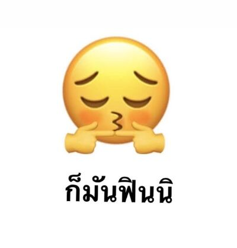
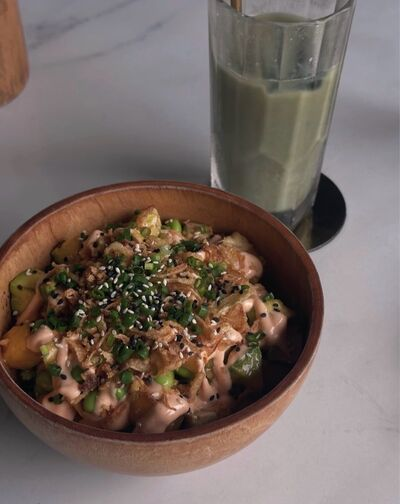
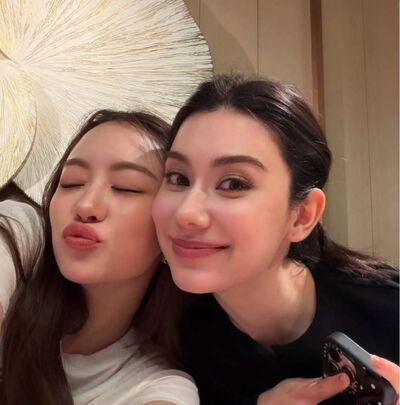
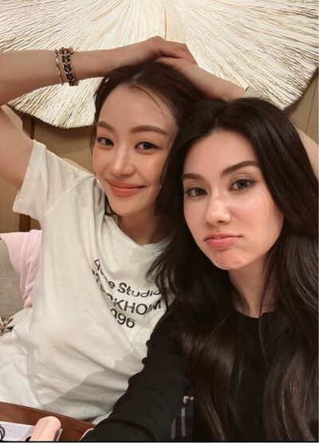
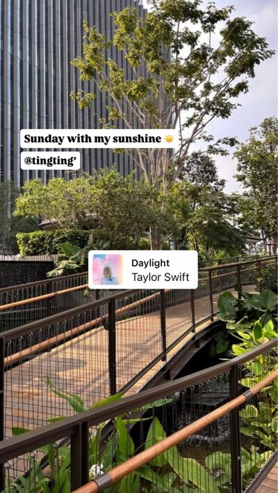
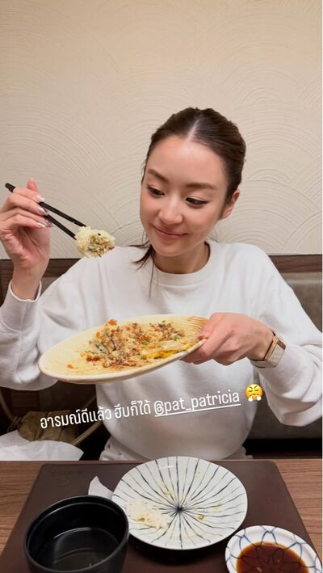

# Never Without You — Chapter 9

English translation · August 29, September 13–14

## Character and alias key

- tt’ — TingTing / Ting / Muay.
- Patricia🌻 — Patricia / Pat / P’Pat.
- lalin — Lalin.
- font_pcp — Font, distinct from the coworker Namfon.
- khim09 — Khim.
- eclaire — Claire / P’Claire.
- JJAPP — Japp.
- BEll — Bell.
- Namfon — Namfon / P’Fon.
- Duen — P’Duen.
- หม่าม้า — Mom, TingTing’s mother (display name retained).
- ปะป๊า — Dad, TingTing’s father (display name retained).

Mentioned: Nong Chan, P’Sita, Aunt Ying, and Patricia’s mother.

## Translation notes

P’ is an affectionate or respectful honorific for someone older. Muay is Patricia’s nickname for TingTing. “55555” and its variations are Thai internet laughter. Kub is a masculine polite particle used playfully here; “P’Ting-kub” and “P’Pat-kub” evoke a handsome, masculine persona. The “thank you / I like you / want you” exchange plays on similar-sounding Thai phrases. The friends’ death and rescue jokes dramatise lovesickness. “Unknown Elders” follows the project’s established group-name rendering. BTS refers to the Bangkok Skytrain.

Original English messages are retained, including the source’s zodiac description. Pictures are linked to your local img folder; their contents have not been inspected or translated. Four unanswered-call records had labels omitted by the TXT exporter; these have been recovered from the JSON’s saved HTML and rendered as call notices rather than picture files. The JSON’s original picture filenames are retained, including chat_image_007.jpg. No chat_image_006.png is needed: that entry is a call-interface icon, not a conversation photograph.

## Full translated chat transcript

---

August 29th  
Saturday

---

### prettybabies (3)

*9:29 p.m.*

**tt’**  
We were born on the SAME DATE

**tt’**  
SAME MONTH

**tt’**  
Just different year!!!

**tt’**  
And she said we were more connected

**tt’**  
I’m so flustered. Help. I was sitting in the car screaming all by myself 🫪

**font_pcp**  
Just another day for P’Pat.

**font_pcp**  
Nothing but playing with the gay kid’s heart.

**lalin**  
You share the exact same birthday?

**tt’**  
Yes.

**tt’**  
We were chatting over dinner, right? Then we got onto zodiac signs. P’Khim asked my sign and I said Scorpio.

**tt’**  
P’Pat turned and said we had the same sign. Then her mom asked what day I was born.

**tt’**  
When I said November 25th, her mom and P’Pat both went, “Huh?” at the same time.

**tt’**  
I was like, “Huh? What?” Then she turned and smiled sweetly and said we share a birthday.

**tt’**  
I’m going to lose my mind. Who could survive this? 🫠

**font_pcp**  
Oh, come on. Is this a drama scene or what?

**tt’**  
Better than a drama, because this is real.

**tt’**  
Her mom even said we could celebrate our birthdays together 🫪

**font_pcp**  
Oh, even Mom’s shipping you.

**lalin**  
The gay kid is getting way too encouraged.

**tt’**  
And do you know what’s even more important?

**lalin**  
Can you stop dragging it out, Ting? I’m about to curse you out. It takes forever for you to tell a story.

**font_pcp**  
555555555555

**font_pcp**  
She’s angry now. Our straight older sister can’t take it anymore.

**tt’**  
555555555

**tt’**  
P’Khim is gay!!!!

**tt’**  
When she said she was bringing her partner, I didn’t know her partner was a woman. I only found out she was gay when we met at P’Pat’s house.

**font_pcp**  
Hey.

**font_pcp**  
So? What does that mean?

**lalin**  
That’s the important thing?

**lalin**  
What’s strange about her having a gay friend?

**tt’**  
She might be gay too!!!

**lalin**  
Are you two gay?

**tt’**  
Yes.

**lalin**  
And what am I?

**font_pcp**  
Straight.

**lalin**  
Exactly.

**font_pcp**  
Oh.

**tt’**  
I don’t understand.

**lalin**  
The gay kid’s brain suddenly decided to play dumb.

**font_pcp**  
Poor Tiiing. 5555555555

**tt’**  
😡

**tt’**  
Not talking to you anymore. I’m going to talk to P’Pat.

**tt’**  
I got home and even texted you before her. Shouldn’t have bothered. Waste of my life 🤬

**font_pcp**  
There she goes, sulking.

**lalin**  
5555555

**lalin**  
So you don’t text P’Claire to tell her anymore?

**font_pcp**  
Hey, what are you saying?

**tt’**  
Claire hasn’t texted me either.

**lalin**  
She’s really hanging in there. Really doesn’t die just because you don’t talk.

**tt’**  
I told her we could talk like before.

**lalin**  
Oh, Ting.

**lalin**  
Imagine P’Pat had a husband. Could you still talk to her like before?

*[Read by 2]*

**font_pcp**  
Knocked out cold, P’.

**font_pcp**  
My friend’s knocked out cold.

**tt’**  
Please don’t type “P’Pat”

**tt’**  
and

**tt’**  
.

.

**tt’**  
“has a husband”

**tt’**  
so close together.

**tt’**  
I’m going to faint.

**tt’**  
She’s single. She’s single!!!

**tt’**  
Remember that she’s single!!!!!

**font_pcp**  
The way you’re spacing the words out is killing me, Ting. You’re insane.

**lalin**  
55555555555

**lalin**  
She really fights to the death over everything.

### Patricia🌻

*9:36 p.m.*

**tt’**  
I’m home now.

**Patricia🌻**  
Okaaay, kub.

**tt’**  
🫪

**tt’**  
🫪🫪🫪🫪🫪

**tt’**  
Who taught you to say kub? 🫪🫪🫪🫪

**Patricia🌻**  
I heard you saying it to my mom.

**Patricia🌻**  
And who taught you to say kub?

**tt’**  
Just following society’s trends.

**Patricia🌻**  
Then I’m following you.

**tt’**  
Perfect. Say it again.

**tt’**  
I like it.

**Patricia🌻**  
You like everything.

**tt’**  
Because I really do like it.

**Patricia🌻**  
555555

**tt’**  
Always laughing.

**Patricia🌻**  
Because you’re funny.

**tt’**  
😠

**tt’**  
But you said you didn’t like P’Ting-kub.

**tt’**  
Why are you turning into P’Pat-kub yourself?

**Patricia🌻**  
What P’Pat-kub? I’m not.

**tt’**  
You said kub.

**Patricia🌻**  
I just said it casually.

**Patricia🌻**  
I don’t want to be P’Pat-kub.

**Patricia🌻**  
I want to be beautiful P’Pat.

**tt’**  
You already are 🫠

**Patricia🌻**  
555555

**Patricia🌻**  
I can only be this full of myself with you.

**Patricia🌻**  
If I said that to Khim, she’d curse me out.

**tt’**  
5555555

**tt’**  
P’Khim’s funny, though. So talkative.

**Patricia🌻**  
You’re talkative too.

**Patricia🌻**  
Chan and I just sit and listen.

**tt’**  
55555555

**tt’**  
So we don’t have to fight to speak. If everyone talked a lot, there’d be no one to listen.

**Patricia🌻**  
One meeting and you’re already getting close to Khim, huh?

**tt’**  
P’Khim’s good at jokes. She’s funny.

**tt’**  
That “I was so startled, give me a hug” bit with P’Chan, over and over.

**Patricia🌻**  
She’s crazy.

**tt’**  
5555555

**Patricia🌻**  
Mom said you were lovely after you left, you know.

**tt’**  
🫪

**Patricia🌻**  
What is it?

**tt’**  
I’m shy. Your mom complimented me.

**tt’**  
I was shy when she thanked me for looking after you too, but I kept it together.

**tt’**  
I hurried to compliment you back so she’d know how lovely her daughter is.

**Patricia🌻**  
555555

**Patricia🌻**  
You never stop complimenting me.

**tt’**  
But your mom seems so worried about you.

**Patricia🌻**  
Why?

**tt’**  
When she said her health wasn’t good and she wanted someone to take care of you. That’s why she was glad you met me.

**Patricia🌻**  
Mom likes saying things like that.

**tt’**  
If you need to take her to the doctor, tell me. I can drive you.

**Patricia🌻**  
It’s okay.

**Patricia🌻**  
Khim can take us. She always does.

**tt’**  
But I’m here now. Why bother P’Khim?

**Patricia🌻**  
You said that yourself.

**tt’**  
I say it, I do it. I’m hardcore like that.

**Patricia🌻**  
555555555

**Patricia🌻**  
Okay, okay. When Mom needs to go to the doctor, I’ll come bother you.

**tt’**  
Yes, ma’am 🫡

**Patricia🌻**  
Thank you for helping at the event today.

**tt’**  
Thank you too, for taking me to dinner at your house and driving me.

**Patricia🌻**  
How many times have you driven me already?

**tt’**  
55555

**tt’**  
You really like saying thank you.

**tt’**  
Every day. You thank me all the time.

**Patricia🌻**  
Yes. I like saying thank you.

**Patricia🌻**  
But you keep giving me reasons to thank you every day too.

**tt’**  
So we have something to thank each other for every day.

**Patricia🌻**  
Isn’t that good?

**Patricia🌻**  
I like it.

**tt’**  
It is. I like it too.

**Patricia🌻**  
I already try to find small wins for myself anyway.

**Patricia🌻**  
Khim once said I’m the best at appreciating the present.

**tt’**  
True.

**tt’**  
You even taught me to appreciate the fact that I'm just being alive.

**Patricia🌻**  
55555

**Patricia🌻**  
Saying thank you helps you see what good things you’ve received today.

**Patricia🌻**  
Having you around means I get to say it often.

**Patricia🌻**  
And that's a good thing

**Patricia🌻**  
I always appreciate your existence 🫳

**tt’**  
🫠

**Patricia🌻**  
I hope we get to thank each other every day for a long, long time.

**tt’**  
Yes. Let’s stay in each other’s lives for a long time.

**Patricia🌻**  
Okie

**Patricia🌻**  
Good night, pretty

**tt’**  
G9, beautiful 🤍

### prettybabies (3)

*10:19 p.m.*

**tt’**  
I can’t take it.

**tt’**  
I don’t want to say “thank you” every day. I want to say “I like you” every day.

**tt’**  
Is P’Pat gay? Can’t she be gay? 😞

**font_pcp**  
Sobbing yet?

**tt’**  
Still thriving.

**lalin**  
Not discouraged at all.

**tt’**  

**font_pcp**  
What’s the beautiful older sister done for you now?

**tt’**  
Said she wants us to thank each other every day for a long time 🫠

**font_pcp**  
Why thank you?

**font_pcp**  
My friend doesn’t want to thank you, beautiful older sister. She wants you.

**lalin**  
55555555

**lalin**  
The gay kid has ulterior motives, P’Pat.

**tt’**  
Lalin, what would you do if you found out a gay girl liked you?

**lalin**  
What kind of gay girl? A close younger friend like you?

**tt’**  
Yes.

**lalin**  
I’d probably keep more distance. Wouldn’t be as close as before.

**lalin**  
Because what I did out of goodwill would become giving her hope instead.

**lalin**  
And I don’t want to give anyone false hope. Especially someone I could never love that way.

**font_pcp**  
Wow. Such a virtuous straight older sister.

**lalin**  
Of course. I don’t play with gay kids’ hearts.

**font_pcp**  
What about P’Pat?

**tt’**  
No.

**lalin**  
No chance of survival.

**tt’**  
She’s not playing!!

**tt’**  
Don’t insult her. She’s a good person.

**lalin**  
Take her away, will you?

**font_pcp**  
55555555555

**tt’**  
Then if she really is straight, how can I tell her?

**tt’**  
If I confess and things change,

**tt’**  
I won’t survive.

**font_pcp**  
Yeah. Will it be like Ting and P’Claire?

**lalin**  
Yes. That’s what it’ll be like.

**lalin**  
Straight or gay doesn’t even matter. If the feelings don’t match, things won’t be the same.

**lalin**  
What will you do, Ting?

**tt’**  
Don’t know.

**tt’**  
I want to keep having P’Pat in my life.

**lalin**  
Trust me. There’ll be a turning point someday. You can’t keep quietly slipping into her life like this forever.

**lalin**  
Either she finds out, you can’t take it and confess, or one of you gets a partner.

**tt’**  
Can’t I just keep slipping by?

**lalin**  
No.

**tt’**  
But maybe we feel the same way.

**lalin**  
Then you’ll be lucky.

**tt’**  
And if she doesn’t feel the same?

**lalin**  
You’ll have to accept that things won’t be the same.

**tt’**  
I can’t.

**tt’**  
I love her.

**tt’**  
So much.

**tt’**  
No. I don’t want P’Pat to change.

**font_pcp**  
Tiiiing.

**lalin**  
At this point it’s not just dying, Ting.

**lalin**  
It’ll be a death that doesn’t leave a pretty corpse.

**tt’**  
It’s okay.

**tt’**  
However it ends, I believe P’Pat won’t hurt me (much).

**tt’**  
She’s so kind. She wouldn’t do anything cruel to me.

**lalin**  
You know, P’Claire says you’re a kind girl too.

**lalin**  
Look at her now. Is she hurt?

**font_pcp**  
Badly.

**tt’**  
🫠

**lalin**  
Ting, if you’re determined to go all the way, there’s something I want to tell you.

**lalin**  
In the end, even lovely feelings aren’t necessarily something the other person values or wants to preserve if they don’t want those feelings.

**lalin**  
So it might be good to brace yourself a little.

**tt’**  
Mm.

---

September 13th  
Sunday

---

### Patricia🌻

*7:22 a.m.*

**Patricia🌻**  
Awake yet?

**Patricia🌻**  
Of course you’re not.

*7:45 a.m.*

**Patricia🌻**  

*8:29 a.m.*

**tt’**  
Woooow.

**tt’**  
Looks delicious.

**Patricia🌻**  
By the time you replied, I’d eaten it all, Muay.

**tt’**  
555555555

**tt’**  
I replied as soon as I opened my eyes.

**Patricia🌻**  
Can’t you wake up earlier?

**tt’**  
No 🫠

**Patricia🌻**  
555555

**tt’**  
But I’m awake now.

**tt’**  
I’ll shower, get dressed, then come straight over.

**Patricia🌻**  
No rush.

**Patricia🌻**  
You can have breakfast first.

**tt’**  
Probably won’t eat much. I’m having lunch with you anyway.

**tt’**  
Does your mom want anything in particular?

**Patricia🌻**  
Anything’s fine. Mom doesn’t eat much either.

**Patricia🌻**  
Up to you.

**tt’**  
Let’s avoid fried or oily food, though. Something healthy.

**Patricia🌻**  
Okay.

**tt’**  
I’ll drive today. Your mom’s coming too.

**Patricia🌻**  
Aren’t you taking care of us a little too well?

**tt’**  
Of course.

**Patricia🌻**  
55555

**Patricia🌻**  
Usually I only go with Khim and Chan. It feels different with you.

**Patricia🌻**  
Such a family date.

**tt’**  
🫪

**tt’**  
Come join my side of the family sometime too.

**tt’**  
Dad and Mom have been waiting so long.

**Patricia🌻**  
I’m scared.

**tt’**  
Scared of what?

**Patricia🌻**  
Of course I’d be nervous, Muay.

**Patricia🌻**  
Your dad is my boss.

**tt’**  
55555555

**tt’**  
Outside working hours doesn’t count.

**Patricia🌻**  
Let’s get through today first.

**tt’**  
I’ll pick you up by eleven.

**Patricia🌻**  
Okaaay, kub.

### prettybabies (3)

*12:16 p.m.*

**tt’**  

**tt’**  

**font_pcp**  
Two weeks later.

**font_pcp**  
Has she managed to brace herself even once?

**lalin**  
She’s even taking her mom out to eat.

**lalin**  
No point hoping for anything from her now.

**tt’**  
P’Pat called it a family date.

**tt’**  
Who could survive this? 🫠

**tt’**  
Eating first. Then I’ll take her mom to Central Park for a walk in the rooftop garden. She likes walking.

**font_pcp**  
Taking such good care of her. Does your mom feel neglected?

**tt’**  
No.

**tt’**  
Speaking of which, let me send Mom a picture.

### Family 🏠 (3)

*12:21 p.m.*

**tt’**  

**tt’**  
I’m eating with P’Pat and her mom.

**หม่าม้า**  
You look so bright and cheerful all the time lately, sweetheart.

**หม่าม้า**  
Because of P’Pat, right?

**tt’**  
🫪

**ปะป๊า**  
You hardly complain about work anymore either. My ears have had peace for too long, little one.

**tt’**  
Hey.

**tt’**  
Now you complain when I don’t complain.

**ปะป๊า**  
I’m not used to it 🤣

**tt’**  
I don’t want to spoil my mood by complaining.

**tt’**  
I know I have to wait and talk to Aunt Ying later.

**หม่าม้า**  
P’Pat has changed my girl a lot.

**tt’**  
55555

**ปะป๊า**  
Dad’s princess has become an ordinary person.

**หม่าม้า**  
Practically a chauffeur now, darling. Picking her up and dropping her off nonstop.

**tt’**  
Mooom.

**tt’**  
I want to do it.

**ปะป๊า**  
Let me tell you: anyone who can’t take care of my daughter as well as I do isn’t allowed near her.

**tt’**  
Whaaat?

**tt’**  
P’Pat always takes good care of me.

**หม่าม้า**  
Don’t scare her. Your dad just wants you to meet good people.

**หม่าม้า**  
Speaking of which, I haven’t seen Claire much. I miss her. Invite her for a meal sometime, sweetheart.

**tt’**  
Okay.

### IG: pat_patricia

*2:16 p.m.*

### khim09

*3:03 p.m.*

**khim09**  
Believe it or not,

**khim09**  
I’ve been waiting ages for your sunshine speech. Finally, the day has come.

**Patricia🌻**  
You see through everything.

**khim09**  
55555555

**khim09**  
So sweet, even with my dear mom there.

**Patricia🌻**  
Excuse me. That’s my dear mom.

**khim09**  
555555

**khim09**  
You’re getting good at going out lately.

**Patricia🌻**  
What can I do? Whenever Ting’s free, she invites me out.

**Patricia🌻**  
But Mom wanted to come too.

**khim09**  
She’s adorable. Seems like the opposite of you.

**Patricia🌻**  
Very much. 555555

**khim09**  
Did Mom like today?

**Patricia🌻**  
Yes. She seems to be enjoying herself.

**Patricia🌻**  
But she got tired after a short walk, so I made her rest.

**Patricia🌻**  
Sitting in a café instead.

**khim09**  
Yeah. Tell Mom to rest if she’s tired. Don’t push herself.

**Patricia🌻**  
Khim, I want Mom to be healthy.

**khim09**  
Here we go again.

**khim09**  
Pat, don’t spiral yet.

**Patricia🌻**  
I’m not spiralling.

**Patricia🌻**  
But honestly, deep down I think I’m scared all the time.

**khim09**  
What can you do?

**Patricia🌻**  
Yeah. I know there’s nothing I can do.

**khim09**  
That’s why you need to spend lots of time with her.

**khim09**  
It’s good having Nong Ting take you places. Your mom gets to go out too.

**Patricia🌻**  
Mom keeps saying she wants someone to look after me. Doesn’t want me to be alone.

**Patricia🌻**  
I hate it.

**Patricia🌻**  
It feels bad. Like an omen.

**khim09**  
She’s just worrying like parents do.

**khim09**  
And she’s all you have left. No wonder she worries so much.

**Patricia🌻**  
Mm.

**Patricia🌻**  
I don’t want her to worry. I want her to be at ease.

**Patricia🌻**  
I can live alone. Really. I’m happy and content as things are.

**khim09**  
You’re always worrying about her. How could she not worry about you?

**khim09**  
No one can just stop worrying about something like this, right?

**Patricia🌻**  
Mm. I understand.

**khim09**  
She’d feel better seeing you have someone by your side to care for you.

**Patricia🌻**  
I do, though.

**Patricia🌻**  
Ting.

**khim09**  
Tell your mom.

**Patricia🌻**  
5555555

**khim09**  
You always laugh it off.

**Patricia🌻**  
I’m not laughing it off.

**Patricia🌻**  
I really do have Ting.

**Patricia🌻**  
And things are so good right now. I don’t feel like I’m missing anything, Khim.

**khim09**  
Okaaay. As you say.

### Unknown Elders (5)

*6:17 p.m.*

**BEll**  
When are PatTing getting together? Let us know.

**BEll**  
What’s all this sunshiny business? Explain.

**JJAPP**  
Oh, someone’s started. Someone finally said it.

**JJAPP**  
I saw it ages ago. Been itching to say something.

**BEll**  
555555555

**tt’**  
🫪

**JJAPP**  
Here she is. Our leading lady, Mrs. Sunshine, has come to claim the title.

**tt’**  
55555555

**BEll**  
Get Pat to answer, please.

**BEll**  
What do you want from society?

**JJAPP**  
Are you selling a fantasy or the real thing? I need to know what I’m buying.

**JJAPP**  
Is the Care Bear couple real?

**Namfon**  
I’m saving up to buy into PatTing every day.

**JJAPP**  
P’Fon. 5555555

**Patricia🌻**  
I’ll let you know when we get together.

**Patricia🌻**  
Anyone wanting to buy can transfer the money first.

**JJAPP**  
You’re really fleecing us.

**Patricia🌻**  
555555

**tt’**  
Can I buy in?

**tt’**  
How much do I transfer?

**BEll**  
Ting, sweetheart.

**JJAPP**  
5555555555

**Patricia🌻**  
Oh, Muaaay.

**Namfon**  
That’s funny. 555555

**JJAPP**  
P’Pat, check with your kid before you joke around.

**Patricia🌻**  
Yeah. Can’t joke about anything.

**JJAPP**  
And you’re only close with each other.

**JJAPP**  
Invite the rest of the team too.

**tt’**  
Just us two being close is fine.

**tt’**  
Everyone else, stay out of it.

**JJAPP**  
Oh, Ting.

**tt’**  
🫪

**BEll**  
Suddenly I’m an outsider.

**tt’**  
5555555

**tt’**  
Kidding. Just wanted to tease P’Japp.

**BEll**  
You scared me. Buy me bubble tea on Monday.

**tt’**  
Yes, ma’am. You’re good at fleecing people too, P’Bell 🙂‍↕️

**BEll**  
5555555

**Patricia🌻**  
Didn’t you say you’d buy bubble tea only for me?

**JJAPP**  
Oh.

**tt’**  
Huh?

**Patricia🌻**  
Forgotten everything already, have you?

**JJAPP**  
Well, Ting? What’s this?

**Patricia🌻**  
Come explain yourself in private, Muay.

**JJAPP**  
They even have private explanations.

**BEll**  
Outsiders aren’t allowed to know, huh?

**JJAPP**  
They’ve definitely gone off to talk privately.

**BEll**  
They have. Already moved on.

**Namfon**  
PatTing is real.

**JJAPP**  
Love that for them.

### Patricia🌻

*6:28 p.m.*

**tt’**  
I haven’t even bought it yet.

**Patricia🌻**  
5555555

**Patricia🌻**  
I was just joking. It was funny.

**Patricia🌻**  
Buy Bell some if you want.

**tt’**  
Oh. You scared me.

**Patricia🌻**  
Do I need to give you a hug?

**tt’**  
🫪

**tt’**  
What is with you, Miss Patricia?

**tt’**  
What do you want from me?

**Patricia🌻**  
5555555

**Patricia🌻**  
Maybe I’m still in a playful mood from the group. They tease so much.

**tt’**  
You’re the one posting all that sunshine stuff.

**tt’**  
Of course they’ll tease you.

**Patricia🌻**  
5555555

**Patricia🌻**  
Khim messaged to tease me too.

**tt’**  
See?

**tt’**  
You keep giving people things to tease you about.

**Patricia🌻**  
But I really do think that.

**Patricia🌻**  
I’ve even told Khim you’re my whole sun.

**tt’**  
🫪

**tt’**  
Whole sun, really?

**Patricia🌻**  
Yes

**Patricia🌻**  
You’re so warm, a little bit too hot sometimes but yes, you got that warm energy around you

**Patricia🌻**  
It's like you warm my heart and soul

**Patricia🌻**  
And I like it

**tt’**  
Are you confessing?

*[Read]*

**tt’**  
Kidding.

**Patricia🌻**  
You scared me.

**tt’**  
I’ll come give you a hug.

**Patricia🌻**  
5555555

**tt’**  
🙂‍↕️

**Patricia🌻**  
Cheesy, huh? Probably because I read too many books.

**tt’**  
Which books? So I can avoid them.

**Patricia🌻**  
Muaaay.

**tt’**  
5555555

**tt’**  
But am I really your whole sun?

**Patricia🌻**  
Yes. You really are.

**Patricia🌻**  
I remember messaging Khim as soon as I felt it that day. I could picture it so clearly, Muay.

**Patricia🌻**  
Do I sound excited? I really was excited then. 5555

**Patricia🌻**  
It felt like one minute you were just standing in a vast snowy land surrounded by cold and dryness, with no horizon line in sight

**Patricia🌻**  
And the next thing you knew you were there in a field, a warm sunflower field

**Patricia🌻**  
A place where you didn’t think it existed on earth anymore

**tt’**  
I believe you really like reading now.

**tt’**  
Which book is this an excerpt from?

**Patricia🌻**  
Could you not tease me?

**Patricia🌻**  
Please don’t treat me like Khim does. I’m begging you, Muay.

**tt’**  
555555555

**tt’**  
There, there. I won’t tease you.

**tt’**  
Am I really that much of a sun to you?

**Patricia🌻**  
After all that, you still don’t believe me?

**Patricia🌻**  
I went to all that effort telling you. Even risked being teased.

**tt’**  
It’s not that I don’t believe you.

**tt’**  
It’s just unbelievable. I never thought I could make you feel that way.

**Patricia🌻**  
Believe me, kiddo

**Patricia🌻**  
You have that much impact on me

**tt’**  
And you know the impact I have on you can't compare to the impact you have on me

**tt’**  
You're that much more special to me

**Patricia🌻**  
Aww 🫳

**Patricia🌻**  
It’s nice, isn’t it? Being able to speak openly like this.

**tt’**  
I’ve always been straightforward.

**Patricia🌻**  
I can’t talk to Khim like this. She always teases me.

**tt’**  
55555

**Patricia🌻**  
Muay, thank you for coming into my life.

**tt’**  
Thank you too.

**tt’**  
I’m glad I get to be in your life, P’Pat.

**Patricia🌻**  
🙂

---

September 14th  
Monday

---

### Patricia🌻

*6:30 a.m.*

**Patricia🌻**  
[Call — no answer]

*6:32 a.m.*

**Patricia🌻**  
[Call — no answer]

**Patricia🌻**  
[Call — unanswered]

**Patricia🌻**  
Muaaay.

**Patricia🌻**  
Are you awake yet?

*6:40 a.m.*

**Patricia🌻**  
[Call — unanswered]

*6:47 a.m.*

**tt’**  
I’m awake. Mom woke me.

**tt’**  
My phone was far away, and I’d left it on vibrate 🫠

**Patricia🌻**  
Will you make it in time?

**tt’**  
Let me hurry.

**tt’**  
I’ll have P’Sita drive me.

**tt’**  
Breakfast in the car.

**Patricia🌻**  
Okay. Good thing your mom woke you.

**Patricia🌻**  
See you soon.

**tt’**  
Okay. Sorry 🫠

**Patricia🌻**  
It’s okay 🫳

### prettybabies (3)

*7:58 a.m.*

**tt’**  
Woke up late 🤬

*8:18 a.m.*

**tt’**  
And none of you are awake yet either.

**tt’**  
Unbelievable.

*8:42 a.m.*

**font_pcp**  
What?

**font_pcp**  
Who called and kept talking until late?

**tt’**  
Me 🫠

**font_pcp**  
Called to scream that she’s definitely straight, then talked forever and refused to sleep.

**font_pcp**  
Couldn’t handle it. Scared she’d change if she found out you like her. Gay kid stress mode on. No sleeping for anyone.

**font_pcp**  
But I really feel sorry for you. Joked, “Are you confessing?” and got silence. Devastating. 555555

**tt’**  
Idiot. It’s not funny.

**font_pcp**  
5555555555555

**tt’**  
Look at what she typed.

**tt’**  
My heart was pounding. I thought she was confessing her love.

**font_pcp**  
You warm my heart and soul

**font_pcp**  
Plot twist: the beautiful older sister reads too many books.

**tt’**  
Exactly. All those things she typed. If she likes me, just say it. Short and simple. Done.

**tt’**  
Why is she writing a novel in real life? 😡

**font_pcp**  
Go snap at P’Pat, then.

**tt’**  
Can’t. P’Pat did nothing wrong 🫠

**font_pcp**  
Unhinged.

**font_pcp**  
Wait till Lalin wakes up. You’ll get told off again.

**tt’**  
😞

**font_pcp**  
You just keep letting her play with your heart.

**tt’**  
And she told P’Khim before she told me. I don’t know how long she’s felt this way.

**tt’**  
But I believe she feels what she says.

**font_pcp**  
The whole sun, huh.

**tt’**  
Every time she thanks me, every time she says she appreciates my existence,

**tt’**  
I really feel it.

**tt’**  
P’Pat isn’t lying. She doesn’t lie.

**font_pcp**  
You’re sure you don’t believe her so completely just because you love her?

**tt’**  
I’m sure.

**tt’**  
Completely sure.

**lalin**  
Bring her to meet us.

**lalin**  
I’ll see whether she’s genuine or playing.

**font_pcp**  
Here we go.

**tt’**  
Mm. I’ll try asking her.

### B2B marketing (6)

*10:48 a.m.*

**Duen**  
Pat, please handle the latest event for me. The one on October 23rd. @Patricia🌻

**Patricia🌻**  
Of course, P’Duen.

### Patricia🌻

*10:50 a.m.*

**tt’**  
Don’t you already have an event that day?

**tt’**  
If you take this too, that’s two events.

**Patricia🌻**  
It’s a small one. It’s fine.

**tt’**  
Small means it won’t be tiring?

**tt’**  
You have so much on your plate already. Why don’t you push some work back?

**Patricia🌻**  
Don’t get angry yet.

**tt’**  
Go tell P’Duen right now that you can’t handle it.

**Patricia🌻**  
Muay, I can’t be bothered having that conversation.

**tt’**  
Then don’t. I’ll talk to her.

**Patricia🌻**  
Noooo.

**tt’**  
I’m not calming down. I mean it. Don’t type “calm down.”

**Patricia🌻**  
🥺

**tt’**  
What?

**Patricia🌻**  
You’re scary, Ting 🥺

**tt’**  
Don’t give me those puppy eyes.

**Patricia🌻**  
Could you calm down for me? 🥺

**tt’**  
I just don’t want you to be exhausted 🫠

**Patricia🌻**  
Talking to P’Duen won’t help anything.

**tt’**  
Can’t you at least try?

**tt’**  
Can’t you fight for yourself a little?

**tt’**  
Please. It really is too much.

*[Read]*

**tt’**  
We’ve talked about this.

**Patricia🌻**  
All right.

### Unknown Elders (5)

*11:16 a.m.*

**JJAPP**  
What’s P’Pat talking to P’Duen about?

**tt’**  
Work.

**JJAPP**  
You know everything.

**tt’**  
That’s how it is when you’re close.

**JJAPP**  
Aha.

**JJAPP**  
If no one else ships them, Ting will do it herself.

**tt’**  
🙂‍↕️

**BEll**  
What work? Is something wrong with a project?

**tt’**  
No. The new event. P’Pat already has so much work.

**tt’**  
And P’Duen keeps piling more on her.

**BEll**  
Yeah, I thought so.

**JJAPP**  
P’Pat’s always “yes, of course.”

**tt’**  
Right? Exactly what I said.

**tt’**  
All she does is work.

**BEll**  
It’s your dad’s company, sweetheart.

**JJAPP**  
555555555

**Namfon**  
Yeah, Ting. True.

**tt’**  
That’s exactly why I don’t like it.

### Patricia🌻

*11:28 a.m.*

**tt’**  
What did she say?

**Patricia🌻**  
She told me to list my work. What exactly I’m handling when I say I have too much.

**Patricia🌻**  
Then she’ll find someone to transfer some of it to. Waiting for confirmation.

**tt’**  
See? Better than saying nothing.

**Patricia🌻**  
If she can find someone to take over, that would be good.

**tt’**  
Of course she can. She said she would.

**Patricia🌻**  
🫳

**tt’**  
What?

**Patricia🌻**  
Nothing. You’re such a baby, Muay.

**tt’**  
How am I a baby?

**Patricia🌻**  
Just because she promises doesn’t mean she’ll actually do it.

**tt’**  
Really?

**Patricia🌻**  
Yes.

**tt’**  
Then why promise?

**Patricia🌻**  
555555

**Patricia🌻**  
Takes the request, doesn’t take it on board.

**tt’**  
😡

**Patricia🌻**  
But let’s wait and see. Maybe she really will find someone to help this time.

**tt’**  
Have you tried pushing work back and it didn’t go away?

**Patricia🌻**  
Yes. It never leaves me. Comes back for me to do anyway.

**Patricia🌻**  
That’s why I can’t be bothered saying anything.

**tt’**  
I’m angry.

**Patricia🌻**  
No, don’t be angry.

**Patricia🌻**  
Let’s wait and see.

**tt’**  
😡

**Patricia🌻**  
Muaaay.

**tt’**  
If that work doesn’t leave you, someone’s going to die 🤬

**Patricia🌻**  
555555

**Patricia🌻**  
Enough. Back to work.

**tt’**  
🫠

### IG: tingting’

*12:41 p.m.*

eclaire liked your story

### Unknown Elders (5)

*12:50 p.m.*

**JJAPP**  
Look at you, going to lunch just the two of you these days, Muay. @tt’

**tt’**  
P’Pat’s treating me too 🫪

**JJAPP**  
Bragging again.

**tt’**  
5555555555

**Patricia🌻**  
Someone was in a bad mood.

**BEll**  
I’m in a bad mood too, P’Pat.

**tt’**  
Give it a rest.

**BEll**  
Ting.

**tt’**  
55555555555555555

**JJAPP**  
Don’t steal Muay’s favourite-little-sister position.

**JJAPP**  
She’ll kill you, P’Bell.

**BEll**  
Oh, favourite little sister?

**BEll**  
Thought it was girlfriend.

**JJAPP**  
Hey.

**JJAPP**  
Shipping overload. Are the police coming?

**Namfon**  
👀

**BEll**  
Police disappeared. Means no raid.

**Patricia🌻**  
Give it a rest.

**BEll**  
55555555555

### eclaire

*5:02 p.m.*

**eclaire**  
Your mom called and said P’Sita had an urgent errand.

**eclaire**  
I’ll come pick you up this evening.

**tt’**  
What errand? How come?

**eclaire**  
Don’t know. You’ll have to ask your mom.

**tt’**  
I can get home myself. Don’t want to trouble you.

**eclaire**  
It’s no trouble. Your mom’s worried and doesn’t want you going home alone. That’s why she called me.

**tt’**  
Mom asked you to pick me up, Claire?

**eclaire**  
Yes.

**tt’**  
I don’t even know what time I’ll finish.

**eclaire**  
I’ll wait there from six.

**tt’**  
Okay.

**tt’**  
Tell me when you arrive.

**eclaire**  
Okay.

### Patricia🌻

*5:46 p.m.*

**tt’**  
It’s raining. How are you getting home?

**tt’**  
I don’t have my car. I can’t drive you.

**Patricia🌻**  
I’ll wait for the rain to ease, then head home.

**Patricia🌻**  
Then take a taxi to my house.

**tt’**  
That sounds so difficult.

**Patricia🌻**  
Difficult how, Muay? This is normal life.

**tt’**  
🫠

**Patricia🌻**  
How are you getting home? P’Sita’s picking you up, right?

**tt’**  
No. P’Sita’s busy.

**tt’**  
Claire’s picking me up.

**Patricia🌻**  
Oh, good. Then I won’t have to worry.

**tt’**  
Why worry about me? Worry about yourself first.

**Patricia🌻**  
Why worry about me? I’m nearly thirty, Muay. I can get home myself. 55555

**tt’**  
But it’s raining.

**Patricia🌻**  
I’ll be fine. No more chatting. Back to work.

**tt’**  
😠

### eclaire

*6:04 p.m.*

**eclaire**  
Wait a little, okay? It’s raining and traffic is awful.

**tt’**  
Mm. It’s fine.

**tt’**  
Drive carefully, Claire. Be safe.

**eclaire**  
Okay.

**eclaire**  
You can wait, right? Do you have friends with you?

**tt’**  
Of course I can wait.

**tt’**  
I’m grown up.

**eclaire**  
555555

**tt’**  
Don’t use your phone while driving. It’s dangerous.

**eclaire**  
Worried about me?

**tt’**  
😠

**eclaire**  
You’re with her, aren’t you?

**tt’**  
I’m with the whole team.

**tt’**  
No one’s left. We’re all stuck because of the rain.

**eclaire**  
That must be a pain.

**tt’**  
Claire.

*[Read]*

**eclaire**  
What is it?

**tt’**  
Nothing.

**eclaire**  
Want me to drive her home?

**tt’**  
How did you know?

**eclaire**  
Because I know you well.

**eclaire**  
I can take her home.

**tt’**  
Really?

**eclaire**  
Yes.

**eclaire**  
I’ve wanted to meet her in person for ages.

**tt’**  
She’s older than you, Claire.

**eclaire**  
I know. Asked Lalin everything already.

**tt’**  
Honestly, you.

**eclaire**  
555555

**eclaire**  
Tell her. I’ll drive her home.

**tt’**  
Are you sure you can?

**eclaire**  
I can.

**eclaire**  
I know you're worried about her

**eclaire**  
I'll drive her home

**eclaire**  
No worries, baby

**tt’**  
Thank you

**eclaire**  
Not at all :)

### Unknown Elders (5)

*6:15 p.m.*

**JJAPP**  
What are our darling older and younger sisters arguing about?

**JJAPP**  
Let me in on it.

**BEll**  
Go over and listen.

**JJAPP**  
Work’s over. We can do whatever we want, right?

**BEll**  
Go listen and report back.

**Namfon**  
5555555

**Patricia🌻**  
Stop. Don’t come over and crowd around.

**Patricia🌻**  
P’Duen will sigh loudly at you. She hasn’t left yet.

**JJAPP**  
What are you arguing about, then? Muay sounds all whiny.

**Patricia🌻**  
Nothing.

**JJAPP**  
Really, Muay? @tt’

**JJAPP**  
Oh, she looked at her first.

**JJAPP**  
Doesn’t dare answer either.

**JJAPP**  
P’Pat, don’t intimidate the kid with your eyes.

**Patricia🌻**  
Intimidate? I’m not.

**BEll**  
Ting’s always been scared of Pat, and she still is.

**Namfon**  
True. Never scared of P’Duen, though. 555555

### Patricia🌻

*6:22 p.m.*

**tt’**  
Can’t we go home together?

**Patricia🌻**  
No.

**Patricia🌻**  
I can get home myself. Don’t be stubborn, Muay.

**tt’**  
But Claire said herself she could drive you.

**Patricia🌻**  
It’s really okay. Thank her for me. But I really can get home myself.

**Patricia🌻**  
I could leave now, actually. But I’ll wait to see you into her car first.

**Patricia🌻**  
Okay?

**tt’**  
🫠

**Patricia🌻**  
No more arguing. People will gather again.

**tt’**  
Fine.

**Patricia🌻**  
Is she nearly here?

**tt’**  
Not yet. Traffic.

**Patricia🌻**  
See? It’ll take so long to get you home already. Stopping to drop me off first would waste even more of her time.

**tt’**  
Then why do you let me drive you?

**Patricia🌻**  
Because it’s you, Muay. That’s why I let you.

**Patricia🌻**  
I don’t want to trouble other people.

**tt’**  
🫠

**Patricia🌻**  
What’s wrong?

**Patricia🌻**  
Someone’s picking you up. That’s good. Why the long face?

**tt’**  
Don’t you want to go together?

**tt’**  
Or Claire doesn’t have to pick me up. I can take a Grab and drop you home first.

**Patricia🌻**  
What, Muay? You’re getting whiny now.

**Patricia🌻**  
She’s already coming to get you. Why go home yourself?

**tt’**  
I want to go with you 🫠

**Patricia🌻**  
Another day. When you bring your own car.

**Patricia🌻**  
Don’t worry about me. I should be worrying about you, and I am. I’m waiting to hand you over to your older friend.

**Patricia🌻**  
Your parents worry even more.

**Patricia🌻**  
I wouldn’t be as comfortable with you taking a Grab alone as with your older friend driving you.

**tt’**  
But you’re taking a taxi yourself.

**Patricia🌻**  
I can take care of myself.

**tt’**  
So can I.

**Patricia🌻**  
Don’t believe you.

**tt’**  
I’m twenty-two. Why does everyone treat me like a child?

**Patricia🌻**  
55555555

**Patricia🌻**  
Because you’re a baby, Muay.

**tt’**  
😠

### eclaire

*6:36 p.m.*

**eclaire**  
Almost there. You can come down and wait.

**tt’**  
P’Pat’s going home herself. You don’t need to drive her.

**eclaire**  
Oh? What a shame. I wanted to meet her.

**tt’**  
You’ll meet her.

**tt’**  
She’s coming down to see me off.

**eclaire**  
She takes such thorough care of you.

**tt’**  
Don’t tease me.

**eclaire**  
555555

**eclaire**  
Does she want to go herself, or did you change your mind, TingTing?

**tt’**  
She wants to go herself.

**eclaire**  
Really? Want me to ask? Maybe she’ll let me drive her.

**tt’**  
Try it, then. If you can manage it, Claire.

### Patricia🌻

*6:54 p.m.*

**Patricia🌻**  
I’m waiting for the BTS. Tell me when you’re home. I’ll message when I get back.

**tt’**  
Okay. Get home safely.

**Patricia🌻**  
Don’t worry. I’ll be fine. Easy 🫳

**tt’**  
Mm.

**tt’**  
Talk later.

### prettybabies (3)

*7:03 p.m.*

**tt’**  
In Claire’s car.

**tt’**  
Claire met P’Pat today too.

**font_pcp**  
Huh? How did they meet?

**tt’**  
Claire picked me up at the office. P’Pat walked me out.

**font_pcp**  
Does P’Pat know P’Claire likes you?

**tt’**  
No.

**tt’**  
Never told her. She only knows we’re close.

**tt’**  
But when P’Pat walked me to the car, Claire got out to talk. Introduced herself and said she’s known me since my first year at university.

**lalin**  
P’Claire’s playing the game now.

**tt’**  
Mm. She’s enjoying herself.

**font_pcp**  
Why do you sound so down? So dejected?

**lalin**  
Did P’Claire say anything else?

**lalin**  
Did P’Pat say anything?

**tt’**  
Claire asked P’Pat if she wasn’t coming with us.

**font_pcp**  
Oh.

**tt’**  
Said she could take her home. Because I wanted her to drive P’Pat, and she could tell just by looking at my face.

**font_pcp**  
What’s with P’Claire?

**lalin**  
She’s saying she can read Ting’s heart just by looking in her eyes. And she’s ready to do anything for her.

**font_pcp**  
Oh.

**font_pcp**  
Seriously?

**lalin**  
What did P’Pat say?

**tt’**  
She said it was fine. She’d rather go home herself.

**tt’**  
So I asked again if she really wouldn’t come with us.

**tt’**  
Then Claire said to P’Pat, “Won’t you indulge her a little? She seems really worried about you.”

**lalin**  
“Won’t you indulge her.” P’Claire’s brilliant.

**lalin**  
Testing her. She’ll indulge Ting in everything. Can P’Pat compete?

**tt’**  
She even stood there holding my hand and patting my head.

**lalin**  
P’Claire did?

**tt’**  
Yes.

**lalin**  
Deliberately, then.

**tt’**  
Mm.

**tt’**  
That’s why I said she’s enjoying herself.

**font_pcp**  
This is a whole production.

**font_pcp**  
Even a gay person like me can’t keep up.

**lalin**  
555555555

**font_pcp**  
I’m confused. Is this a war over the gay kid?

**font_pcp**  
What did P’Pat say next?

**tt’**  
Still no. And thanked Claire for offering.

**tt’**  
Then P’Pat just walked away. She just messaged to say she’d reached the BTS.

**lalin**  
So she’s talking like normal?

**lalin**  
Like she never met Claire?

**tt’**  
Yes.

**tt’**  
Still sending me head-pat emojis.

**tt’**  
Not one second of her energy changed when she met Claire. Just stood there smiling kindly and worrying about me like always.

**tt’**  
She even said, “You have someone taking care of you now, Muay. I don’t have to worry.”

**font_pcp**  
Then why are you down? Nothing happened.

**font_pcp**  
Thought they’d slapped each other fighting over you.

**lalin**  
It’d be better if they had.

**lalin**  
She’s down because nothing happened.

**font_pcp**  
Huh?

**lalin**  
Maybe gay kids really are all stupid.

**tt’**  
I’m not stupid.

**tt’**  
I’m not.

**lalin**  
So you know what it means that P’Pat acted completely normal?

**tt’**  
I know.

**font_pcp**  
Am I the only stupid one?

**lalin**  
If P’Japp wasn’t jealous seeing you with someone else, how would you feel, Font?

**lalin**  
And that someone else is so obviously gay you can tell just from them breathing.

**font_pcp**  
Oh.

**font_pcp**  
Dejected.

**font_pcp**  
I get it. I understand Ting completely.

### eclaire

*8:39 p.m.*

**eclaire**  
Are you angry with me?

**eclaire**  
You didn’t say anything in the car.

**tt’**  
You’re home?

**eclaire**  
Yes.

**tt’**  
I’m not angry.

**tt’**  
But don’t do that again.

**tt’**  
I don’t like it.

**eclaire**  
Do you dislike what I did,

**eclaire**  
or just the way she reacted?

**tt’**  
Is this fun for you, Claire?

**tt’**  
Because it isn’t for me.

**eclaire**  
It wasn’t fun.

**eclaire**  
I just wanted to test her.

**tt’**  
And now what?

**tt’**  
Now you know. So what?

**eclaire**  
I stepped back because I knew you loved her.

**eclaire**  
But from what I saw today, I think that place is still mine.

**eclaire**  
I’m even more ready to take care of you than she is, TingTing.

*[Read]*

**eclaire**  
I didn’t see any sign she feels the same way about you.

**eclaire**  
And even if she does, she isn’t serious about you.

**eclaire**  
Cause I didn’t see any commitment or eagerness to win you over

**eclaire**  
It simply means she's not that into you

**eclaire**  
Or it's never been love?

**tt’**  
Enough

**tt’**  
Don’t say anything else.

**tt’**  
Don’t talk to me about P’Pat again.

**tt’**  
You have no right to talk about her.

**tt’**  
No right at all.

.

.

.

## Author’s note

My baby Ting. I don’t know who doesn’t love you, but I love you most of all 😭😭😭😭😭
Once again: absolutely no insulting P’Pat. If anyone does, I’ll shoot 😡🔫 (myself. 5555555555)

Thank you to everyone who came to read. Have a lovely weekend. I’ll be watching the pls love teaser on repeat 🙂‍↕️
